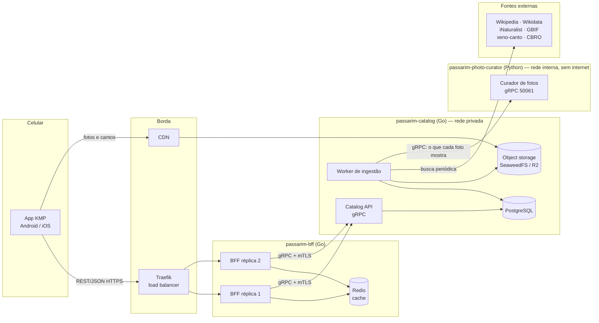
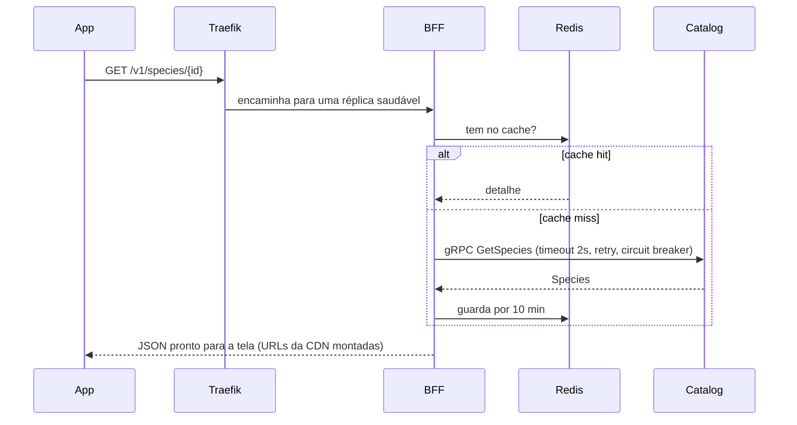

# 🐦 Passarim

App gratuito para conhecer as aves do Brasil — foto, descrição, curiosidades,
onde encontrar e o canto de cada espécie. Projeto de **estudo e portfólio**:
back-end em **Go** com arquitetura limpa e app em **Kotlin Multiplatform**.

> Todo o código é comentado para que um estudante consiga ler e entender.

## System design



### Como uma tela é carregada



## Repositórios

| Repositório | Papel |
|---|---|
| [passarim-docs](https://github.com/velosobr/passarim-docs) | Este: arquitetura, ADRs, segurança, `docker-compose` |
| [passarim-proto](https://github.com/velosobr/passarim-proto) | Contratos gRPC |
| [passarim-catalog](https://github.com/velosobr/passarim-catalog) | Catalog API (gRPC) + banco + aves curadas |
| [passarim-bff](https://github.com/velosobr/passarim-bff) | BFF REST/JSON + cache Redis + resiliência |
| [passarim-photo-curator](https://github.com/velosobr/passarim-photo-curator) | Curador de fotos (Python, gRPC): separa ave sozinha de ninho, ovo, bando... (frente A) |
| [passarim-app](https://github.com/velosobr/passarim-app) | App KMP (Android e iOS) |

Os repositórios ficam lado a lado na mesma pasta (`~/dev/passarim/passarim-*`): o compose e os scripts abaixo
encontram os vizinhos por caminho relativo.

## Operando o ambiente local (`env.scripts`)

A pasta [`env.scripts`](env.scripts) é a interface para subir, conferir e derrubar o ambiente. **Use estes
comandos em vez de montar a sequência à mão** (vale para gente e para agentes de IA). Todos aceitam `--help`, saem
com código diferente de 0 quando algo não está pronto e podem ser chamados de qualquer pasta.

| Comando | O que faz | Tempo típico |
|---|---|---|
| `env.scripts/init-all [--ios] [--device] [--build]` | back-end e depois o app (emulador Android, ou simulador iOS com `--ios`) | ~1 min com imagens prontas |
| `env.scripts/status` | uma linha por serviço, a API testada de ponta a ponta e onde o app está aberto; sai 0 se a API estiver pronta | segundos |
| `env.scripts/down-all` | fecha o app, desliga emuladores, simuladores e Gradle, e derruba os containers. **Mantém os dados** | ~10 s |
| `env.scripts/clean-all --yes` | o mesmo, mais **apagar** banco, mídia, painéis, imagens locais e o app dos aparelhos Android. Sem `--yes`, só avisa | ~10 s |
| `env.scripts/back-end-init [--device] [--build]` | só o back-end: abre o Docker Desktop se preciso, cria o `.env`, `docker compose up --wait`, confere a API | ~30 s |
| `env.scripts/back-end-status` | só o back-end | segundos |
| `env.scripts/back-end-down` | só o back-end, mantendo os volumes | ~5 s |
| `env.scripts/front-end-init [--ios]` | só o app: liga um emulador se não houver aparelho, compila, instala e abre | ~30 s Android; minutos no iOS |
| `env.scripts/front-end-status` | aparelhos e simuladores, app instalado ou aberto, daemons do Gradle | segundos |
| `env.scripts/front-end-down [--keep-device]` | fecha o app; sem `--keep-device`, desliga emuladores, simuladores e o Gradle | segundos |

**Derrubar não é limpar.** `down-all` e `back-end-down` param os containers e deixam os volumes: as aves, a mídia
baixada pelo worker e os jobs de ingestão continuam lá na próxima subida. Só o `clean-all --yes` volta ao zero, e
depois dele o worker baixa a mídia de novo das APIs externas.

Pré-requisitos: Docker Desktop; para o app, Android SDK e JDK 21 (Android) ou Xcode e XcodeGen (iOS), como no
README do `passarim-app`. Na primeira vez o `back-end-init` copia o `.env.example` para `.env` e para, pedindo a
`XENO_CANTO_API_KEY` (a única variável sem padrão). Variáveis opcionais: `PASSARIM_AVD` (nome do emulador Android) e
`PASSARIM_SIMULATOR` (UDID do simulador iOS). Os logs do compose e do emulador ficam em `$TMPDIR/passarim-*.log`.

**Curador de fotos.** O `photo-curator` sobe junto com o back-end, numa rede só dele e do worker
(`passarim-curation`, sem internet, gRPC na porta 50061). A primeira construção baixa os pesos dos modelos (a imagem
tem cerca de 2 GB) e ele usa perto de 2 GB de memória: no Docker Desktop, deixe pelo menos 6 GB para os containers.
Para reprocessar as fotos: `docker compose run --rm catalog-worker requeue [species-id...]`; para conferir o
resultado: `docker compose run --rm catalog-worker curation-report > relatorio.md`.

### O que os scripts fazem por baixo

Para entender o ambiente, ou se um script falhar, os passos à mão:

```bash
cp .env.example .env
# Edite o .env e preencha XENO_CANTO_API_KEY (necessária para o worker de ingestão).
docker compose up -d --wait
```

| Serviço | Endereço |
|---|---|
| API (BFF via Traefik) | <http://localhost:8080/v1/species> (porta `HOST_PORT_TRAEFIK_HTTP` do `.env`; o `back-end-init` imprime a real) |
| Traefik (dashboard) | <http://localhost:8081> |
| Grafana | <http://localhost:3000> (admin / ver `.env`) |
| Prometheus | <http://localhost:9090> |
| Jaeger | <http://localhost:16686> |
| Object storage (arquivos) | <http://localhost:8888> — a mídia fica no bucket `passarim-media` |

### Testando o app num aparelho físico

O compose publica tudo só em `127.0.0.1`. O emulador Android (`10.0.2.2`) e o simulador iOS (`localhost`) alcançam o
computador sem mudar nada, mas um aparelho físico não. Para esse caso, suba com o override opcional, que republica
só o BFF (Traefik) e a mídia (porta `HOST_PORT_S3_UI`) em todas as interfaces:

```bash
env.scripts/back-end-init --device
# o mesmo que: docker compose -f docker-compose.yml -f docker-compose.device.yml up -d --wait
```

Use **apenas em rede confiável** e só para teste local. Depois configure o endereço do computador no app (veja o
README do `passarim-app`).

## Demonstração: derrubar uma réplica do BFF

O BFF roda em duas réplicas (`bff-1` e `bff-2`) atrás do Traefik. Para ver o balanceamento:

```bash
# Terminal 1: um laço de requisições (troque 8080 pelo HOST_PORT_TRAEFIK_HTTP do seu .env)
while true; do curl -s -o /dev/null -w "%{http_code} " localhost:8080/v1/filters; sleep 0.2; done

# Terminal 2: derrube uma réplica. As respostas continuam 200: o BFF marca /readyz como 503,
# espera o Traefik tirá-lo da rotação e só então termina.
docker compose stop bff-1
docker compose start bff-1
```

Para ver o stale-while-error (dado velho quando o catalog cai):

```bash
curl -si localhost:8080/v1/species/turdus-rufiventris | grep -i x-cache   # miss (ou hit)
docker compose stop catalog-api
# Depois de 10 min o dado deixa de ser "fresco", mas ainda é servido:
curl -si localhost:8080/v1/species/turdus-rufiventris | grep -i x-cache   # stale
curl -si localhost:8080/v1/species/uma-ave-nunca-consultada               # 503 problem+json
docker compose start catalog-api
```

## Documentação

- [Decisões de arquitetura (ADRs)](docs/adr/)
- [Modelo de ameaças](docs/security/threat-model.md)
- [Aula 1: como as peças conversam](docs/aulas/01-arquitetura-local.md)
- [Spec de design](docs/superpowers/specs/2026-10-01-passarim-design.md)
- [Revisão do protótipo](docs/design/revisao-design-v1.md)
