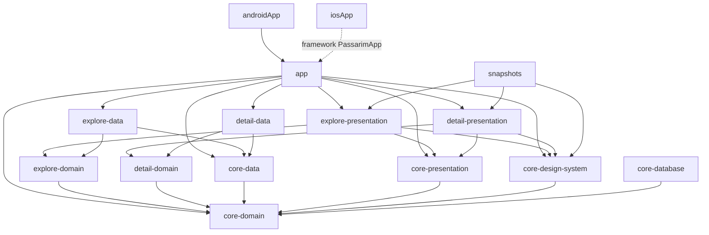

# Passarim — Etapa 5c: Detalhe da ave — Plano de Implementação

> **For agentic workers:** REQUIRED SUB-SKILL: Use superpowers:subagent-driven-development (recommended) or superpowers:executing-plans to implement this plan task-by-task. Steps use checkbox (`- [ ]`) syntax for tracking.

**Goal:** A tela de **Detalhe** do app, contra o BFF local e em Android e iOS. Ela mostra:
- hero com foto, selo de conservação e família;
- fatos, biomas e dieta;
- player do canto;
- descrição, curiosidades e galeria;
- mapa "Onde encontrar" com clusters e lista de estados;
- créditos expansíveis.

Também trata o carregamento, a ave não encontrada e os erros de rede.

**Architecture:** A fatia cria três módulos de feature (`feature:detail:domain`, `:data` e `:presentation`) sobre a 5b.
- **`core:domain`** ganha os status `EX`/`DD`, `Credit` e `Settings`/`SettingsRepository`. O `FavoritesRepository` ganha `refresh`.
- **Design system:** recebe os componentes genéricos do Detalhe.
- **Tela:** segue o MVI das fatias anteriores (`DetailRoot` com Koin + `DetailScreen` stateless). O player é um `AudioPlayer` próprio (`expect/actual`: Media3 no Android, AVPlayer no iOS). O mapa usa o `maplibre-compose` com o estilo público do OpenFreeMap.
- **`app`:** liga a `DetailRoute(id)` ao `DetailRoot` e registra as configurações em memória.

**Tech Stack:** o da 5b (Gradle 9.8.1 · AGP 9.4.1 · Kotlin 2.4.21 · Compose Multiplatform 1.12.1 · Ktor 3.6.0 · Koin 4.2.2 · Coil 3.6.3 · Paparazzi 2.0.0-alpha05 · JDK 21), mais:
- **`maplibre-compose` 0.19.0**, com o runtime nativo `maplibre-native-ffi-runtime-opengl` 0.202609.5 no Android;
- **Media3 ExoPlayer 1.11.1**;
- **Xcode 26.4** para os testes iOS.

**Spec:** `docs/superpowers/specs/2026-10-08-passarim-app-detalhe-design.md` é a fonte única; `§N` abaixo refere-se a ela. Bases:
- o plano da 5b (`docs/superpowers/plans/2026-10-10-passarim-app-5b-explorar.md`);
- o contrato `passarim-bff/openapi.yaml` (`GET /v1/species/{id}`, schema `Species`).

## Estado atual e como executar este plano

Como na 5a e na 5b, um esqueleto **já validado** existe: a branch `feat/5c-detalhe` do `~/dev/passarim/passarim-app`, com 10 commits sobre a `main` em `db11bcc`.

O código embutido abaixo é, arquivo por arquivo, o desses commits. Cada tarefa corresponde a um commit, e o conteúdo de cada arquivo é o do fim daquela tarefa. O plano foi gerado lendo os commits, e a reconstrução a partir dele foi comparada com a branch.

Duas formas de executar, a escolher pelo dono:

- **(a) Reconstruir** numa branch nova a partir da `main`, tarefa por tarefa, e no fim comparar com `feat/5c-detalhe`: `git diff feat/5c-detalhe --stat` deve listar só PNGs, se algum renderizar diferente.
- **(b) Adotar** a branch `feat/5c-detalhe` e executar só as verificações de cada tarefa e a Task 11, inclusive a publicação, que exige confirmação.

Todos os comandos rodam em `~/dev/passarim/passarim-app` (chamado `APP`), salvo indicação, com `export JAVA_HOME="$(/usr/libexec/java_home -v 21)"`. Arquivos marcados "substitui o arquivo inteiro" já existem e devem ser sobrescritos com o conteúdo mostrado.

## Global Constraints

- **Herdado da 5b:** JDK 21; `compileSdk` 37; versões só no catálogo; plugins só por convention plugin; `kotlin.test` + Turbine + AssertK em `commonTest` nas duas plataformas; nome de teste sem vírgula; identificadores em inglês; strings de interface em `composeResources`.
- **Comentários (regra nova do projeto):** o código **não** leva comentários explicativos, e o plano é que conta a história. Só entram fatos externos ao repositório em uma linha, como o contrato do BFF ou um limite de biblioteca. O detekt do projeto recusa `TODO`.
- **Commits:** formato `<tipo>: mensagem` em português, **um por tarefa**. `git add` com caminhos explícitos. Autor `velosobr <linoc.veloso@gmail.com>`.
- **Dependências entre módulos:** `presentation → domain ← data`. Features não dependem entre si; só o `app` conecta. `AudioPlayerCard` e `SpeciesMap` ficam na feature, e o design system fica livre de player e de mapa (§7).
- **`GET /v1/species/{id}`:**
  - o `id` é validado contra `^[a-z0-9-]{1,80}$` **antes** da chamada; um `id` inválido vira `NotFound` sem requisição (§4);
  - campos `nullable` **e** strings vazias viram ausentes;
  - status fora de `LC/NT/VU/EN/CR/EW/EX/DD` vira ausente (selo oculto);
  - o `MediaUrlRewriter` vale para fotos e áudio.
- **Fotos:** a primeira é a principal. O hero usa `largeUrl` (cai para `mediumUrl`) e a galeria usa `mediumUrl` (cai para `largeUrl`). O resumo do favorito usa `photos[0].thumbUrl` e é atualizado ao abrir uma ave já favorita (§4).
- **Créditos:**
  - formato "autor · licença", com "Autor não informado" e "Licença não informada" quando faltar;
  - `formatLicense` (`CC-BY-NC-SA-4.0` → "CC BY-NC-SA 4.0");
  - **só links `https://`** abrem (§4, §5).
- **Player:**
  - um por tela;
  - pausa ao perder o foco (`ON_PAUSE`) e é liberado em `onCleared`;
  - erro mostra "Não foi possível tocar o canto" e o play tenta de novo;
  - reprodução automática lê `autoPlay` (padrão `false`) (§5).
- **Mapa:**
  - OpenFreeMap, sem chave;
  - atribuição visível sobre o mapa;
  - câmera nos limites dos clusters (o Brasil inteiro sem clusters);
  - "Mapa indisponível" com a lista de estados se o estilo falhar ou não carregar em 10 s (§6).
- **Layout e snapshots:** fatos em coluna única com `fontScale` ≥ 1.5. Snapshots em claro e escuro × 1.0×/1.3×/2.0× (§7, §8).

## Review Focus

Condições que a spec implica e que um usuário encontra antes de qualquer teste. Cada uma tem a verificação na tarefa indicada.

1. **Uma foto que o Android não decodifica.** O worker do catálogo gerava WebP com o tamanho do RIFF zerado e 4 bytes a mais no fim (ffmpeg 6.1 escrevendo num pipe). O Android recusa o arquivo (`ImageDecoder: invalid input`); o iOS e o navegador toleram. Esperado: a foto real aparece. (Corrigido na origem, no `passarim-catalog`: ver "Pendências"; verificação na Task 11, Step 2.)
2. **Sair do Detalhe ou mandar o app para o segundo plano com o canto tocando.** Esperado: o áudio pausa e, ao sair, é liberado. (Task 4: "perder o foco pausa o player" e "sair da tela libera o player"; Task 11, Step 2.)
3. **Crédito com `sourceUrl` `http:`, `javascript:` ou vazio, e autor ou licença `""`.** Esperado: texto sem link e "Autor não informado"/"Licença não informada", nunca "null". (Task 2: `CreditFormatTest`; Task 3: "campos nulos e vazios viram ausentes"; Task 4: "so links https de credito abrem".)
4. **Servidor de tiles fora ou sem internet.** Esperado: "Mapa indisponível" e a lista de estados, sem travar a tela. (Task 7: `awaitMapReady` com falha e com 10 s; Task 11, Step 3.)
5. **Fonte do sistema em 2.0× e o app morto em segundo plano no Detalhe.** Esperado: fatos em coluna única sem texto cortado; ao voltar, a mesma ave. O `id` vem da rota pelo `SavedStateHandle`. (Task 8: `DetailLayoutTest` e snapshots 2.0×; Task 9: `RoutesTest`; Task 11, Step 2.)

## Diferenças em relação à spec (decididas na validação do esqueleto)

| Spec | Implementação | Por quê |
|---|---|---|
| Framework nativo do MapLibre no Xcode por SPM ou CocoaPods (§6, critério 7) | Nada no projeto Xcode | O `maplibre-compose` 0.19 traz o MapLibre nativo dentro do klib (`maplibre-native-ffi`). O `xcodebuild` do `iosApp` compila e roda sem pacote extra. No Android basta o runtime `maplibre-native-ffi-runtime-opengl`; sem ele, `UnsatisfiedLinkError: libmaplibre-native-c.so` |
| Xcode 16+ (README da 5b) | **Xcode 26.4** e iOS **16** mínimo | O Kotlin 2.4.21 compila contra o SDK do iOS 26.4. Com o MapLibre, os executáveis de teste iOS precisam do framework `_LocationEssentials`, que só existe no SDK 26. As bibliotecas nativas do MapLibre exigem iOS 15.5+ |
| Atribuição "© OpenFreeMap · dados © OpenStreetMap" (§6) | "© OpenFreeMap © OpenMapTiles · dados © OpenStreetMap" | O estilo do OpenFreeMap usa o esquema OpenMapTiles, cuja licença também pede crédito (é a atribuição que o próprio estilo declara) |
| Clusters do BFF desenhados como vêm (§6) | A fonte GeoJSON agrupa de novo no app (`cluster = true`, raio 25, soma de `count` em `total`) | O BFF devolve até ~50 clusters; num mapa de 200 dp eles se sobrepõem num borrão de números |
| "Tiles que não carregam em 10 s" (§6) | 10 s para o **estilo** ficar `Ready`; falha do estilo derruba na hora | A biblioteca expõe com segurança o estado do estilo (`MapStyleState.loadState`), mas não a falha de tiles individuais (a própria spec chama de "melhor esforço") |
| Mapa interativo | Mapa estático (`MapInteractions.None`) | O mapa fica dentro de uma tela com rolagem vertical; gestos no mapa disputariam a rolagem. A navegação pelo mapa fica fora do escopo |
| `player` como estado próprio do ViewModel (§5) | `PlaybackState` do domínio, espelhado do `AudioPlayer.state` | Uma só fonte de verdade: o player real publica posição e fase, e o ViewModel só repassa |
| Fotos: galeria com todas (§1) | Hero = `photos[0]` (com o crédito logo abaixo); galeria = as demais | A primeira foto já aparece grande; repeti-la na galeria só ocuparia espaço |
| — | `SettingsRepository` mínimo (`Settings(autoPlay)`) e `FavoritesRepository.refresh` | A 5d acrescenta o resto das configurações e o Room; o Detalhe só precisa disso |
| — | Faixa com a cor de fundo atrás da barra de status depois que a tela rola | O conteúdo é *edge-to-edge* (o hero passa por baixo da barra de status); sem a faixa, o texto rolado fica sob o relógio |

**Pendências encontradas fora do escopo:**
- **Correção no `passarim-catalog`:** fica na branch `fix/webp-riff-size`, num PR próprio. O worker passou a gerar o WebP com `-f image2pipe` em vez do muxer `webp` via pipe. Ela vale para o ffmpeg 6.1 da imagem do worker; o 8.x/9.x já não tem o bug. O teste novo falha com o código antigo no ffmpeg 6.1 da imagem e passa com o novo. Depois do merge, a mídia de cada ambiente precisa ser reprocessada: volte os jobs `inaturalist` para `pending` e limpe o cache do BFF.
- **Autoria do iNaturalist:** o texto de autoria já traz a licença ("(c) Fulano, some rights reserved (CC BY-NC)"), e o crédito fica com a licença repetida. É dado do catálogo e fica para lá.
- **Herdada da 5b:** a 2.0× o rótulo "Configurações" quebra (5e).

---

### Task 0: Pré-requisitos e branch

- [ ] **Step 1: Ferramentas**

O que a 5b pedia, mais o **Xcode 26.4** (`xcodebuild -version` deve mostrar `Xcode 26.4`). Com o Xcode 16, o app compila e roda, mas `allTests` falha no link dos testes iOS de `feature:detail:presentation` e do `app` (`ld: framework '_LocationEssentials' not found`).

- [ ] **Step 2: Tokens EX e DD no `passarim-docs`** (§2)

Os status `EX` e `DD` entram no `passarim-docs` (`docs/design/tokens/passarim-tokens.json`) antes do código. Os valores são estes:

| Status | Claro (fundo / texto) | Escuro (fundo / texto) |
|---|---|---|
| `EX` "Extinta" | `#DDDDDD` / `#1F1F1F` | `#3C3C3C` / `#E3E3E3` |
| `DD` "Dados insuficientes" | `#D3E4F5` / `#14304D` | `#22405E` / `#D3E4F5` |

```bash
cd ../passarim-docs/docs/design/tools && npm run -s check && npm run -s build && npm test 2>&1 | grep -E "^ℹ (pass|fail)"; cd -
```

Expected: `tokens OK`; `_base.css` e `TOKENS.md` regenerados; `pass 43`, `fail 0`. A lista `STATUSES` do `check-tokens.mjs` e o teste "as listas esperadas não encolheram" passam a 8. Esses tokens já estão no PR de docs deste plano.

- [ ] **Step 3: Partir da `main` atualizada**

```bash
git checkout main && git pull --ff-only
git log --oneline -1
git config user.email
git checkout -b feat/5c-detalhe
```

Expected: `main` em `db11bcc` ou depois, com a 5b mergeada; o e-mail é `linoc.veloso@gmail.com`. Na opção (a), use outro nome de branch, por exemplo `feat/5c-detalhe-plano`.

### Task 1: Núcleo: status `EX` e `DD`, `Credit`, `Settings` e favoritos com resumo atualizável

**Files:**
- Create: `app/src/commonMain/kotlin/com/velosobr/passarim/app/settings/InMemorySettingsRepository.kt`, `core/domain/src/commonMain/kotlin/com/velosobr/passarim/core/domain/Credit.kt`, `core/domain/src/commonMain/kotlin/com/velosobr/passarim/core/domain/Settings.kt`
- Modify: `app/src/commonMain/kotlin/com/velosobr/passarim/app/di/AppModule.kt`, `app/src/commonMain/kotlin/com/velosobr/passarim/app/favorites/InMemoryFavoritesRepository.kt`, `core/design-system/src/commonMain/composeResources/values/strings.xml`, `core/design-system/src/commonMain/kotlin/com/velosobr/passarim/core/designsystem/components/ConservationBadge.kt`, `core/design-system/src/commonMain/kotlin/com/velosobr/passarim/core/designsystem/theme/ConservationColors.kt`, `core/domain/src/commonMain/kotlin/com/velosobr/passarim/core/domain/ConservationStatus.kt`, `core/domain/src/commonMain/kotlin/com/velosobr/passarim/core/domain/FavoritesRepository.kt`
- Test: `app/src/commonTest/kotlin/com/velosobr/passarim/app/favorites/InMemoryFavoritesRepositoryTest.kt`, `app/src/commonTest/kotlin/com/velosobr/passarim/app/settings/InMemorySettingsRepositoryTest.kt`, `core/design-system/src/commonTest/kotlin/com/velosobr/passarim/core/designsystem/TokensTest.kt`, `core/domain/src/commonTest/kotlin/com/velosobr/passarim/core/domain/ConservationStatusTest.kt`, `feature/explore/presentation/src/commonTest/kotlin/com/velosobr/passarim/feature/explore/presentation/ExploreFakes.kt`

**Interfaces:**
- Consumes: `ConservationStatus`, as paletas de conservação e o `ConservationBadge` da 5a; `FavoritesRepository`/`InMemoryFavoritesRepository` da 5b.
- Produces: `ConservationStatus` com `EX` e `DD` e `conservationStatusOf(code: String?): ConservationStatus?` (nulo para desconhecido); `Credit(author: String?, license: String?, source: String?, sourceUrl: String?)`; `Settings(autoPlay: Boolean = false)` e `SettingsRepository.observe(): Flow<Settings>`; `FavoritesRepository.refresh(summary)` (troca o resumo só se a espécie já for favorita); `InMemoryFavoritesRepository.summaries: StateFlow<Map<String, SpeciesSummary>>`; `InMemorySettingsRepository` registrado no `appModule`. Rótulos "Extinta" e "Dados insuficientes" no design system.

As cores de `EX`/`DD` são as dos tokens (Task 0, Step 2); o `TokensTest` existente já percorre todos os status e cobra contraste ≥ 4.5:1. O favorito falso de Explorar ganha um `refresh` vazio, porque a interface mudou.

- [ ] **Step 1: Escrever os testes que falham** (e a configuração de build que eles exigem)

`app/src/commonTest/kotlin/com/velosobr/passarim/app/favorites/InMemoryFavoritesRepositoryTest.kt` — substitui o arquivo inteiro

```kotlin
package com.velosobr.passarim.app.favorites

import app.cash.turbine.test
import assertk.assertThat
import assertk.assertions.isEmpty
import assertk.assertions.isEqualTo
import com.velosobr.passarim.core.domain.SpeciesSummary
import kotlinx.coroutines.test.runTest
import kotlin.test.Test

class InMemoryFavoritesRepositoryTest {
    private val bemTeVi = SpeciesSummary("bem-te-vi", "Bem-te-vi", "Pitangus sulphuratus", null)
    private val sabia = SpeciesSummary("sabia-laranjeira", "Sabiá-laranjeira", "Turdus rufiventris", null)

    @Test
    fun `comeca vazio e cada toggle emite o conjunto novo`() =
        runTest {
            val repo = InMemoryFavoritesRepository()
            repo.observeIds().test {
                assertThat(awaitItem()).isEmpty()
                repo.toggle(bemTeVi)
                assertThat(awaitItem()).isEqualTo(setOf("bem-te-vi"))
                repo.toggle(sabia)
                assertThat(awaitItem()).isEqualTo(setOf("bem-te-vi", "sabia-laranjeira"))
                repo.toggle(bemTeVi)
                assertThat(awaitItem()).isEqualTo(setOf("sabia-laranjeira"))
            }
        }

    @Test
    fun `refresh atualiza o resumo de um favorito e ignora quem nao e favorito`() =
        runTest {
            val repo = InMemoryFavoritesRepository()
            repo.toggle(bemTeVi)
            val novaFoto = bemTeVi.copy(thumbnailUrl = "https://media/bem-te-vi.webp")

            repo.refresh(novaFoto)
            repo.refresh(sabia)

            assertThat(repo.summaries.value).isEqualTo(mapOf("bem-te-vi" to novaFoto))
        }
}
```

`app/src/commonTest/kotlin/com/velosobr/passarim/app/settings/InMemorySettingsRepositoryTest.kt`

```kotlin
package com.velosobr.passarim.app.settings

import assertk.assertThat
import assertk.assertions.isEqualTo
import com.velosobr.passarim.core.domain.Settings
import kotlinx.coroutines.flow.first
import kotlinx.coroutines.test.runTest
import kotlin.test.Test

class InMemorySettingsRepositoryTest {
    @Test
    fun `comeca com os padroes e reproducao automatica desligada`() =
        runTest {
            assertThat(InMemorySettingsRepository().observe().first()).isEqualTo(Settings(autoPlay = false))
        }
}
```

`core/design-system/src/commonTest/kotlin/com/velosobr/passarim/core/designsystem/TokensTest.kt` — substitui o arquivo inteiro

```kotlin
package com.velosobr.passarim.core.designsystem

import androidx.compose.ui.graphics.Color
import androidx.compose.ui.graphics.luminance
import assertk.assertThat
import assertk.assertions.isEqualTo
import assertk.assertions.isGreaterThanOrEqualTo
import com.velosobr.passarim.core.designsystem.theme.DarkConservationPalette
import com.velosobr.passarim.core.designsystem.theme.LightConservationPalette
import com.velosobr.passarim.core.designsystem.theme.PassarimDarkColors
import com.velosobr.passarim.core.designsystem.theme.PassarimLightColors
import com.velosobr.passarim.core.domain.ConservationStatus
import kotlin.math.max
import kotlin.math.min
import kotlin.test.Test

class TokensTest {
    private fun contrast(
        a: Color,
        b: Color,
    ): Float {
        val hi = max(a.luminance(), b.luminance())
        val lo = min(a.luminance(), b.luminance())
        return (hi + 0.05f) / (lo + 0.05f)
    }

    @Test
    fun `cores de marca batem com os tokens nos dois temas`() {
        assertThat(PassarimLightColors.primary).isEqualTo(Color(0xFF1A6D3C))
        assertThat(PassarimLightColors.onPrimary).isEqualTo(Color(0xFFFFFFFF))
        assertThat(PassarimDarkColors.primary).isEqualTo(Color(0xFF7DDB97))
        assertThat(PassarimDarkColors.surface).isEqualTo(Color(0xFF101410))
    }

    @Test
    fun `fundo unico - background e igual a surface nos dois temas`() {
        assertThat(PassarimLightColors.background).isEqualTo(PassarimLightColors.surface)
        assertThat(PassarimDarkColors.background).isEqualTo(PassarimDarkColors.surface)
    }

    @Test
    fun `nenhum papel do esquema cai no baseline lilas do Material`() {
        // O baseline do Material 3 usa 0xFF6750A4 (roxo) como primary; qualquer papel herdado dele seria um bug.
        val baselinePurple = Color(0xFF6750A4)
        listOf(PassarimLightColors, PassarimDarkColors).forEach {
            assertThat(it.primary == baselinePurple).isEqualTo(false)
            assertThat(it.surfaceContainerHighest == Color(0xFFE6E0E9)).isEqualTo(false)
            assertThat(it.surfaceContainerLow == Color(0xFFF7F2FA)).isEqualTo(false)
        }
    }

    @Test
    fun `EX e DD batem com os tokens nos dois temas`() {
        assertThat(LightConservationPalette[ConservationStatus.EX].background).isEqualTo(Color(0xFFDDDDDD))
        assertThat(LightConservationPalette[ConservationStatus.DD].content).isEqualTo(Color(0xFF14304D))
        assertThat(DarkConservationPalette[ConservationStatus.EX].background).isEqualTo(Color(0xFF3C3C3C))
        assertThat(DarkConservationPalette[ConservationStatus.DD].content).isEqualTo(Color(0xFFD3E4F5))
    }

    @Test
    fun `as paletas de conservacao tem todos os status com contraste minimo de 4_5`() {
        listOf(LightConservationPalette, DarkConservationPalette).forEach { palette ->
            ConservationStatus.entries.forEach { status ->
                val c = palette[status]
                assertThat(contrast(c.background, c.content)).isGreaterThanOrEqualTo(4.5f)
            }
        }
    }
}
```

`core/domain/src/commonTest/kotlin/com/velosobr/passarim/core/domain/ConservationStatusTest.kt`

```kotlin
package com.velosobr.passarim.core.domain

import assertk.assertThat
import assertk.assertions.isEqualTo
import assertk.assertions.isNull
import kotlin.test.Test

class ConservationStatusTest {
    @Test
    fun `cada codigo do contrato vira o status correspondente`() {
        listOf("LC", "NT", "VU", "EN", "CR", "EW", "EX", "DD").forEach { code ->
            assertThat(conservationStatusOf(code)?.name).isEqualTo(code)
        }
    }

    @Test
    fun `codigo nulo ou desconhecido vira ausente`() {
        assertThat(conservationStatusOf(null)).isNull()
        assertThat(conservationStatusOf("")).isNull()
        assertThat(conservationStatusOf("XX")).isNull()
        assertThat(conservationStatusOf("lc")).isNull()
    }
}
```

`feature/explore/presentation/src/commonTest/kotlin/com/velosobr/passarim/feature/explore/presentation/ExploreFakes.kt` — substitui o arquivo inteiro

```kotlin
package com.velosobr.passarim.feature.explore.presentation

import com.velosobr.passarim.core.domain.BiomeFilter
import com.velosobr.passarim.core.domain.DataError
import com.velosobr.passarim.core.domain.FavoritesRepository
import com.velosobr.passarim.core.domain.Filters
import com.velosobr.passarim.core.domain.FiltersRepository
import com.velosobr.passarim.core.domain.Result
import com.velosobr.passarim.core.domain.SpeciesSummary
import com.velosobr.passarim.core.domain.StateFilter
import com.velosobr.passarim.feature.explore.domain.ExploreRepository
import com.velosobr.passarim.feature.explore.domain.SpeciesPage
import kotlinx.coroutines.CompletableDeferred
import kotlinx.coroutines.flow.Flow
import kotlinx.coroutines.flow.MutableStateFlow

fun bird(id: String) = SpeciesSummary(id, "Ave $id", "Avis $id", thumbnailUrl = null)

/** Página com os ids `from..<to` (por exemplo `page(0, 20, "c1")`). */
fun page(
    from: Int,
    to: Int,
    next: String?,
) = SpeciesPage((from until to).map { bird("ave-$it") }, next)

data class ListCall(
    val query: String,
    val biome: String?,
    val state: String?,
    val cursor: String?,
)

/**
 * Repositório falso: responde por cursor (`pages[null]` é a primeira página) e guarda cada chamada.
 * [gates] seguram a resposta de uma chamada (pelo índice) para observar estados intermediários.
 */
class FakeExploreRepository : ExploreRepository {
    val calls = mutableListOf<ListCall>()
    val pages = mutableMapOf<String?, Result<SpeciesPage, DataError.Network>>(null to Result.Success(page(0, 20, "c1")))
    val gates = mutableMapOf<Int, CompletableDeferred<Unit>>()

    override suspend fun list(
        query: String,
        biome: String?,
        state: String?,
        cursor: String?,
        limit: Int,
    ): Result<SpeciesPage, DataError.Network> {
        val index = calls.size
        calls += ListCall(query, biome, state, cursor)
        gates[index]?.await()
        return pages.getValue(cursor)
    }
}

val sampleFilters =
    Filters(
        biomes = listOf(BiomeFilter("cerrado", "Cerrado", 26), BiomeFilter("pampa", "Pampa", 15)),
        states = listOf(StateFilter("RJ", 23), StateFilter("SP", 29), StateFilter("AC", 3)),
    )

class FakeFiltersRepository(
    var next: Result<Filters, DataError.Network> = Result.Success(sampleFilters),
) : FiltersRepository {
    var calls = 0

    override suspend fun get(): Result<Filters, DataError.Network> {
        calls++
        return next
    }
}

class FakeFavoritesRepository : FavoritesRepository {
    val ids = MutableStateFlow<Set<String>>(emptySet())

    override fun observeIds(): Flow<Set<String>> = ids

    override suspend fun toggle(summary: SpeciesSummary) {
        ids.value = if (summary.id in ids.value) ids.value - summary.id else ids.value + summary.id
    }

    override suspend fun refresh(summary: SpeciesSummary) = Unit
}
```

- [ ] **Step 2: Rodar e ver falhar**

```bash
export JAVA_HOME="$(/usr/libexec/java_home -v 21)" && ./gradlew :core:domain:testAndroidHostTest --console=plain 2>&1 | grep -E "^e:|BUILD" | head -3
```

Expected: `BUILD FAILED` com `Unresolved reference 'conservationStatusOf'`.

- [ ] **Step 3: Implementar**

`app/src/commonMain/kotlin/com/velosobr/passarim/app/di/AppModule.kt` — substitui o arquivo inteiro

```kotlin
package com.velosobr.passarim.app.di

import com.velosobr.passarim.app.favorites.InMemoryFavoritesRepository
import com.velosobr.passarim.app.settings.InMemorySettingsRepository
import com.velosobr.passarim.core.data.coreDataModule
import com.velosobr.passarim.core.domain.AppConfig
import com.velosobr.passarim.core.domain.FavoritesRepository
import com.velosobr.passarim.core.domain.SettingsRepository
import com.velosobr.passarim.feature.explore.data.exploreDataModule
import com.velosobr.passarim.feature.explore.presentation.explorePresentationModule
import org.koin.core.KoinApplication
import org.koin.core.context.startKoin
import org.koin.dsl.module

private val appModule =
    module {
        single<FavoritesRepository> { InMemoryFavoritesRepository() }
        single<SettingsRepository> { InMemorySettingsRepository() }
    }

/**
 * Inicia o Koin. No Android é chamado pelo `Application`; no iOS, por `MainViewController`.
 * [platform] permite à plataforma acrescentar o que é só dela (`androidContext`, por exemplo).
 */
fun initKoin(
    config: AppConfig,
    platform: KoinApplication.() -> Unit = {},
) {
    startKoin {
        platform()
        modules(module { single { config } }, coreDataModule, appModule, exploreDataModule, explorePresentationModule)
    }
}
```

`app/src/commonMain/kotlin/com/velosobr/passarim/app/favorites/InMemoryFavoritesRepository.kt` — substitui o arquivo inteiro

```kotlin
package com.velosobr.passarim.app.favorites

import com.velosobr.passarim.core.domain.FavoritesRepository
import com.velosobr.passarim.core.domain.SpeciesSummary
import kotlinx.coroutines.flow.Flow
import kotlinx.coroutines.flow.MutableStateFlow
import kotlinx.coroutines.flow.StateFlow
import kotlinx.coroutines.flow.asStateFlow
import kotlinx.coroutines.flow.distinctUntilChanged
import kotlinx.coroutines.flow.map
import kotlinx.coroutines.flow.update

class InMemoryFavoritesRepository : FavoritesRepository {
    private val _summaries = MutableStateFlow<Map<String, SpeciesSummary>>(emptyMap())
    val summaries: StateFlow<Map<String, SpeciesSummary>> = _summaries.asStateFlow()

    override fun observeIds(): Flow<Set<String>> = _summaries.map { it.keys }.distinctUntilChanged()

    override suspend fun toggle(summary: SpeciesSummary) {
        _summaries.update { if (summary.id in it) it - summary.id else it + (summary.id to summary) }
    }

    override suspend fun refresh(summary: SpeciesSummary) {
        _summaries.update { if (summary.id in it) it + (summary.id to summary) else it }
    }
}
```

`app/src/commonMain/kotlin/com/velosobr/passarim/app/settings/InMemorySettingsRepository.kt`

```kotlin
package com.velosobr.passarim.app.settings

import com.velosobr.passarim.core.domain.Settings
import com.velosobr.passarim.core.domain.SettingsRepository
import kotlinx.coroutines.flow.Flow
import kotlinx.coroutines.flow.MutableStateFlow
import kotlinx.coroutines.flow.asStateFlow

class InMemorySettingsRepository : SettingsRepository {
    private val settings = MutableStateFlow(Settings())

    override fun observe(): Flow<Settings> = settings.asStateFlow()
}
```

`core/design-system/src/commonMain/composeResources/values/strings.xml` — substitui o arquivo inteiro

```xml
<resources>
    <string name="conservation_lc">Pouco preocupante</string>
    <string name="conservation_nt">Quase ameaçada</string>
    <string name="conservation_vu">Vulnerável</string>
    <string name="conservation_en">Em perigo</string>
    <string name="conservation_cr">Criticamente em perigo</string>
    <string name="conservation_ew">Extinta na natureza</string>
    <string name="conservation_ex">Extinta</string>
    <string name="conservation_dd">Dados insuficientes</string>
    <string name="photo_placeholder">foto ilustrativa</string>
    <string name="favorite_add">Favoritar %1$s</string>
    <string name="favorite_remove">Desfavoritar %1$s</string>
    <string name="search_clear">Limpar busca</string>
    <string name="filter_remove">Remover filtro %1$s</string>
</resources>
```

`core/design-system/src/commonMain/kotlin/com/velosobr/passarim/core/designsystem/components/ConservationBadge.kt` — substitui o arquivo inteiro

```kotlin
package com.velosobr.passarim.core.designsystem.components

import androidx.compose.foundation.background
import androidx.compose.foundation.layout.Arrangement
import androidx.compose.foundation.layout.Box
import androidx.compose.foundation.layout.Row
import androidx.compose.foundation.layout.heightIn
import androidx.compose.foundation.layout.padding
import androidx.compose.foundation.layout.size
import androidx.compose.foundation.shape.CircleShape
import androidx.compose.foundation.shape.RoundedCornerShape
import androidx.compose.material3.MaterialTheme
import androidx.compose.material3.Text
import androidx.compose.runtime.Composable
import androidx.compose.ui.Alignment
import androidx.compose.ui.Modifier
import androidx.compose.ui.draw.clip
import androidx.compose.ui.unit.dp
import com.velosobr.passarim.core.designsystem.resources.Res
import com.velosobr.passarim.core.designsystem.resources.conservation_cr
import com.velosobr.passarim.core.designsystem.resources.conservation_dd
import com.velosobr.passarim.core.designsystem.resources.conservation_en
import com.velosobr.passarim.core.designsystem.resources.conservation_ew
import com.velosobr.passarim.core.designsystem.resources.conservation_ex
import com.velosobr.passarim.core.designsystem.resources.conservation_lc
import com.velosobr.passarim.core.designsystem.resources.conservation_nt
import com.velosobr.passarim.core.designsystem.resources.conservation_vu
import com.velosobr.passarim.core.designsystem.theme.LocalConservationPalette
import com.velosobr.passarim.core.domain.ConservationStatus
import org.jetbrains.compose.resources.StringResource
import org.jetbrains.compose.resources.stringResource

/** Selo de conservação: ponto + rótulo, com as cores semânticas do tema (min. 4.5:1 de contraste). */
@Composable
fun ConservationBadge(
    status: ConservationStatus,
    modifier: Modifier = Modifier,
) {
    val colors = LocalConservationPalette.current[status]
    Row(
        modifier =
            modifier
                .heightIn(min = 24.dp)
                .clip(RoundedCornerShape(12.dp))
                .background(colors.background)
                .padding(horizontal = 10.dp),
        verticalAlignment = Alignment.CenterVertically,
        horizontalArrangement = Arrangement.spacedBy(6.dp),
    ) {
        Box(Modifier.size(8.dp).background(colors.content, CircleShape))
        Text(
            text = stringResource(status.label()),
            color = colors.content,
            style = MaterialTheme.typography.labelLarge,
        )
    }
}

private fun ConservationStatus.label(): StringResource =
    when (this) {
        ConservationStatus.LC -> Res.string.conservation_lc
        ConservationStatus.NT -> Res.string.conservation_nt
        ConservationStatus.VU -> Res.string.conservation_vu
        ConservationStatus.EN -> Res.string.conservation_en
        ConservationStatus.CR -> Res.string.conservation_cr
        ConservationStatus.EW -> Res.string.conservation_ew
        ConservationStatus.EX -> Res.string.conservation_ex
        ConservationStatus.DD -> Res.string.conservation_dd
    }
```

`core/design-system/src/commonMain/kotlin/com/velosobr/passarim/core/designsystem/theme/ConservationColors.kt` — substitui o arquivo inteiro

```kotlin
package com.velosobr.passarim.core.designsystem.theme

import androidx.compose.runtime.staticCompositionLocalOf
import androidx.compose.ui.graphics.Color
import com.velosobr.passarim.core.domain.ConservationStatus

/** Cor do selo de um status: fundo e texto, com contraste mínimo de 4.5:1 (verificado nos tokens). */
data class ConservationColor(
    val background: Color,
    val content: Color,
)

/** Cores semânticas dos status por tema. Não seguem as cores dinâmicas do sistema. */
data class ConservationPalette(
    private val colors: Map<ConservationStatus, ConservationColor>,
) {
    operator fun get(status: ConservationStatus): ConservationColor = colors.getValue(status)
}

val LightConservationPalette =
    ConservationPalette(
        mapOf(
            ConservationStatus.LC to ConservationColor(background = Color(0xFFCDEBD3), content = Color(0xFF0B3B1C)),
            ConservationStatus.NT to ConservationColor(background = Color(0xFFE3EDB8), content = Color(0xFF33400A)),
            ConservationStatus.VU to ConservationColor(background = Color(0xFFFFE08A), content = Color(0xFF4A3600)),
            ConservationStatus.EN to ConservationColor(background = Color(0xFFFFC9A3), content = Color(0xFF5A2200)),
            ConservationStatus.CR to ConservationColor(background = Color(0xFFFFB4AB), content = Color(0xFF5C0008)),
            ConservationStatus.EW to ConservationColor(background = Color(0xFFE1D5F0), content = Color(0xFF2E1A4D)),
            ConservationStatus.EX to ConservationColor(background = Color(0xFFDDDDDD), content = Color(0xFF1F1F1F)),
            ConservationStatus.DD to ConservationColor(background = Color(0xFFD3E4F5), content = Color(0xFF14304D)),
        ),
    )

val DarkConservationPalette =
    ConservationPalette(
        mapOf(
            ConservationStatus.LC to ConservationColor(background = Color(0xFF1F4A2C), content = Color(0xFFBDF0C8)),
            ConservationStatus.NT to ConservationColor(background = Color(0xFF4A5418), content = Color(0xFFE3EDB8)),
            ConservationStatus.VU to ConservationColor(background = Color(0xFF5E4800), content = Color(0xFFFFE08A)),
            ConservationStatus.EN to ConservationColor(background = Color(0xFF6E3000), content = Color(0xFFFFC9A3)),
            ConservationStatus.CR to ConservationColor(background = Color(0xFF8A1018), content = Color(0xFFFFDAD6)),
            ConservationStatus.EW to ConservationColor(background = Color(0xFF44306A), content = Color(0xFFE8DDFF)),
            ConservationStatus.EX to ConservationColor(background = Color(0xFF3C3C3C), content = Color(0xFFE3E3E3)),
            ConservationStatus.DD to ConservationColor(background = Color(0xFF22405E), content = Color(0xFFD3E4F5)),
        ),
    )

val LocalConservationPalette = staticCompositionLocalOf { LightConservationPalette }
```

`core/domain/src/commonMain/kotlin/com/velosobr/passarim/core/domain/ConservationStatus.kt` — substitui o arquivo inteiro

```kotlin
package com.velosobr.passarim.core.domain

enum class ConservationStatus { LC, NT, VU, EN, CR, EW, EX, DD }

fun conservationStatusOf(code: String?): ConservationStatus? = ConservationStatus.entries.firstOrNull { it.name == code }
```

`core/domain/src/commonMain/kotlin/com/velosobr/passarim/core/domain/Credit.kt`

```kotlin
package com.velosobr.passarim.core.domain

data class Credit(
    val author: String?,
    val license: String?,
    val source: String?,
    val sourceUrl: String?,
)
```

`core/domain/src/commonMain/kotlin/com/velosobr/passarim/core/domain/FavoritesRepository.kt` — substitui o arquivo inteiro

```kotlin
package com.velosobr.passarim.core.domain

import kotlinx.coroutines.flow.Flow

/**
 * Favoritos do usuário, usados por Explorar, Detalhe e Favoritos. Na 5b o `app` registra uma
 * implementação em memória; a 5d a troca por uma com Room, sem mudar as features.
 */
interface FavoritesRepository {
    /** Ids favoritados; emite de novo a cada mudança. */
    fun observeIds(): Flow<Set<String>>

    /** Favorita a espécie se ela não for favorita; senão, desfavorita. */
    suspend fun toggle(summary: SpeciesSummary)

    suspend fun refresh(summary: SpeciesSummary)
}
```

`core/domain/src/commonMain/kotlin/com/velosobr/passarim/core/domain/Settings.kt`

```kotlin
package com.velosobr.passarim.core.domain

import kotlinx.coroutines.flow.Flow

data class Settings(
    val autoPlay: Boolean = false,
)

interface SettingsRepository {
    fun observe(): Flow<Settings>
}
```

- [ ] **Step 4: Gravar as referências e conferir a olho**

```bash
export JAVA_HOME="$(/usr/libexec/java_home -v 21)" && ./gradlew :snapshots:recordPaparazziDebug --console=plain 2>&1 | grep BUILD
ls snapshots/src/test/snapshots/images | wc -l
```

Expected: `BUILD SUCCESSFUL`; continuam **60** PNGs, e só os 6 `ConservationBadgeSnapshotTest_allStatuses*` mudam (`git status --short snapshots`). Abra `allStatuses[dark=true,_fontScale=100%]`: oito selos, os dois novos em cinza ("Extinta") e azul ("Dados insuficientes").

- [ ] **Step 5: Rodar e ver passar**

```bash
export JAVA_HOME="$(/usr/libexec/java_home -v 21)" && ./gradlew :core:domain:allTests :core:design-system:allTests :app:allTests :feature:explore:presentation:allTests :snapshots:verifyPaparazziDebug ktlintCheck detekt --console=plain 2>&1 | grep BUILD
scripts/test-summary.sh core/domain core/design-system app
```

Expected: `BUILD SUCCESSFUL`; por plataforma, `ConservationStatusTest` 2 e `ResultTest` 5, `TokensTest` 5 e, no `app`, `InMemoryFavoritesRepositoryTest` 2, `InMemorySettingsRepositoryTest` 1 e `TabTest` 1 (`TOTAL: 32 testes, 0 falhas`).

- [ ] **Commit**

```bash
git add core/domain core/design-system app/src feature/explore/presentation/src/commonTest snapshots/src/test/snapshots
git commit -m "feat: status EX e DD, créditos e configurações no domínio, e favoritos com resumo atualizável"
```

### Task 2: `feature:detail:domain` — espécie, id, licença, links e o contrato do player

**Files:**
- Create: `feature/detail/domain/build.gradle.kts`, `feature/detail/domain/src/commonMain/kotlin/com/velosobr/passarim/feature/detail/domain/AudioPlayer.kt`, `feature/detail/domain/src/commonMain/kotlin/com/velosobr/passarim/feature/detail/domain/CreditFormat.kt`, `feature/detail/domain/src/commonMain/kotlin/com/velosobr/passarim/feature/detail/domain/DetailRepository.kt`, `feature/detail/domain/src/commonMain/kotlin/com/velosobr/passarim/feature/detail/domain/SpeciesDetail.kt`, `feature/detail/domain/src/commonMain/kotlin/com/velosobr/passarim/feature/detail/domain/SpeciesId.kt`
- Modify: `settings.gradle.kts`
- Test: `feature/detail/domain/src/commonTest/kotlin/com/velosobr/passarim/feature/detail/domain/CreditFormatTest.kt`, `feature/detail/domain/src/commonTest/kotlin/com/velosobr/passarim/feature/detail/domain/SpeciesDetailTest.kt`, `feature/detail/domain/src/commonTest/kotlin/com/velosobr/passarim/feature/detail/domain/SpeciesIdTest.kt`

**Interfaces:**
- Consumes: `ConservationStatus`, `Credit`, `SpeciesSummary`, `Result`, `DataError.Network` (`core:domain`).
- Produces: `SpeciesDetail(id, commonName, scientificName, family, conservation: ConservationStatus?, sizeCm: Int?, diet: String?, description, descriptionCredit: Credit, facts: List<String>, biomes: List<Biome>, photos: List<Photo>, audio: Audio?, whereToFind: WhereToFind)`; `Biome(code, label)`; `Photo(thumbUrl, mediumUrl, largeUrl, credit)` com `heroUrl` (grande → média) e `galleryUrl` (média → grande); `Audio(url, durationMs: Long, credit)`; `WhereToFind(states, biomes, clusters)`; `Cluster(lat, lng, count)`; `SpeciesDetail.toSummary()`; `isValidSpeciesId(id)`; `formatLicense(raw: String?): String?`; `isSafeLink(url: String?)` (só `https://` com host e sem espaço); `DetailRepository.get(id)`; `PlaybackState` (`Idle`, `Loading`, `Playing(positionMs)`, `Paused(positionMs)`, `Error`) e `AudioPlayer` (`state: StateFlow<PlaybackState>`, `play(url)`, `pause()`, `seekTo(positionMs)`, `release()`).

O módulo é incluído no `settings.gradle.kts` nesta tarefa (o Gradle 9 recusa incluir um diretório que ainda não existe). O `build.gradle.kts` é o mesmo do `feature:explore:domain`.

- [ ] **Step 1: Escrever os testes que falham** (e a configuração de build que eles exigem)

`feature/detail/domain/build.gradle.kts`

```kotlin
plugins {
    id("passarim.kmp-library")
}

kotlin {
    sourceSets {
        commonMain.dependencies {
            api(projects.core.domain)
        }
        commonTest.dependencies {
            implementation(libs.assertk)
        }
    }
}
```

`feature/detail/domain/src/commonTest/kotlin/com/velosobr/passarim/feature/detail/domain/CreditFormatTest.kt`

```kotlin
package com.velosobr.passarim.feature.detail.domain

import assertk.assertThat
import assertk.assertions.isEqualTo
import assertk.assertions.isFalse
import assertk.assertions.isNull
import assertk.assertions.isTrue
import kotlin.test.Test

class CreditFormatTest {
    @Test
    fun `formatLicense separa o prefixo e a versao`() {
        assertThat(formatLicense("CC0")).isEqualTo("CC0")
        assertThat(formatLicense("CC-BY")).isEqualTo("CC BY")
        assertThat(formatLicense("CC-BY-NC")).isEqualTo("CC BY-NC")
        assertThat(formatLicense("CC-BY-4.0")).isEqualTo("CC BY 4.0")
        assertThat(formatLicense("CC-BY-NC-SA-4.0")).isEqualTo("CC BY-NC-SA 4.0")
    }

    @Test
    fun `formatLicense devolve nulo para licenca vazia`() {
        assertThat(formatLicense(null)).isNull()
        assertThat(formatLicense("")).isNull()
        assertThat(formatLicense("  ")).isNull()
    }

    @Test
    fun `so links https com host abrem`() {
        assertThat(isSafeLink("https://xeno-canto.org/403887")).isTrue()
        assertThat(isSafeLink("HTTPS://www.inaturalist.org/observations/1")).isTrue()
    }

    @Test
    fun `javascript http vazio e https sem host nao abrem`() {
        listOf(null, "", "http://www.inaturalist.org/observations/1", "javascript:alert(1)", "https://", "ftp://x.org", "//x.org").forEach {
            assertThat(isSafeLink(it)).isFalse()
        }
    }
}
```

`feature/detail/domain/src/commonTest/kotlin/com/velosobr/passarim/feature/detail/domain/SpeciesDetailTest.kt`

```kotlin
package com.velosobr.passarim.feature.detail.domain

import assertk.assertThat
import assertk.assertions.isEqualTo
import assertk.assertions.isNull
import com.velosobr.passarim.core.domain.Credit
import com.velosobr.passarim.core.domain.SpeciesSummary
import kotlin.test.Test

class SpeciesDetailTest {
    private val credit = Credit("autor", "CC BY", "inaturalist", null)

    private fun photo(
        thumb: String? = "t",
        medium: String? = "m",
        large: String? = "l",
    ) = Photo(thumb, medium, large, credit)

    private val detail =
        SpeciesDetail(
            id = "pitangus-sulphuratus",
            commonName = "Bem-te-vi",
            scientificName = "Pitangus sulphuratus",
            family = "Tyrannidae",
            conservation = null,
            sizeCm = null,
            diet = null,
            description = "",
            descriptionCredit = credit,
            facts = emptyList(),
            biomes = emptyList(),
            photos = listOf(photo(thumb = "thumb-1"), photo(thumb = "thumb-2")),
            audio = null,
            whereToFind = WhereToFind(emptyList(), emptyList(), emptyList()),
        )

    @Test
    fun `o hero usa a foto grande e cai para a media`() {
        assertThat(photo().heroUrl).isEqualTo("l")
        assertThat(photo(large = null).heroUrl).isEqualTo("m")
        assertThat(photo(medium = null, large = null).heroUrl).isNull()
    }

    @Test
    fun `a galeria usa a foto media e cai para a grande`() {
        assertThat(photo().galleryUrl).isEqualTo("m")
        assertThat(photo(medium = null).galleryUrl).isEqualTo("l")
        assertThat(photo(medium = null, large = null).galleryUrl).isNull()
    }

    @Test
    fun `o resumo do favorito usa a miniatura da primeira foto`() {
        assertThat(detail.toSummary()).isEqualTo(SpeciesSummary("pitangus-sulphuratus", "Bem-te-vi", "Pitangus sulphuratus", "thumb-1"))
        assertThat(detail.copy(photos = emptyList()).toSummary().thumbnailUrl).isNull()
    }
}
```

`feature/detail/domain/src/commonTest/kotlin/com/velosobr/passarim/feature/detail/domain/SpeciesIdTest.kt`

```kotlin
package com.velosobr.passarim.feature.detail.domain

import assertk.assertThat
import assertk.assertions.isFalse
import assertk.assertions.isTrue
import kotlin.test.Test

class SpeciesIdTest {
    @Test
    fun `aceita os ids do catalogo`() {
        assertThat(isValidSpeciesId("anodorhynchus-hyacinthinus")).isTrue()
        assertThat(isValidSpeciesId("a")).isTrue()
        assertThat(isValidSpeciesId("a".repeat(80))).isTrue()
    }

    @Test
    fun `recusa vazio maiusculas barras espacos e mais de 80 caracteres`() {
        listOf("", "Arara", "../admin", "ara ra", "ara/azul", "ara%2F", "a".repeat(81), "ará").forEach {
            assertThat(isValidSpeciesId(it)).isFalse()
        }
    }
}
```

`settings.gradle.kts` — substitui o arquivo inteiro

```kotlin
pluginManagement {
    includeBuild("build-logic")
    repositories {
        google()
        mavenCentral()
        gradlePluginPortal()
    }
}

dependencyResolutionManagement {
    repositories {
        google()
        mavenCentral()
    }
}

rootProject.name = "passarim-app"

enableFeaturePreview("TYPESAFE_PROJECT_ACCESSORS")

include(":androidApp")
include(":app")
include(":core:domain")
include(":core:data")
include(":core:presentation")
include(":core:design-system")
include(":core:database")
include(":feature:explore:domain")
include(":feature:explore:data")
include(":feature:explore:presentation")
include(":feature:detail:domain")
include(":snapshots")
```

- [ ] **Step 2: Rodar e ver falhar**

```bash
export JAVA_HOME="$(/usr/libexec/java_home -v 21)" && ./gradlew :feature:detail:domain:testAndroidHostTest --console=plain 2>&1 | grep -E "^e:|BUILD" | head -3
```

Expected: `BUILD FAILED` com `Unresolved reference 'formatLicense'`.

- [ ] **Step 3: Implementar**

`feature/detail/domain/src/commonMain/kotlin/com/velosobr/passarim/feature/detail/domain/AudioPlayer.kt`

```kotlin
package com.velosobr.passarim.feature.detail.domain

import kotlinx.coroutines.flow.StateFlow

sealed interface PlaybackState {
    data object Idle : PlaybackState

    data object Loading : PlaybackState

    data class Playing(
        val positionMs: Long,
    ) : PlaybackState

    data class Paused(
        val positionMs: Long,
    ) : PlaybackState

    data object Error : PlaybackState
}

interface AudioPlayer {
    val state: StateFlow<PlaybackState>

    fun play(url: String)

    fun pause()

    fun seekTo(positionMs: Long)

    fun release()
}
```

`feature/detail/domain/src/commonMain/kotlin/com/velosobr/passarim/feature/detail/domain/CreditFormat.kt`

```kotlin
package com.velosobr.passarim.feature.detail.domain

private val VERSION_SUFFIX = Regex("-(\\d+(?:\\.\\d+)*)$")

fun formatLicense(raw: String?): String? {
    val code = raw?.trim().orEmpty()
    if (code.isEmpty()) return null
    return VERSION_SUFFIX.replace(code.replaceFirst('-', ' ')) { " ${it.groupValues[1]}" }
}

private const val HTTPS = "https://"

fun isSafeLink(url: String?): Boolean =
    url != null &&
        url.startsWith(HTTPS, ignoreCase = true) &&
        url.length > HTTPS.length &&
        url.none { it.isWhitespace() }
```

`feature/detail/domain/src/commonMain/kotlin/com/velosobr/passarim/feature/detail/domain/DetailRepository.kt`

```kotlin
package com.velosobr.passarim.feature.detail.domain

import com.velosobr.passarim.core.domain.DataError
import com.velosobr.passarim.core.domain.Result

interface DetailRepository {
    suspend fun get(id: String): Result<SpeciesDetail, DataError.Network>
}
```

`feature/detail/domain/src/commonMain/kotlin/com/velosobr/passarim/feature/detail/domain/SpeciesDetail.kt`

```kotlin
package com.velosobr.passarim.feature.detail.domain

import com.velosobr.passarim.core.domain.ConservationStatus
import com.velosobr.passarim.core.domain.Credit
import com.velosobr.passarim.core.domain.SpeciesSummary

data class SpeciesDetail(
    val id: String,
    val commonName: String,
    val scientificName: String,
    val family: String,
    val conservation: ConservationStatus?,
    val sizeCm: Int?,
    val diet: String?,
    val description: String,
    val descriptionCredit: Credit,
    val facts: List<String>,
    val biomes: List<Biome>,
    val photos: List<Photo>,
    val audio: Audio?,
    val whereToFind: WhereToFind,
)

data class Biome(
    val code: String,
    val label: String,
)

data class Photo(
    val thumbUrl: String?,
    val mediumUrl: String?,
    val largeUrl: String?,
    val credit: Credit,
) {
    val heroUrl: String? get() = largeUrl ?: mediumUrl
    val galleryUrl: String? get() = mediumUrl ?: largeUrl
}

data class Audio(
    val url: String,
    val durationMs: Long,
    val credit: Credit,
)

data class WhereToFind(
    val states: List<String>,
    val biomes: List<String>,
    val clusters: List<Cluster>,
)

data class Cluster(
    val lat: Double,
    val lng: Double,
    val count: Int,
)

fun SpeciesDetail.toSummary(): SpeciesSummary = SpeciesSummary(id, commonName, scientificName, photos.firstOrNull()?.thumbUrl)
```

`feature/detail/domain/src/commonMain/kotlin/com/velosobr/passarim/feature/detail/domain/SpeciesId.kt`

```kotlin
package com.velosobr.passarim.feature.detail.domain

private val SPECIES_ID = Regex("^[a-z0-9-]{1,80}$")

fun isValidSpeciesId(id: String): Boolean = SPECIES_ID.matches(id)
```

- [ ] **Step 4: Rodar e ver passar**

```bash
export JAVA_HOME="$(/usr/libexec/java_home -v 21)" && ./gradlew :feature:detail:domain:allTests ktlintCheck detekt --console=plain 2>&1 | grep BUILD
scripts/test-summary.sh feature/detail/domain
```

Expected: `BUILD SUCCESSFUL`; `CreditFormatTest` 4, `SpeciesDetailTest` 3 e `SpeciesIdTest` 2 em cada plataforma (`TOTAL: 18 testes, 0 falhas`).

- [ ] **Commit**

```bash
git add settings.gradle.kts feature/detail/domain
git commit -m "feat: domínio do Detalhe (espécie, créditos, id, licença, links e player)"
```

### Task 3: `feature:detail:data` — `GET /v1/species/{id}` com o mapper de nulos e vazios

**Files:**
- Create: `feature/detail/data/build.gradle.kts`, `feature/detail/data/src/commonMain/kotlin/com/velosobr/passarim/feature/detail/data/DetailDataModule.kt`, `feature/detail/data/src/commonMain/kotlin/com/velosobr/passarim/feature/detail/data/RemoteDetailRepository.kt`, `feature/detail/data/src/commonMain/kotlin/com/velosobr/passarim/feature/detail/data/SpeciesDetailDto.kt`, `feature/detail/data/src/commonMain/kotlin/com/velosobr/passarim/feature/detail/data/SpeciesDetailMapper.kt`
- Modify: `settings.gradle.kts`
- Test: `feature/detail/data/src/commonTest/kotlin/com/velosobr/passarim/feature/detail/data/RemoteDetailRepositoryTest.kt`

**Interfaces:**
- Consumes: tudo da Task 2; `safeCall`, `createHttpClient`, `MediaUrlRewriter` (`core:data`); `conservationStatusOf`, `Credit` (Task 1).
- Produces: `RemoteDetailRepository(client, rewriter)` (caminho com o `id` codificado; `SPECIES_NOT_FOUND` vira `DataError.Network.NotFound`); o mapper interno `SpeciesDetailDto.toDomain(rewriter)` (strings vazias ou só com espaços viram `null`, fatos vazios somem, licença formatada, `MediaUrlRewriter` nas fotos e no áudio, áudio com URL vazia vira ausente); `detailDataModule` (Koin).

O DTO segue o schema `Species` do contrato: `chips` vira `biomes`, e `width`/`height`/`precision`/`label` do status ficam de fora (o app não os usa).

- [ ] **Step 1: Escrever os testes que falham** (e a configuração de build que eles exigem)

`feature/detail/data/build.gradle.kts`

```kotlin
plugins {
    id("passarim.kmp-library")
    id("passarim.serialization")
}

kotlin {
    sourceSets {
        commonMain.dependencies {
            api(projects.feature.detail.domain)
            implementation(projects.core.data)
            implementation(libs.ktor.client.core)
            implementation(libs.kotlinx.serialization.json)
            implementation(libs.koin.core)
        }
        commonTest.dependencies {
            implementation(libs.ktor.client.mock)
            implementation(libs.kotlinx.coroutines.test)
            implementation(libs.assertk)
        }
    }
}
```

`feature/detail/data/src/commonTest/kotlin/com/velosobr/passarim/feature/detail/data/RemoteDetailRepositoryTest.kt`

```kotlin
package com.velosobr.passarim.feature.detail.data

import assertk.assertThat
import assertk.assertions.containsExactly
import assertk.assertions.isEmpty
import assertk.assertions.isEqualTo
import assertk.assertions.isNull
import com.velosobr.passarim.core.data.MediaUrlRewriter
import com.velosobr.passarim.core.data.createHttpClient
import com.velosobr.passarim.core.domain.AppConfig
import com.velosobr.passarim.core.domain.ConservationStatus
import com.velosobr.passarim.core.domain.Credit
import com.velosobr.passarim.core.domain.DataError
import com.velosobr.passarim.core.domain.Result
import com.velosobr.passarim.feature.detail.domain.Audio
import com.velosobr.passarim.feature.detail.domain.Biome
import com.velosobr.passarim.feature.detail.domain.Cluster
import com.velosobr.passarim.feature.detail.domain.Photo
import com.velosobr.passarim.feature.detail.domain.SpeciesDetail
import com.velosobr.passarim.feature.detail.domain.WhereToFind
import io.ktor.client.engine.mock.MockEngine
import io.ktor.client.engine.mock.respond
import io.ktor.http.HttpHeaders
import io.ktor.http.HttpStatusCode
import io.ktor.http.Url
import io.ktor.http.headersOf
import kotlinx.coroutines.test.runTest
import kotlin.test.Test

class RemoteDetailRepositoryTest {
    private val media = "http://localhost:8888/buckets/passarim-media/species/anodorhynchus-hyacinthinus"

    private val full =
        """
        {"id":"anodorhynchus-hyacinthinus","commonName":"Arara-azul-grande","scientificName":"Anodorhynchus hyacinthinus",
         "family":"Psittacidae","conservationStatus":{"code":"VU","label":"Vulnerável"},"sizeCm":100,
         "diet":"Sementes duras de palmeiras.","description":"A maior arara do mundo.",
         "descriptionCredit":{"author":"Equipe Passarim","license":"CC-BY-4.0","source":"curated","sourceUrl":"https://pt.wikipedia.org/wiki/Arara-azul-grande"},
         "facts":[{"text":"Formam casais monogâmicos.","source":"https://pt.wikipedia.org/wiki/Arara-azul-grande"}],
         "chips":[{"code":"cerrado","label":"Cerrado"},{"code":"pantanal","label":"Pantanal"}],
         "photos":[{"thumbUrl":"$media/p1-thumb.webp","mediumUrl":"$media/p1-medium.webp","largeUrl":"$media/p1-large.webp",
                    "width":900,"height":794,
                    "credit":{"author":"(c) Paul Donahue","license":"CC-BY-NC","source":"inaturalist","sourceUrl":"https://www.inaturalist.org/observations/87436377"}}],
         "audio":{"url":"$media/audio-403887.aac","durationMs":5000,
                  "credit":{"author":"Jayrson","license":"CC-BY-NC-SA","source":"xeno-canto","sourceUrl":"https://xeno-canto.org/403887"}},
         "whereToFind":{"states":["MS","MT"],"biomes":["cerrado","pantanal"],
                        "clusters":[{"lat":-19.65,"lng":-56.42,"count":197,"precision":1}]}}
        """.trimIndent()

    private val empty =
        """
        {"id":"cyanopsitta-spixii","commonName":"Ararinha-azul","scientificName":"Cyanopsitta spixii","family":"Psittacidae",
         "conservationStatus":null,"sizeCm":null,"diet":"","description":"Texto.",
         "descriptionCredit":{"author":"","license":"","source":"","sourceUrl":""},
         "facts":[{"text":"","source":""}],"chips":[],
         "photos":[{"thumbUrl":null,"mediumUrl":null,"largeUrl":"$media/p1-large.webp","width":1,"height":1,
                    "credit":{"author":" ","license":"","source":"inaturalist","sourceUrl":""}}],
         "audio":null,"whereToFind":{"states":[],"biomes":[],"clusters":[]}}
        """.trimIndent()

    private fun repo(
        body: String = full,
        status: HttpStatusCode = HttpStatusCode.OK,
        contentType: String = "application/json",
        mediaHostOverride: String? = null,
        onRequest: (Url) -> Unit = {},
    ): RemoteDetailRepository {
        val config = AppConfig(isDebug = false, baseUrl = "http://localhost:8080", mediaHostOverride = mediaHostOverride)
        val engine =
            MockEngine { request ->
                onRequest(request.url)
                respond(body, status, headersOf(HttpHeaders.ContentType, contentType))
            }
        return RemoteDetailRepository(createHttpClient(engine, config), MediaUrlRewriter(config))
    }

    private fun conservationJson(code: String) =
        full.replace("{\"code\":\"VU\",\"label\":\"Vulnerável\"}", "{\"code\":\"$code\",\"label\":\"x\"}")

    @Test
    fun `pede a especie pelo id no caminho`() =
        runTest {
            var url: Url? = null
            repo { url = it }.get("anodorhynchus-hyacinthinus")
            assertThat(url.toString()).isEqualTo("http://localhost:8080/v1/species/anodorhynchus-hyacinthinus")
        }

    @Test
    fun `mapeia a especie completa com a licenca formatada`() =
        runTest {
            val result = repo().get("anodorhynchus-hyacinthinus")
            assertThat(result).isEqualTo(
                Result.Success(
                    SpeciesDetail(
                        id = "anodorhynchus-hyacinthinus",
                        commonName = "Arara-azul-grande",
                        scientificName = "Anodorhynchus hyacinthinus",
                        family = "Psittacidae",
                        conservation = ConservationStatus.VU,
                        sizeCm = 100,
                        diet = "Sementes duras de palmeiras.",
                        description = "A maior arara do mundo.",
                        descriptionCredit =
                            Credit("Equipe Passarim", "CC BY 4.0", "curated", "https://pt.wikipedia.org/wiki/Arara-azul-grande"),
                        facts = listOf("Formam casais monogâmicos."),
                        biomes = listOf(Biome("cerrado", "Cerrado"), Biome("pantanal", "Pantanal")),
                        photos =
                            listOf(
                                Photo(
                                    "$media/p1-thumb.webp",
                                    "$media/p1-medium.webp",
                                    "$media/p1-large.webp",
                                    Credit(
                                        "(c) Paul Donahue",
                                        "CC BY-NC",
                                        "inaturalist",
                                        "https://www.inaturalist.org/observations/87436377",
                                    ),
                                ),
                            ),
                        audio =
                            Audio(
                                "$media/audio-403887.aac",
                                5000,
                                Credit("Jayrson", "CC BY-NC-SA", "xeno-canto", "https://xeno-canto.org/403887"),
                            ),
                        whereToFind = WhereToFind(listOf("MS", "MT"), listOf("cerrado", "pantanal"), listOf(Cluster(-19.65, -56.42, 197))),
                    ),
                ),
            )
        }

    @Test
    fun `campos nulos e vazios viram ausentes`() =
        runTest {
            val detail = (repo(body = empty).get("cyanopsitta-spixii") as Result.Success).data
            assertThat(detail.conservation).isNull()
            assertThat(detail.sizeCm).isNull()
            assertThat(detail.diet).isNull()
            assertThat(detail.audio).isNull()
            assertThat(detail.facts).isEmpty()
            assertThat(detail.descriptionCredit).isEqualTo(Credit(null, null, null, null))
            assertThat(detail.photos.single().credit).isEqualTo(Credit(null, null, "inaturalist", null))
            assertThat(detail.photos.single().heroUrl).isEqualTo("$media/p1-large.webp")
            assertThat(detail.photos.single().galleryUrl).isEqualTo("$media/p1-large.webp")
        }

    @Test
    fun `EX e DD sao reconhecidos e status desconhecido vira ausente`() =
        runTest {
            assertThat((repo(body = conservationJson("EX")).get("x") as Result.Success).data.conservation).isEqualTo(ConservationStatus.EX)
            assertThat((repo(body = conservationJson("DD")).get("x") as Result.Success).data.conservation).isEqualTo(ConservationStatus.DD)
            assertThat((repo(body = conservationJson("ZZ")).get("x") as Result.Success).data.conservation).isNull()
        }

    @Test
    fun `audio com url vazia vira ausente`() =
        runTest {
            val body = full.replace("\"$media/audio-403887.aac\"", "\"\"")
            assertThat((repo(body = body).get("x") as Result.Success).data.audio).isNull()
        }

    @Test
    fun `o MediaUrlRewriter e aplicado as fotos e ao audio`() =
        runTest {
            val detail = (repo(mediaHostOverride = "10.0.2.2").get("x") as Result.Success).data
            val rewritten = "http://10.0.2.2:8888/buckets/passarim-media/species/anodorhynchus-hyacinthinus"
            val photo = detail.photos.single()
            assertThat(listOf(photo.thumbUrl, photo.mediumUrl, photo.largeUrl))
                .containsExactly("$rewritten/p1-thumb.webp", "$rewritten/p1-medium.webp", "$rewritten/p1-large.webp")
            assertThat(detail.audio?.url).isEqualTo("$rewritten/audio-403887.aac")
        }

    @Test
    fun `especie inexistente vira NotFound`() =
        runTest {
            val problem = """{"type":"urn:passarim:problem:species-not-found","status":404,"code":"SPECIES_NOT_FOUND","requestId":"r"}"""
            val result = repo(body = problem, status = HttpStatusCode.NotFound, contentType = "application/problem+json").get("nao-existe")
            assertThat(result).isEqualTo(Result.Failure(DataError.Network.NotFound))
        }
}
```

`settings.gradle.kts` — substitui o arquivo inteiro

```kotlin
pluginManagement {
    includeBuild("build-logic")
    repositories {
        google()
        mavenCentral()
        gradlePluginPortal()
    }
}

dependencyResolutionManagement {
    repositories {
        google()
        mavenCentral()
    }
}

rootProject.name = "passarim-app"

enableFeaturePreview("TYPESAFE_PROJECT_ACCESSORS")

include(":androidApp")
include(":app")
include(":core:domain")
include(":core:data")
include(":core:presentation")
include(":core:design-system")
include(":core:database")
include(":feature:explore:domain")
include(":feature:explore:data")
include(":feature:explore:presentation")
include(":feature:detail:domain")
include(":feature:detail:data")
include(":snapshots")
```

- [ ] **Step 2: Rodar e ver falhar**

```bash
export JAVA_HOME="$(/usr/libexec/java_home -v 21)" && ./gradlew :feature:detail:data:testAndroidHostTest --console=plain 2>&1 | grep -E "^e:|BUILD" | head -3
```

Expected: `BUILD FAILED` com `Unresolved reference 'RemoteDetailRepository'`.

- [ ] **Step 3: Implementar**

`feature/detail/data/src/commonMain/kotlin/com/velosobr/passarim/feature/detail/data/DetailDataModule.kt`

```kotlin
package com.velosobr.passarim.feature.detail.data

import com.velosobr.passarim.feature.detail.domain.DetailRepository
import org.koin.dsl.module

val detailDataModule =
    module {
        single<DetailRepository> { RemoteDetailRepository(get(), get()) }
    }
```

`feature/detail/data/src/commonMain/kotlin/com/velosobr/passarim/feature/detail/data/RemoteDetailRepository.kt`

```kotlin
package com.velosobr.passarim.feature.detail.data

import com.velosobr.passarim.core.data.MediaUrlRewriter
import com.velosobr.passarim.core.data.safeCall
import com.velosobr.passarim.core.domain.DataError
import com.velosobr.passarim.core.domain.Result
import com.velosobr.passarim.core.domain.map
import com.velosobr.passarim.feature.detail.domain.DetailRepository
import com.velosobr.passarim.feature.detail.domain.SpeciesDetail
import io.ktor.client.HttpClient
import io.ktor.client.request.get
import io.ktor.http.encodeURLPathPart

class RemoteDetailRepository(
    private val client: HttpClient,
    private val rewriter: MediaUrlRewriter,
) : DetailRepository {
    override suspend fun get(id: String): Result<SpeciesDetail, DataError.Network> =
        safeCall<SpeciesDetailDto> { client.get("/v1/species/${id.encodeURLPathPart()}") }.map { it.toDomain(rewriter) }
}
```

`feature/detail/data/src/commonMain/kotlin/com/velosobr/passarim/feature/detail/data/SpeciesDetailDto.kt`

```kotlin
package com.velosobr.passarim.feature.detail.data

import kotlinx.serialization.Serializable

@Serializable
internal data class SpeciesDetailDto(
    val id: String,
    val commonName: String,
    val scientificName: String,
    val family: String,
    val conservationStatus: ConservationStatusDto? = null,
    val sizeCm: Int? = null,
    val diet: String? = null,
    val description: String,
    val descriptionCredit: CreditDto,
    val facts: List<FactDto> = emptyList(),
    val chips: List<LabelDto> = emptyList(),
    val photos: List<PhotoDto> = emptyList(),
    val audio: AudioDto? = null,
    val whereToFind: WhereToFindDto,
)

@Serializable
internal data class ConservationStatusDto(
    val code: String,
)

@Serializable
internal data class CreditDto(
    val author: String,
    val license: String,
    val source: String,
    val sourceUrl: String,
)

@Serializable
internal data class FactDto(
    val text: String,
)

@Serializable
internal data class LabelDto(
    val code: String,
    val label: String,
)

@Serializable
internal data class PhotoDto(
    val thumbUrl: String? = null,
    val mediumUrl: String? = null,
    val largeUrl: String? = null,
    val credit: CreditDto,
)

@Serializable
internal data class AudioDto(
    val url: String,
    val durationMs: Long,
    val credit: CreditDto,
)

@Serializable
internal data class WhereToFindDto(
    val states: List<String> = emptyList(),
    val biomes: List<String> = emptyList(),
    val clusters: List<ClusterDto> = emptyList(),
)

@Serializable
internal data class ClusterDto(
    val lat: Double,
    val lng: Double,
    val count: Int,
)
```

`feature/detail/data/src/commonMain/kotlin/com/velosobr/passarim/feature/detail/data/SpeciesDetailMapper.kt`

```kotlin
package com.velosobr.passarim.feature.detail.data

import com.velosobr.passarim.core.data.MediaUrlRewriter
import com.velosobr.passarim.core.domain.Credit
import com.velosobr.passarim.core.domain.conservationStatusOf
import com.velosobr.passarim.feature.detail.domain.Audio
import com.velosobr.passarim.feature.detail.domain.Biome
import com.velosobr.passarim.feature.detail.domain.Cluster
import com.velosobr.passarim.feature.detail.domain.Photo
import com.velosobr.passarim.feature.detail.domain.SpeciesDetail
import com.velosobr.passarim.feature.detail.domain.WhereToFind
import com.velosobr.passarim.feature.detail.domain.formatLicense

internal fun SpeciesDetailDto.toDomain(rewriter: MediaUrlRewriter) =
    SpeciesDetail(
        id = id,
        commonName = commonName,
        scientificName = scientificName,
        family = family,
        conservation = conservationStatusOf(conservationStatus?.code),
        sizeCm = sizeCm,
        diet = diet.orNullIfBlank(),
        description = description,
        descriptionCredit = descriptionCredit.toDomain(),
        facts = facts.mapNotNull { it.text.orNullIfBlank() },
        biomes = chips.map { Biome(it.code, it.label) },
        photos = photos.map { it.toDomain(rewriter) },
        audio = audio?.toDomain(rewriter),
        whereToFind =
            WhereToFind(
                states = whereToFind.states,
                biomes = whereToFind.biomes,
                clusters = whereToFind.clusters.map { Cluster(it.lat, it.lng, it.count) },
            ),
    )

private fun CreditDto.toDomain() =
    Credit(
        author = author.orNullIfBlank(),
        license = formatLicense(license),
        source = source.orNullIfBlank(),
        sourceUrl = sourceUrl.orNullIfBlank(),
    )

private fun PhotoDto.toDomain(rewriter: MediaUrlRewriter) =
    Photo(
        thumbUrl = rewriter.rewrite(thumbUrl.orNullIfBlank()),
        mediumUrl = rewriter.rewrite(mediumUrl.orNullIfBlank()),
        largeUrl = rewriter.rewrite(largeUrl.orNullIfBlank()),
        credit = credit.toDomain(),
    )

private fun AudioDto.toDomain(rewriter: MediaUrlRewriter): Audio? =
    rewriter.rewrite(url.orNullIfBlank())?.let { Audio(it, durationMs, credit.toDomain()) }

private fun String?.orNullIfBlank(): String? = this?.trim()?.takeIf { it.isNotEmpty() }
```

- [ ] **Step 4: Rodar e ver passar**

```bash
export JAVA_HOME="$(/usr/libexec/java_home -v 21)" && ./gradlew :feature:detail:data:allTests ktlintCheck detekt --console=plain 2>&1 | grep BUILD
scripts/test-summary.sh feature/detail/data
```

Expected: `BUILD SUCCESSFUL`; `RemoteDetailRepositoryTest` com 7 testes em cada plataforma (`TOTAL: 14 testes, 0 falhas`).

- [ ] **Commit**

```bash
git add settings.gradle.kts feature/detail/data
git commit -m "feat: repositório do Detalhe com mapper que trata nulos, vazios e status desconhecido"
```

### Task 4: `DetailViewModel` — carregamento, erros, favorito, player, créditos e reprodução automática

**Files:**
- Create: `feature/detail/presentation/build.gradle.kts`, `feature/detail/presentation/src/commonMain/kotlin/com/velosobr/passarim/feature/detail/presentation/DetailAction.kt`, `feature/detail/presentation/src/commonMain/kotlin/com/velosobr/passarim/feature/detail/presentation/DetailState.kt`, `feature/detail/presentation/src/commonMain/kotlin/com/velosobr/passarim/feature/detail/presentation/DetailViewModel.kt`
- Modify: `settings.gradle.kts`
- Test: `feature/detail/presentation/src/commonTest/kotlin/com/velosobr/passarim/feature/detail/presentation/DetailFakes.kt`, `feature/detail/presentation/src/commonTest/kotlin/com/velosobr/passarim/feature/detail/presentation/DetailViewModelTest.kt`

**Interfaces:**
- Consumes: `DetailRepository`, `SpeciesDetail`, `toSummary`, `isValidSpeciesId`, `isSafeLink`, `AudioPlayer`, `PlaybackState` (Task 2); `FavoritesRepository.refresh`, `SettingsRepository` (Task 1); `ScreenError`, `toScreenError` (5b).
- Produces: `DetailViewModel(savedState, repository, favorites, settings, player)` com `state: StateFlow<DetailState>`, `events: Flow<DetailEvent>` e `onAction(DetailAction)`; `KEY_SPECIES_ID = "id"` (o nome do argumento da `DetailRoute`); `DetailState(phase, retryEnabled, isFavorite, creditsExpanded, player: PlaybackState)`; `DetailPhase` (`Loading`, `Content(detail)`, `NotFound`, `Error(error)`); `DetailAction` (`Back`, `Retry`, `ToggleFavorite`, `TogglePlay`, `Seek(positionMs)`, `ToggleCredits`, `OpenCredit(url)`, `ScreenPaused`); `DetailEvent` (`NavigateBack`, `OpenUrl(url)`).

Regras que os testes fixam (spec §5):
- o `id` inválido vira `NotFound` sem chamar o repositório;
- `NotFound` do BFF vira a fase própria, e os outros erros viram `ScreenError` (com o `Retry-After` do `RateLimited`, como na 5b);
- ao carregar uma ave já favorita, o resumo guardado é atualizado;
- `autoPlay` ligado toca o canto ao carregar;
- tocar alterna entre `play` e `pause` (depois de um erro do player, tocar tenta de novo);
- `ScreenPaused` pausa e `onCleared` libera o player;
- `OpenCredit` só emite `OpenUrl` para `https://`.

O teste de `onCleared` usa um `ViewModelStore` real (`ViewModelProvider.create` + `store.clear()`), porque `onCleared` é protegido. O módulo de apresentação é incluído no `settings.gradle.kts` nesta tarefa.

- [ ] **Step 1: Escrever os testes que falham** (e a configuração de build que eles exigem)

`feature/detail/presentation/build.gradle.kts`

```kotlin
plugins {
    id("passarim.kmp-compose")
}

kotlin {
    sourceSets {
        commonMain.dependencies {
            api(projects.feature.detail.domain)
            api(projects.core.presentation)
            implementation(projects.core.designSystem)
            implementation(libs.compose.resources)
            implementation(libs.lifecycle.viewmodel.savedstate)
            implementation(libs.koin.core)
            implementation(libs.koin.compose.viewmodel)
        }
        commonTest.dependencies {
            implementation(libs.assertk)
            implementation(libs.turbine)
            implementation(libs.kotlinx.coroutines.test)
        }
    }
}
```

`feature/detail/presentation/src/commonTest/kotlin/com/velosobr/passarim/feature/detail/presentation/DetailFakes.kt`

```kotlin
package com.velosobr.passarim.feature.detail.presentation

import com.velosobr.passarim.core.domain.Credit
import com.velosobr.passarim.core.domain.DataError
import com.velosobr.passarim.core.domain.FavoritesRepository
import com.velosobr.passarim.core.domain.Result
import com.velosobr.passarim.core.domain.Settings
import com.velosobr.passarim.core.domain.SettingsRepository
import com.velosobr.passarim.core.domain.SpeciesSummary
import com.velosobr.passarim.feature.detail.domain.Audio
import com.velosobr.passarim.feature.detail.domain.AudioPlayer
import com.velosobr.passarim.feature.detail.domain.DetailRepository
import com.velosobr.passarim.feature.detail.domain.Photo
import com.velosobr.passarim.feature.detail.domain.PlaybackState
import com.velosobr.passarim.feature.detail.domain.SpeciesDetail
import com.velosobr.passarim.feature.detail.domain.WhereToFind
import kotlinx.coroutines.flow.Flow
import kotlinx.coroutines.flow.MutableStateFlow

const val ARARA_ID = "anodorhynchus-hyacinthinus"
const val AUDIO_URL = "https://media/arara.aac"

val credit = Credit("autor", "CC BY", "inaturalist", "https://www.inaturalist.org/observations/1")

val arara =
    SpeciesDetail(
        id = ARARA_ID,
        commonName = "Arara-azul-grande",
        scientificName = "Anodorhynchus hyacinthinus",
        family = "Psittacidae",
        conservation = null,
        sizeCm = 100,
        diet = null,
        description = "A maior arara do mundo.",
        descriptionCredit = credit,
        facts = emptyList(),
        biomes = emptyList(),
        photos = listOf(Photo("https://media/thumb.webp", null, null, credit)),
        audio = Audio(AUDIO_URL, 5_000, credit),
        whereToFind = WhereToFind(emptyList(), emptyList(), emptyList()),
    )

class FakeDetailRepository(
    var next: Result<SpeciesDetail, DataError.Network> = Result.Success(arara),
) : DetailRepository {
    val calls = mutableListOf<String>()

    override suspend fun get(id: String): Result<SpeciesDetail, DataError.Network> {
        calls += id
        return next
    }
}

class FakeFavoritesRepository : FavoritesRepository {
    val ids = MutableStateFlow<Set<String>>(emptySet())
    val toggled = mutableListOf<SpeciesSummary>()
    val refreshed = mutableListOf<SpeciesSummary>()

    override fun observeIds(): Flow<Set<String>> = ids

    override suspend fun toggle(summary: SpeciesSummary) {
        toggled += summary
        ids.value = if (summary.id in ids.value) ids.value - summary.id else ids.value + summary.id
    }

    override suspend fun refresh(summary: SpeciesSummary) {
        refreshed += summary
    }
}

class FakeSettingsRepository(
    autoPlay: Boolean = false,
) : SettingsRepository {
    private val settings = MutableStateFlow(Settings(autoPlay = autoPlay))

    override fun observe(): Flow<Settings> = settings
}

class FakeAudioPlayer : AudioPlayer {
    override val state = MutableStateFlow<PlaybackState>(PlaybackState.Idle)
    val calls = mutableListOf<String>()

    override fun play(url: String) {
        calls += "play:$url"
    }

    override fun pause() {
        calls += "pause"
    }

    override fun seekTo(positionMs: Long) {
        calls += "seek:$positionMs"
    }

    override fun release() {
        calls += "release"
    }
}
```

`feature/detail/presentation/src/commonTest/kotlin/com/velosobr/passarim/feature/detail/presentation/DetailViewModelTest.kt`

```kotlin
package com.velosobr.passarim.feature.detail.presentation

import androidx.lifecycle.SavedStateHandle
import androidx.lifecycle.ViewModelProvider
import androidx.lifecycle.ViewModelStore
import androidx.lifecycle.viewmodel.initializer
import androidx.lifecycle.viewmodel.viewModelFactory
import app.cash.turbine.test
import assertk.assertThat
import assertk.assertions.containsExactly
import assertk.assertions.isEmpty
import assertk.assertions.isEqualTo
import assertk.assertions.isFalse
import assertk.assertions.isTrue
import com.velosobr.passarim.core.domain.DataError
import com.velosobr.passarim.core.domain.Result
import com.velosobr.passarim.core.presentation.ScreenError
import com.velosobr.passarim.feature.detail.domain.PlaybackState
import com.velosobr.passarim.feature.detail.domain.toSummary
import kotlinx.coroutines.Dispatchers
import kotlinx.coroutines.ExperimentalCoroutinesApi
import kotlinx.coroutines.test.UnconfinedTestDispatcher
import kotlinx.coroutines.test.advanceTimeBy
import kotlinx.coroutines.test.resetMain
import kotlinx.coroutines.test.runTest
import kotlinx.coroutines.test.setMain
import kotlin.test.AfterTest
import kotlin.test.BeforeTest
import kotlin.test.Test

@OptIn(ExperimentalCoroutinesApi::class)
class DetailViewModelTest {
    private val repo = FakeDetailRepository()
    private val favorites = FakeFavoritesRepository()
    private val player = FakeAudioPlayer()

    private fun viewModel(
        id: String = ARARA_ID,
        autoPlay: Boolean = false,
    ) = DetailViewModel(SavedStateHandle(mapOf(KEY_SPECIES_ID to id)), repo, favorites, FakeSettingsRepository(autoPlay), player)

    @BeforeTest
    fun setUp() = Dispatchers.setMain(UnconfinedTestDispatcher())

    @AfterTest
    fun tearDown() = Dispatchers.resetMain()

    @Test
    fun `ao abrir carrega a especie do id da rota`() {
        val vm = viewModel()
        assertThat(repo.calls).containsExactly(ARARA_ID)
        assertThat(vm.state.value.phase).isEqualTo(DetailPhase.Content(arara))
    }

    @Test
    fun `id invalido vira nao encontrada sem chamar o repositorio`() {
        val vm = viewModel(id = "../admin")
        assertThat(repo.calls).isEmpty()
        assertThat(vm.state.value.phase).isEqualTo(DetailPhase.NotFound)
    }

    @Test
    fun `especie inexistente vira nao encontrada`() {
        repo.next = Result.Failure(DataError.Network.NotFound)
        assertThat(viewModel().state.value.phase).isEqualTo(DetailPhase.NotFound)
    }

    @Test
    fun `cada erro de rede vira o erro de tela correspondente`() {
        mapOf(
            DataError.Network.NoConnection to ScreenError.NoConnection,
            DataError.Network.Timeout to ScreenError.NoConnection,
            DataError.Network.ServiceUnavailable to ScreenError.ServiceUnavailable,
            DataError.Network.Internal to ScreenError.ServiceUnavailable,
            DataError.Network.InvalidParameter to ScreenError.Generic,
            DataError.Network.Unknown to ScreenError.Generic,
        ).forEach { (error, expected) ->
            repo.next = Result.Failure(error)
            assertThat(viewModel().state.value.phase).isEqualTo(DetailPhase.Error(expected))
        }
    }

    @Test
    fun `RateLimited so libera tentar de novo depois do Retry-After`() =
        runTest {
            repo.next = Result.Failure(DataError.Network.RateLimited(30))
            val vm = viewModel()
            assertThat(vm.state.value.retryEnabled).isFalse()

            vm.onAction(DetailAction.Retry)
            assertThat(repo.calls).containsExactly(ARARA_ID)

            advanceTimeBy(30_001)
            assertThat(vm.state.value.retryEnabled).isTrue()
        }

    @Test
    fun `tentar de novo recarrega a especie`() {
        repo.next = Result.Failure(DataError.Network.NoConnection)
        val vm = viewModel()
        repo.next = Result.Success(arara)

        vm.onAction(DetailAction.Retry)

        assertThat(repo.calls).containsExactly(ARARA_ID, ARARA_ID)
        assertThat(vm.state.value.phase).isEqualTo(DetailPhase.Content(arara))
    }

    @Test
    fun `favoritar envia o resumo da especie e o estado acompanha os favoritos`() {
        val vm = viewModel()
        assertThat(vm.state.value.isFavorite).isFalse()

        vm.onAction(DetailAction.ToggleFavorite)

        assertThat(favorites.toggled).containsExactly(arara.toSummary())
        assertThat(vm.state.value.isFavorite).isTrue()
    }

    @Test
    fun `abrir uma especie ja favorita atualiza o resumo guardado`() {
        favorites.ids.value = setOf(ARARA_ID)
        viewModel()
        assertThat(favorites.refreshed).containsExactly(arara.toSummary())
    }

    @Test
    fun `abrir uma especie que nao e favorita nao mexe nos favoritos`() {
        viewModel()
        assertThat(favorites.refreshed).isEmpty()
    }

    @Test
    fun `tocar pausar e retomar o canto`() {
        val vm = viewModel()

        vm.onAction(DetailAction.TogglePlay)
        player.state.value = PlaybackState.Playing(1_200)
        vm.onAction(DetailAction.TogglePlay)
        player.state.value = PlaybackState.Paused(1_200)
        vm.onAction(DetailAction.TogglePlay)

        assertThat(player.calls).containsExactly("play:$AUDIO_URL", "pause", "play:$AUDIO_URL")
    }

    @Test
    fun `o estado do player aparece no estado da tela`() {
        val vm = viewModel()
        player.state.value = PlaybackState.Playing(2_500)
        assertThat(vm.state.value.player).isEqualTo(PlaybackState.Playing(2_500))
    }

    @Test
    fun `seek move o player`() {
        val vm = viewModel()
        vm.onAction(DetailAction.Seek(3_000))
        assertThat(player.calls).containsExactly("seek:3000")
    }

    @Test
    fun `sem audio tocar nao faz nada`() {
        repo.next = Result.Success(arara.copy(audio = null))
        val vm = viewModel()
        vm.onAction(DetailAction.TogglePlay)
        assertThat(player.calls).isEmpty()
    }

    @Test
    fun `depois de um erro do player tocar tenta de novo`() {
        val vm = viewModel()
        player.state.value = PlaybackState.Error
        assertThat(vm.state.value.player).isEqualTo(PlaybackState.Error)

        vm.onAction(DetailAction.TogglePlay)

        assertThat(player.calls).containsExactly("play:$AUDIO_URL")
    }

    @Test
    fun `perder o foco pausa o player`() {
        val vm = viewModel()
        player.state.value = PlaybackState.Playing(100)
        vm.onAction(DetailAction.ScreenPaused)
        assertThat(player.calls).containsExactly("pause")
    }

    @Test
    fun `sair da tela libera o player`() {
        val store = ViewModelStore()
        ViewModelProvider.create(store, viewModelFactory { initializer { viewModel() } })[DetailViewModel::class]

        store.clear()

        assertThat(player.calls).containsExactly("release")
    }

    @Test
    fun `com reproducao automatica ligada toca ao carregar`() {
        viewModel(autoPlay = true)
        assertThat(player.calls).containsExactly("play:$AUDIO_URL")
    }

    @Test
    fun `com reproducao automatica desligada nao toca`() {
        viewModel(autoPlay = false)
        assertThat(player.calls).isEmpty()
    }

    @Test
    fun `reproducao automatica sem audio nao toca`() {
        repo.next = Result.Success(arara.copy(audio = null))
        viewModel(autoPlay = true)
        assertThat(player.calls).isEmpty()
    }

    @Test
    fun `a linha de creditos expande e recolhe`() {
        val vm = viewModel()
        vm.onAction(DetailAction.ToggleCredits)
        assertThat(vm.state.value.creditsExpanded).isTrue()
        vm.onAction(DetailAction.ToggleCredits)
        assertThat(vm.state.value.creditsExpanded).isFalse()
    }

    @Test
    fun `so links https de credito abrem`() =
        runTest {
            val vm = viewModel()
            vm.events.test {
                vm.onAction(DetailAction.OpenCredit("javascript:alert(1)"))
                vm.onAction(DetailAction.OpenCredit("http://www.inaturalist.org/observations/1"))
                vm.onAction(DetailAction.OpenCredit(""))
                vm.onAction(DetailAction.OpenCredit("https://xeno-canto.org/403887"))
                assertThat(awaitItem()).isEqualTo(DetailEvent.OpenUrl("https://xeno-canto.org/403887"))
            }
        }

    @Test
    fun `voltar emite a navegacao de volta`() =
        runTest {
            val vm = viewModel()
            vm.events.test {
                vm.onAction(DetailAction.Back)
                assertThat(awaitItem()).isEqualTo(DetailEvent.NavigateBack)
            }
        }
}
```

`settings.gradle.kts` — substitui o arquivo inteiro

```kotlin
pluginManagement {
    includeBuild("build-logic")
    repositories {
        google()
        mavenCentral()
        gradlePluginPortal()
    }
}

dependencyResolutionManagement {
    repositories {
        google()
        mavenCentral()
    }
}

rootProject.name = "passarim-app"

enableFeaturePreview("TYPESAFE_PROJECT_ACCESSORS")

include(":androidApp")
include(":app")
include(":core:domain")
include(":core:data")
include(":core:presentation")
include(":core:design-system")
include(":core:database")
include(":feature:explore:domain")
include(":feature:explore:data")
include(":feature:explore:presentation")
include(":feature:detail:domain")
include(":feature:detail:data")
include(":feature:detail:presentation")
include(":snapshots")
```

- [ ] **Step 2: Rodar e ver falhar**

```bash
export JAVA_HOME="$(/usr/libexec/java_home -v 21)" && ./gradlew :feature:detail:presentation:testAndroidHostTest --console=plain 2>&1 | grep -E "^e:|BUILD" | head -3
```

Expected: `BUILD FAILED` com `Unresolved reference 'DetailViewModel'` (e `KEY_SPECIES_ID`).

- [ ] **Step 3: Implementar**

`feature/detail/presentation/src/commonMain/kotlin/com/velosobr/passarim/feature/detail/presentation/DetailAction.kt`

```kotlin
package com.velosobr.passarim.feature.detail.presentation

sealed interface DetailAction {
    data object Back : DetailAction

    data object Retry : DetailAction

    data object ToggleFavorite : DetailAction

    data object TogglePlay : DetailAction

    data class Seek(
        val positionMs: Long,
    ) : DetailAction

    data object ToggleCredits : DetailAction

    data class OpenCredit(
        val url: String,
    ) : DetailAction

    data object ScreenPaused : DetailAction
}

sealed interface DetailEvent {
    data object NavigateBack : DetailEvent

    data class OpenUrl(
        val url: String,
    ) : DetailEvent
}
```

`feature/detail/presentation/src/commonMain/kotlin/com/velosobr/passarim/feature/detail/presentation/DetailState.kt`

```kotlin
package com.velosobr.passarim.feature.detail.presentation

import com.velosobr.passarim.core.presentation.ScreenError
import com.velosobr.passarim.feature.detail.domain.PlaybackState
import com.velosobr.passarim.feature.detail.domain.SpeciesDetail

data class DetailState(
    val phase: DetailPhase = DetailPhase.Loading,
    val retryEnabled: Boolean = true,
    val isFavorite: Boolean = false,
    val creditsExpanded: Boolean = false,
    val player: PlaybackState = PlaybackState.Idle,
)

sealed interface DetailPhase {
    data object Loading : DetailPhase

    data class Content(
        val detail: SpeciesDetail,
    ) : DetailPhase

    data object NotFound : DetailPhase

    data class Error(
        val error: ScreenError,
    ) : DetailPhase
}
```

`feature/detail/presentation/src/commonMain/kotlin/com/velosobr/passarim/feature/detail/presentation/DetailViewModel.kt`

```kotlin
package com.velosobr.passarim.feature.detail.presentation

import androidx.lifecycle.SavedStateHandle
import androidx.lifecycle.ViewModel
import androidx.lifecycle.viewModelScope
import com.velosobr.passarim.core.domain.DataError
import com.velosobr.passarim.core.domain.FavoritesRepository
import com.velosobr.passarim.core.domain.SettingsRepository
import com.velosobr.passarim.core.domain.onFailure
import com.velosobr.passarim.core.domain.onSuccess
import com.velosobr.passarim.core.presentation.ScreenError
import com.velosobr.passarim.core.presentation.toScreenError
import com.velosobr.passarim.feature.detail.domain.AudioPlayer
import com.velosobr.passarim.feature.detail.domain.DetailRepository
import com.velosobr.passarim.feature.detail.domain.PlaybackState
import com.velosobr.passarim.feature.detail.domain.SpeciesDetail
import com.velosobr.passarim.feature.detail.domain.isSafeLink
import com.velosobr.passarim.feature.detail.domain.isValidSpeciesId
import com.velosobr.passarim.feature.detail.domain.toSummary
import kotlinx.coroutines.Job
import kotlinx.coroutines.channels.Channel
import kotlinx.coroutines.delay
import kotlinx.coroutines.flow.Flow
import kotlinx.coroutines.flow.MutableStateFlow
import kotlinx.coroutines.flow.StateFlow
import kotlinx.coroutines.flow.asStateFlow
import kotlinx.coroutines.flow.first
import kotlinx.coroutines.flow.launchIn
import kotlinx.coroutines.flow.onEach
import kotlinx.coroutines.flow.receiveAsFlow
import kotlinx.coroutines.flow.update
import kotlinx.coroutines.launch

const val KEY_SPECIES_ID = "id"

class DetailViewModel(
    savedState: SavedStateHandle,
    private val repository: DetailRepository,
    private val favorites: FavoritesRepository,
    private val settings: SettingsRepository,
    private val player: AudioPlayer,
) : ViewModel() {
    private val id: String = savedState[KEY_SPECIES_ID] ?: ""

    private val _state = MutableStateFlow(DetailState())
    val state: StateFlow<DetailState> = _state.asStateFlow()

    private val eventChannel = Channel<DetailEvent>(Channel.BUFFERED)
    val events: Flow<DetailEvent> = eventChannel.receiveAsFlow()

    private var retryJob: Job? = null

    private val detail: SpeciesDetail?
        get() = (_state.value.phase as? DetailPhase.Content)?.detail

    init {
        favorites.observeIds().onEach { ids -> _state.update { it.copy(isFavorite = id in ids) } }.launchIn(viewModelScope)
        player.state.onEach { playback -> _state.update { it.copy(player = playback) } }.launchIn(viewModelScope)
        if (isValidSpeciesId(id)) load() else _state.update { it.copy(phase = DetailPhase.NotFound) }
    }

    fun onAction(action: DetailAction) {
        when (action) {
            DetailAction.Back -> eventChannel.trySend(DetailEvent.NavigateBack)
            DetailAction.Retry -> if (_state.value.retryEnabled) load()
            DetailAction.ToggleFavorite -> detail?.let { viewModelScope.launch { favorites.toggle(it.toSummary()) } }
            DetailAction.TogglePlay -> togglePlay()
            is DetailAction.Seek -> player.seekTo(action.positionMs)
            DetailAction.ToggleCredits -> _state.update { it.copy(creditsExpanded = !it.creditsExpanded) }
            is DetailAction.OpenCredit -> if (isSafeLink(action.url)) eventChannel.trySend(DetailEvent.OpenUrl(action.url))
            DetailAction.ScreenPaused -> if (isPlaying()) player.pause()
        }
    }

    override fun onCleared() {
        player.release()
    }

    private fun load() {
        retryJob?.cancel()
        _state.update { it.copy(phase = DetailPhase.Loading, retryEnabled = true) }
        viewModelScope.launch {
            repository
                .get(id)
                .onSuccess { detail ->
                    _state.update { it.copy(phase = DetailPhase.Content(detail)) }
                    if (id in favorites.observeIds().first()) favorites.refresh(detail.toSummary())
                    if (settings.observe().first().autoPlay) detail.audio?.let { player.play(it.url) }
                }.onFailure { error ->
                    if (error == DataError.Network.NotFound) {
                        _state.update { it.copy(phase = DetailPhase.NotFound) }
                    } else {
                        showError(error.toScreenError())
                    }
                }
        }
    }

    private fun showError(error: ScreenError) {
        val wait = (error as? ScreenError.RateLimited)?.retryAfterSeconds
        _state.update { it.copy(phase = DetailPhase.Error(error), retryEnabled = wait == null) }
        if (wait != null) {
            retryJob =
                viewModelScope.launch {
                    delay(wait * 1_000L)
                    _state.update { it.copy(retryEnabled = true) }
                }
        }
    }

    private fun togglePlay() {
        val audio = detail?.audio ?: return
        if (isPlaying()) player.pause() else player.play(audio.url)
    }

    private fun isPlaying(): Boolean = _state.value.player.let { it is PlaybackState.Playing || it == PlaybackState.Loading }
}
```

- [ ] **Step 4: Rodar e ver passar**

```bash
export JAVA_HOME="$(/usr/libexec/java_home -v 21)" && ./gradlew :feature:detail:presentation:allTests ktlintCheck detekt --console=plain 2>&1 | grep BUILD
scripts/test-summary.sh feature/detail/presentation
```

Expected: `BUILD SUCCESSFUL`; `DetailViewModelTest` com 22 testes em cada plataforma (`TOTAL: 44 testes, 0 falhas`). Prova de que os testes mordem: tirar o `player.release()` de `onCleared` faz falhar "sair da tela libera o player"; trocar `isSafeLink(action.url)` por `true` faz falhar "so links https de credito abrem" (desfaça depois).

- [ ] **Commit**

```bash
git add settings.gradle.kts feature/detail/presentation
git commit -m "feat: DetailViewModel com carregamento, erros, favorito, player, créditos e reprodução automática"
```

### Task 5: Componentes do design system: `HeroPhoto`, `FactTile`, `LabeledChips`, `CreditCaption`, `PhotoGallery`

**Files:**
- Create: `core/design-system/src/commonMain/composeResources/drawable/ic_arrow_back.xml`, `core/design-system/src/commonMain/composeResources/drawable/ic_map.xml`, `core/design-system/src/commonMain/composeResources/drawable/ic_pause.xml`, `core/design-system/src/commonMain/composeResources/drawable/ic_play.xml`, `core/design-system/src/commonMain/kotlin/com/velosobr/passarim/core/designsystem/components/CreditCaption.kt`, `core/design-system/src/commonMain/kotlin/com/velosobr/passarim/core/designsystem/components/FactTile.kt`, `core/design-system/src/commonMain/kotlin/com/velosobr/passarim/core/designsystem/components/GalleryPhoto.kt`, `core/design-system/src/commonMain/kotlin/com/velosobr/passarim/core/designsystem/components/HeroPhoto.kt`, `core/design-system/src/commonMain/kotlin/com/velosobr/passarim/core/designsystem/components/LabeledChips.kt`, `core/design-system/src/commonMain/kotlin/com/velosobr/passarim/core/designsystem/components/PhotoGallery.kt`, `core/design-system/src/commonMain/kotlin/com/velosobr/passarim/core/designsystem/components/PhotoPlaceholder.kt`
- Modify: `core/design-system/src/commonMain/kotlin/com/velosobr/passarim/core/designsystem/components/SpeciesCard.kt`
- Test: `snapshots/src/test/kotlin/com/velosobr/passarim/snapshots/ComponentsSnapshotTest.kt`

**Interfaces:**
- Consumes: tema e `PassarimDimens` (5a); o placeholder de foto que vivia dentro do `SpeciesCard` (5b).
- Produces (em `com.velosobr.passarim.core.designsystem.components`): `HeroPhoto(imageUrl: String?, modifier, overlay: @Composable BoxScope.() -> Unit)` (proporção 1,3, Coil sobre o placeholder); `HeroIconButton(icon: Painter, contentDescription, onClick, modifier, tint)` (alvo de 48 dp com fundo translúcido); `FactTile(value, label, modifier)`; `LabeledChips(label, chips: List<String>, modifier)` e `InfoChips(chips, modifier)` (chips não clicáveis num `FlowRow`); `CreditCaption(text, modifier)`; `PhotoGallery(photos: List<GalleryPhoto>, modifier)` e `GalleryPhoto(url: String?, caption)`; `PhotoPlaceholder(modifier, iconSize: Dp? = null, showLabel = true)` interno, agora compartilhado com o `SpeciesCard`. Ícones novos: `ic_arrow_back`, `ic_play`, `ic_pause` e `ic_map`.

O `iconSize` do placeholder é opcional: sem ele, o ícone usa o tamanho do próprio vetor (48 dp), e os snapshots do `SpeciesCard` não mudam. A galeria é uma `Row` com rolagem horizontal, não uma `LazyRow`: são poucas fotos, e a `LazyRow` media errado a altura das legendas de duas linhas.

- [ ] **Step 1: Escrever os testes que falham** (e a configuração de build que eles exigem)

`snapshots/src/test/kotlin/com/velosobr/passarim/snapshots/ComponentsSnapshotTest.kt` — substitui o arquivo inteiro

```kotlin
package com.velosobr.passarim.snapshots

import androidx.compose.foundation.layout.Arrangement
import androidx.compose.foundation.layout.Column
import androidx.compose.foundation.layout.Row
import androidx.compose.foundation.layout.fillMaxWidth
import androidx.compose.foundation.layout.height
import androidx.compose.foundation.layout.padding
import androidx.compose.foundation.layout.statusBarsPadding
import androidx.compose.foundation.layout.width
import androidx.compose.material3.Button
import androidx.compose.material3.Text
import androidx.compose.ui.Modifier
import androidx.compose.ui.unit.dp
import com.velosobr.passarim.core.designsystem.components.CreditCaption
import com.velosobr.passarim.core.designsystem.components.FactTile
import com.velosobr.passarim.core.designsystem.components.FilterChip
import com.velosobr.passarim.core.designsystem.components.GalleryPhoto
import com.velosobr.passarim.core.designsystem.components.HeroIconButton
import com.velosobr.passarim.core.designsystem.components.HeroPhoto
import com.velosobr.passarim.core.designsystem.components.LabeledChips
import com.velosobr.passarim.core.designsystem.components.PhotoGallery
import com.velosobr.passarim.core.designsystem.components.SearchField
import com.velosobr.passarim.core.designsystem.components.SkeletonBox
import com.velosobr.passarim.core.designsystem.components.SpeciesCard
import com.velosobr.passarim.core.designsystem.components.StateScreen
import com.velosobr.passarim.core.designsystem.components.StateTone
import com.velosobr.passarim.core.designsystem.resources.Res
import com.velosobr.passarim.core.designsystem.resources.ic_arrow_back
import com.velosobr.passarim.core.designsystem.resources.ic_favorite_filled
import com.velosobr.passarim.core.designsystem.resources.ic_wifi_off
import org.jetbrains.compose.resources.painterResource
import org.junit.Test

class ComponentsSnapshotTest(
    dark: Boolean,
    fontScalePercent: Int,
) : ThemedSnapshotTest(dark, fontScalePercent) {
    @Test
    fun speciesCards() =
        snap("species-cards") {
            Row(Modifier.padding(16.dp), horizontalArrangement = Arrangement.spacedBy(12.dp)) {
                SpeciesCard(
                    name = "Arara-azul-grande",
                    scientificName = "Anodorhynchus hyacinthinus",
                    imageUrl = null,
                    isFavorite = true,
                    onToggleFavorite = {},
                    onClick = {},
                    modifier = Modifier.weight(1f),
                )
                SpeciesCard(
                    name = "Bem-te-vi",
                    scientificName = "Pitangus sulphuratus",
                    imageUrl = null,
                    isFavorite = false,
                    onToggleFavorite = {},
                    onClick = {},
                    modifier = Modifier.weight(1f),
                )
            }
        }

    @Test
    fun searchAndChips() =
        snap("search-and-chips") {
            Column(Modifier.padding(16.dp), verticalArrangement = Arrangement.spacedBy(12.dp)) {
                SearchField(value = "", onValueChange = {}, placeholder = "Buscar aves", modifier = Modifier.fillMaxWidth())
                SearchField(value = "azul", onValueChange = {}, placeholder = "Buscar aves", modifier = Modifier.fillMaxWidth())
                Row(horizontalArrangement = Arrangement.spacedBy(8.dp)) {
                    FilterChip(label = "Bioma", selected = false, onClick = {}, showDropdown = true)
                    FilterChip(label = "Pampa", selected = true, onClick = {}, onClear = {})
                }
                Row(horizontalArrangement = Arrangement.spacedBy(8.dp)) {
                    FilterChip(label = "Cerrado · 26", selected = true, onClick = {})
                    FilterChip(label = "Mata Atlântica · 29", selected = false, onClick = {})
                }
            }
        }

    @Test
    fun stateScreenAndSkeleton() =
        snap("state-and-skeleton") {
            Column(Modifier.padding(16.dp), verticalArrangement = Arrangement.spacedBy(16.dp)) {
                StateScreen(
                    icon = painterResource(Res.drawable.ic_wifi_off),
                    title = "Sem conexão",
                    body = "Verifique sua internet e tente de novo.",
                    tone = StateTone.Error,
                ) {
                    Button(onClick = {}) { Text("Tentar novamente") }
                }
                SkeletonBox(Modifier.width(160.dp).height(14.dp))
            }
        }

    @Test
    fun detailComponents() =
        snap("detail-components") {
            Column(verticalArrangement = Arrangement.spacedBy(16.dp)) {
                HeroPhoto(imageUrl = null) {
                    Row(Modifier.fillMaxWidth().statusBarsPadding().padding(8.dp), horizontalArrangement = Arrangement.SpaceBetween) {
                        HeroIconButton(painterResource(Res.drawable.ic_arrow_back), contentDescription = "Voltar", onClick = {})
                        HeroIconButton(painterResource(Res.drawable.ic_favorite_filled), contentDescription = "Desfavoritar", onClick = {})
                    }
                }
                Column(Modifier.padding(horizontal = 16.dp), verticalArrangement = Arrangement.spacedBy(16.dp)) {
                    FactTile(value = "100 cm", label = "Tamanho")
                    LabeledChips(label = "Bioma", chips = listOf("Pantanal", "Cerrado", "Amazônia"))
                    CreditCaption("Texto: Equipe Passarim · CC BY 4.0")
                    PhotoGallery(
                        photos =
                            listOf(
                                GalleryPhoto(null, "Paul Donahue · CC BY-NC"),
                                GalleryPhoto(null, "Jéssica Martins · CC BY-NC-SA"),
                                GalleryPhoto(null, "Autor não informado · CC0"),
                            ),
                    )
                }
            }
        }
}
```

- [ ] **Step 2: Rodar e ver falhar**

```bash
export JAVA_HOME="$(/usr/libexec/java_home -v 21)" && ./gradlew :snapshots:compileDebugUnitTestKotlin --console=plain 2>&1 | grep -E "^e:|BUILD" | head -3
```

Expected: `BUILD FAILED` com `Unresolved reference 'CreditCaption'` (e os outros componentes).

- [ ] **Step 3: Implementar**

`core/design-system/src/commonMain/composeResources/drawable/ic_arrow_back.xml`

```xml
<vector xmlns:android="http://schemas.android.com/apk/res/android"
    android:width="24dp"
    android:height="24dp"
    android:viewportWidth="24"
    android:viewportHeight="24">
    <path
        android:fillColor="#FF000000"
        android:pathData="M20 11H7.83l5.59-5.59L12 4l-8 8 8 8 1.41-1.41L7.83 13H20v-2z" />
</vector>
```

`core/design-system/src/commonMain/composeResources/drawable/ic_map.xml`

```xml
<vector xmlns:android="http://schemas.android.com/apk/res/android"
    android:width="24dp"
    android:height="24dp"
    android:viewportWidth="24"
    android:viewportHeight="24">
    <path
        android:fillColor="#FF000000"
        android:pathData="M20.5 3l-.16.03L15 5.1 9 3 3.36 4.9c-.21.07-.36.25-.36.48V20.5c0 .28.22.5.5.5l.16-.03L9 18.9l6 2.1 5.64-1.9c.21-.07.36-.25.36-.48V3.5c0-.28-.22-.5-.5-.5zM15 19l-6-2.11V5l6 2.11V19z" />
</vector>
```

`core/design-system/src/commonMain/composeResources/drawable/ic_pause.xml`

```xml
<vector xmlns:android="http://schemas.android.com/apk/res/android"
    android:width="24dp"
    android:height="24dp"
    android:viewportWidth="24"
    android:viewportHeight="24">
    <path
        android:fillColor="#FF000000"
        android:pathData="M6 19h4V5H6v14zm8-14v14h4V5h-4z" />
</vector>
```

`core/design-system/src/commonMain/composeResources/drawable/ic_play.xml`

```xml
<vector xmlns:android="http://schemas.android.com/apk/res/android"
    android:width="24dp"
    android:height="24dp"
    android:viewportWidth="24"
    android:viewportHeight="24">
    <path
        android:fillColor="#FF000000"
        android:pathData="M8 5v14l11-7z" />
</vector>
```

`core/design-system/src/commonMain/kotlin/com/velosobr/passarim/core/designsystem/components/CreditCaption.kt`

```kotlin
package com.velosobr.passarim.core.designsystem.components

import androidx.compose.material3.MaterialTheme
import androidx.compose.material3.Text
import androidx.compose.runtime.Composable
import androidx.compose.ui.Modifier

@Composable
fun CreditCaption(
    text: String,
    modifier: Modifier = Modifier,
) {
    Text(text, style = MaterialTheme.typography.labelSmall, color = MaterialTheme.colorScheme.onSurfaceVariant, modifier = modifier)
}
```

`core/design-system/src/commonMain/kotlin/com/velosobr/passarim/core/designsystem/components/FactTile.kt`

```kotlin
package com.velosobr.passarim.core.designsystem.components

import androidx.compose.foundation.background
import androidx.compose.foundation.layout.Arrangement
import androidx.compose.foundation.layout.Column
import androidx.compose.foundation.layout.padding
import androidx.compose.material3.MaterialTheme
import androidx.compose.material3.Text
import androidx.compose.runtime.Composable
import androidx.compose.ui.Modifier
import androidx.compose.ui.draw.clip
import androidx.compose.ui.unit.dp

@Composable
fun FactTile(
    value: String,
    label: String,
    modifier: Modifier = Modifier,
) {
    Column(
        modifier
            .clip(MaterialTheme.shapes.small)
            .background(MaterialTheme.colorScheme.surfaceContainer)
            .padding(horizontal = 12.dp, vertical = 14.dp),
        verticalArrangement = Arrangement.spacedBy(2.dp),
    ) {
        Text(value, style = MaterialTheme.typography.titleMedium, color = MaterialTheme.colorScheme.onSurface)
        Text(label, style = MaterialTheme.typography.labelSmall, color = MaterialTheme.colorScheme.onSurfaceVariant)
    }
}
```

`core/design-system/src/commonMain/kotlin/com/velosobr/passarim/core/designsystem/components/GalleryPhoto.kt`

```kotlin
package com.velosobr.passarim.core.designsystem.components

data class GalleryPhoto(
    val url: String?,
    val caption: String,
)
```

`core/design-system/src/commonMain/kotlin/com/velosobr/passarim/core/designsystem/components/HeroPhoto.kt`

```kotlin
package com.velosobr.passarim.core.designsystem.components

import androidx.compose.foundation.background
import androidx.compose.foundation.layout.Box
import androidx.compose.foundation.layout.BoxScope
import androidx.compose.foundation.layout.aspectRatio
import androidx.compose.foundation.layout.fillMaxSize
import androidx.compose.foundation.layout.fillMaxWidth
import androidx.compose.foundation.layout.size
import androidx.compose.foundation.shape.CircleShape
import androidx.compose.material3.Icon
import androidx.compose.material3.IconButton
import androidx.compose.material3.MaterialTheme
import androidx.compose.runtime.Composable
import androidx.compose.ui.Alignment
import androidx.compose.ui.Modifier
import androidx.compose.ui.graphics.Color
import androidx.compose.ui.graphics.painter.Painter
import androidx.compose.ui.layout.ContentScale
import androidx.compose.ui.unit.dp
import coil3.compose.AsyncImage
import com.velosobr.passarim.core.designsystem.theme.PassarimDimens

private const val HERO_ASPECT_RATIO = 1.3f

@Composable
fun HeroPhoto(
    imageUrl: String?,
    modifier: Modifier = Modifier,
    overlay: @Composable BoxScope.() -> Unit = {},
) {
    Box(modifier.fillMaxWidth().aspectRatio(HERO_ASPECT_RATIO)) {
        PhotoPlaceholder(iconSize = 96.dp)
        if (imageUrl != null) {
            AsyncImage(model = imageUrl, contentDescription = null, contentScale = ContentScale.Crop, modifier = Modifier.fillMaxSize())
        }
        overlay()
    }
}

@Composable
fun HeroIconButton(
    icon: Painter,
    contentDescription: String,
    onClick: () -> Unit,
    modifier: Modifier = Modifier,
    tint: Color = MaterialTheme.colorScheme.onSurface,
) {
    IconButton(onClick = onClick, modifier = modifier.size(PassarimDimens.touchTarget)) {
        Box(
            Modifier.size(40.dp).background(MaterialTheme.colorScheme.surface.copy(alpha = 0.85f), CircleShape),
            contentAlignment = Alignment.Center,
        ) {
            Icon(icon, contentDescription = contentDescription, tint = tint)
        }
    }
}
```

`core/design-system/src/commonMain/kotlin/com/velosobr/passarim/core/designsystem/components/LabeledChips.kt`

```kotlin
package com.velosobr.passarim.core.designsystem.components

import androidx.compose.foundation.BorderStroke
import androidx.compose.foundation.layout.Arrangement
import androidx.compose.foundation.layout.Column
import androidx.compose.foundation.layout.FlowRow
import androidx.compose.foundation.layout.heightIn
import androidx.compose.foundation.layout.padding
import androidx.compose.material3.MaterialTheme
import androidx.compose.material3.Surface
import androidx.compose.material3.Text
import androidx.compose.runtime.Composable
import androidx.compose.ui.Modifier
import androidx.compose.ui.unit.dp

@Composable
fun LabeledChips(
    label: String,
    chips: List<String>,
    modifier: Modifier = Modifier,
) {
    Column(modifier, verticalArrangement = Arrangement.spacedBy(8.dp)) {
        Text(label, style = MaterialTheme.typography.labelLarge, color = MaterialTheme.colorScheme.onSurfaceVariant)
        InfoChips(chips)
    }
}

@Composable
fun InfoChips(
    chips: List<String>,
    modifier: Modifier = Modifier,
) {
    FlowRow(modifier, horizontalArrangement = Arrangement.spacedBy(8.dp), verticalArrangement = Arrangement.spacedBy(8.dp)) {
        chips.forEach { InfoChip(it) }
    }
}

@Composable
private fun InfoChip(text: String) {
    Surface(
        shape = MaterialTheme.shapes.large,
        border = BorderStroke(1.dp, MaterialTheme.colorScheme.outline),
        color = MaterialTheme.colorScheme.surface,
    ) {
        Text(
            text,
            style = MaterialTheme.typography.labelLarge,
            color = MaterialTheme.colorScheme.onSurface,
            modifier = Modifier.heightIn(min = 32.dp).padding(horizontal = 16.dp, vertical = 6.dp),
        )
    }
}
```

`core/design-system/src/commonMain/kotlin/com/velosobr/passarim/core/designsystem/components/PhotoGallery.kt`

```kotlin
package com.velosobr.passarim.core.designsystem.components

import androidx.compose.foundation.horizontalScroll
import androidx.compose.foundation.layout.Arrangement
import androidx.compose.foundation.layout.Box
import androidx.compose.foundation.layout.Column
import androidx.compose.foundation.layout.Row
import androidx.compose.foundation.layout.aspectRatio
import androidx.compose.foundation.layout.fillMaxSize
import androidx.compose.foundation.layout.fillMaxWidth
import androidx.compose.foundation.layout.width
import androidx.compose.foundation.rememberScrollState
import androidx.compose.material3.MaterialTheme
import androidx.compose.runtime.Composable
import androidx.compose.ui.Modifier
import androidx.compose.ui.draw.clip
import androidx.compose.ui.layout.ContentScale
import androidx.compose.ui.unit.dp
import coil3.compose.AsyncImage

@Composable
fun PhotoGallery(
    photos: List<GalleryPhoto>,
    modifier: Modifier = Modifier,
) {
    Row(modifier.fillMaxWidth().horizontalScroll(rememberScrollState()), horizontalArrangement = Arrangement.spacedBy(8.dp)) {
        photos.forEach { photo ->
            Column(Modifier.width(112.dp), verticalArrangement = Arrangement.spacedBy(6.dp)) {
                Box(Modifier.fillMaxWidth().aspectRatio(1f).clip(MaterialTheme.shapes.small)) {
                    PhotoPlaceholder(iconSize = 32.dp, showLabel = false)
                    if (photo.url != null) {
                        AsyncImage(
                            model = photo.url,
                            contentDescription = null,
                            contentScale = ContentScale.Crop,
                            modifier = Modifier.fillMaxSize(),
                        )
                    }
                }
                CreditCaption(photo.caption)
            }
        }
    }
}
```

`core/design-system/src/commonMain/kotlin/com/velosobr/passarim/core/designsystem/components/PhotoPlaceholder.kt`

```kotlin
package com.velosobr.passarim.core.designsystem.components

import androidx.compose.foundation.background
import androidx.compose.foundation.layout.Box
import androidx.compose.foundation.layout.fillMaxSize
import androidx.compose.foundation.layout.padding
import androidx.compose.foundation.layout.size
import androidx.compose.material3.Icon
import androidx.compose.material3.MaterialTheme
import androidx.compose.material3.Text
import androidx.compose.runtime.Composable
import androidx.compose.ui.Alignment
import androidx.compose.ui.Modifier
import androidx.compose.ui.draw.alpha
import androidx.compose.ui.graphics.Brush
import androidx.compose.ui.unit.Dp
import androidx.compose.ui.unit.dp
import com.velosobr.passarim.core.designsystem.resources.Res
import com.velosobr.passarim.core.designsystem.resources.ic_bird
import com.velosobr.passarim.core.designsystem.resources.photo_placeholder
import org.jetbrains.compose.resources.stringResource
import org.jetbrains.compose.resources.vectorResource

@Composable
internal fun PhotoPlaceholder(
    modifier: Modifier = Modifier,
    iconSize: Dp? = null,
    showLabel: Boolean = true,
) {
    val colors = MaterialTheme.colorScheme
    Box(
        modifier
            .fillMaxSize()
            .background(Brush.linearGradient(listOf(colors.primaryContainer, colors.surfaceVariant))),
        contentAlignment = Alignment.Center,
    ) {
        Icon(
            vectorResource(Res.drawable.ic_bird),
            contentDescription = null,
            tint = colors.onPrimaryContainer,
            modifier = (if (iconSize != null) Modifier.size(iconSize) else Modifier).alpha(0.45f),
        )
        if (showLabel) {
            Text(
                stringResource(Res.string.photo_placeholder),
                style = MaterialTheme.typography.labelSmall,
                color = colors.onSurfaceVariant,
                modifier = Modifier.align(Alignment.BottomStart).padding(start = 8.dp, bottom = 6.dp),
            )
        }
    }
}
```

`core/design-system/src/commonMain/kotlin/com/velosobr/passarim/core/designsystem/components/SpeciesCard.kt` — substitui o arquivo inteiro

```kotlin
package com.velosobr.passarim.core.designsystem.components

import androidx.compose.foundation.background
import androidx.compose.foundation.clickable
import androidx.compose.foundation.layout.Arrangement
import androidx.compose.foundation.layout.Box
import androidx.compose.foundation.layout.Column
import androidx.compose.foundation.layout.aspectRatio
import androidx.compose.foundation.layout.fillMaxSize
import androidx.compose.foundation.layout.fillMaxWidth
import androidx.compose.foundation.layout.padding
import androidx.compose.foundation.layout.size
import androidx.compose.foundation.shape.CircleShape
import androidx.compose.material3.Icon
import androidx.compose.material3.IconToggleButton
import androidx.compose.material3.MaterialTheme
import androidx.compose.material3.Text
import androidx.compose.runtime.Composable
import androidx.compose.ui.Alignment
import androidx.compose.ui.Modifier
import androidx.compose.ui.draw.clip
import androidx.compose.ui.layout.ContentScale
import androidx.compose.ui.text.font.FontStyle
import androidx.compose.ui.unit.dp
import coil3.compose.AsyncImage
import com.velosobr.passarim.core.designsystem.resources.Res
import com.velosobr.passarim.core.designsystem.resources.favorite_add
import com.velosobr.passarim.core.designsystem.resources.favorite_remove
import com.velosobr.passarim.core.designsystem.resources.ic_favorite_filled
import com.velosobr.passarim.core.designsystem.resources.ic_favorites
import com.velosobr.passarim.core.designsystem.theme.PassarimDimens
import org.jetbrains.compose.resources.stringResource
import org.jetbrains.compose.resources.vectorResource

/**
 * Card de espécie da grade: foto 4:5 (ou o placeholder "foto ilustrativa"), botão de favorito de 48dp
 * no canto, nome popular e nome científico em itálico. Os nomes quebram linha; nunca são cortados.
 */
@Composable
fun SpeciesCard(
    name: String,
    scientificName: String,
    imageUrl: String?,
    isFavorite: Boolean,
    onToggleFavorite: () -> Unit,
    onClick: () -> Unit,
    modifier: Modifier = Modifier,
) {
    Column(
        modifier
            .clip(MaterialTheme.shapes.small)
            .background(MaterialTheme.colorScheme.surfaceContainer)
            .clickable(onClick = onClick),
    ) {
        Box(Modifier.fillMaxWidth().aspectRatio(4f / 5f)) {
            PhotoPlaceholder()
            if (imageUrl != null) {
                // Sem foto ainda (carregando ou com erro), o placeholder de baixo continua visível.
                AsyncImage(model = imageUrl, contentDescription = null, contentScale = ContentScale.Crop, modifier = Modifier.fillMaxSize())
            }
            FavoriteButton(name, isFavorite, onToggleFavorite, Modifier.align(Alignment.TopEnd))
        }
        Column(
            Modifier.padding(start = 12.dp, top = 10.dp, end = 12.dp, bottom = 12.dp),
            verticalArrangement = Arrangement.spacedBy(2.dp),
        ) {
            Text(name, style = MaterialTheme.typography.titleSmall, color = MaterialTheme.colorScheme.onSurface)
            Text(
                scientificName,
                style = MaterialTheme.typography.bodySmall,
                fontStyle = FontStyle.Italic,
                color = MaterialTheme.colorScheme.onSurfaceVariant,
            )
        }
    }
}

@Composable
private fun FavoriteButton(
    name: String,
    isFavorite: Boolean,
    onToggle: () -> Unit,
    modifier: Modifier,
) {
    val description = stringResource(if (isFavorite) Res.string.favorite_remove else Res.string.favorite_add, name)
    IconToggleButton(checked = isFavorite, onCheckedChange = { onToggle() }, modifier = modifier.size(PassarimDimens.touchTarget)) {
        Box(
            Modifier.size(32.dp).background(MaterialTheme.colorScheme.surface.copy(alpha = 0.85f), CircleShape),
            contentAlignment = Alignment.Center,
        ) {
            Icon(
                vectorResource(if (isFavorite) Res.drawable.ic_favorite_filled else Res.drawable.ic_favorites),
                contentDescription = description,
                tint = if (isFavorite) MaterialTheme.colorScheme.primary else MaterialTheme.colorScheme.onSurface,
                modifier = Modifier.size(18.dp),
            )
        }
    }
}
```

- [ ] **Step 4: Gravar as referências e conferir a olho**

```bash
export JAVA_HOME="$(/usr/libexec/java_home -v 21)" && ./gradlew :snapshots:recordPaparazziDebug --console=plain 2>&1 | grep BUILD
ls snapshots/src/test/snapshots/images | wc -l
```

Expected: `BUILD SUCCESSFUL` e **6** PNGs novos `ComponentsSnapshotTest_detailComponents*` (66 no total); os `speciesCards` continuam iguais. Abra `detailComponents[dark=false,_fontScale=130%]`: hero com gradiente, ave grande e "foto ilustrativa", botões redondos de voltar e de coração; um bloco "100 cm / Tamanho"; "Bioma" com três chips de contorno; a linha de crédito; três quadrados da galeria com legendas de duas linhas inteiras.

- [ ] **Step 5: Rodar e ver passar**

```bash
export JAVA_HOME="$(/usr/libexec/java_home -v 21)" && ./gradlew :snapshots:verifyPaparazziDebug :core:design-system:allTests ktlintCheck detekt --console=plain 2>&1 | grep BUILD
```

Expected: `BUILD SUCCESSFUL`.

- [ ] **Commit**

```bash
git add core/design-system snapshots
git commit -m "feat: componentes do Detalhe no design system (hero, fatos, chips, crédito e galeria)"
```

### Task 6: `AudioPlayer` nativo: Media3 no Android e AVPlayer no iOS

**Files:**
- Create: `feature/detail/presentation/src/androidMain/kotlin/com/velosobr/passarim/feature/detail/presentation/AudioPlayerModule.android.kt`, `feature/detail/presentation/src/androidMain/kotlin/com/velosobr/passarim/feature/detail/presentation/ExoAudioPlayer.kt`, `feature/detail/presentation/src/commonMain/kotlin/com/velosobr/passarim/feature/detail/presentation/AudioPlayerModule.kt`, `feature/detail/presentation/src/iosMain/kotlin/com/velosobr/passarim/feature/detail/presentation/AudioPlayerModule.ios.kt`, `feature/detail/presentation/src/iosMain/kotlin/com/velosobr/passarim/feature/detail/presentation/AvAudioPlayer.kt`
- Modify: `feature/detail/presentation/build.gradle.kts`, `gradle/libs.versions.toml`

**Interfaces:**
- Consumes: `AudioPlayer`, `PlaybackState` (Task 2).
- Produces: `ExoAudioPlayer(context)` (Android) e `AvAudioPlayer()` (iOS), ambos publicando `Playing(posição)` a cada 200 ms enquanto tocam, `Loading` enquanto carregam, `Paused(0)` ao terminar e `Error` em falha (o próximo `play` recarrega); `expect val audioPlayerModule: Module` com `factory<AudioPlayer>` (um player novo por tela). No iOS, `play` ativa a `AVAudioSession` na categoria `playback`, que toca com o aparelho no modo silencioso.

Não há teste unitário nesta tarefa: as duas classes só falam com o player do sistema, e o contrato delas já está fixado pelo `FakeAudioPlayer` da Task 4. A verificação é a compilação aqui e o áudio real na Task 11.

- [ ] **Step 1: Configuração de build**

`feature/detail/presentation/build.gradle.kts` — substitui o arquivo inteiro

```kotlin
plugins {
    id("passarim.kmp-compose")
}

kotlin {
    sourceSets {
        commonMain.dependencies {
            api(projects.feature.detail.domain)
            api(projects.core.presentation)
            implementation(projects.core.designSystem)
            implementation(libs.compose.resources)
            implementation(libs.lifecycle.viewmodel.savedstate)
            implementation(libs.koin.core)
            implementation(libs.koin.compose.viewmodel)
        }
        androidMain.dependencies {
            implementation(libs.media3.exoplayer)
            implementation(libs.koin.android)
        }
        commonTest.dependencies {
            implementation(libs.assertk)
            implementation(libs.turbine)
            implementation(libs.kotlinx.coroutines.test)
        }
    }
}
```

`gradle/libs.versions.toml` — substitui o arquivo inteiro

```toml
[versions]
agp = "9.4.1"
kotlin = "2.4.21"
compose = "1.12.1"
composeMaterial3 = "1.9.0"
ksp = "2.3.12"
room = "2.8.5"
sqlite = "2.6.2"
paparazzi = "2.0.0-alpha05.1"
ktor = "3.6.0"
koin = "4.2.2"
serialization = "1.11.0"
coroutines = "1.11.0"
turbine = "1.2.1"
assertk = "0.28.1"
lifecycle = "2.11.0"
navigation = "2.9.2"
splashscreen = "1.2.0"
activityCompose = "1.13.0"
coil = "3.6.3"
media3 = "1.11.1"
ktlint = "14.2.0"
detekt = "2.0.0-alpha.6"
junit4 = "4.13.2"

[libraries]
# plugins usados pelo build-logic
android-gradlePlugin = { module = "com.android.tools.build:gradle", version.ref = "agp" }
kotlin-gradlePlugin = { module = "org.jetbrains.kotlin:kotlin-gradle-plugin", version.ref = "kotlin" }
kotlin-serialization-gradlePlugin = { module = "org.jetbrains.kotlin:kotlin-serialization", version.ref = "kotlin" }
compose-compiler-gradlePlugin = { module = "org.jetbrains.kotlin:compose-compiler-gradle-plugin", version.ref = "kotlin" }
compose-gradlePlugin = { module = "org.jetbrains.compose:compose-gradle-plugin", version.ref = "compose" }
ksp-gradlePlugin = { module = "com.google.devtools.ksp:symbol-processing-gradle-plugin", version.ref = "ksp" }
room-gradlePlugin = { module = "androidx.room:room-gradle-plugin", version.ref = "room" }
paparazzi-gradlePlugin = { module = "app.cash.paparazzi:paparazzi-gradle-plugin", version.ref = "paparazzi" }
ktlint-gradlePlugin = { module = "org.jlleitschuh.gradle:ktlint-gradle", version.ref = "ktlint" }
detekt-gradlePlugin = { module = "dev.detekt:detekt-gradle-plugin", version.ref = "detekt" }

# Compose Multiplatform
compose-runtime = { module = "org.jetbrains.compose.runtime:runtime", version.ref = "compose" }
compose-foundation = { module = "org.jetbrains.compose.foundation:foundation", version.ref = "compose" }
compose-material3 = { module = "org.jetbrains.compose.material3:material3", version.ref = "composeMaterial3" }
compose-ui = { module = "org.jetbrains.compose.ui:ui", version.ref = "compose" }
compose-resources = { module = "org.jetbrains.compose.components:components-resources", version.ref = "compose" }
compose-uiToolingPreview = { module = "org.jetbrains.compose.ui:ui-tooling-preview", version.ref = "compose" }
lifecycle-viewmodel-compose = { module = "org.jetbrains.androidx.lifecycle:lifecycle-viewmodel-compose", version.ref = "lifecycle" }
lifecycle-viewmodel-savedstate = { module = "org.jetbrains.androidx.lifecycle:lifecycle-viewmodel-savedstate", version.ref = "lifecycle" }
lifecycle-runtime-compose = { module = "org.jetbrains.androidx.lifecycle:lifecycle-runtime-compose", version.ref = "lifecycle" }
navigation-compose = { module = "org.jetbrains.androidx.navigation:navigation-compose", version.ref = "navigation" }
androidx-activity-compose = { module = "androidx.activity:activity-compose", version.ref = "activityCompose" }
androidx-core-splashscreen = { module = "androidx.core:core-splashscreen", version.ref = "splashscreen" }

# Rede e serialização
ktor-client-core = { module = "io.ktor:ktor-client-core", version.ref = "ktor" }
ktor-client-contentNegotiation = { module = "io.ktor:ktor-client-content-negotiation", version.ref = "ktor" }
ktor-client-logging = { module = "io.ktor:ktor-client-logging", version.ref = "ktor" }
ktor-client-okhttp = { module = "io.ktor:ktor-client-okhttp", version.ref = "ktor" }
ktor-client-darwin = { module = "io.ktor:ktor-client-darwin", version.ref = "ktor" }
ktor-client-mock = { module = "io.ktor:ktor-client-mock", version.ref = "ktor" }
ktor-serialization-kotlinxJson = { module = "io.ktor:ktor-serialization-kotlinx-json", version.ref = "ktor" }
kotlinx-serialization-json = { module = "org.jetbrains.kotlinx:kotlinx-serialization-json", version.ref = "serialization" }
kotlinx-coroutines-core = { module = "org.jetbrains.kotlinx:kotlinx-coroutines-core", version.ref = "coroutines" }
kotlinx-coroutines-test = { module = "org.jetbrains.kotlinx:kotlinx-coroutines-test", version.ref = "coroutines" }

# Imagens
coil-compose = { module = "io.coil-kt.coil3:coil-compose", version.ref = "coil" }
coil-network-ktor3 = { module = "io.coil-kt.coil3:coil-network-ktor3", version.ref = "coil" }

# Áudio
media3-exoplayer = { module = "androidx.media3:media3-exoplayer", version.ref = "media3" }

# DI
koin-core = { module = "io.insert-koin:koin-core", version.ref = "koin" }
koin-compose = { module = "io.insert-koin:koin-compose", version.ref = "koin" }
koin-compose-viewmodel = { module = "io.insert-koin:koin-compose-viewmodel", version.ref = "koin" }
koin-android = { module = "io.insert-koin:koin-android", version.ref = "koin" }

# Testes
turbine = { module = "app.cash.turbine:turbine", version.ref = "turbine" }
assertk = { module = "com.willowtreeapps.assertk:assertk", version.ref = "assertk" }
junit4 = { module = "junit:junit", version.ref = "junit4" }
```

- [ ] **Step 2: Implementar**

`feature/detail/presentation/src/androidMain/kotlin/com/velosobr/passarim/feature/detail/presentation/AudioPlayerModule.android.kt`

```kotlin
package com.velosobr.passarim.feature.detail.presentation

import com.velosobr.passarim.feature.detail.domain.AudioPlayer
import org.koin.android.ext.koin.androidContext
import org.koin.core.module.Module
import org.koin.dsl.module

actual val audioPlayerModule: Module =
    module {
        factory<AudioPlayer> { ExoAudioPlayer(androidContext()) }
    }
```

`feature/detail/presentation/src/androidMain/kotlin/com/velosobr/passarim/feature/detail/presentation/ExoAudioPlayer.kt`

```kotlin
package com.velosobr.passarim.feature.detail.presentation

import android.content.Context
import androidx.media3.common.AudioAttributes
import androidx.media3.common.C
import androidx.media3.common.MediaItem
import androidx.media3.common.PlaybackException
import androidx.media3.common.Player
import androidx.media3.exoplayer.ExoPlayer
import com.velosobr.passarim.feature.detail.domain.AudioPlayer
import com.velosobr.passarim.feature.detail.domain.PlaybackState
import kotlinx.coroutines.Job
import kotlinx.coroutines.MainScope
import kotlinx.coroutines.cancel
import kotlinx.coroutines.delay
import kotlinx.coroutines.flow.MutableStateFlow
import kotlinx.coroutines.flow.StateFlow
import kotlinx.coroutines.flow.asStateFlow
import kotlinx.coroutines.isActive
import kotlinx.coroutines.launch

private const val PROGRESS_INTERVAL_MILLIS = 200L

class ExoAudioPlayer(
    private val context: Context,
) : AudioPlayer {
    private val _state = MutableStateFlow<PlaybackState>(PlaybackState.Idle)
    override val state: StateFlow<PlaybackState> = _state.asStateFlow()

    private val scope = MainScope()
    private var player: ExoPlayer? = null
    private var currentUrl: String? = null
    private var failed = false
    private var progressJob: Job? = null

    private val listener =
        object : Player.Listener {
            override fun onPlaybackStateChanged(playbackState: Int) {
                if (playbackState == Player.STATE_ENDED) {
                    player?.run {
                        pause()
                        seekTo(0)
                    }
                }
                publish()
            }

            override fun onIsPlayingChanged(isPlaying: Boolean) {
                if (isPlaying) startProgress() else progressJob?.cancel()
                publish()
            }

            override fun onPlayerError(error: PlaybackException) {
                failed = true
                publish()
            }
        }

    override fun play(url: String) {
        val exo = player ?: createPlayer().also { player = it }
        if (url != currentUrl || failed) {
            currentUrl = url
            failed = false
            exo.setMediaItem(MediaItem.fromUri(url))
            exo.prepare()
        }
        exo.play()
        publish()
    }

    override fun pause() {
        player?.pause()
        publish()
    }

    override fun seekTo(positionMs: Long) {
        player?.seekTo(positionMs)
        publish()
    }

    override fun release() {
        progressJob?.cancel()
        scope.cancel()
        player?.run {
            removeListener(listener)
            release()
        }
        player = null
        currentUrl = null
        _state.value = PlaybackState.Idle
    }

    private fun createPlayer(): ExoPlayer =
        ExoPlayer
            .Builder(context)
            .setAudioAttributes(
                AudioAttributes
                    .Builder()
                    .setUsage(C.USAGE_MEDIA)
                    .setContentType(C.AUDIO_CONTENT_TYPE_MUSIC)
                    .build(),
                true,
            ).build()
            .also { it.addListener(listener) }

    private fun startProgress() {
        progressJob?.cancel()
        progressJob =
            scope.launch {
                while (isActive) {
                    publish()
                    delay(PROGRESS_INTERVAL_MILLIS)
                }
            }
    }

    private fun publish() {
        val exo = player
        _state.value =
            when {
                exo == null || currentUrl == null -> PlaybackState.Idle
                failed -> PlaybackState.Error
                exo.isPlaying -> PlaybackState.Playing(exo.currentPosition)
                exo.playWhenReady && exo.playbackState == Player.STATE_BUFFERING -> PlaybackState.Loading
                else -> PlaybackState.Paused(exo.currentPosition)
            }
    }
}
```

`feature/detail/presentation/src/commonMain/kotlin/com/velosobr/passarim/feature/detail/presentation/AudioPlayerModule.kt`

```kotlin
package com.velosobr.passarim.feature.detail.presentation

import org.koin.core.module.Module

expect val audioPlayerModule: Module
```

`feature/detail/presentation/src/iosMain/kotlin/com/velosobr/passarim/feature/detail/presentation/AudioPlayerModule.ios.kt`

```kotlin
package com.velosobr.passarim.feature.detail.presentation

import com.velosobr.passarim.feature.detail.domain.AudioPlayer
import org.koin.core.module.Module
import org.koin.dsl.module

actual val audioPlayerModule: Module =
    module {
        factory<AudioPlayer> { AvAudioPlayer() }
    }
```

`feature/detail/presentation/src/iosMain/kotlin/com/velosobr/passarim/feature/detail/presentation/AvAudioPlayer.kt`

```kotlin
package com.velosobr.passarim.feature.detail.presentation

import com.velosobr.passarim.feature.detail.domain.AudioPlayer
import com.velosobr.passarim.feature.detail.domain.PlaybackState
import kotlinx.cinterop.ExperimentalForeignApi
import kotlinx.coroutines.Job
import kotlinx.coroutines.MainScope
import kotlinx.coroutines.cancel
import kotlinx.coroutines.delay
import kotlinx.coroutines.flow.MutableStateFlow
import kotlinx.coroutines.flow.StateFlow
import kotlinx.coroutines.flow.asStateFlow
import kotlinx.coroutines.isActive
import kotlinx.coroutines.launch
import platform.AVFAudio.AVAudioSession
import platform.AVFAudio.AVAudioSessionCategoryPlayback
import platform.AVFAudio.setActive
import platform.AVFoundation.AVPlayer
import platform.AVFoundation.AVPlayerItem
import platform.AVFoundation.AVPlayerItemDidPlayToEndTimeNotification
import platform.AVFoundation.AVPlayerItemStatusFailed
import platform.AVFoundation.AVPlayerTimeControlStatusPlaying
import platform.AVFoundation.AVPlayerTimeControlStatusWaitingToPlayAtSpecifiedRate
import platform.AVFoundation.currentItem
import platform.AVFoundation.currentTime
import platform.AVFoundation.pause
import platform.AVFoundation.play
import platform.AVFoundation.replaceCurrentItemWithPlayerItem
import platform.AVFoundation.seekToTime
import platform.AVFoundation.timeControlStatus
import platform.CoreMedia.CMTimeGetSeconds
import platform.CoreMedia.CMTimeMakeWithSeconds
import platform.Foundation.NSNotificationCenter
import platform.Foundation.NSOperationQueue
import platform.Foundation.NSURL
import platform.darwin.NSObjectProtocol

private const val PROGRESS_INTERVAL_MILLIS = 200L
private const val MILLIS_PER_SECOND = 1_000.0
private const val TIMESCALE = 1_000

@OptIn(ExperimentalForeignApi::class)
class AvAudioPlayer : AudioPlayer {
    private val _state = MutableStateFlow<PlaybackState>(PlaybackState.Idle)
    override val state: StateFlow<PlaybackState> = _state.asStateFlow()

    private val scope = MainScope()
    private var player: AVPlayer? = null
    private var currentUrl: String? = null
    private var endObserver: NSObjectProtocol? = null
    private var progressJob: Job? = null

    override fun play(url: String) {
        activateSession()
        val av = player ?: AVPlayer().also { player = it }
        if (url != currentUrl || _state.value == PlaybackState.Error) {
            val nsUrl = NSURL.URLWithString(url)
            if (nsUrl == null) {
                _state.value = PlaybackState.Error
                return
            }
            currentUrl = url
            val item = AVPlayerItem(uRL = nsUrl)
            observeEnd(item)
            av.replaceCurrentItemWithPlayerItem(item)
        }
        av.play()
        _state.value = PlaybackState.Loading
        startProgress()
    }

    override fun pause() {
        player?.pause()
        publish()
    }

    override fun seekTo(positionMs: Long) {
        player?.seekToTime(CMTimeMakeWithSeconds(positionMs / MILLIS_PER_SECOND, TIMESCALE))
        publish()
    }

    override fun release() {
        progressJob?.cancel()
        scope.cancel()
        removeEndObserver()
        player?.run {
            pause()
            replaceCurrentItemWithPlayerItem(null)
        }
        player = null
        currentUrl = null
        _state.value = PlaybackState.Idle
    }

    private fun activateSession() {
        val session = AVAudioSession.sharedInstance()
        session.setCategory(AVAudioSessionCategoryPlayback, error = null)
        session.setActive(true, error = null)
    }

    private fun observeEnd(item: AVPlayerItem) {
        removeEndObserver()
        endObserver =
            NSNotificationCenter.defaultCenter.addObserverForName(
                name = AVPlayerItemDidPlayToEndTimeNotification,
                `object` = item,
                queue = NSOperationQueue.mainQueue,
            ) { _ ->
                player?.run {
                    pause()
                    seekToTime(CMTimeMakeWithSeconds(0.0, TIMESCALE))
                }
                _state.value = PlaybackState.Paused(0)
            }
    }

    private fun removeEndObserver() {
        endObserver?.let { NSNotificationCenter.defaultCenter.removeObserver(it) }
        endObserver = null
    }

    private fun startProgress() {
        progressJob?.cancel()
        progressJob =
            scope.launch {
                while (isActive) {
                    publish()
                    delay(PROGRESS_INTERVAL_MILLIS)
                }
            }
    }

    private fun publish() {
        val av = player
        val position = av?.let { (CMTimeGetSeconds(it.currentTime()) * MILLIS_PER_SECOND).toLong().coerceAtLeast(0) } ?: 0
        _state.value =
            when {
                av == null || currentUrl == null -> PlaybackState.Idle
                av.currentItem?.status == AVPlayerItemStatusFailed -> PlaybackState.Error
                av.timeControlStatus == AVPlayerTimeControlStatusPlaying -> PlaybackState.Playing(position)
                av.timeControlStatus == AVPlayerTimeControlStatusWaitingToPlayAtSpecifiedRate -> PlaybackState.Loading
                else -> PlaybackState.Paused(position)
            }
        if (_state.value !is PlaybackState.Playing && _state.value != PlaybackState.Loading) progressJob?.cancel()
    }
}
```

- [ ] **Step 3: Compilar nas duas plataformas**

```bash
export JAVA_HOME="$(/usr/libexec/java_home -v 21)" && ./gradlew :feature:detail:presentation:compileAndroidMain :feature:detail:presentation:compileKotlinIosSimulatorArm64 :feature:detail:presentation:allTests ktlintCheck detekt --console=plain 2>&1 | grep BUILD
```

Expected: `BUILD SUCCESSFUL`.

- [ ] **Commit**

```bash
git add gradle/libs.versions.toml feature/detail/presentation
git commit -m "feat: AudioPlayer com Media3 no Android e AVPlayer com sessão de playback no iOS"
```

### Task 7: Mapa "Onde encontrar": MapLibre, clusters, atribuição e queda para a lista de estados

**Files:**
- Create: `feature/detail/presentation/src/commonMain/composeResources/values/strings.xml`, `feature/detail/presentation/src/commonMain/kotlin/com/velosobr/passarim/feature/detail/presentation/SpeciesMap.kt`, `feature/detail/presentation/src/commonMain/kotlin/com/velosobr/passarim/feature/detail/presentation/SpeciesMapSupport.kt`
- Modify: `feature/detail/presentation/build.gradle.kts`, `gradle/libs.versions.toml`
- Test: `feature/detail/presentation/src/commonTest/kotlin/com/velosobr/passarim/feature/detail/presentation/SpeciesMapSupportTest.kt`

**Interfaces:**
- Consumes: `Cluster` (Task 2); `ic_map` (Task 5).
- Produces: as funções puras `clustersGeoJson(clusters): String` (pontos `[lng, lat]` com `count`), `mapBounds(clusters): MapBounds` (margem de 1°, área mínima de 6°; `BRAZIL_BOUNDS` sem clusters) e `suspend awaitMapReady(loadStates: Flow<StyleLoadState>, timeoutMillis = MAP_LOAD_TIMEOUT_MILLIS): Boolean` (10 s); o composable `SpeciesMap(clusters, modifier)` (estilo `OPENFREEMAP_STYLE_URL`, mapa estático de `MAP_HEIGHT` = 200 dp, fonte GeoJSON que reagrupa e soma `count`, círculos com o total, câmera ajustada a `mapBounds`, "Mapa indisponível" se `awaitMapReady` falhar); `MapAttribution(modifier)` (também usada nos snapshots); as strings `map_attribution` e `map_unavailable`.

O `maplibre-compose` 0.19.0 já traz o MapLibre nativo no klib, então o projeto Xcode não muda. No Android, porém, o runtime OpenGL precisa entrar à parte (`maplibre-native-ffi-runtime-opengl`); sem ele, o mapa derruba o app com `UnsatisfiedLinkError: dlopen failed: library "libmaplibre-native-c.so" not found`.

A espera pelo mapa lê `snapshotFlow { mapState.style.loadState }` em vez de `mapState.events`: os eventos não são repetidos para quem começa a ouvir depois, e um estilo em cache pode carregar antes do `LaunchedEffect`.

**Xcode 26 a partir daqui:** com o MapLibre no módulo, o link dos testes iOS de `feature:detail:presentation` precisa do SDK do iOS 26 (Task 0).

- [ ] **Step 1: Escrever os testes que falham** (e a configuração de build que eles exigem)

`feature/detail/presentation/build.gradle.kts` — substitui o arquivo inteiro

```kotlin
plugins {
    id("passarim.kmp-compose")
}

kotlin {
    sourceSets {
        commonMain.dependencies {
            api(projects.feature.detail.domain)
            api(projects.core.presentation)
            implementation(projects.core.designSystem)
            implementation(libs.compose.resources)
            implementation(libs.lifecycle.viewmodel.savedstate)
            implementation(libs.koin.core)
            implementation(libs.koin.compose.viewmodel)
            implementation(libs.maplibre.compose)
        }
        androidMain.dependencies {
            implementation(libs.media3.exoplayer)
            implementation(libs.maplibre.runtime.opengl)
            implementation(libs.koin.android)
        }
        commonTest.dependencies {
            implementation(libs.assertk)
            implementation(libs.turbine)
            implementation(libs.kotlinx.coroutines.test)
        }
    }
}
```

`feature/detail/presentation/src/commonTest/kotlin/com/velosobr/passarim/feature/detail/presentation/SpeciesMapSupportTest.kt`

```kotlin
package com.velosobr.passarim.feature.detail.presentation

import assertk.assertThat
import assertk.assertions.isEqualTo
import assertk.assertions.isFalse
import assertk.assertions.isTrue
import com.velosobr.passarim.feature.detail.domain.Cluster
import kotlinx.coroutines.ExperimentalCoroutinesApi
import kotlinx.coroutines.flow.MutableStateFlow
import kotlinx.coroutines.flow.flowOf
import kotlinx.coroutines.test.runTest
import org.maplibre.compose.map.StyleLoadState
import kotlin.test.Test

@OptIn(ExperimentalCoroutinesApi::class)
class SpeciesMapSupportTest {
    @Test
    fun `o GeoJSON dos clusters poe longitude antes de latitude e leva a contagem`() {
        val json =
            clustersGeoJson(
                listOf(Cluster(lat = -19.65, lng = -56.42, count = 197), Cluster(lat = -3.5, lng = -60.0, count = 4)),
            )
        assertThat(json).isEqualTo(
            """{"type":"FeatureCollection","features":[""" +
                """{"type":"Feature","geometry":{"type":"Point","coordinates":[-56.42,-19.65]},""" +
                """"properties":{"count":197}},""" +
                """{"type":"Feature","geometry":{"type":"Point","coordinates":[-60.0,-3.5]},""" +
                """"properties":{"count":4}}""" +
                """]}""",
        )
    }

    @Test
    fun `sem clusters o GeoJSON e uma colecao vazia`() {
        assertThat(clustersGeoJson(emptyList())).isEqualTo("""{"type":"FeatureCollection","features":[]}""")
    }

    @Test
    fun `sem clusters a camera mostra o Brasil inteiro`() {
        assertThat(mapBounds(emptyList())).isEqualTo(BRAZIL_BOUNDS)
    }

    @Test
    fun `a camera cobre todos os clusters com margem`() {
        val bounds = mapBounds(listOf(Cluster(-19.0, -56.0, 1), Cluster(-3.0, -60.0, 1), Cluster(-10.0, -40.0, 1)))
        assertThat(bounds).isEqualTo(MapBounds(west = -61.0, south = -20.0, east = -39.0, north = -2.0))
    }

    @Test
    fun `um cluster so ganha uma area minima em volta`() {
        val bounds = mapBounds(listOf(Cluster(-19.0, -56.0, 1)))
        assertThat(bounds).isEqualTo(MapBounds(west = -59.0, south = -22.0, east = -53.0, north = -16.0))
    }

    @Test
    fun `estilo carregado deixa o mapa disponivel`() =
        runTest {
            assertThat(awaitMapReady(flowOf(StyleLoadState.Pending, StyleLoadState.Loading, StyleLoadState.Ready))).isTrue()
        }

    @Test
    fun `falha no estilo derruba o mapa para a lista de estados`() =
        runTest {
            assertThat(awaitMapReady(flowOf(StyleLoadState.Loading, StyleLoadState.Failed("404")))).isFalse()
        }

    @Test
    fun `estilo que nao carrega em 10 segundos derruba o mapa`() =
        runTest {
            assertThat(awaitMapReady(MutableStateFlow(StyleLoadState.Loading))).isFalse()
            assertThat(testScheduler.currentTime).isEqualTo(MAP_LOAD_TIMEOUT_MILLIS)
        }
}
```

`gradle/libs.versions.toml` — substitui o arquivo inteiro

```toml
[versions]
agp = "9.4.1"
kotlin = "2.4.21"
compose = "1.12.1"
composeMaterial3 = "1.9.0"
ksp = "2.3.12"
room = "2.8.5"
sqlite = "2.6.2"
paparazzi = "2.0.0-alpha05.1"
ktor = "3.6.0"
koin = "4.2.2"
serialization = "1.11.0"
coroutines = "1.11.0"
turbine = "1.2.1"
assertk = "0.28.1"
lifecycle = "2.11.0"
navigation = "2.9.2"
splashscreen = "1.2.0"
activityCompose = "1.13.0"
coil = "3.6.3"
media3 = "1.11.1"
maplibreCompose = "0.19.0"
maplibreNativeFfi = "0.202609.5"
ktlint = "14.2.0"
detekt = "2.0.0-alpha.6"
junit4 = "4.13.2"

[libraries]
# plugins usados pelo build-logic
android-gradlePlugin = { module = "com.android.tools.build:gradle", version.ref = "agp" }
kotlin-gradlePlugin = { module = "org.jetbrains.kotlin:kotlin-gradle-plugin", version.ref = "kotlin" }
kotlin-serialization-gradlePlugin = { module = "org.jetbrains.kotlin:kotlin-serialization", version.ref = "kotlin" }
compose-compiler-gradlePlugin = { module = "org.jetbrains.kotlin:compose-compiler-gradle-plugin", version.ref = "kotlin" }
compose-gradlePlugin = { module = "org.jetbrains.compose:compose-gradle-plugin", version.ref = "compose" }
ksp-gradlePlugin = { module = "com.google.devtools.ksp:symbol-processing-gradle-plugin", version.ref = "ksp" }
room-gradlePlugin = { module = "androidx.room:room-gradle-plugin", version.ref = "room" }
paparazzi-gradlePlugin = { module = "app.cash.paparazzi:paparazzi-gradle-plugin", version.ref = "paparazzi" }
ktlint-gradlePlugin = { module = "org.jlleitschuh.gradle:ktlint-gradle", version.ref = "ktlint" }
detekt-gradlePlugin = { module = "dev.detekt:detekt-gradle-plugin", version.ref = "detekt" }

# Compose Multiplatform
compose-runtime = { module = "org.jetbrains.compose.runtime:runtime", version.ref = "compose" }
compose-foundation = { module = "org.jetbrains.compose.foundation:foundation", version.ref = "compose" }
compose-material3 = { module = "org.jetbrains.compose.material3:material3", version.ref = "composeMaterial3" }
compose-ui = { module = "org.jetbrains.compose.ui:ui", version.ref = "compose" }
compose-resources = { module = "org.jetbrains.compose.components:components-resources", version.ref = "compose" }
compose-uiToolingPreview = { module = "org.jetbrains.compose.ui:ui-tooling-preview", version.ref = "compose" }
lifecycle-viewmodel-compose = { module = "org.jetbrains.androidx.lifecycle:lifecycle-viewmodel-compose", version.ref = "lifecycle" }
lifecycle-viewmodel-savedstate = { module = "org.jetbrains.androidx.lifecycle:lifecycle-viewmodel-savedstate", version.ref = "lifecycle" }
lifecycle-runtime-compose = { module = "org.jetbrains.androidx.lifecycle:lifecycle-runtime-compose", version.ref = "lifecycle" }
navigation-compose = { module = "org.jetbrains.androidx.navigation:navigation-compose", version.ref = "navigation" }
androidx-activity-compose = { module = "androidx.activity:activity-compose", version.ref = "activityCompose" }
androidx-core-splashscreen = { module = "androidx.core:core-splashscreen", version.ref = "splashscreen" }

# Rede e serialização
ktor-client-core = { module = "io.ktor:ktor-client-core", version.ref = "ktor" }
ktor-client-contentNegotiation = { module = "io.ktor:ktor-client-content-negotiation", version.ref = "ktor" }
ktor-client-logging = { module = "io.ktor:ktor-client-logging", version.ref = "ktor" }
ktor-client-okhttp = { module = "io.ktor:ktor-client-okhttp", version.ref = "ktor" }
ktor-client-darwin = { module = "io.ktor:ktor-client-darwin", version.ref = "ktor" }
ktor-client-mock = { module = "io.ktor:ktor-client-mock", version.ref = "ktor" }
ktor-serialization-kotlinxJson = { module = "io.ktor:ktor-serialization-kotlinx-json", version.ref = "ktor" }
kotlinx-serialization-json = { module = "org.jetbrains.kotlinx:kotlinx-serialization-json", version.ref = "serialization" }
kotlinx-coroutines-core = { module = "org.jetbrains.kotlinx:kotlinx-coroutines-core", version.ref = "coroutines" }
kotlinx-coroutines-test = { module = "org.jetbrains.kotlinx:kotlinx-coroutines-test", version.ref = "coroutines" }

# Imagens
coil-compose = { module = "io.coil-kt.coil3:coil-compose", version.ref = "coil" }
coil-network-ktor3 = { module = "io.coil-kt.coil3:coil-network-ktor3", version.ref = "coil" }

# Mapa
maplibre-compose = { module = "org.maplibre.compose:maplibre-compose", version.ref = "maplibreCompose" }
maplibre-runtime-opengl = { module = "org.maplibre.nativeffi:maplibre-native-ffi-runtime-opengl", version.ref = "maplibreNativeFfi" }

# Áudio
media3-exoplayer = { module = "androidx.media3:media3-exoplayer", version.ref = "media3" }

# DI
koin-core = { module = "io.insert-koin:koin-core", version.ref = "koin" }
koin-compose = { module = "io.insert-koin:koin-compose", version.ref = "koin" }
koin-compose-viewmodel = { module = "io.insert-koin:koin-compose-viewmodel", version.ref = "koin" }
koin-android = { module = "io.insert-koin:koin-android", version.ref = "koin" }

# Testes
turbine = { module = "app.cash.turbine:turbine", version.ref = "turbine" }
assertk = { module = "com.willowtreeapps.assertk:assertk", version.ref = "assertk" }
junit4 = { module = "junit:junit", version.ref = "junit4" }
```

- [ ] **Step 2: Rodar e ver falhar**

```bash
export JAVA_HOME="$(/usr/libexec/java_home -v 21)" && ./gradlew :feature:detail:presentation:testAndroidHostTest --console=plain 2>&1 | grep -E "^e:|BUILD" | head -3
```

Expected: `BUILD FAILED` com `Unresolved reference 'clustersGeoJson'`.

- [ ] **Step 3: Implementar**

`feature/detail/presentation/src/commonMain/composeResources/values/strings.xml`

```xml
<resources>
    <string name="map_attribution">© OpenFreeMap © OpenMapTiles · dados © OpenStreetMap</string>
    <string name="map_unavailable">Mapa indisponível</string>
</resources>
```

`feature/detail/presentation/src/commonMain/kotlin/com/velosobr/passarim/feature/detail/presentation/SpeciesMap.kt`

```kotlin
package com.velosobr.passarim.feature.detail.presentation

import androidx.compose.foundation.background
import androidx.compose.foundation.layout.Arrangement
import androidx.compose.foundation.layout.Box
import androidx.compose.foundation.layout.Row
import androidx.compose.foundation.layout.fillMaxSize
import androidx.compose.foundation.layout.fillMaxWidth
import androidx.compose.foundation.layout.height
import androidx.compose.foundation.layout.padding
import androidx.compose.material3.Icon
import androidx.compose.material3.MaterialTheme
import androidx.compose.material3.Text
import androidx.compose.runtime.Composable
import androidx.compose.runtime.LaunchedEffect
import androidx.compose.runtime.getValue
import androidx.compose.runtime.mutableStateOf
import androidx.compose.runtime.remember
import androidx.compose.runtime.saveable.rememberSaveable
import androidx.compose.runtime.setValue
import androidx.compose.runtime.snapshotFlow
import androidx.compose.ui.Alignment
import androidx.compose.ui.Modifier
import androidx.compose.ui.draw.clip
import androidx.compose.ui.unit.dp
import androidx.compose.ui.unit.sp
import com.velosobr.passarim.core.designsystem.resources.ic_map
import com.velosobr.passarim.feature.detail.domain.Cluster
import com.velosobr.passarim.feature.detail.presentation.resources.Res
import com.velosobr.passarim.feature.detail.presentation.resources.map_attribution
import com.velosobr.passarim.feature.detail.presentation.resources.map_unavailable
import org.jetbrains.compose.resources.stringResource
import org.jetbrains.compose.resources.vectorResource
import org.maplibre.compose.camera.CameraPosition
import org.maplibre.compose.expressions.dsl.asNumber
import org.maplibre.compose.expressions.dsl.const
import org.maplibre.compose.expressions.dsl.convertToString
import org.maplibre.compose.expressions.dsl.feature
import org.maplibre.compose.expressions.dsl.format
import org.maplibre.compose.expressions.dsl.plus
import org.maplibre.compose.expressions.dsl.span
import org.maplibre.compose.interaction.MapInteractions
import org.maplibre.compose.layers.CircleLayer
import org.maplibre.compose.layers.SymbolLayer
import org.maplibre.compose.map.MaplibreMap
import org.maplibre.compose.map.rememberMapState
import org.maplibre.compose.sources.GeoJsonData
import org.maplibre.compose.sources.GeoJsonOptions
import org.maplibre.compose.sources.rememberGeoJsonSource
import org.maplibre.compose.style.BaseStyle
import org.maplibre.compose.util.DpPadding
import org.maplibre.spatialk.geojson.BoundingBox
import org.maplibre.spatialk.geojson.Position
import com.velosobr.passarim.core.designsystem.resources.Res as DesignRes

const val OPENFREEMAP_STYLE_URL = "https://tiles.openfreemap.org/styles/liberty"
private const val OPENFREEMAP_BOLD_FONT = "Noto Sans Bold"
val MAP_HEIGHT = 200.dp
private val BRAZIL_CENTER = Position(longitude = -52.0, latitude = -14.0)
private const val BRAZIL_ZOOM = 2.5

private const val CLUSTER_TOTAL = "total"
private const val CLUSTER_RADIUS = 25

private val CLUSTER_OPTIONS =
    GeoJsonOptions(
        cluster = true,
        clusterRadius = CLUSTER_RADIUS,
        clusterProperties =
            mapOf(
                CLUSTER_TOTAL to
                    GeoJsonOptions.ClusterPropertyAggregator(
                        mapper = feature["count"].asNumber(),
                        reducer = feature.accumulated().asNumber() + feature[CLUSTER_TOTAL].asNumber(),
                    ),
            ),
    )

private fun clusterTotal() = feature[CLUSTER_TOTAL].asNumber(feature["count"])

@Composable
fun SpeciesMap(
    clusters: List<Cluster>,
    modifier: Modifier = Modifier,
) {
    var available by rememberSaveable { mutableStateOf(true) }
    if (available) {
        ClusterMap(clusters, onUnavailable = { available = false }, modifier = modifier)
    } else {
        MapUnavailable(modifier)
    }
}

@Composable
private fun ClusterMap(
    clusters: List<Cluster>,
    onUnavailable: () -> Unit,
    modifier: Modifier,
) {
    val circle = MaterialTheme.colorScheme.primary
    val onCircle = MaterialTheme.colorScheme.onPrimary
    val geoJson = remember(clusters) { clustersGeoJson(clusters) }
    val mapState =
        rememberMapState(
            baseStyle = BaseStyle.Uri(OPENFREEMAP_STYLE_URL),
            initialCameraPosition = CameraPosition(target = BRAZIL_CENTER, zoom = BRAZIL_ZOOM),
        ) {
            val source = rememberGeoJsonSource(GeoJsonData.JsonString(geoJson), CLUSTER_OPTIONS)
            CircleLayer(
                id = "clusters",
                source = source,
                color = const(circle),
                radius = const(14.dp),
                strokeColor = const(onCircle),
                strokeWidth = const(2.dp),
            )
            SymbolLayer(
                id = "cluster-counts",
                source = source,
                textField = format(span(clusterTotal().convertToString())),
                textFont = const(listOf(OPENFREEMAP_BOLD_FONT)),
                textColor = const(onCircle),
                textSize = const(12.sp),
                textAllowOverlap = const(true),
            )
        }
    LaunchedEffect(mapState) {
        if (awaitMapReady(snapshotFlow { mapState.style.loadState })) {
            val bounds = mapBounds(clusters)
            mapState.fitCameraToBounds(
                BoundingBox(west = bounds.west, south = bounds.south, east = bounds.east, north = bounds.north),
                fitPadding = DpPadding(24.dp, 24.dp, 24.dp, 24.dp),
            )
        } else {
            onUnavailable()
        }
    }
    Box(modifier.fillMaxWidth().height(MAP_HEIGHT).clip(MaterialTheme.shapes.small)) {
        MaplibreMap(Modifier.fillMaxSize(), state = mapState, interactions = MapInteractions.None, overlay = {})
        MapAttribution(Modifier.align(Alignment.BottomStart))
    }
}

@Composable
fun MapAttribution(modifier: Modifier = Modifier) {
    Text(
        stringResource(Res.string.map_attribution),
        style = MaterialTheme.typography.labelSmall,
        color = MaterialTheme.colorScheme.onSurface,
        modifier =
            modifier
                .padding(6.dp)
                .background(MaterialTheme.colorScheme.surface.copy(alpha = 0.85f), MaterialTheme.shapes.small)
                .padding(horizontal = 6.dp, vertical = 2.dp),
    )
}

@Composable
private fun MapUnavailable(modifier: Modifier) {
    Row(
        modifier
            .fillMaxWidth()
            .clip(MaterialTheme.shapes.small)
            .background(MaterialTheme.colorScheme.surfaceContainer)
            .padding(12.dp),
        horizontalArrangement = Arrangement.spacedBy(8.dp),
        verticalAlignment = Alignment.CenterVertically,
    ) {
        Icon(vectorResource(DesignRes.drawable.ic_map), contentDescription = null, tint = MaterialTheme.colorScheme.onSurfaceVariant)
        Text(
            stringResource(Res.string.map_unavailable),
            style = MaterialTheme.typography.bodyMedium,
            color = MaterialTheme.colorScheme.onSurfaceVariant,
        )
    }
}
```

`feature/detail/presentation/src/commonMain/kotlin/com/velosobr/passarim/feature/detail/presentation/SpeciesMapSupport.kt`

```kotlin
package com.velosobr.passarim.feature.detail.presentation

import com.velosobr.passarim.feature.detail.domain.Cluster
import kotlinx.coroutines.flow.Flow
import kotlinx.coroutines.flow.first
import kotlinx.coroutines.withTimeoutOrNull
import org.maplibre.compose.map.StyleLoadState
import kotlin.math.max

const val MAP_LOAD_TIMEOUT_MILLIS = 10_000L
private const val BOUNDS_MARGIN_DEGREES = 1.0
private const val MIN_SPAN_DEGREES = 6.0

data class MapBounds(
    val west: Double,
    val south: Double,
    val east: Double,
    val north: Double,
)

val BRAZIL_BOUNDS = MapBounds(west = -74.0, south = -34.0, east = -34.0, north = 5.5)

fun mapBounds(clusters: List<Cluster>): MapBounds {
    if (clusters.isEmpty()) return BRAZIL_BOUNDS
    val (west, east) = widen(clusters.minOf { it.lng } - BOUNDS_MARGIN_DEGREES, clusters.maxOf { it.lng } + BOUNDS_MARGIN_DEGREES)
    val (south, north) = widen(clusters.minOf { it.lat } - BOUNDS_MARGIN_DEGREES, clusters.maxOf { it.lat } + BOUNDS_MARGIN_DEGREES)
    return MapBounds(west, south, east, north)
}

private fun widen(
    min: Double,
    max: Double,
): Pair<Double, Double> {
    val half = max(max - min, MIN_SPAN_DEGREES) / 2
    val center = (min + max) / 2
    return (center - half) to (center + half)
}

fun clustersGeoJson(clusters: List<Cluster>): String =
    clusters.joinToString(prefix = """{"type":"FeatureCollection","features":[""", postfix = "]}", separator = ",") {
        """{"type":"Feature","geometry":{"type":"Point","coordinates":[${it.lng},${it.lat}]},""" +
            """"properties":{"count":${it.count}}}"""
    }

suspend fun awaitMapReady(
    loadStates: Flow<StyleLoadState>,
    timeoutMillis: Long = MAP_LOAD_TIMEOUT_MILLIS,
): Boolean =
    withTimeoutOrNull(timeoutMillis) {
        loadStates.first { it == StyleLoadState.Ready || it is StyleLoadState.Failed } == StyleLoadState.Ready
    } ?: false
```

- [ ] **Step 4: Rodar e ver passar**

```bash
export JAVA_HOME="$(/usr/libexec/java_home -v 21)" && ./gradlew :feature:detail:presentation:allTests ktlintCheck detekt --console=plain 2>&1 | grep BUILD
scripts/test-summary.sh feature/detail/presentation
```

Expected: `BUILD SUCCESSFUL`; `DetailViewModelTest` 22 e `SpeciesMapSupportTest` 8 em cada plataforma (`TOTAL: 60 testes, 0 falhas`). Com o Xcode 16 o `iosSimulatorArm64Test` falha no link (`framework '_LocationEssentials' not found`): instale o 26.4.

- [ ] **Commit**

```bash
git add gradle/libs.versions.toml feature/detail/presentation
git commit -m "feat: mapa Onde encontrar com MapLibre, clusters, atribuição e queda para a lista de estados"
```

### Task 8: Tela de Detalhe: seções, player, créditos e os estados de carregamento, não encontrada e erro

**Files:**
- Create: `feature/detail/presentation/src/commonMain/kotlin/com/velosobr/passarim/feature/detail/presentation/AudioPlayerCard.kt`, `feature/detail/presentation/src/commonMain/kotlin/com/velosobr/passarim/feature/detail/presentation/DetailContent.kt`, `feature/detail/presentation/src/commonMain/kotlin/com/velosobr/passarim/feature/detail/presentation/DetailFormat.kt`, `feature/detail/presentation/src/commonMain/kotlin/com/velosobr/passarim/feature/detail/presentation/DetailPresentationModule.kt`, `feature/detail/presentation/src/commonMain/kotlin/com/velosobr/passarim/feature/detail/presentation/DetailRoot.kt`, `feature/detail/presentation/src/commonMain/kotlin/com/velosobr/passarim/feature/detail/presentation/DetailScreen.kt`
- Modify: `feature/detail/presentation/src/commonMain/composeResources/values/strings.xml`, `snapshots/build.gradle.kts`
- Test: `feature/detail/presentation/src/commonTest/kotlin/com/velosobr/passarim/feature/detail/presentation/DetailLayoutTest.kt`, `snapshots/src/test/kotlin/com/velosobr/passarim/snapshots/DetailSnapshotTest.kt`

**Interfaces:**
- Consumes: tudo das Tasks 4–7.
- Produces: `DetailScreen(state, onAction, mapContent: @Composable (List<Cluster>, Modifier) -> Unit = SpeciesMap, scrollState = rememberScrollState())` (stateless; o mapa é um slot para os snapshots usarem um placeholder, e a rolagem é injetável para fotografar o meio e o fim); `AudioPlayerCard(durationMs, credit, playback, onTogglePlay, onSeek, modifier)`; `DetailRoot(onBack, viewModel = koinViewModel())` (eventos, `UriHandler` e `ON_PAUSE` → `ScreenPaused`); `detailPresentationModule` (inclui o `audioPlayerModule`); as funções puras `factsInSingleColumn(fontScale)`, `formatTime(millis)` e `creditLine(credit, unknownAuthor, unknownLicense)`; `SINGLE_COLUMN_FONT_SCALE = 1.5`.

Seções ausentes não ocupam espaço:
- sem foto, o hero mostra o placeholder;
- sem status, sem tamanho ou sem dieta, os blocos somem;
- sem áudio, não há "Canto";
- sem fotos extras, não há "Galeria";
- sem clusters nem estados, não há "Onde encontrar".

O crédito da foto principal fica logo abaixo do hero, e a galeria mostra as outras fotos. Os textos de erro são os da 5b, adaptados ("esta ave").

Depois que a tela rola, uma faixa com a cor de fundo cobre a barra de status: o conteúdo é *edge-to-edge*, e sem ela o texto ficaria sob o relógio.

O Paparazzi reduz cada imagem a no máximo 1000 px de altura, então uma tela alta fica ilegível. Por isso a tela completa é fotografada em três posições da rolagem: topo, meio a 2 200 px e fim.

- [ ] **Step 1: Escrever os testes que falham** (e a configuração de build que eles exigem)

`feature/detail/presentation/src/commonTest/kotlin/com/velosobr/passarim/feature/detail/presentation/DetailLayoutTest.kt`

```kotlin
package com.velosobr.passarim.feature.detail.presentation

import assertk.assertThat
import assertk.assertions.isEqualTo
import assertk.assertions.isFalse
import assertk.assertions.isTrue
import com.velosobr.passarim.core.domain.Credit
import kotlin.test.Test

class DetailLayoutTest {
    @Test
    fun `fatos em 3 colunas ate fonte 1_3 e em coluna unica a partir de 1_5`() {
        assertThat(factsInSingleColumn(1.0f)).isFalse()
        assertThat(factsInSingleColumn(1.3f)).isFalse()
        assertThat(factsInSingleColumn(1.5f)).isTrue()
        assertThat(factsInSingleColumn(2.0f)).isTrue()
    }

    @Test
    fun `o tempo do player aparece como minutos e segundos`() {
        assertThat(formatTime(0)).isEqualTo("0:00")
        assertThat(formatTime(12_400)).isEqualTo("0:12")
        assertThat(formatTime(31_000)).isEqualTo("0:31")
        assertThat(formatTime(125_000)).isEqualTo("2:05")
        assertThat(formatTime(-5)).isEqualTo("0:00")
    }

    @Test
    fun `a linha de credito usa autor e licenca e os textos de ausencia`() {
        assertThat(creditLine(Credit("Paul Donahue", "CC BY-NC", "inaturalist", null), "sem autor", "sem licença"))
            .isEqualTo("Paul Donahue · CC BY-NC")
        assertThat(creditLine(Credit(null, null, null, null), "Autor não informado", "Licença não informada"))
            .isEqualTo("Autor não informado · Licença não informada")
    }
}
```

`snapshots/build.gradle.kts` — substitui o arquivo inteiro

```kotlin
plugins {
    id("passarim.paparazzi")
}

android {
    namespace = "com.velosobr.passarim.snapshots"
}

dependencies {
    // Cada feature/*/presentation entra aqui, com `implementation` (os recursos precisam virar assets).
    implementation(projects.core.designSystem)
    implementation(projects.feature.explore.presentation)
    implementation(projects.feature.detail.presentation)
    testImplementation(libs.junit4)
}
```

`snapshots/src/test/kotlin/com/velosobr/passarim/snapshots/DetailSnapshotTest.kt`

```kotlin
package com.velosobr.passarim.snapshots

import androidx.compose.foundation.ScrollState
import androidx.compose.foundation.background
import androidx.compose.foundation.layout.Box
import androidx.compose.foundation.layout.fillMaxWidth
import androidx.compose.foundation.layout.height
import androidx.compose.material3.MaterialTheme
import androidx.compose.runtime.Composable
import androidx.compose.ui.Alignment
import androidx.compose.ui.Modifier
import androidx.compose.ui.draw.clip
import com.velosobr.passarim.core.domain.ConservationStatus
import com.velosobr.passarim.core.domain.Credit
import com.velosobr.passarim.core.presentation.ScreenError
import com.velosobr.passarim.feature.detail.domain.Audio
import com.velosobr.passarim.feature.detail.domain.Biome
import com.velosobr.passarim.feature.detail.domain.Cluster
import com.velosobr.passarim.feature.detail.domain.Photo
import com.velosobr.passarim.feature.detail.domain.PlaybackState
import com.velosobr.passarim.feature.detail.domain.SpeciesDetail
import com.velosobr.passarim.feature.detail.domain.WhereToFind
import com.velosobr.passarim.feature.detail.presentation.DetailPhase
import com.velosobr.passarim.feature.detail.presentation.DetailScreen
import com.velosobr.passarim.feature.detail.presentation.DetailState
import com.velosobr.passarim.feature.detail.presentation.MAP_HEIGHT
import com.velosobr.passarim.feature.detail.presentation.MapAttribution
import org.junit.Test

class DetailSnapshotTest(
    dark: Boolean,
    fontScalePercent: Int,
) : ThemedSnapshotTest(dark, fontScalePercent) {
    private val photoCredit = Credit("(c) Paul Donahue", "CC BY-NC", "inaturalist", "https://www.inaturalist.org/observations/87436377")

    private val arara =
        SpeciesDetail(
            id = "anodorhynchus-hyacinthinus",
            commonName = "Arara-azul-grande",
            scientificName = "Anodorhynchus hyacinthinus",
            family = "Psittacidae",
            conservation = ConservationStatus.VU,
            sizeCm = 100,
            diet = "Sementes duras de palmeiras, como coco-de-urucuri e coco-de-espinho, quebradas com a força do bico.",
            description =
                "A arara-azul-grande é a maior espécie de arara do mundo, com plumagem azul-cobalto intensa e um anel " +
                    "amarelo ao redor dos olhos e na base do bico.",
            descriptionCredit = Credit("Equipe Passarim", "CC BY 4.0", "curated", "https://pt.wikipedia.org/wiki/Arara-azul-grande"),
            facts =
                listOf(
                    "Formam casais monogâmicos que permanecem juntos durante toda a vida.",
                    "Já foram registradas usando folhas mastigadas como ferramentas.",
                ),
            biomes = listOf(Biome("amazonia", "Amazônia"), Biome("cerrado", "Cerrado"), Biome("pantanal", "Pantanal")),
            photos =
                listOf(
                    Photo(null, null, null, photoCredit),
                    Photo(null, null, null, Credit("(c) Jéssica Martins", "CC BY-NC-SA", "inaturalist", null)),
                    Photo(null, null, null, Credit(null, "CC0", "inaturalist", null)),
                ),
            audio = Audio("https://media/arara.aac", 31_000, Credit("Jayrson Araujo de Oliveira", "CC BY-NC-SA", "xeno-canto", null)),
            whereToFind =
                WhereToFind(
                    states = listOf("AM", "BA", "GO", "MA", "MG", "MS", "MT", "PA", "PI", "TO"),
                    biomes = listOf("amazonia", "cerrado", "pantanal"),
                    clusters = listOf(Cluster(-19.6, -56.4, 197)),
                ),
        )

    private val complete =
        DetailState(phase = DetailPhase.Content(arara), isFavorite = true, player = PlaybackState.Paused(12_000), creditsExpanded = true)

    private fun screen(
        name: String,
        state: DetailState,
        scrollPx: Int = 0,
    ) = snap(name) {
        DetailScreen(
            state = state,
            onAction = {},
            mapContent = { _, modifier -> MapPlaceholder(modifier) },
            scrollState = ScrollState(scrollPx),
        )
    }

    @Test
    fun completeTop() = screen("detail-complete-top", complete)

    @Test
    fun completeMiddle() = screen("detail-complete-middle", complete, scrollPx = MIDDLE_PX)

    @Test
    fun completeBottom() = screen("detail-complete-bottom", complete, scrollPx = Int.MAX_VALUE)

    @Test
    fun withoutAudio() = screen("detail-without-audio", DetailState(phase = DetailPhase.Content(arara.copy(audio = null))), MIDDLE_PX)

    @Test
    fun withoutPhoto() =
        screen(
            "detail-without-photo",
            DetailState(
                phase =
                    DetailPhase.Content(
                        arara.copy(photos = emptyList(), conservation = null, sizeCm = null, diet = null, facts = emptyList()),
                    ),
                player = PlaybackState.Error,
            ),
        )

    @Test
    fun loading() = screen("detail-loading", DetailState(phase = DetailPhase.Loading))

    @Test
    fun notFound() = screen("detail-not-found", DetailState(phase = DetailPhase.NotFound))

    @Test
    fun errorServer() = screen("detail-error-server", DetailState(phase = DetailPhase.Error(ScreenError.ServiceUnavailable)))
}

private const val MIDDLE_PX = 2_200

@Composable
private fun MapPlaceholder(modifier: Modifier) {
    Box(
        modifier
            .fillMaxWidth()
            .height(MAP_HEIGHT)
            .clip(MaterialTheme.shapes.small)
            .background(MaterialTheme.colorScheme.surfaceVariant),
    ) {
        MapAttribution(Modifier.align(Alignment.BottomStart))
    }
}
```

- [ ] **Step 2: Rodar e ver falhar**

```bash
export JAVA_HOME="$(/usr/libexec/java_home -v 21)" && ./gradlew :feature:detail:presentation:testAndroidHostTest :snapshots:compileDebugUnitTestKotlin --console=plain 2>&1 | grep -E "^e:|BUILD" | head -3
```

Expected: `BUILD FAILED` com `Unresolved reference 'factsInSingleColumn'` (e `DetailScreen` nos snapshots).

- [ ] **Step 3: Implementar**

`feature/detail/presentation/src/commonMain/composeResources/values/strings.xml` — substitui o arquivo inteiro

```xml
<resources>
    <string name="map_attribution">© OpenFreeMap © OpenMapTiles · dados © OpenStreetMap</string>
    <string name="map_unavailable">Mapa indisponível</string>
    <string name="back">Voltar</string>
    <string name="family">Família %1$s</string>
    <string name="fact_size_value">%1$d cm</string>
    <string name="fact_size">Tamanho</string>
    <string name="fact_occurrence">Ocorrência</string>
    <plurals name="fact_biomes">
        <item quantity="one">%1$d bioma</item>
        <item quantity="other">%1$d biomas</item>
    </plurals>
    <plurals name="fact_states">
        <item quantity="one">%1$d estado</item>
        <item quantity="other">%1$d estados</item>
    </plurals>
    <string name="section_biome">Bioma</string>
    <string name="section_diet">Dieta</string>
    <string name="section_song">Canto</string>
    <string name="section_about">Sobre a ave</string>
    <string name="section_facts">Curiosidades</string>
    <string name="section_gallery">Galeria</string>
    <string name="section_where">Onde encontrar</string>
    <string name="fact_bullet">• %1$s</string>
    <string name="credit_photo">Foto: %1$s</string>
    <string name="credit_photo_numbered">Foto %1$d: %2$s</string>
    <string name="credit_audio">Gravação: %1$s</string>
    <string name="credit_text">Texto: %1$s</string>
    <string name="credit_unknown_author">Autor não informado</string>
    <string name="credit_unknown_license">Licença não informada</string>
    <string name="credit_open_source">Abrir fonte</string>
    <string name="credits_toggle">Créditos e licenças desta ave</string>
    <string name="audio_play">Tocar canto</string>
    <string name="audio_pause">Pausar canto</string>
    <string name="audio_error">Não foi possível tocar o canto. Toque para tentar de novo.</string>
    <string name="audio_progress">Progresso do canto</string>
    <string name="not_found_title">Ave não encontrada</string>
    <string name="not_found_body">Essa ave não está mais no catálogo ou o link está incorreto.</string>
    <string name="not_found_action">Voltar para Explorar</string>
    <string name="error_no_connection_title">Sem conexão</string>
    <string name="error_no_connection_body">Verifique sua internet e tente de novo.</string>
    <string name="error_server_title">Serviço indisponível</string>
    <string name="error_server_body">Não conseguimos carregar esta ave agora. Tente novamente em alguns instantes.</string>
    <string name="error_rate_limited_title">Muitas tentativas seguidas</string>
    <string name="error_rate_limited_body">Aguarde alguns segundos e tente de novo.</string>
    <string name="error_generic_title">Algo deu errado</string>
    <string name="error_generic_body">Não conseguimos carregar esta ave. Tente de novo.</string>
    <string name="retry">Tentar novamente</string>
</resources>
```

`feature/detail/presentation/src/commonMain/kotlin/com/velosobr/passarim/feature/detail/presentation/AudioPlayerCard.kt`

```kotlin
package com.velosobr.passarim.feature.detail.presentation

import androidx.compose.foundation.background
import androidx.compose.foundation.layout.Arrangement
import androidx.compose.foundation.layout.Column
import androidx.compose.foundation.layout.Row
import androidx.compose.foundation.layout.fillMaxWidth
import androidx.compose.foundation.layout.padding
import androidx.compose.foundation.layout.size
import androidx.compose.material3.CircularProgressIndicator
import androidx.compose.material3.FilledIconButton
import androidx.compose.material3.Icon
import androidx.compose.material3.MaterialTheme
import androidx.compose.material3.Slider
import androidx.compose.material3.Text
import androidx.compose.runtime.Composable
import androidx.compose.runtime.getValue
import androidx.compose.runtime.mutableStateOf
import androidx.compose.runtime.remember
import androidx.compose.runtime.setValue
import androidx.compose.ui.Alignment
import androidx.compose.ui.Modifier
import androidx.compose.ui.draw.clip
import androidx.compose.ui.semantics.contentDescription
import androidx.compose.ui.semantics.semantics
import androidx.compose.ui.unit.dp
import com.velosobr.passarim.core.designsystem.components.CreditCaption
import com.velosobr.passarim.core.designsystem.resources.ic_pause
import com.velosobr.passarim.core.designsystem.resources.ic_play
import com.velosobr.passarim.feature.detail.domain.PlaybackState
import com.velosobr.passarim.feature.detail.presentation.resources.Res
import com.velosobr.passarim.feature.detail.presentation.resources.audio_error
import com.velosobr.passarim.feature.detail.presentation.resources.audio_pause
import com.velosobr.passarim.feature.detail.presentation.resources.audio_play
import com.velosobr.passarim.feature.detail.presentation.resources.audio_progress
import org.jetbrains.compose.resources.stringResource
import org.jetbrains.compose.resources.vectorResource
import com.velosobr.passarim.core.designsystem.resources.Res as DesignRes

@Composable
fun AudioPlayerCard(
    durationMs: Long,
    credit: String,
    playback: PlaybackState,
    onTogglePlay: () -> Unit,
    onSeek: (Long) -> Unit,
    modifier: Modifier = Modifier,
) {
    val position =
        when (playback) {
            is PlaybackState.Playing -> playback.positionMs
            is PlaybackState.Paused -> playback.positionMs
            else -> 0L
        }
    var dragging by remember { mutableStateOf<Float?>(null) }
    val duration = durationMs.coerceAtLeast(1)
    Row(
        modifier
            .fillMaxWidth()
            .clip(MaterialTheme.shapes.medium)
            .background(MaterialTheme.colorScheme.surfaceContainer)
            .padding(12.dp),
        horizontalArrangement = Arrangement.spacedBy(12.dp),
        verticalAlignment = Alignment.CenterVertically,
    ) {
        PlayButton(playback, onTogglePlay)
        Column(Modifier.weight(1f), verticalArrangement = Arrangement.spacedBy(2.dp)) {
            val progressLabel = stringResource(Res.string.audio_progress)
            Slider(
                value = dragging ?: (position.toFloat() / duration).coerceIn(0f, 1f),
                onValueChange = { dragging = it },
                onValueChangeFinished = {
                    dragging?.let { onSeek((it * duration).toLong()) }
                    dragging = null
                },
                modifier = Modifier.semantics { contentDescription = progressLabel },
            )
            Row(Modifier.fillMaxWidth(), horizontalArrangement = Arrangement.SpaceBetween) {
                Text(formatTime(position), style = MaterialTheme.typography.labelSmall)
                Text(formatTime(durationMs), style = MaterialTheme.typography.labelSmall)
            }
            if (playback == PlaybackState.Error) {
                Text(
                    stringResource(Res.string.audio_error),
                    style = MaterialTheme.typography.bodySmall,
                    color = MaterialTheme.colorScheme.error,
                )
            }
            CreditCaption(credit)
        }
    }
}

@Composable
private fun PlayButton(
    playback: PlaybackState,
    onTogglePlay: () -> Unit,
) {
    val playing = playback is PlaybackState.Playing || playback == PlaybackState.Loading
    val label = stringResource(if (playing) Res.string.audio_pause else Res.string.audio_play)
    FilledIconButton(onClick = onTogglePlay, modifier = Modifier.size(56.dp).semantics { contentDescription = label }) {
        if (playback == PlaybackState.Loading) {
            CircularProgressIndicator(Modifier.size(24.dp), color = MaterialTheme.colorScheme.onPrimary, strokeWidth = 2.dp)
        } else {
            Icon(
                vectorResource(if (playing) DesignRes.drawable.ic_pause else DesignRes.drawable.ic_play),
                contentDescription = null,
                modifier = Modifier.size(28.dp),
            )
        }
    }
}
```

`feature/detail/presentation/src/commonMain/kotlin/com/velosobr/passarim/feature/detail/presentation/DetailContent.kt`

```kotlin
package com.velosobr.passarim.feature.detail.presentation

import androidx.compose.foundation.ScrollState
import androidx.compose.foundation.background
import androidx.compose.foundation.layout.Arrangement
import androidx.compose.foundation.layout.Box
import androidx.compose.foundation.layout.Column
import androidx.compose.foundation.layout.ColumnScope
import androidx.compose.foundation.layout.FlowRow
import androidx.compose.foundation.layout.Row
import androidx.compose.foundation.layout.WindowInsets
import androidx.compose.foundation.layout.fillMaxSize
import androidx.compose.foundation.layout.fillMaxWidth
import androidx.compose.foundation.layout.heightIn
import androidx.compose.foundation.layout.navigationBarsPadding
import androidx.compose.foundation.layout.padding
import androidx.compose.foundation.layout.statusBars
import androidx.compose.foundation.layout.statusBarsPadding
import androidx.compose.foundation.layout.windowInsetsTopHeight
import androidx.compose.foundation.verticalScroll
import androidx.compose.material3.MaterialTheme
import androidx.compose.material3.Text
import androidx.compose.material3.TextButton
import androidx.compose.runtime.Composable
import androidx.compose.ui.Alignment
import androidx.compose.ui.Modifier
import androidx.compose.ui.platform.LocalDensity
import androidx.compose.ui.text.font.FontStyle
import androidx.compose.ui.unit.dp
import com.velosobr.passarim.core.designsystem.components.ConservationBadge
import com.velosobr.passarim.core.designsystem.components.CreditCaption
import com.velosobr.passarim.core.designsystem.components.FactTile
import com.velosobr.passarim.core.designsystem.components.GalleryPhoto
import com.velosobr.passarim.core.designsystem.components.HeroIconButton
import com.velosobr.passarim.core.designsystem.components.HeroPhoto
import com.velosobr.passarim.core.designsystem.components.InfoChips
import com.velosobr.passarim.core.designsystem.components.LabeledChips
import com.velosobr.passarim.core.designsystem.components.PhotoGallery
import com.velosobr.passarim.core.designsystem.resources.favorite_add
import com.velosobr.passarim.core.designsystem.resources.favorite_remove
import com.velosobr.passarim.core.designsystem.resources.ic_arrow_back
import com.velosobr.passarim.core.designsystem.resources.ic_favorite_filled
import com.velosobr.passarim.core.designsystem.resources.ic_favorites
import com.velosobr.passarim.core.designsystem.theme.PassarimDimens
import com.velosobr.passarim.core.domain.Credit
import com.velosobr.passarim.feature.detail.domain.Audio
import com.velosobr.passarim.feature.detail.domain.Cluster
import com.velosobr.passarim.feature.detail.domain.PlaybackState
import com.velosobr.passarim.feature.detail.domain.SpeciesDetail
import com.velosobr.passarim.feature.detail.domain.WhereToFind
import com.velosobr.passarim.feature.detail.domain.isSafeLink
import com.velosobr.passarim.feature.detail.presentation.resources.Res
import com.velosobr.passarim.feature.detail.presentation.resources.back
import com.velosobr.passarim.feature.detail.presentation.resources.credit_audio
import com.velosobr.passarim.feature.detail.presentation.resources.credit_open_source
import com.velosobr.passarim.feature.detail.presentation.resources.credit_photo
import com.velosobr.passarim.feature.detail.presentation.resources.credit_photo_numbered
import com.velosobr.passarim.feature.detail.presentation.resources.credit_text
import com.velosobr.passarim.feature.detail.presentation.resources.credit_unknown_author
import com.velosobr.passarim.feature.detail.presentation.resources.credit_unknown_license
import com.velosobr.passarim.feature.detail.presentation.resources.credits_toggle
import com.velosobr.passarim.feature.detail.presentation.resources.fact_biomes
import com.velosobr.passarim.feature.detail.presentation.resources.fact_bullet
import com.velosobr.passarim.feature.detail.presentation.resources.fact_occurrence
import com.velosobr.passarim.feature.detail.presentation.resources.fact_size
import com.velosobr.passarim.feature.detail.presentation.resources.fact_size_value
import com.velosobr.passarim.feature.detail.presentation.resources.fact_states
import com.velosobr.passarim.feature.detail.presentation.resources.family
import com.velosobr.passarim.feature.detail.presentation.resources.section_about
import com.velosobr.passarim.feature.detail.presentation.resources.section_biome
import com.velosobr.passarim.feature.detail.presentation.resources.section_diet
import com.velosobr.passarim.feature.detail.presentation.resources.section_facts
import com.velosobr.passarim.feature.detail.presentation.resources.section_gallery
import com.velosobr.passarim.feature.detail.presentation.resources.section_song
import com.velosobr.passarim.feature.detail.presentation.resources.section_where
import org.jetbrains.compose.resources.painterResource
import org.jetbrains.compose.resources.pluralStringResource
import org.jetbrains.compose.resources.stringResource
import com.velosobr.passarim.core.designsystem.resources.Res as DesignRes

@Composable
internal fun DetailContent(
    detail: SpeciesDetail,
    state: DetailState,
    onAction: (DetailAction) -> Unit,
    mapContent: @Composable (List<Cluster>, Modifier) -> Unit,
    scrollState: ScrollState,
) {
    val credit = rememberCreditFormatter()
    Box {
        Column(Modifier.fillMaxSize().verticalScroll(scrollState).navigationBarsPadding()) {
            Hero(detail, state.isFavorite, onAction)
            Column(
                Modifier.padding(horizontal = PassarimDimens.screenMargin, vertical = 16.dp),
                verticalArrangement = Arrangement.spacedBy(24.dp),
            ) {
                Header(
                    detail,
                    detail.photos
                        .firstOrNull()
                        ?.credit
                        ?.let { stringResource(Res.string.credit_photo, credit(it)) },
                )
                Facts(detail)
                if (detail.biomes.isNotEmpty()) LabeledChips(stringResource(Res.string.section_biome), detail.biomes.map { it.label })
                detail.diet?.let { Diet(it) }
                detail.audio?.let { Song(it, state.player, credit, onAction) }
                if (detail.description.isNotBlank()) {
                    Section(stringResource(Res.string.section_about)) {
                        Text(detail.description, style = MaterialTheme.typography.bodyMedium)
                        CreditCaption(stringResource(Res.string.credit_text, credit(detail.descriptionCredit)))
                    }
                }
                if (detail.facts.isNotEmpty()) {
                    Section(stringResource(Res.string.section_facts)) {
                        detail.facts.forEach {
                            Text(
                                stringResource(Res.string.fact_bullet, it),
                                style = MaterialTheme.typography.bodyMedium,
                            )
                        }
                    }
                }
                if (detail.photos.size > 1) {
                    Section(stringResource(Res.string.section_gallery)) {
                        PhotoGallery(detail.photos.drop(1).map { GalleryPhoto(it.galleryUrl, credit(it.credit)) })
                    }
                }
                WhereToFindSection(detail.whereToFind, mapContent)
                Credits(detail, state.creditsExpanded, credit, onAction)
            }
        }
        if (scrollState.value > 0) {
            Box(Modifier.fillMaxWidth().windowInsetsTopHeight(WindowInsets.statusBars).background(MaterialTheme.colorScheme.surface))
        }
    }
}

@Composable
private fun Diet(diet: String) {
    Column(verticalArrangement = Arrangement.spacedBy(8.dp)) {
        Text(
            stringResource(Res.string.section_diet),
            style = MaterialTheme.typography.labelLarge,
            color = MaterialTheme.colorScheme.onSurfaceVariant,
        )
        Text(diet, style = MaterialTheme.typography.bodyMedium)
    }
}

@Composable
private fun Song(
    audio: Audio,
    playback: PlaybackState,
    credit: (Credit) -> String,
    onAction: (DetailAction) -> Unit,
) {
    Section(stringResource(Res.string.section_song)) {
        AudioPlayerCard(
            durationMs = audio.durationMs,
            credit = stringResource(Res.string.credit_audio, credit(audio.credit)),
            playback = playback,
            onTogglePlay = { onAction(DetailAction.TogglePlay) },
            onSeek = { onAction(DetailAction.Seek(it)) },
        )
    }
}

@Composable
private fun WhereToFindSection(
    where: WhereToFind,
    mapContent: @Composable (List<Cluster>, Modifier) -> Unit,
) {
    if (where.clusters.isEmpty() && where.states.isEmpty()) return
    Section(stringResource(Res.string.section_where)) {
        mapContent(where.clusters, Modifier)
        if (where.states.isNotEmpty()) InfoChips(where.states)
    }
}

@Composable
private fun Hero(
    detail: SpeciesDetail,
    isFavorite: Boolean,
    onAction: (DetailAction) -> Unit,
) {
    HeroPhoto(imageUrl = detail.photos.firstOrNull()?.heroUrl) {
        Row(Modifier.fillMaxWidth().statusBarsPadding().padding(8.dp), horizontalArrangement = Arrangement.SpaceBetween) {
            HeroIconButton(
                painterResource(DesignRes.drawable.ic_arrow_back),
                contentDescription = stringResource(Res.string.back),
                onClick = { onAction(DetailAction.Back) },
            )
            HeroIconButton(
                painterResource(if (isFavorite) DesignRes.drawable.ic_favorite_filled else DesignRes.drawable.ic_favorites),
                contentDescription =
                    stringResource(if (isFavorite) DesignRes.string.favorite_remove else DesignRes.string.favorite_add, detail.commonName),
                onClick = { onAction(DetailAction.ToggleFavorite) },
                tint = if (isFavorite) MaterialTheme.colorScheme.primary else MaterialTheme.colorScheme.onSurface,
            )
        }
    }
}

@Composable
private fun Header(
    detail: SpeciesDetail,
    photoCredit: String?,
) {
    Column(verticalArrangement = Arrangement.spacedBy(6.dp)) {
        photoCredit?.let { CreditCaption(it) }
        Text(detail.commonName, style = MaterialTheme.typography.headlineMedium, color = MaterialTheme.colorScheme.onSurface)
        Text(
            detail.scientificName,
            style = MaterialTheme.typography.bodyLarge,
            fontStyle = FontStyle.Italic,
            color = MaterialTheme.colorScheme.onSurfaceVariant,
        )
        FlowRow(horizontalArrangement = Arrangement.spacedBy(12.dp), verticalArrangement = Arrangement.spacedBy(6.dp)) {
            detail.conservation?.let { ConservationBadge(it, Modifier.align(Alignment.CenterVertically)) }
            Text(
                stringResource(Res.string.family, detail.family),
                style = MaterialTheme.typography.bodyMedium,
                color = MaterialTheme.colorScheme.onSurfaceVariant,
                modifier = Modifier.align(Alignment.CenterVertically),
            )
        }
    }
}

@Composable
private fun Facts(detail: SpeciesDetail) {
    val tiles =
        buildList {
            detail.sizeCm?.let { add(stringResource(Res.string.fact_size_value, it) to stringResource(Res.string.fact_size)) }
            val biomes = detail.biomes.size
            if (biomes > 0) add(pluralStringResource(Res.plurals.fact_biomes, biomes, biomes) to stringResource(Res.string.fact_occurrence))
            val states = detail.whereToFind.states.size
            if (states > 0) add(pluralStringResource(Res.plurals.fact_states, states, states) to stringResource(Res.string.fact_occurrence))
        }
    if (tiles.isEmpty()) return
    if (factsInSingleColumn(LocalDensity.current.fontScale)) {
        Column(verticalArrangement = Arrangement.spacedBy(8.dp)) {
            tiles.forEach { (value, label) -> FactTile(value, label, Modifier.fillMaxWidth()) }
        }
    } else {
        Row(horizontalArrangement = Arrangement.spacedBy(8.dp)) {
            tiles.forEach { (value, label) -> FactTile(value, label, Modifier.weight(1f)) }
        }
    }
}

@Composable
private fun Section(
    title: String,
    content: @Composable ColumnScope.() -> Unit,
) {
    Column(verticalArrangement = Arrangement.spacedBy(12.dp)) {
        Text(title, style = MaterialTheme.typography.titleMedium, color = MaterialTheme.colorScheme.onSurface)
        content()
    }
}

@Composable
private fun Credits(
    detail: SpeciesDetail,
    expanded: Boolean,
    credit: (Credit) -> String,
    onAction: (DetailAction) -> Unit,
) {
    Column(verticalArrangement = Arrangement.spacedBy(8.dp)) {
        TextButton(onClick = { onAction(DetailAction.ToggleCredits) }, modifier = Modifier.heightIn(min = PassarimDimens.touchTarget)) {
            Text(stringResource(Res.string.credits_toggle))
        }
        if (!expanded) return@Column
        val photos = detail.photos
        photos.forEachIndexed { index, photo ->
            val line =
                if (photos.size == 1) {
                    stringResource(Res.string.credit_photo, credit(photo.credit))
                } else {
                    stringResource(Res.string.credit_photo_numbered, index + 1, credit(photo.credit))
                }
            CreditEntry(line, photo.credit.sourceUrl, onAction)
        }
        detail.audio?.let { CreditEntry(stringResource(Res.string.credit_audio, credit(it.credit)), it.credit.sourceUrl, onAction) }
        CreditEntry(stringResource(Res.string.credit_text, credit(detail.descriptionCredit)), detail.descriptionCredit.sourceUrl, onAction)
    }
}

@Composable
private fun CreditEntry(
    text: String,
    url: String?,
    onAction: (DetailAction) -> Unit,
) {
    Column {
        Text(text, style = MaterialTheme.typography.bodySmall, color = MaterialTheme.colorScheme.onSurfaceVariant)
        if (url != null && isSafeLink(url)) {
            TextButton(
                onClick = { onAction(DetailAction.OpenCredit(url)) },
                modifier = Modifier.heightIn(min = PassarimDimens.touchTarget),
            ) {
                Text(stringResource(Res.string.credit_open_source))
            }
        }
    }
}

@Composable
private fun rememberCreditFormatter(): (Credit) -> String {
    val unknownAuthor = stringResource(Res.string.credit_unknown_author)
    val unknownLicense = stringResource(Res.string.credit_unknown_license)
    return { creditLine(it, unknownAuthor, unknownLicense) }
}
```

`feature/detail/presentation/src/commonMain/kotlin/com/velosobr/passarim/feature/detail/presentation/DetailFormat.kt`

```kotlin
package com.velosobr.passarim.feature.detail.presentation

import com.velosobr.passarim.core.domain.Credit

const val SINGLE_COLUMN_FONT_SCALE = 1.5f
private const val MILLIS_PER_SECOND = 1_000
private const val SECONDS_PER_MINUTE = 60

fun factsInSingleColumn(fontScale: Float): Boolean = fontScale >= SINGLE_COLUMN_FONT_SCALE

fun formatTime(millis: Long): String {
    val totalSeconds = millis.coerceAtLeast(0) / MILLIS_PER_SECOND
    val seconds = totalSeconds % SECONDS_PER_MINUTE
    return "${totalSeconds / SECONDS_PER_MINUTE}:${seconds.toString().padStart(2, '0')}"
}

fun creditLine(
    credit: Credit,
    unknownAuthor: String,
    unknownLicense: String,
): String = "${credit.author ?: unknownAuthor} · ${credit.license ?: unknownLicense}"
```

`feature/detail/presentation/src/commonMain/kotlin/com/velosobr/passarim/feature/detail/presentation/DetailPresentationModule.kt`

```kotlin
package com.velosobr.passarim.feature.detail.presentation

import org.koin.core.module.dsl.viewModelOf
import org.koin.dsl.module

val detailPresentationModule =
    module {
        includes(audioPlayerModule)
        viewModelOf(::DetailViewModel)
    }
```

`feature/detail/presentation/src/commonMain/kotlin/com/velosobr/passarim/feature/detail/presentation/DetailRoot.kt`

```kotlin
package com.velosobr.passarim.feature.detail.presentation

import androidx.compose.runtime.Composable
import androidx.compose.runtime.getValue
import androidx.compose.ui.platform.LocalUriHandler
import androidx.lifecycle.Lifecycle
import androidx.lifecycle.compose.LifecycleEventEffect
import androidx.lifecycle.compose.collectAsStateWithLifecycle
import com.velosobr.passarim.core.presentation.ObserveAsEvents
import org.koin.compose.viewmodel.koinViewModel

@Composable
fun DetailRoot(
    onBack: () -> Unit,
    viewModel: DetailViewModel = koinViewModel(),
) {
    val state by viewModel.state.collectAsStateWithLifecycle()
    val uriHandler = LocalUriHandler.current
    LifecycleEventEffect(Lifecycle.Event.ON_PAUSE) { viewModel.onAction(DetailAction.ScreenPaused) }
    ObserveAsEvents(viewModel.events) { event ->
        when (event) {
            DetailEvent.NavigateBack -> onBack()
            is DetailEvent.OpenUrl -> uriHandler.openUri(event.url)
        }
    }
    DetailScreen(state = state, onAction = viewModel::onAction)
}
```

`feature/detail/presentation/src/commonMain/kotlin/com/velosobr/passarim/feature/detail/presentation/DetailScreen.kt`

```kotlin
package com.velosobr.passarim.feature.detail.presentation

import androidx.compose.foundation.ScrollState
import androidx.compose.foundation.layout.Arrangement
import androidx.compose.foundation.layout.Box
import androidx.compose.foundation.layout.Column
import androidx.compose.foundation.layout.Row
import androidx.compose.foundation.layout.fillMaxSize
import androidx.compose.foundation.layout.fillMaxWidth
import androidx.compose.foundation.layout.height
import androidx.compose.foundation.layout.padding
import androidx.compose.foundation.layout.statusBarsPadding
import androidx.compose.foundation.layout.width
import androidx.compose.foundation.rememberScrollState
import androidx.compose.foundation.verticalScroll
import androidx.compose.material3.Button
import androidx.compose.material3.Icon
import androidx.compose.material3.IconButton
import androidx.compose.material3.Text
import androidx.compose.runtime.Composable
import androidx.compose.ui.Alignment
import androidx.compose.ui.Modifier
import androidx.compose.ui.graphics.RectangleShape
import androidx.compose.ui.unit.dp
import com.velosobr.passarim.core.designsystem.components.HeroIconButton
import com.velosobr.passarim.core.designsystem.components.SkeletonBox
import com.velosobr.passarim.core.designsystem.components.StateScreen
import com.velosobr.passarim.core.designsystem.components.StateTone
import com.velosobr.passarim.core.designsystem.resources.ic_arrow_back
import com.velosobr.passarim.core.designsystem.resources.ic_bird
import com.velosobr.passarim.core.designsystem.resources.ic_cloud_off
import com.velosobr.passarim.core.designsystem.resources.ic_wifi_off
import com.velosobr.passarim.core.designsystem.theme.PassarimDimens
import com.velosobr.passarim.core.presentation.ScreenError
import com.velosobr.passarim.feature.detail.domain.Cluster
import com.velosobr.passarim.feature.detail.presentation.resources.Res
import com.velosobr.passarim.feature.detail.presentation.resources.back
import com.velosobr.passarim.feature.detail.presentation.resources.error_generic_body
import com.velosobr.passarim.feature.detail.presentation.resources.error_generic_title
import com.velosobr.passarim.feature.detail.presentation.resources.error_no_connection_body
import com.velosobr.passarim.feature.detail.presentation.resources.error_no_connection_title
import com.velosobr.passarim.feature.detail.presentation.resources.error_rate_limited_body
import com.velosobr.passarim.feature.detail.presentation.resources.error_rate_limited_title
import com.velosobr.passarim.feature.detail.presentation.resources.error_server_body
import com.velosobr.passarim.feature.detail.presentation.resources.error_server_title
import com.velosobr.passarim.feature.detail.presentation.resources.not_found_action
import com.velosobr.passarim.feature.detail.presentation.resources.not_found_body
import com.velosobr.passarim.feature.detail.presentation.resources.not_found_title
import com.velosobr.passarim.feature.detail.presentation.resources.retry
import org.jetbrains.compose.resources.DrawableResource
import org.jetbrains.compose.resources.StringResource
import org.jetbrains.compose.resources.painterResource
import org.jetbrains.compose.resources.stringResource
import org.jetbrains.compose.resources.vectorResource
import com.velosobr.passarim.core.designsystem.resources.Res as DesignRes

@Composable
fun DetailScreen(
    state: DetailState,
    onAction: (DetailAction) -> Unit,
    mapContent: @Composable (List<Cluster>, Modifier) -> Unit = { clusters, modifier -> SpeciesMap(clusters, modifier) },
    scrollState: ScrollState = rememberScrollState(),
) {
    when (val phase = state.phase) {
        DetailPhase.Loading -> DetailSkeleton(onBack = { onAction(DetailAction.Back) })
        is DetailPhase.Content -> DetailContent(phase.detail, state, onAction, mapContent, scrollState)
        DetailPhase.NotFound ->
            StatePage(onBack = { onAction(DetailAction.Back) }) {
                StateScreen(
                    icon = painterResource(DesignRes.drawable.ic_bird),
                    title = stringResource(Res.string.not_found_title),
                    body = stringResource(Res.string.not_found_body),
                ) {
                    Button(onClick = { onAction(DetailAction.Back) }, modifier = Modifier.height(PassarimDimens.touchTarget)) {
                        Text(stringResource(Res.string.not_found_action))
                    }
                }
            }
        is DetailPhase.Error -> {
            val copy = phase.error.copy()
            StatePage(onBack = { onAction(DetailAction.Back) }) {
                StateScreen(
                    icon = painterResource(copy.icon),
                    title = stringResource(copy.title),
                    body = stringResource(copy.body),
                    tone = StateTone.Error,
                ) {
                    Button(
                        onClick = { onAction(DetailAction.Retry) },
                        enabled = state.retryEnabled,
                        modifier = Modifier.height(PassarimDimens.touchTarget),
                    ) { Text(stringResource(Res.string.retry)) }
                }
            }
        }
    }
}

@Composable
private fun DetailSkeleton(onBack: () -> Unit) {
    Column(Modifier.fillMaxSize()) {
        Box {
            SkeletonBox(Modifier.fillMaxWidth().height(300.dp), shape = RectangleShape)
            HeroIconButton(
                painterResource(DesignRes.drawable.ic_arrow_back),
                contentDescription = stringResource(Res.string.back),
                onClick = onBack,
                modifier = Modifier.statusBarsPadding().padding(8.dp),
            )
        }
        Column(Modifier.padding(16.dp), verticalArrangement = Arrangement.spacedBy(12.dp)) {
            SkeletonBox(Modifier.width(250.dp).height(32.dp))
            SkeletonBox(Modifier.width(180.dp).height(18.dp))
            SkeletonBox(Modifier.width(125.dp).height(24.dp))
            Row(horizontalArrangement = Arrangement.spacedBy(8.dp)) {
                repeat(3) { SkeletonBox(Modifier.weight(1f).height(64.dp)) }
            }
            SkeletonBox(Modifier.fillMaxWidth().height(72.dp))
            SkeletonBox(Modifier.fillMaxWidth().height(14.dp))
            SkeletonBox(Modifier.fillMaxWidth().height(14.dp))
            SkeletonBox(Modifier.width(285.dp).height(14.dp))
        }
    }
}

@Composable
private fun StatePage(
    onBack: () -> Unit,
    content: @Composable () -> Unit,
) {
    Column(Modifier.fillMaxSize().statusBarsPadding()) {
        IconButton(onClick = onBack, modifier = Modifier.padding(8.dp)) {
            Icon(vectorResource(DesignRes.drawable.ic_arrow_back), contentDescription = stringResource(Res.string.back))
        }
        Box(Modifier.fillMaxWidth().weight(1f), contentAlignment = Alignment.Center) {
            Box(Modifier.verticalScroll(rememberScrollState()).padding(vertical = 24.dp)) { content() }
        }
    }
}

private class ErrorCopy(
    val icon: DrawableResource,
    val title: StringResource,
    val body: StringResource,
)

private fun ScreenError.copy(): ErrorCopy =
    when (this) {
        ScreenError.NoConnection ->
            ErrorCopy(DesignRes.drawable.ic_wifi_off, Res.string.error_no_connection_title, Res.string.error_no_connection_body)
        ScreenError.ServiceUnavailable ->
            ErrorCopy(DesignRes.drawable.ic_cloud_off, Res.string.error_server_title, Res.string.error_server_body)
        is ScreenError.RateLimited ->
            ErrorCopy(DesignRes.drawable.ic_cloud_off, Res.string.error_rate_limited_title, Res.string.error_rate_limited_body)
        ScreenError.Generic ->
            ErrorCopy(DesignRes.drawable.ic_cloud_off, Res.string.error_generic_title, Res.string.error_generic_body)
    }
```

- [ ] **Step 4: Gravar as referências e conferir a olho**

```bash
export JAVA_HOME="$(/usr/libexec/java_home -v 21)" && ./gradlew :snapshots:recordPaparazziDebug --console=plain 2>&1 | grep BUILD
ls snapshots/src/test/snapshots/images | wc -l
```

Expected: `BUILD SUCCESSFUL` e **48** PNGs novos `DetailSnapshotTest_*` (114 no total). Compare com `passarim-docs/docs/design/mockups/png/`:

| Snapshot | Mockup | O que conferir |
|---|---|---|
| `completeTop` | `detalhe` | voltar e coração cheio sobre o hero; crédito da foto; nome, nome científico em itálico, selo "Vulnerável" e família; três blocos de fatos; chips de bioma; dieta; o começo do player |
| `completeMiddle` | `detalhe` | player com 0:12 / 0:31 e o crédito da gravação; "Sobre a ave" com o crédito do texto; curiosidades com marcador; galeria com 2 fotos |
| `completeBottom` | `detalhe` | o mapa (placeholder cinza com a atribuição), os chips dos 10 estados e os créditos expandidos, com "Abrir fonte" só nos links `https` |
| `withoutAudio` | — | sem a seção Canto |
| `withoutPhoto` | — | sem selo, sem bloco de tamanho, sem dieta, sem curiosidades; o player mostra "Não foi possível tocar o canto" |
| `loading` | `loading-detalhe` | o skeleton |
| `notFound` | `erro-nao-encontrada` | "Ave não encontrada" com "Voltar para Explorar" |
| `errorServer` | `erro-servidor` | "Serviço indisponível" |

A 2.0× os fatos ficam em coluna única e nenhum texto é cortado.

- [ ] **Step 5: Rodar e ver passar**

```bash
export JAVA_HOME="$(/usr/libexec/java_home -v 21)" && ./gradlew :snapshots:verifyPaparazziDebug :feature:detail:presentation:allTests ktlintCheck detekt --console=plain 2>&1 | grep BUILD
scripts/test-summary.sh feature/detail/presentation
```

Expected: `BUILD SUCCESSFUL`; `DetailViewModelTest` 22, `SpeciesMapSupportTest` 8 e `DetailLayoutTest` 3 em cada plataforma (`TOTAL: 66 testes, 0 falhas`).

- [ ] **Commit**

```bash
git add feature/detail/presentation snapshots
git commit -m "feat: tela de Detalhe com player, mapa, créditos e estados de carregamento, não encontrada e erro"
```

### Task 9: `app`: a `DetailRoute` abre o Detalhe, Koin com os módulos novos e iOS 16 mínimo

**Files:**
- Modify: `androidApp/gradle.lockfile`, `app/build.gradle.kts`, `app/gradle.lockfile`, `app/src/commonMain/composeResources/values/strings.xml`, `app/src/commonMain/kotlin/com/velosobr/passarim/app/App.kt`, `app/src/commonMain/kotlin/com/velosobr/passarim/app/di/AppModule.kt`, `app/src/commonMain/kotlin/com/velosobr/passarim/app/navigation/Routes.kt`, `iosApp/project.yml`
- Delete: `app/src/commonMain/kotlin/com/velosobr/passarim/app/detail/DetailPlaceholder.kt`
- Test: `app/src/commonTest/kotlin/com/velosobr/passarim/app/navigation/RoutesTest.kt`

**Interfaces:**
- Consumes: `detailDataModule` (Task 3); `DetailRoot`, `detailPresentationModule`, `KEY_SPECIES_ID` (Tasks 4 e 8).
- Produces: `composable<DetailRoute> { DetailRoot(onBack = dropUnlessResumed { rootNav.popBackStack() }) }` (o `dropUnlessResumed` evita que um toque duplo em voltar esvazie a pilha); `initKoin` com `detailDataModule` e `detailPresentationModule`; o `DetailPlaceholder` da 5b e a string `back` do `app` saem; `iosApp/project.yml` com `deploymentTarget` iOS **16.0**.

O `RoutesTest` amarra o nome do campo da rota (`DetailRoute.id`) à chave que o ViewModel lê do `SavedStateHandle`. Com tipos de navegação, o Navigation guarda cada argumento pelo nome do campo, e renomear um dos dois quebraria a tela sem erro de compilação.

- [ ] **Step 1: Escrever os testes que falham** (e a configuração de build que eles exigem)

`app/src/commonTest/kotlin/com/velosobr/passarim/app/navigation/RoutesTest.kt`

```kotlin
package com.velosobr.passarim.app.navigation

import assertk.assertThat
import assertk.assertions.isEqualTo
import com.velosobr.passarim.feature.detail.presentation.KEY_SPECIES_ID
import kotlin.test.Test

class RoutesTest {
    @Test
    fun `o argumento da rota do Detalhe e a chave que o ViewModel le`() {
        assertThat(DetailRoute::id.name).isEqualTo(KEY_SPECIES_ID)
    }
}
```

- [ ] **Step 2: Rodar e ver falhar**

```bash
export JAVA_HOME="$(/usr/libexec/java_home -v 21)" && ./gradlew :app:testAndroidHostTest --console=plain 2>&1 | grep -E "^e: file|BUILD" | head -3
```

Expected: `BUILD FAILED` com `Unresolved reference 'detail'` no `RoutesTest` (o `app` ainda não depende do Detalhe).

- [ ] **Step 3: Implementar**

Remover o detalhe provisório da 5b:

```bash
git rm app/src/commonMain/kotlin/com/velosobr/passarim/app/detail/DetailPlaceholder.kt
```

`app/build.gradle.kts` — substitui o arquivo inteiro

```kotlin
plugins {
    id("passarim.kmp-compose")
    id("passarim.serialization")
    id("passarim.ios-framework")
}

kotlin {
    sourceSets {
        commonMain.dependencies {
            implementation(projects.core.domain)
            implementation(projects.core.data)
            implementation(projects.core.presentation)
            implementation(projects.core.designSystem)
            implementation(projects.feature.explore.data)
            implementation(projects.feature.explore.presentation)
            implementation(projects.feature.detail.data)
            implementation(projects.feature.detail.presentation)
            implementation(libs.compose.resources)
            implementation(libs.navigation.compose)
            implementation(libs.koin.core)
            implementation(libs.koin.compose)
            implementation(libs.koin.compose.viewmodel)
            implementation(libs.kotlinx.serialization.json)
            implementation(libs.ktor.client.core)
            implementation(libs.coil.compose)
            implementation(libs.coil.network.ktor3)
        }
        commonTest.dependencies {
            implementation(libs.assertk)
            implementation(libs.turbine)
            implementation(libs.kotlinx.coroutines.test)
        }
    }
}
```

`app/src/commonMain/composeResources/values/strings.xml` — substitui o arquivo inteiro

```xml
<resources>
    <string name="app_name">Passarim</string>
    <string name="tab_explore">Explorar</string>
    <string name="tab_favorites">Favoritos</string>
    <string name="tab_settings">Configurações</string>
    <string name="placeholder_in_progress">Em construção</string>
</resources>
```

`app/src/commonMain/kotlin/com/velosobr/passarim/app/App.kt` — substitui o arquivo inteiro

```kotlin
package com.velosobr.passarim.app

import androidx.compose.foundation.layout.fillMaxSize
import androidx.compose.material3.MaterialTheme
import androidx.compose.material3.Surface
import androidx.compose.runtime.Composable
import androidx.compose.ui.Modifier
import androidx.lifecycle.compose.dropUnlessResumed
import androidx.navigation.compose.NavHost
import androidx.navigation.compose.composable
import androidx.navigation.compose.rememberNavController
import coil3.compose.setSingletonImageLoaderFactory
import com.velosobr.passarim.app.images.passarimImageLoader
import com.velosobr.passarim.app.navigation.DetailRoute
import com.velosobr.passarim.app.navigation.TabsRoute
import com.velosobr.passarim.app.tabs.TabsScreen
import com.velosobr.passarim.core.data.MediaHttpClientQualifier
import com.velosobr.passarim.core.designsystem.theme.PassarimTheme
import com.velosobr.passarim.feature.detail.presentation.DetailRoot
import io.ktor.client.HttpClient
import org.koin.compose.koinInject

/**
 * Raiz do app. O `NavHost` raiz tem as abas (`TabsRoute`) e, por cima delas, as telas cheias, como o
 * detalhe (`DetailRoute`). O Coil é configurado aqui uma vez, com o `HttpClient` de mídia.
 */
@Composable
fun App() {
    val mediaClient = koinInject<HttpClient>(MediaHttpClientQualifier)
    setSingletonImageLoaderFactory { context -> passarimImageLoader(context, mediaClient) }
    PassarimTheme {
        Surface(Modifier.fillMaxSize(), color = MaterialTheme.colorScheme.background) {
            val rootNav = rememberNavController()
            NavHost(rootNav, startDestination = TabsRoute) {
                composable<TabsRoute> {
                    TabsScreen(onOpenDetail = { id -> rootNav.navigate(DetailRoute(id)) })
                }
                composable<DetailRoute> {
                    DetailRoot(onBack = dropUnlessResumed { rootNav.popBackStack() })
                }
            }
        }
    }
}
```

`app/src/commonMain/kotlin/com/velosobr/passarim/app/di/AppModule.kt` — substitui o arquivo inteiro

```kotlin
package com.velosobr.passarim.app.di

import com.velosobr.passarim.app.favorites.InMemoryFavoritesRepository
import com.velosobr.passarim.app.settings.InMemorySettingsRepository
import com.velosobr.passarim.core.data.coreDataModule
import com.velosobr.passarim.core.domain.AppConfig
import com.velosobr.passarim.core.domain.FavoritesRepository
import com.velosobr.passarim.core.domain.SettingsRepository
import com.velosobr.passarim.feature.detail.data.detailDataModule
import com.velosobr.passarim.feature.detail.presentation.detailPresentationModule
import com.velosobr.passarim.feature.explore.data.exploreDataModule
import com.velosobr.passarim.feature.explore.presentation.explorePresentationModule
import org.koin.core.KoinApplication
import org.koin.core.context.startKoin
import org.koin.dsl.module

private val appModule =
    module {
        single<FavoritesRepository> { InMemoryFavoritesRepository() }
        single<SettingsRepository> { InMemorySettingsRepository() }
    }

/**
 * Inicia o Koin. No Android é chamado pelo `Application`; no iOS, por `MainViewController`.
 * [platform] permite à plataforma acrescentar o que é só dela (`androidContext`, por exemplo).
 */
fun initKoin(
    config: AppConfig,
    platform: KoinApplication.() -> Unit = {},
) {
    startKoin {
        platform()
        modules(
            module { single { config } },
            coreDataModule,
            appModule,
            exploreDataModule,
            explorePresentationModule,
            detailDataModule,
            detailPresentationModule,
        )
    }
}
```

`app/src/commonMain/kotlin/com/velosobr/passarim/app/navigation/Routes.kt` — substitui o arquivo inteiro

```kotlin
package com.velosobr.passarim.app.navigation

import kotlinx.serialization.Serializable

/** Camada 1 (raiz): o scaffold com a barra inferior. */
@Serializable
data object TabsRoute

/** Camada 2 (dentro do scaffold): um grafo por aba, cada um com a sua pilha. */
@Serializable
data object ExploreRoute

@Serializable
data object FavoritesRoute

@Serializable
data object SettingsRoute

/** Tela cheia, empilhada sobre as abas (sem a barra inferior). */
@Serializable
data class DetailRoute(
    val id: String,
)
```

`iosApp/project.yml` — substitui o arquivo inteiro

```yaml
# Projeto Xcode gerado por XcodeGen (`xcodegen generate` dentro de iosApp/). O .xcodeproj não é versionado.
name: iosApp
options:
  bundleIdPrefix: com.velosobr
  deploymentTarget:
    iOS: "16.0"
configFiles:
  Debug: Config/Debug.xcconfig
  Release: Config/Release.xcconfig
settings:
  base:
    PRODUCT_BUNDLE_IDENTIFIER: com.velosobr.passarim
    MARKETING_VERSION: 0.1.0
    CURRENT_PROJECT_VERSION: 1
    SWIFT_VERSION: "5.0"
    ASSETCATALOG_COMPILER_APPICON_NAME: AppIcon
    # O script do Gradle precisa ler e escrever fora da pasta do app.
    ENABLE_USER_SCRIPT_SANDBOXING: NO
    FRAMEWORK_SEARCH_PATHS: "$(SRCROOT)/../app/build/xcode-frameworks/$(CONFIGURATION)/$(SDK_NAME)"
    OTHER_LDFLAGS: "-framework PassarimApp"
    # O framework só existe para iosSimulatorArm64: sem isto, o destino genérico também compila x86_64.
    EXCLUDED_ARCHS[sdk=iphonesimulator*]: x86_64
  configs:
    Debug:
      INFOPLIST_FILE: iosApp/Info-Debug.plist
    Release:
      INFOPLIST_FILE: iosApp/Info-Release.plist
targets:
  iosApp:
    type: application
    platform: iOS
    sources:
      - path: iosApp
        excludes:
          - Info-Debug.plist
          - Info-Release.plist
    preBuildScripts:
      - name: Compilar o framework Kotlin
        basedOnDependencyAnalysis: false
        script: |
          cd "$SRCROOT/.."
          export JAVA_HOME="$(/usr/libexec/java_home -v 21)"
          ./gradlew :app:embedAndSignAppleFrameworkForXcode
```

- [ ] **Step 4: Regenerar as travas de dependência**

Dependência nova dentro do app: sem regenerar, o alvo `iosArm64` do `app` não resolve o que entrou (`KMP Dependencies Resolution Failure` em `appleMain`) e o job `security` do CI falha.

```bash
export JAVA_HOME="$(/usr/libexec/java_home -v 21)" && ./gradlew resolveAndLockShipped --write-locks --console=plain 2>&1 | grep BUILD
git diff --stat -- '*.lockfile'
```

Expected: `BUILD SUCCESSFUL`; `androidApp/gradle.lockfile` e `app/gradle.lockfile` ganham o `maplibre-compose`/`location` 0.19.0, o `maplibre-native-ffi` (e os runtimes `-metal` no iOS e `-opengl` no Android) 0.202609.5, o `spatialk` 0.8.0, o `htmlconverter` 1.1.1, o `ktxml` 1.0.0, o `atomicfu` 0.33.0 e, no Android, o Media3 1.11.1 com o `guava` 33.3.1-android e o `javacpp` 1.5.14.

- [ ] **Step 5: Rodar e ver passar**

```bash
export JAVA_HOME="$(/usr/libexec/java_home -v 21)" && ./gradlew :app:allTests :androidApp:assembleDebug :app:linkDebugFrameworkIosSimulatorArm64 ktlintCheck detekt --console=plain 2>&1 | grep -E "BUILD|KMP Dependencies"
scripts/test-summary.sh app
```

Expected: `BUILD SUCCESSFUL`, sem `KMP Dependencies Resolution Failure`; no `app`, `InMemoryFavoritesRepositoryTest` 2, `InMemorySettingsRepositoryTest` 1, `RoutesTest` 1 e `TabTest` 1 em cada plataforma (`TOTAL: 10 testes, 0 falhas`).

- [ ] **Commit**

```bash
git add app androidApp/gradle.lockfile iosApp/project.yml
git commit -m "feat: Detalhe na rota DetailRoute, módulos de Detalhe no Koin e iOS 16 como versão mínima"
```

### Task 10: README da 5c

**Files:**
- Modify: `README.md`

**Interfaces:**
- Consumes: os módulos das Tasks 1–9.
- Produces: README com o estado da 5c, o Xcode 26.4 e o iOS 16, o diagrama e a tabela com os três módulos do Detalhe, as notas de áudio e mapa e as convenções novas (branch + PR; código sem comentários explicativos).

- [ ] **Step 1: Atualizar o README** (substitui o arquivo inteiro)

`README.md`

````markdown
# Passarim — app

Guia de aves do Brasil para Android e iOS, em **Kotlin Multiplatform** com **Compose Multiplatform**: todo o código de produto fica em `commonMain`; Android e iOS só têm uma casca fina. O app fala com o BFF do [`passarim-bff`](https://github.com/velosobr/passarim-bff), que roda localmente no `docker compose` do [`passarim-docs`](https://github.com/velosobr/passarim-docs).

> Estado: **etapa 5c (Detalhe)**. O app abre com splash e as abas Explorar · Favoritos · Configurações. Explorar lista as aves do BFF em grade, com busca, filtros, paginação e favoritos. Tocar numa ave abre o Detalhe: foto, selo de conservação, fatos, canto com player, curiosidades, galeria, mapa "Onde encontrar" e créditos. Favoritos e configurações ficam em memória até a 5d; as telas de Favoritos e Configurações chegam nas fatias 5d e 5e (specs em `passarim-docs/docs/superpowers/specs/`).

## Requisitos

| Ferramenta | Versão |
|---|---|
| JDK | **21** (o Paparazzi 2.x gera bytecode Java 21) |
| Android SDK | plataforma 37 (`compileSdk` 37) e um emulador ou aparelho |
| Android Studio | **Quail 3 (2026.1.4) ou mais novo**. O AGP 9.4 não abre em versões anteriores: o Narwhal (2025.1) e o Otter recusam o sync com "The project is using an incompatible version (AGP 9.4.1) of the Android Gradle plugin". Em *Settings › Build Tools › Gradle*, use o **JDK 21** como Gradle JDK |
| Xcode | **26.4** com um simulador iOS (só para o iOS). O Kotlin 2.4.21 é compilado contra o SDK do iOS 26.4: com o Xcode 16 o app compila, mas os testes iOS dos módulos com mapa não linkam (`framework '_LocationEssentials' not found`). O app roda no iOS **16** ou mais novo |
| XcodeGen | `brew install xcodegen` (gera o projeto Xcode) |
| Docker | para o backend local (`passarim-docs`) |

Use o `./gradlew` do repositório (Gradle 9.8.1); não é preciso instalar o Gradle. Se o `java` do seu terminal não for o 21, exporte `JAVA_HOME` antes de rodar.

## Módulos



| Módulo | Papel |
|---|---|
| `androidApp` | Casca Android: `Application`, `Activity`, splash, ícone adaptativo, `BuildConfig` |
| `iosApp` | Casca iOS: projeto Xcode gerado por XcodeGen, Info.plist, ícone e Launch Screen |
| `app` | `App()`, navegação (abas e telas empilhadas), Koin, Coil, favoritos e configurações em memória, ponto de entrada do iOS |
| `core:domain` | `Result`, `DataError`, `AppConfig`, modelos e interfaces de repositório |
| `core:data` | Ktor (`safeCall`), o cliente da API e o de mídia, `MediaUrlRewriter` |
| `core:presentation` | `UiText`, `ObserveAsEvents`, mensagens de erro, `ScreenError` |
| `core:design-system` | Tema (tokens, Manrope), componentes genéricos (card de espécie, busca, chip, estados, skeleton, hero, fatos, chips rotulados, crédito, galeria) |
| `feature:explore:domain` | `ExploreRepository`, `SpeciesPage`, limpeza da busca |
| `feature:explore:data` | `GET /v1/species` e `GET /v1/filters` (DTOs e mappers) |
| `feature:explore:presentation` | `ExploreViewModel` (MVI), tela, sheet de filtros |
| `feature:detail:domain` | `SpeciesDetail`, `DetailRepository`, `AudioPlayer`, validação do id, licenças e links |
| `feature:detail:data` | `GET /v1/species/{id}` (DTOs e mapper que trata nulos e vazios) |
| `feature:detail:presentation` | `DetailViewModel` (MVI), tela, player (Media3 no Android, AVPlayer no iOS) e mapa (MapLibre) |
| `core:database` | Reservado para o Room (etapa 5d); alvo `jvm()` só para testes |
| `snapshots` | Testes de snapshot com Paparazzi (módulo Android puro) |
| `build-logic` | *Convention plugins* do Gradle |

Regras: `presentation → domain ← data`; features nunca dependem entre si; só o `app` conecta tudo. Componentes de feature (mapa, player) não entram no design system.

## Rodando contra o backend local

1. No `passarim-docs`: `cp .env.example .env` e `docker compose up -d` (o Traefik publica o BFF em `localhost:8080`).
2. Escolha o caso:

| Caso | Como |
|---|---|
| **Emulador Android** | `./gradlew :androidApp:installDebug` e abra o app. O endereço padrão é `http://10.0.2.2:8080` (o emulador enxerga o computador por esse IP) |
| **Simulador iOS** | `cd iosApp && xcodegen generate`, abra `iosApp.xcodeproj` no Xcode e rode. O endereço é `http://localhost:8080` (`iosApp/Config/Debug.xcconfig`) |
| **Aparelho físico** | O aparelho precisa alcançar o computador pela rede: no `passarim-docs`, suba com `docker compose -f docker-compose.yml -f docker-compose.device.yml up -d`. Android: crie `local.properties` com `bff.baseUrl=http://<IP-do-computador>:8080`. iOS: crie `iosApp/Config/Local.xcconfig` com `BFF_BASE_URL = http:/$()/<IP>:8080` |

O texto puro (HTTP) só é permitido no **debug** (network security config no Android, exceção de ATS no iOS). O release exige HTTPS e aponta para um endereço reservado e inválido até a etapa 6 (deploy).

**Conferindo a conexão:** a aba Explorar já lista as aves do BFF. Com o backend parado, mostra "Sem conexão"; com o Traefik no ar e as réplicas do BFF paradas, "Serviço indisponível".

**Mídia:** o BFF monta URLs de mídia com `localhost`. No debug o `MediaUrlRewriter` troca só o host pelo do BFF (por exemplo `10.0.2.2`), mantendo a porta. O `compose` não muda. As fotos são baixadas pelo Coil 3 com um `HttpClient` próprio para mídia (sem a URL base da API e com timeouts maiores).

**Detalhe:** o canto é transmitido do SeaweedFS a cada reprodução (sem cache de áudio). No iOS a sessão de áudio fica em `playback`, então o canto toca com o aparelho no modo silencioso. O mapa usa o estilo público do OpenFreeMap (sem chave): os tiles vêm direto da internet, não do BFF. Sem internet, ou com o servidor de tiles fora, a seção mostra "Mapa indisponível" e a lista de estados.

No simulador iOS listado por `xcrun simctl list devices`, prefira `-destination 'platform=iOS Simulator,id=<UDID>'` ao nome do aparelho se o `xcodebuild` não achar o destino.

## Testes e qualidade

```bash
./gradlew allTests                      # lógica: commonTest no Android (JVM do host) e no simulador iOS
./gradlew ktlintCheck detekt            # estilo e análise estática (ktlintFormat corrige o que dá)
./gradlew :snapshots:verifyPaparazziDebug   # compara os snapshots com as referências
./gradlew :snapshots:recordPaparazziDebug   # regrava as referências (revise o diff antes de commitar)
./gradlew :androidApp:assembleDebug :app:linkDebugFrameworkIosSimulatorArm64
scripts/osv-gate.sh                     # vulnerabilidades altas/críticas nas dependências do app
```

- A lógica usa `kotlin.test` + Turbine + AssertK em `commonTest`. Só os snapshots usam JUnit4 (a regra do Paparazzi).
- Os snapshots cobrem claro e escuro × fonte 1.0×, 1.3× e 2.0×. O Paparazzi usado é a **2.0.0-alpha05** (a 1.3.5 estável não funciona com o AGP 9 nem com o Gradle atual); o fallback é o Roborazzi.
- Depois de mudar dependências: `./gradlew resolveAndLockShipped --write-locks` e commite os `gradle.lockfile`. O CI confere se as travas estão em dia.

## Design

Cores, tipografia e formas vêm de `passarim-docs/docs/design/tokens/passarim-tokens.json`. **Mudanças de cor começam lá** (com a verificação de contraste) e depois são refletidas em `core/design-system/.../theme/Color.kt`. A fonte é a Manrope (variável, licença OFL em `LICENSES/Manrope-OFL.txt`). Os ícones vêm de `design/icon/` (cópia dos SVGs do `passarim-docs`); `scripts/render-ios-icons.sh` gera os PNGs do iOS (requer o Chrome).

## Segurança

HTTPS apenas fora do debug · nenhum segredo no app · R8 no release (regras de keep na 5e) · sem coleta de dados pessoais · sem *certificate pinning* no MVP (ADR-0008) · dependências verificadas no CI (`osv-scanner`, Dependabot, gitleaks).

## Convenções

Commits no formato `<tipo>: mensagem` em português, numa branch por fatia, com PR para a `main`. Identificadores em inglês. O código não leva comentários explicativos (o plano de cada fatia, no `passarim-docs`, conta a história); só fatos externos ao repositório, como o contrato do BFF ou um limite de biblioteca. Cada decisão técnica relevante vira um ADR no `passarim-docs`.
````

- [ ] **Commit**

```bash
git add README.md
git commit -m "docs: README da etapa 5c (módulos de Detalhe, Xcode 26, mapa, áudio e convenções)"
```

### Task 11: Verificação final, integração com o BFF e publicação

Esta tarefa liga os critérios de pronto da spec (§1) às evidências.

- [ ] **Step 1: Tudo de uma vez, a partir de uma cópia limpa**

```bash
export JAVA_HOME="$(/usr/libexec/java_home -v 21)"
rm -rf /tmp/passarim-app-clean && git clone -q -b feat/5c-detalhe . /tmp/passarim-app-clean && cd /tmp/passarim-app-clean
./gradlew ktlintCheck detekt allTests :snapshots:verifyPaparazziDebug :androidApp:assembleDebug :app:linkDebugFrameworkIosSimulatorArm64 --console=plain 2>&1 | grep -E "BUILD|What went wrong"
scripts/test-summary.sh | tail -1
./gradlew resolveAndLockShipped --write-locks -q && git diff --exit-code --stat -- '*.lockfile' && echo travas-ok
scripts/osv-gate.sh
cd - >/dev/null
```

Expected:
- `BUILD SUCCESSFUL`;
- `TOTAL: 390 testes, 0 falhas` (138 testes de lógica em cada plataforma + 114 snapshots);
- `travas-ok`;
- `osv-scanner: nenhuma vulnerabilidade com CVSS >= 7.0 nas dependências do app.`

Isso cobre o critério 8, exceto o CI do GitHub, que roda no Step 6. Com o Xcode 16, só os dois links de teste iOS (`feature:detail:presentation` e `app`) falham, e o total fica em 352: instale o 26.4 (Task 0).

- [ ] **Step 2: Integração no emulador Android** (critérios 1 a 4)

A mídia do ambiente precisa ter sido gerada com o worker corrigido (ver "Pendências"); senão, metade das fotos não abre no Android.

```bash
cd ../passarim-docs && cp .env.example .env && echo 'XENO_CANTO_API_KEY=x' >> .env && docker compose up -d --wait && cd ../passarim-app
python3 - <<'EOF'
import json, struct, urllib.request
ids = [i["id"] for i in json.load(urllib.request.urlopen("http://127.0.0.1:8080/v1/species?limit=50"))["items"]]
bad = 0
for i in ids:
    for p in json.load(urllib.request.urlopen(f"http://127.0.0.1:8080/v1/species/{i}"))["photos"]:
        for url in (p["thumbUrl"], p["mediumUrl"], p["largeUrl"]):
            if url:
                b = urllib.request.urlopen(url.replace("localhost", "127.0.0.1")).read()
                bad += struct.unpack("<I", b[4:8])[0] != len(b) - 8
print("WebP com RIFF inválido:", bad)
EOF
./gradlew :androidApp:installDebug && adb shell am start -n com.velosobr.passarim/.MainActivity
```

Expected: `WebP com RIFF inválido: 0`. Se não der 0, reprocesse as fotos com o worker corrigido: `docker compose build catalog-worker && docker compose up -d --no-deps catalog-worker`, depois `update ingestion_job set status='pending', attempts=0, next_run_at=now() where source='inaturalist'` no Postgres, espere todos ficarem `done` e rode `FLUSHALL` no Redis. Depois, no app:

| Ação | Esperado |
|---|---|
| Tocar em **Arara-azul-grande** | Foto real no hero e o crédito "Foto: (c) Paul Donahue…" logo abaixo; "Vulnerável", "Família Psittacidae"; "100 cm", "3 biomas", "10 estados"; biomas, dieta, canto (0:05), "Sobre a ave", curiosidades, galeria com 4 fotos reais, mapa com 3 grupos (91, 807, 2), chips dos 10 estados |
| Tocar no play | O botão vira pausa e o tempo avança; no fim, volta para 0:00 com o play |
| Tocar no play e apertar Home; voltar | O canto pausou (o tempo parou onde estava) |
| Tocar no coração; voltar à grade | O `contentDescription` vira "Desfavoritar Arara-azul-grande" nos dois lugares |
| "Créditos e licenças desta ave"; "Abrir fonte" | A lista expande no lugar; o link abre o navegador |
| **Ararinha-azul** | Placeholder no hero, sem seção "Canto", "Extinta na natureza", "1 bioma", "1 estado", mapa com 1 grupo na Bahia |
| **Corruíra** (`troglodytes-musculus`) | Sem selo de conservação e sem "Canto" |
| **Pica-pau-de-banda-branca** (`dryocopus-lineatus`) | Sem "Dieta" |
| Abrir uma ave, Home, `adb shell am kill com.velosobr.passarim`, reabrir | O mesmo Detalhe (o `id` volta pela rota) |
| `adb shell settings put system font_scale 2.0` | Fatos em coluna única, nada cortado. Depois: `font_scale 1.0` |
| Rolar o Detalhe | A barra de status fica sobre a cor de fundo, não sobre o texto |

`NotFound` não é alcançável pela interface (a grade só tem ids válidos); ele está coberto pela Task 4 e pelo snapshot `notFound`.

- [ ] **Step 3: Erros e mapa indisponível** (critérios 4 e 5)

```bash
docker stop passarim-bff-1-1 passarim-bff-2-1
```

Abra uma ave: "Serviço indisponível" com "Tentar novamente". Depois disso:

```bash
cd ../passarim-docs && docker compose up -d --wait && cd ../passarim-app
```

Para ver o mapa indisponível, gere um build temporário com o estilo num host inexistente e desfaça depois:

```bash
F=feature/detail/presentation/src/commonMain/kotlin/com/velosobr/passarim/feature/detail/presentation/SpeciesMap.kt
sed -i '' 's|tiles.openfreemap.org|tiles.openfreemap.invalid|' $F && ./gradlew :androidApp:installDebug -q; git checkout -- $F
adb shell pm clear com.velosobr.passarim && adb shell am start -n com.velosobr.passarim/.MainActivity
```

Na Arara-azul-grande: "Mapa indisponível" com o ícone de mapa e, embaixo, os chips dos estados, sem travar a tela. A atribuição "© OpenFreeMap © OpenMapTiles · dados © OpenStreetMap" fica visível sobre o mapa normal (critério 6). Depois, reinstale o build certo: `./gradlew :androidApp:installDebug`.

- [ ] **Step 4: iOS no simulador** (critérios 2 e 7)

O endereço padrão é `http://localhost:8080`. Se `curl -s -o /dev/null -w "%{http_code}" http://localhost:8080/v1/filters` não der `200` (no Mac de desenvolvimento, um Node em IPv6 ocupa a 8080 de `localhost`), crie `iosApp/Config/Local.xcconfig` (fora do git) com `BFF_BASE_URL = http:/$()/127.0.0.1:8080`. Então:

```bash
cd iosApp && xcodegen generate
UDID=$(xcrun simctl list devices available | grep -m1 "iPhone 1[5-7] (" | grep -oE "[0-9A-F-]{36}")
xcrun simctl boot $UDID; open -a Simulator
xcodebuild -project iosApp.xcodeproj -scheme iosApp -configuration Debug -destination "platform=iOS Simulator,id=$UDID" -derivedDataPath build CODE_SIGNING_ALLOWED=NO build | tail -1
xcrun simctl install $UDID build/Build/Products/Debug-iphonesimulator/iosApp.app && xcrun simctl launch $UDID com.velosobr.passarim
cd ..
```

Expected: `** BUILD SUCCEEDED **`, sem pacote do MapLibre no Xcode (critério 7). Na Arara-azul-grande:
- a foto, o mapa com os grupos e a atribuição aparecem como no Android;
- o canto (`.aac` servido como `audio/aac`) toca, mostra o progresso, pausa e retoma;
- o canto toca também com o modo silencioso ligado, por causa da sessão `playback`;
- voltar à grade ou mandar o app para o segundo plano pausa o canto.

- [ ] **Step 5: Desligar o ambiente**

```bash
cd ../passarim-docs && docker compose down && rm -f .env && cd ../passarim-app
rm -f iosApp/Config/Local.xcconfig
xcrun simctl shutdown all; adb emu kill
```

- [ ] **Step 6: Critérios de pronto — conferência e publicação**

| # | Critério da spec (§1) | Evidência |
|---|---|---|
| 1 | Todas as seções com dados reais | Tasks 3 e 8 + Step 2 |
| 2 | O player toca no Android e no iOS, mostra progresso e tempo, pausa e retoma, e pausa e libera ao sair | Task 4 (player falso), Task 6 + Steps 2 e 4 |
| 3 | Campos nulos ou vazios não quebram a tela | Task 3 (mapper), Task 8 (`withoutAudio`, `withoutPhoto`) + Step 2 (Ararinha-azul, Corruíra, Pica-pau) |
| 4 | `NotFound` → "Ave não encontrada"; rede e servidor → erros da 5b; loading → skeleton | Task 4 + Task 8 (`notFound`, `errorServer`, `loading`) + Step 3 |
| 5 | Mapa com clusters; estilo ou tiles fora → "Mapa indisponível" com a lista de estados | Task 7 + Steps 2 e 3 |
| 6 | Atribuição visível sobre o mapa | Task 7 (`MapAttribution`) + Step 3 |
| 7 | `xcodebuild` do `iosApp` com o MapLibre nativo | Step 4 e o job `ios` do CI |
| 8 | Snapshots (completo, sem áudio, sem foto, loading, não encontrada) × claro/escuro × 1.0/1.3/2.0; testes e CI verdes | Tasks 5 e 8, Step 1 e o CI abaixo |

```bash
git push -u origin feat/5c-detalhe
gh pr create --repo velosobr/passarim-app --base main --head feat/5c-detalhe \
  --title "feat: etapa 5c — Detalhe da ave" --body "Implementa docs/superpowers/plans/2026-10-13-passarim-app-5c-detalhe.md (passarim-docs)."
gh pr checks --watch
```

Expected: os jobs `android`, `security`, `secrets` e `ios` verdes. O dono faz o merge. Depois, marque a 5c como concluída e siga para o plano da 5d (Favoritos, Configurações e Room). A 5d troca `InMemoryFavoritesRepository` e `InMemorySettingsRepository` pelos persistidos.
