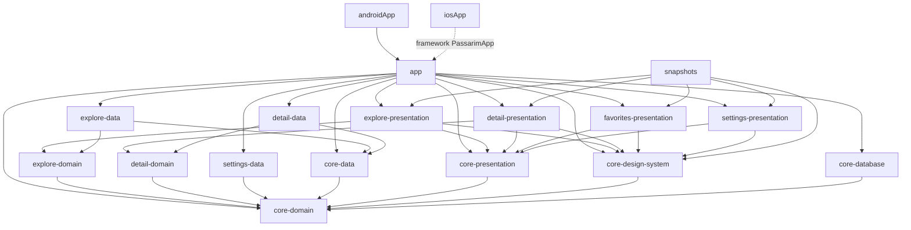

# Passarim — Etapa 5d: Favoritos e Configurações — Plano de Implementação

> **For agentic workers:** REQUIRED SUB-SKILL: Use superpowers:subagent-driven-development (recommended) or superpowers:executing-plans to implement this plan task-by-task. Steps use checkbox (`- [ ]`) syntax for tracking.

**Goal:** Favoritos **persistentes e offline** e a aba **Configurações** completa, em Android e iOS:
- favoritar no Explorar ou no Detalhe grava no Room, e a aba Favoritos lista do mais recente para o mais antigo, mesmo sem BFF e sem internet;
- tema Sistema/Claro/Escuro aplicado na hora e lido antes do primeiro frame; cores dinâmicas no Android 12+;
- "Tocar canto ao abrir ave" ligado ao `autoPlay` do Detalhe;
- Dados e armazenamento (limpar o cache de imagens), Sobre (créditos, política de privacidade) e Licenças de código aberto.

**Architecture:** A fatia completa o `core:database` (Room KMP) e cria `feature:favorites:presentation` e `feature:settings:data`/`:presentation` sobre a 5c.
- **`core:domain`** ganha `observeAll` nos favoritos, `ThemeMode`, `Settings` completo com setters, `ImageCacheCleaner` e `AppConfig.versionName`.
- **Persistência:** o Room fica só no `core:database` (`LocalFavoritesRepository`); o DataStore Preferences, só no `feature:settings:data` (`DataStoreSettingsRepository`). Os dois trocam as implementações em memória da 5b e da 5c no Koin do `app`, sem mudar Explorar nem Detalhe.
- **Telas:** o MVI das fatias anteriores (`*Root` com Koin + `*Screen` sem estado), um ViewModel por tela.
- **`app`:** o `App()` lê as configurações antes de desenhar e aplica tema, cores dinâmicas e a cor dos ícones das barras do sistema; as telas cheias (Dados e armazenamento, Sobre, Licenças) entram na pilha raiz, sobre as abas.

**Tech Stack:** o da 5c (Gradle 9.8.1 · AGP 9.4.1 · Kotlin 2.4.21 · Compose Multiplatform 1.12.1 · Koin 4.2.2 · Coil 3.6.3 · Paparazzi 2.0.0-alpha05.1 · JDK 21 · Xcode 26.4), mais:
- **Room 2.8.5** com **SQLite bundled 2.6.2** (KSP 2.3.12; o plugin já estava no `build-logic` desde a 5a);
- **DataStore Preferences 1.2.1** (KMP, com `okio`);
- **AboutLibraries 15.3.0** (plugin e `aboutlibraries-compose-m3`).

**Spec:** `docs/superpowers/specs/2026-10-08-passarim-app-favoritos-configuracoes-design.md` é a fonte única; `§N` abaixo refere-se a ela. Bases: o plano da 5c (`docs/superpowers/plans/2026-10-13-passarim-app-5c-detalhe.md`), ADR-0007 (licenças de conteúdo), ADR-0009 (Room KMP), ADR-0018 (testes) e ADR-0020 (lista de licenças, nova neste PR).

## Estado atual e como executar este plano

Como nas fatias anteriores, um esqueleto **já validado** existe: a branch `feat/5d-favoritos-configuracoes` do `~/dev/passarim/passarim-app`, com 8 commits sobre a `main` em `1166c37`. Ela **não foi publicada** (sem push): o dono revisa antes.

O código embutido abaixo é, arquivo por arquivo, o desses commits. Cada tarefa corresponde a um commit, e o conteúdo de cada arquivo é o do fim daquela tarefa. Dois arquivos gerados pelo build não são embutidos: o esquema do Room (`core/database/schemas/.../1.json`, gerado pelo KSP) e a lista de licenças (`aboutlibraries.json`, gerada pela Task 6, Step 4). O plano foi gerado lendo os commits, e a reconstrução a partir dele foi comparada com a branch.

Duas formas de executar, a escolher pelo dono:

- **(a) Reconstruir** numa branch nova a partir da `main`, tarefa por tarefa, e no fim comparar com `feat/5d-favoritos-configuracoes`: `git diff feat/5d-favoritos-configuracoes --stat` deve listar só PNGs, se algum renderizar diferente.
- **(b) Adotar** a branch `feat/5d-favoritos-configuracoes` e executar só as verificações de cada tarefa e a Task 9, inclusive a publicação, que exige confirmação.

Todos os comandos rodam em `~/dev/passarim/passarim-app` (chamado `APP`), salvo indicação, com `export JAVA_HOME="$(/usr/libexec/java_home -v 21)"`. Arquivos marcados "substitui o arquivo inteiro" já existem e devem ser sobrescritos com o conteúdo mostrado.

## Global Constraints

- **Herdado da 5c:** JDK 21; `compileSdk` 37; versões só no catálogo; plugins de terceiros só por convention plugin; `kotlin.test` + Turbine + AssertK em `commonTest` nas duas plataformas; nome de teste sem vírgula; identificadores em inglês; strings de interface em `composeResources`; snapshots em claro e escuro × 1.0×/1.3×/2.0×.
- **Comentários:** o código **não** leva comentários explicativos; o plano conta a história. Só entram fatos externos ao repositório em uma linha. O detekt recusa `TODO`.
- **Commits:** formato `<tipo>: mensagem` em português, **um por tarefa**. `git add` com caminhos explícitos. Autor `velosobr <linoc.veloso@gmail.com>`.
- **Dependências entre módulos:** `presentation → domain ← data`. Features não dependem entre si; só o `app` conecta. O **Room só existe no `core:database`** e o **DataStore só no `feature:settings:data`** (§2). Favoritos → Detalhe e "Explorar aves" → aba Explorar vão por callback (§6).
- **Nomes:** métodos de repositório levam o substantivo (`setTheme`, `clearImageCache`, `observeAll`); nada de `get`/`set` sozinhos.
- **Room (§3):** entidade `favorites` com o resumo (sem o selo); versão 1 com **esquema exportado e commitado**; `toggle` numa transação; `BundledSQLiteDriver` e `Dispatchers.IO` nas duas plataformas; arquivo `passarim.db` no `getDatabasePath` (Android) e em `Documents` (iOS).
- **DataStore (§4):** chaves `theme` (`SYSTEM` | `LIGHT` | `DARK`, padrão `SYSTEM`), `dynamicColors` e `autoPlay` (padrão `false`); valor inválido cai no padrão; arquivo `settings.preferences_pb`.
- **Tema (§4):** nenhuma leitura bloqueia a thread principal; o `App()` não desenha antes da primeira leitura; a splash do Android espera por ela. Cores dinâmicas só no Android 12+ (no iOS a linha não existe), e o selo de conservação nunca muda com elas.
- **Limpar cache (§4):** só imagens do Coil (memória e disco), confirmação inline, sem diálogo do sistema; favoritos e preferências ficam.
- **Licenças (ADR-0020):** depois de mudar dependências, regenere as travas **e** o `aboutlibraries.json`; o CI confere os dois.

## Review Focus

Condições que a spec implica e que um usuário encontra antes de qualquer teste. Cada uma tem a verificação na tarefa indicada.

1. **Tocar no coração várias vezes seguidas.** Esperado: o estado final é o da paridade dos toques, sem registro duplicado nem perdido. (Task 1: os dois testes de toggles simultâneos.)
2. **Abrir o app sem BFF e sem internet.** Esperado: a aba Favoritos lista as aves salvas, do mais recente para o mais antigo, com as miniaturas que o Coil já tinha em disco e o placeholder nas outras. (Task 1 + Task 9, Step 2.)
3. **Tema Escuro com o sistema em Claro, e reabrir o app.** Esperado: a primeira tela já vem escura, sem piscar o claro, e os ícones da barra de status ficam claros. (Tasks 3 e 7 + Task 9, Step 2.)
4. **"Limpar cache" com favoritos salvos.** Esperado: o cache em disco do Coil encolhe; `passarim.db` e `settings.preferences_pb` continuam; a aba Favoritos continua igual. (Task 5: `StorageViewModelTest`; Task 9, Step 2.)
5. **Arquivo de preferências com um tema desconhecido** (por exemplo, gravado por uma versão futura). Esperado: o app abre no tema do sistema. (Task 2: "tema invalido no arquivo cai no padrao".)
6. **Fonte do sistema em 2.0×.** Esperado: Configurações, Dados e armazenamento, Sobre e Favoritos sem texto cortado. (Snapshots 2.0× das Tasks 4, 5 e 6.)

## Diferenças em relação à spec (decididas na validação do esqueleto)

| Spec | Implementação | Por quê |
|---|---|---|
| Limpador de cache em `feature/settings/data` (§2) | A interface `ImageCacheCleaner` fica em `core:domain`; a implementação `CoilImageCacheCleaner`, no `data` | A apresentação não enxerga o `data`, e a 5d não tem um `feature:settings:domain` |
| Um ViewModel de Configurações (§7) | Três: `SettingsViewModel`, `StorageViewModel` e `AboutViewModel` | Cada tela cheia tem a sua entrada na pilha. O `StorageViewModel` só recebe o limpador, e isso garante, pela construção, que limpar o cache não toca favoritos nem configurações |
| iOS: "a primeira leitura roda antes de compor a UI" (§4) | O `App()` não desenha nada até a primeira emissão, nas duas plataformas; só o Android tem a splash segurando | Ler antes de compor no iOS exigiria bloquear a thread principal, o que a própria spec proíbe. No simulador, a primeira tela já veio com o tema certo; a 5e confirma no aparelho |
| `FavoritesRepository`: `observeIds`, `observeAll`, `toggle` (§3) | Os três e o `refresh` da 5c | O Detalhe continua atualizando a miniatura de uma ave favorita ao abri-la |
| — | `core:domain` ganha o alvo `jvm()` (só testes) | O `jvmTest` do `core:database` precisa de todas as dependências com alvo JVM (ADR-0018 atualizado) |
| AboutLibraries gera a lista na compilação (§5) | O plugin exporta o classpath de release do Android para um JSON versionado em `feature:settings:presentation`; o CI confere se está em dia | Em KMP, o plugin não liga a exportação aos recursos do Compose (ADR-0020). O iOS mostra a lista do Android |
| Créditos conforme ADR-0007 (§4) | Os da ADR-0007 e do mockup, mais a linha "Mapa" com a atribuição do Detalhe ("© OpenFreeMap © OpenMapTiles · dados © OpenStreetMap") | A spec pede a atribuição do mapa no Sobre, e o texto é o que o estilo do OpenFreeMap declara (5c) |
| "Libera espaço; o conteúdo é baixado de novo…" (mockup) | "Libera espaço; as imagens são baixadas de novo…" | Critério 6: o texto da tela fala só de imagens (não há cache de áudio) |
| — | Os ícones das barras do sistema seguem o tema do app; as telas cheias novas aplicam `systemBarsPadding()` | Defeitos vistos no emulador (Task 7) |
| Room no iOS "só linka na 5d" (§8) | Além de linkar, o banco foi criado no simulador (`Documents/passarim.db`): o Explorar observa os ids favoritos ao abrir | Evidência extra; abrir, gravar e listar no iOS continua na 5e |

**Pendências encontradas fora do escopo:**
- **Xcode 26.4 sem a licença aceita** no Mac de desenvolvimento: `sudo xcodebuild -license accept` (com `DEVELOPER_DIR=/Applications/Xcode.app/Contents/Developer` ou depois de `sudo xcode-select -s /Applications/Xcode.app`). Até lá, os testes iOS de `app` e `feature:detail:presentation` não linkam (MapLibre), e a verificação iOS da 5c (Task 11, Step 4) também fica pendente.
- **Política de privacidade:** o texto (`docs/privacidade.md`) e a URL dependem da revisão do dono (§5). O link do app só abre depois do merge deste PR de docs.
- **Herdada da 5a:** a 2.0× o rótulo "Configurações" da barra inferior quebra (5e).
- O `local.properties` do Mac de desenvolvimento aponta para `192.168.0.6:8090`, mas o IP atual é `192.168.0.7`. Para o emulador, basta remover a linha `bff.baseUrl` (o padrão é `10.0.2.2:8080`).

---

### Task 0: Pré-requisitos e branch

- [ ] **Step 1: Ferramentas**

As da 5c. O Xcode 26.4 precisa ter a licença aceita (`xcodebuild -version` sem aviso de licença). Com o Xcode 16, tudo passa, menos o link dos testes iOS de `feature:detail:presentation` e do `app`.

- [ ] **Step 2: Partir da `main` atualizada**

```bash
git checkout main && git pull --ff-only
git log --oneline -1
git config user.email
git checkout -b feat/5d-favoritos-configuracoes
```

Expected: `main` em `1166c37` ou depois, com a 5c mergeada; o e-mail é `linoc.veloso@gmail.com`. Na opção (a), use outro nome de branch, por exemplo `feat/5d-favoritos-configuracoes-plano`.

### Task 1: Room KMP em `core:database` e favoritos persistentes

**Files:**
- Create: `build-logic/src/main/kotlin/passarim.room.gradle.kts`, `core/database/src/androidMain/kotlin/com/velosobr/passarim/core/database/DatabaseModule.android.kt`, `core/database/src/commonMain/kotlin/com/velosobr/passarim/core/database/DatabaseModule.kt`, `core/database/src/commonMain/kotlin/com/velosobr/passarim/core/database/FavoriteDao.kt`, `core/database/src/commonMain/kotlin/com/velosobr/passarim/core/database/FavoriteEntity.kt`, `core/database/src/commonMain/kotlin/com/velosobr/passarim/core/database/LocalFavoritesRepository.kt`, `core/database/src/commonMain/kotlin/com/velosobr/passarim/core/database/PassarimDatabase.kt`, `core/database/src/iosMain/kotlin/com/velosobr/passarim/core/database/DatabaseModule.ios.kt`, `core/database/src/jvmMain/kotlin/com/velosobr/passarim/core/database/DatabaseModule.jvm.kt`
- Modify: `androidApp/gradle.lockfile`, `app/build.gradle.kts`, `app/gradle.lockfile`, `app/src/commonMain/kotlin/com/velosobr/passarim/app/di/AppModule.kt`, `core/database/build.gradle.kts`, `core/domain/build.gradle.kts`, `core/domain/src/commonMain/kotlin/com/velosobr/passarim/core/domain/FavoritesRepository.kt`, `gradle/libs.versions.toml`
- Delete: `app/src/commonMain/kotlin/com/velosobr/passarim/app/favorites/InMemoryFavoritesRepository.kt`, `app/src/commonTest/kotlin/com/velosobr/passarim/app/favorites/InMemoryFavoritesRepositoryTest.kt`
- Test: `core/database/src/jvmTest/kotlin/com/velosobr/passarim/core/database/LocalFavoritesRepositoryTest.kt`, `core/database/src/jvmTest/kotlin/com/velosobr/passarim/core/database/PassarimDatabaseMigrationTest.kt`, `feature/detail/presentation/src/commonTest/kotlin/com/velosobr/passarim/feature/detail/presentation/DetailFakes.kt`, `feature/explore/presentation/src/commonTest/kotlin/com/velosobr/passarim/feature/explore/presentation/ExploreFakes.kt`
- Generated: `core/database/schemas/com.velosobr.passarim.core.database.PassarimDatabase/1.json`

**Interfaces:**
- Consumes: `FavoritesRepository`, `SpeciesSummary` (`core:domain`); o plugin do Room e o KSP já no `build-logic` desde a 5a.
- Produces: `FavoritesRepository.observeAll(): Flow<List<SpeciesSummary>>`; `FavoriteEntity(id, commonName, scientificName, thumbnailUrl?, addedAt)` na tabela `favorites`; `FavoriteDao` (`observeAll` por `addedAt DESC`, `observeIds`, `insert`, `deleteById`, `updateSummary` e o `toggle` em `@Transaction`); `PassarimDatabase` versão 1 com esquema exportado em `core/database/schemas`; `LocalFavoritesRepository(dao, now)`; `databaseModule` (Koin), com o builder por plataforma (`Scope.passarimDatabaseBuilder()`: `getDatabasePath` no Android, `Documents` no iOS, `tmpdir` na JVM de teste); convention plugin `passarim.room`. O `InMemoryFavoritesRepository` da 5b sai.

O alvo `jvm()` do `core:database` só existe para os testes (ADR-0018). Como o banco depende do `core:domain`, o `core:domain` também ganha o alvo `jvm()`; sem ele, o `jvmTest` não resolve a dependência. Os fakes de Explorar e Detalhe ganham um `observeAll` vazio, porque a interface mudou.

O `toggle` apaga e, se nada foi apagado, insere, dentro da mesma transação. Os testes de toggles simultâneos (10 e 11 em paralelo no `Dispatchers.IO`) provam que alternar rápido não duplica nem perde. O teste de migração cria a versão 1 a partir do JSON exportado: quando a versão 2 vier, o mesmo `MigrationTestHelper` valida a migração.

- [ ] **Step 1: Escrever os testes que falham** (e a configuração de build que eles exigem)

`app/build.gradle.kts` — substitui o arquivo inteiro

```kotlin
plugins {
    id("passarim.kmp-compose")
    id("passarim.serialization")
    id("passarim.ios-framework")
}

kotlin {
    sourceSets {
        commonMain.dependencies {
            implementation(projects.core.domain)
            implementation(projects.core.data)
            implementation(projects.core.database)
            implementation(projects.core.presentation)
            implementation(projects.core.designSystem)
            implementation(projects.feature.explore.data)
            implementation(projects.feature.explore.presentation)
            implementation(projects.feature.detail.data)
            implementation(projects.feature.detail.presentation)
            implementation(libs.compose.resources)
            implementation(libs.navigation.compose)
            implementation(libs.koin.core)
            implementation(libs.koin.compose)
            implementation(libs.koin.compose.viewmodel)
            implementation(libs.kotlinx.serialization.json)
            implementation(libs.ktor.client.core)
            implementation(libs.coil.compose)
            implementation(libs.coil.network.ktor3)
        }
        commonTest.dependencies {
            implementation(libs.assertk)
            implementation(libs.turbine)
            implementation(libs.kotlinx.coroutines.test)
        }
    }
}
```

`build-logic/src/main/kotlin/passarim.room.gradle.kts`

```kotlin
plugins {
    id("com.google.devtools.ksp")
    id("androidx.room")
}

room {
    schemaDirectory("$projectDir/schemas")
}
```

`core/database/build.gradle.kts` — substitui o arquivo inteiro

```kotlin
plugins {
    id("passarim.kmp-library")
    id("passarim.room")
}

kotlin {
    jvm()

    compilerOptions {
        freeCompilerArgs.add("-Xexpect-actual-classes")
    }

    sourceSets {
        commonMain.dependencies {
            api(projects.core.domain)
            implementation(libs.room.runtime)
            implementation(libs.sqlite.bundled)
            implementation(libs.koin.core)
        }
        androidMain.dependencies {
            implementation(libs.koin.android)
        }
        jvmTest.dependencies {
            implementation(libs.room.testing)
            implementation(libs.kotlinx.coroutines.test)
            implementation(libs.turbine)
            implementation(libs.assertk)
        }
    }
}

dependencies {
    listOf("kspAndroid", "kspIosArm64", "kspIosSimulatorArm64", "kspJvm").forEach { add(it, libs.room.compiler) }
}
```

`core/database/src/jvmTest/kotlin/com/velosobr/passarim/core/database/LocalFavoritesRepositoryTest.kt`

```kotlin
package com.velosobr.passarim.core.database

import androidx.room.Room
import androidx.sqlite.driver.bundled.BundledSQLiteDriver
import app.cash.turbine.test
import assertk.assertThat
import assertk.assertions.containsExactly
import assertk.assertions.isEmpty
import assertk.assertions.isEqualTo
import com.velosobr.passarim.core.domain.SpeciesSummary
import kotlinx.coroutines.Dispatchers
import kotlinx.coroutines.async
import kotlinx.coroutines.awaitAll
import kotlinx.coroutines.flow.first
import kotlinx.coroutines.test.runTest
import kotlin.test.AfterTest
import kotlin.test.Test

class LocalFavoritesRepositoryTest {
    private val bemTeVi = SpeciesSummary("bem-te-vi", "Bem-te-vi", "Pitangus sulphuratus", "https://media/bem-te-vi.webp")
    private val sabia = SpeciesSummary("sabia-laranjeira", "Sabiá-laranjeira", "Turdus rufiventris", null)
    private val tucano = SpeciesSummary("tucano-toco", "Tucano-toco", "Ramphastos toco", null)

    private val database =
        Room
            .inMemoryDatabaseBuilder<PassarimDatabase>()
            .setDriver(BundledSQLiteDriver())
            .setQueryCoroutineContext(Dispatchers.IO)
            .build()

    private var now = 0L
    private val repository = LocalFavoritesRepository(database.favoriteDao()) { ++now }

    @AfterTest
    fun closeDatabase() = database.close()

    @Test
    fun `comeca vazio`() =
        runTest {
            assertThat(repository.observeAll().first()).isEmpty()
            assertThat(repository.observeIds().first()).isEmpty()
        }

    @Test
    fun `toggle grava e lista do mais recente para o mais antigo`() =
        runTest {
            repository.toggle(bemTeVi)
            repository.toggle(sabia)
            repository.toggle(tucano)

            assertThat(repository.observeAll().first()).containsExactly(tucano, sabia, bemTeVi)
        }

    @Test
    fun `toggle de um favorito remove`() =
        runTest {
            repository.toggle(bemTeVi)
            repository.toggle(sabia)

            repository.toggle(bemTeVi)

            assertThat(repository.observeAll().first()).containsExactly(sabia)
        }

    @Test
    fun `observeIds emite a cada mudanca`() =
        runTest {
            repository.observeIds().test {
                assertThat(awaitItem()).isEmpty()
                repository.toggle(bemTeVi)
                assertThat(awaitItem()).isEqualTo(setOf("bem-te-vi"))
                repository.toggle(sabia)
                assertThat(awaitItem()).isEqualTo(setOf("bem-te-vi", "sabia-laranjeira"))
                repository.toggle(bemTeVi)
                assertThat(awaitItem()).isEqualTo(setOf("sabia-laranjeira"))
            }
        }

    @Test
    fun `toggles simultaneos em numero par nao deixam rastro`() =
        runTest {
            List(10) { async(Dispatchers.IO) { repository.toggle(bemTeVi) } }.awaitAll()

            assertThat(repository.observeAll().first()).isEmpty()
        }

    @Test
    fun `toggles simultaneos em numero impar deixam um registro so`() =
        runTest {
            List(11) { async(Dispatchers.IO) { repository.toggle(bemTeVi) } }.awaitAll()

            assertThat(repository.observeAll().first()).containsExactly(bemTeVi)
        }

    @Test
    fun `refresh atualiza o resumo e mantem a posicao na lista`() =
        runTest {
            repository.toggle(bemTeVi)
            repository.toggle(sabia)
            val novaFoto = bemTeVi.copy(thumbnailUrl = "https://media/bem-te-vi-2.webp")

            repository.refresh(novaFoto)

            assertThat(repository.observeAll().first()).containsExactly(sabia, novaFoto)
        }

    @Test
    fun `refresh ignora quem nao e favorito`() =
        runTest {
            repository.refresh(tucano)

            assertThat(repository.observeAll().first()).isEmpty()
        }
}
```

`core/database/src/jvmTest/kotlin/com/velosobr/passarim/core/database/PassarimDatabaseMigrationTest.kt`

```kotlin
package com.velosobr.passarim.core.database

import androidx.room.testing.MigrationTestHelper
import androidx.sqlite.driver.bundled.BundledSQLiteDriver
import androidx.sqlite.execSQL
import assertk.assertThat
import assertk.assertions.isEqualTo
import java.nio.file.Files
import kotlin.io.path.Path
import kotlin.test.Test

class PassarimDatabaseMigrationTest {
    private val databaseFile = Files.createTempDirectory("passarim-db").resolve("passarim.db")

    private val helper =
        MigrationTestHelper(
            schemaDirectoryPath = Path("schemas"),
            databasePath = databaseFile,
            driver = BundledSQLiteDriver(),
            databaseClass = PassarimDatabase::class,
        )

    @Test
    fun `cria a versao 1 a partir do esquema exportado`() {
        helper.createDatabase(1).use { connection ->
            connection.execSQL(
                "INSERT INTO favorites (id, commonName, scientificName, thumbnailUrl, addedAt) " +
                    "VALUES ('bem-te-vi', 'Bem-te-vi', 'Pitangus sulphuratus', NULL, 1)",
            )
            connection.prepare("SELECT COUNT(*) FROM favorites").use { statement ->
                statement.step()
                assertThat(statement.getLong(0)).isEqualTo(1L)
            }
        }
    }
}
```

`core/domain/build.gradle.kts` — substitui o arquivo inteiro

```kotlin
plugins {
    id("passarim.kmp-library")
}

kotlin {
    jvm()

    sourceSets {
        commonMain.dependencies {
            api(libs.kotlinx.coroutines.core)
        }
        commonTest.dependencies {
            implementation(libs.assertk)
        }
    }
}
```

`feature/detail/presentation/src/commonTest/kotlin/com/velosobr/passarim/feature/detail/presentation/DetailFakes.kt` — substitui o arquivo inteiro

```kotlin
package com.velosobr.passarim.feature.detail.presentation

import com.velosobr.passarim.core.domain.Credit
import com.velosobr.passarim.core.domain.DataError
import com.velosobr.passarim.core.domain.FavoritesRepository
import com.velosobr.passarim.core.domain.Result
import com.velosobr.passarim.core.domain.Settings
import com.velosobr.passarim.core.domain.SettingsRepository
import com.velosobr.passarim.core.domain.SpeciesSummary
import com.velosobr.passarim.feature.detail.domain.Audio
import com.velosobr.passarim.feature.detail.domain.AudioPlayer
import com.velosobr.passarim.feature.detail.domain.DetailRepository
import com.velosobr.passarim.feature.detail.domain.Photo
import com.velosobr.passarim.feature.detail.domain.PlaybackState
import com.velosobr.passarim.feature.detail.domain.SpeciesDetail
import com.velosobr.passarim.feature.detail.domain.WhereToFind
import kotlinx.coroutines.flow.Flow
import kotlinx.coroutines.flow.MutableStateFlow
import kotlinx.coroutines.flow.flowOf

const val ARARA_ID = "anodorhynchus-hyacinthinus"
const val AUDIO_URL = "https://media/arara.aac"

val credit = Credit("autor", "CC BY", "inaturalist", "https://www.inaturalist.org/observations/1")

val arara =
    SpeciesDetail(
        id = ARARA_ID,
        commonName = "Arara-azul-grande",
        scientificName = "Anodorhynchus hyacinthinus",
        family = "Psittacidae",
        conservation = null,
        sizeCm = 100,
        diet = null,
        description = "A maior arara do mundo.",
        descriptionCredit = credit,
        facts = emptyList(),
        biomes = emptyList(),
        photos = listOf(Photo("https://media/thumb.webp", null, null, credit)),
        audio = Audio(AUDIO_URL, 5_000, credit),
        whereToFind = WhereToFind(emptyList(), emptyList(), emptyList()),
    )

class FakeDetailRepository(
    var next: Result<SpeciesDetail, DataError.Network> = Result.Success(arara),
) : DetailRepository {
    val calls = mutableListOf<String>()

    override suspend fun get(id: String): Result<SpeciesDetail, DataError.Network> {
        calls += id
        return next
    }
}

class FakeFavoritesRepository : FavoritesRepository {
    val ids = MutableStateFlow<Set<String>>(emptySet())
    val toggled = mutableListOf<SpeciesSummary>()
    val refreshed = mutableListOf<SpeciesSummary>()

    override fun observeIds(): Flow<Set<String>> = ids

    override fun observeAll(): Flow<List<SpeciesSummary>> = flowOf(emptyList())

    override suspend fun toggle(summary: SpeciesSummary) {
        toggled += summary
        ids.value = if (summary.id in ids.value) ids.value - summary.id else ids.value + summary.id
    }

    override suspend fun refresh(summary: SpeciesSummary) {
        refreshed += summary
    }
}

class FakeSettingsRepository(
    autoPlay: Boolean = false,
) : SettingsRepository {
    private val settings = MutableStateFlow(Settings(autoPlay = autoPlay))

    override fun observe(): Flow<Settings> = settings
}

class FakeAudioPlayer : AudioPlayer {
    override val state = MutableStateFlow<PlaybackState>(PlaybackState.Idle)
    val calls = mutableListOf<String>()

    override fun play(url: String) {
        calls += "play:$url"
    }

    override fun pause() {
        calls += "pause"
    }

    override fun seekTo(positionMs: Long) {
        calls += "seek:$positionMs"
    }

    override fun release() {
        calls += "release"
    }
}
```

`feature/explore/presentation/src/commonTest/kotlin/com/velosobr/passarim/feature/explore/presentation/ExploreFakes.kt` — substitui o arquivo inteiro

```kotlin
package com.velosobr.passarim.feature.explore.presentation

import com.velosobr.passarim.core.domain.BiomeFilter
import com.velosobr.passarim.core.domain.DataError
import com.velosobr.passarim.core.domain.FavoritesRepository
import com.velosobr.passarim.core.domain.Filters
import com.velosobr.passarim.core.domain.FiltersRepository
import com.velosobr.passarim.core.domain.Result
import com.velosobr.passarim.core.domain.SpeciesSummary
import com.velosobr.passarim.core.domain.StateFilter
import com.velosobr.passarim.feature.explore.domain.ExploreRepository
import com.velosobr.passarim.feature.explore.domain.SpeciesPage
import kotlinx.coroutines.CompletableDeferred
import kotlinx.coroutines.flow.Flow
import kotlinx.coroutines.flow.MutableStateFlow
import kotlinx.coroutines.flow.flowOf

fun bird(id: String) = SpeciesSummary(id, "Ave $id", "Avis $id", thumbnailUrl = null)

/** Página com os ids `from..<to` (por exemplo `page(0, 20, "c1")`). */
fun page(
    from: Int,
    to: Int,
    next: String?,
) = SpeciesPage((from until to).map { bird("ave-$it") }, next)

data class ListCall(
    val query: String,
    val biome: String?,
    val state: String?,
    val cursor: String?,
)

/**
 * Repositório falso: responde por cursor (`pages[null]` é a primeira página) e guarda cada chamada.
 * [gates] seguram a resposta de uma chamada (pelo índice) para observar estados intermediários.
 */
class FakeExploreRepository : ExploreRepository {
    val calls = mutableListOf<ListCall>()
    val pages = mutableMapOf<String?, Result<SpeciesPage, DataError.Network>>(null to Result.Success(page(0, 20, "c1")))
    val gates = mutableMapOf<Int, CompletableDeferred<Unit>>()

    override suspend fun list(
        query: String,
        biome: String?,
        state: String?,
        cursor: String?,
        limit: Int,
    ): Result<SpeciesPage, DataError.Network> {
        val index = calls.size
        calls += ListCall(query, biome, state, cursor)
        gates[index]?.await()
        return pages.getValue(cursor)
    }
}

val sampleFilters =
    Filters(
        biomes = listOf(BiomeFilter("cerrado", "Cerrado", 26), BiomeFilter("pampa", "Pampa", 15)),
        states = listOf(StateFilter("RJ", 23), StateFilter("SP", 29), StateFilter("AC", 3)),
    )

class FakeFiltersRepository(
    var next: Result<Filters, DataError.Network> = Result.Success(sampleFilters),
) : FiltersRepository {
    var calls = 0

    override suspend fun get(): Result<Filters, DataError.Network> {
        calls++
        return next
    }
}

class FakeFavoritesRepository : FavoritesRepository {
    val ids = MutableStateFlow<Set<String>>(emptySet())

    override fun observeIds(): Flow<Set<String>> = ids

    override fun observeAll(): Flow<List<SpeciesSummary>> = flowOf(emptyList())

    override suspend fun toggle(summary: SpeciesSummary) {
        ids.value = if (summary.id in ids.value) ids.value - summary.id else ids.value + summary.id
    }

    override suspend fun refresh(summary: SpeciesSummary) = Unit
}
```

`gradle/libs.versions.toml` — substitui o arquivo inteiro

```toml
[versions]
agp = "9.4.1"
kotlin = "2.4.21"
compose = "1.12.1"
composeMaterial3 = "1.9.0"
ksp = "2.3.12"
room = "2.8.5"
sqlite = "2.6.2"
datastore = "1.2.1"
paparazzi = "2.0.0-alpha05.1"
ktor = "3.6.0"
koin = "4.2.2"
serialization = "1.11.0"
coroutines = "1.11.0"
turbine = "1.2.1"
assertk = "0.28.1"
lifecycle = "2.11.0"
navigation = "2.9.2"
splashscreen = "1.2.0"
activityCompose = "1.13.0"
coil = "3.6.3"
media3 = "1.11.1"
maplibreCompose = "0.19.0"
maplibreNativeFfi = "0.202609.5"
ktlint = "14.2.0"
detekt = "2.0.0-alpha.6"
junit4 = "4.13.2"

[libraries]
# plugins usados pelo build-logic
android-gradlePlugin = { module = "com.android.tools.build:gradle", version.ref = "agp" }
kotlin-gradlePlugin = { module = "org.jetbrains.kotlin:kotlin-gradle-plugin", version.ref = "kotlin" }
kotlin-serialization-gradlePlugin = { module = "org.jetbrains.kotlin:kotlin-serialization", version.ref = "kotlin" }
compose-compiler-gradlePlugin = { module = "org.jetbrains.kotlin:compose-compiler-gradle-plugin", version.ref = "kotlin" }
compose-gradlePlugin = { module = "org.jetbrains.compose:compose-gradle-plugin", version.ref = "compose" }
ksp-gradlePlugin = { module = "com.google.devtools.ksp:symbol-processing-gradle-plugin", version.ref = "ksp" }
room-gradlePlugin = { module = "androidx.room:room-gradle-plugin", version.ref = "room" }
paparazzi-gradlePlugin = { module = "app.cash.paparazzi:paparazzi-gradle-plugin", version.ref = "paparazzi" }
ktlint-gradlePlugin = { module = "org.jlleitschuh.gradle:ktlint-gradle", version.ref = "ktlint" }
detekt-gradlePlugin = { module = "dev.detekt:detekt-gradle-plugin", version.ref = "detekt" }

# Compose Multiplatform
compose-runtime = { module = "org.jetbrains.compose.runtime:runtime", version.ref = "compose" }
compose-foundation = { module = "org.jetbrains.compose.foundation:foundation", version.ref = "compose" }
compose-material3 = { module = "org.jetbrains.compose.material3:material3", version.ref = "composeMaterial3" }
compose-ui = { module = "org.jetbrains.compose.ui:ui", version.ref = "compose" }
compose-resources = { module = "org.jetbrains.compose.components:components-resources", version.ref = "compose" }
compose-uiToolingPreview = { module = "org.jetbrains.compose.ui:ui-tooling-preview", version.ref = "compose" }
lifecycle-viewmodel-compose = { module = "org.jetbrains.androidx.lifecycle:lifecycle-viewmodel-compose", version.ref = "lifecycle" }
lifecycle-viewmodel-savedstate = { module = "org.jetbrains.androidx.lifecycle:lifecycle-viewmodel-savedstate", version.ref = "lifecycle" }
lifecycle-runtime-compose = { module = "org.jetbrains.androidx.lifecycle:lifecycle-runtime-compose", version.ref = "lifecycle" }
navigation-compose = { module = "org.jetbrains.androidx.navigation:navigation-compose", version.ref = "navigation" }
androidx-activity-compose = { module = "androidx.activity:activity-compose", version.ref = "activityCompose" }
androidx-core-splashscreen = { module = "androidx.core:core-splashscreen", version.ref = "splashscreen" }

# Persistência
room-runtime = { module = "androidx.room:room-runtime", version.ref = "room" }
room-compiler = { module = "androidx.room:room-compiler", version.ref = "room" }
room-testing = { module = "androidx.room:room-testing", version.ref = "room" }
sqlite-bundled = { module = "androidx.sqlite:sqlite-bundled", version.ref = "sqlite" }
datastore-preferences-core = { module = "androidx.datastore:datastore-preferences-core", version.ref = "datastore" }

# Rede e serialização
ktor-client-core = { module = "io.ktor:ktor-client-core", version.ref = "ktor" }
ktor-client-contentNegotiation = { module = "io.ktor:ktor-client-content-negotiation", version.ref = "ktor" }
ktor-client-logging = { module = "io.ktor:ktor-client-logging", version.ref = "ktor" }
ktor-client-okhttp = { module = "io.ktor:ktor-client-okhttp", version.ref = "ktor" }
ktor-client-darwin = { module = "io.ktor:ktor-client-darwin", version.ref = "ktor" }
ktor-client-mock = { module = "io.ktor:ktor-client-mock", version.ref = "ktor" }
ktor-serialization-kotlinxJson = { module = "io.ktor:ktor-serialization-kotlinx-json", version.ref = "ktor" }
kotlinx-serialization-json = { module = "org.jetbrains.kotlinx:kotlinx-serialization-json", version.ref = "serialization" }
kotlinx-coroutines-core = { module = "org.jetbrains.kotlinx:kotlinx-coroutines-core", version.ref = "coroutines" }
kotlinx-coroutines-test = { module = "org.jetbrains.kotlinx:kotlinx-coroutines-test", version.ref = "coroutines" }

# Imagens
coil-compose = { module = "io.coil-kt.coil3:coil-compose", version.ref = "coil" }
coil-network-ktor3 = { module = "io.coil-kt.coil3:coil-network-ktor3", version.ref = "coil" }

# Mapa
maplibre-compose = { module = "org.maplibre.compose:maplibre-compose", version.ref = "maplibreCompose" }
maplibre-runtime-opengl = { module = "org.maplibre.nativeffi:maplibre-native-ffi-runtime-opengl", version.ref = "maplibreNativeFfi" }

# Áudio
media3-exoplayer = { module = "androidx.media3:media3-exoplayer", version.ref = "media3" }

# DI
koin-core = { module = "io.insert-koin:koin-core", version.ref = "koin" }
koin-compose = { module = "io.insert-koin:koin-compose", version.ref = "koin" }
koin-compose-viewmodel = { module = "io.insert-koin:koin-compose-viewmodel", version.ref = "koin" }
koin-android = { module = "io.insert-koin:koin-android", version.ref = "koin" }

# Testes
turbine = { module = "app.cash.turbine:turbine", version.ref = "turbine" }
assertk = { module = "com.willowtreeapps.assertk:assertk", version.ref = "assertk" }
junit4 = { module = "junit:junit", version.ref = "junit4" }
```

- [ ] **Step 2: Rodar e ver falhar**

```bash
export JAVA_HOME="$(/usr/libexec/java_home -v 21)" && ./gradlew :core:database:jvmTest --console=plain 2>&1 | grep -E "^e: |BUILD" | head -3
```

Expected: `BUILD FAILED` com `Unresolved reference 'PassarimDatabase'` (e `LocalFavoritesRepository`).

- [ ] **Step 3: Implementar**

Remover os favoritos em memória da 5b:

```bash
git rm app/src/commonMain/kotlin/com/velosobr/passarim/app/favorites/InMemoryFavoritesRepository.kt app/src/commonTest/kotlin/com/velosobr/passarim/app/favorites/InMemoryFavoritesRepositoryTest.kt
```

`app/src/commonMain/kotlin/com/velosobr/passarim/app/di/AppModule.kt` — substitui o arquivo inteiro

```kotlin
package com.velosobr.passarim.app.di

import com.velosobr.passarim.app.settings.InMemorySettingsRepository
import com.velosobr.passarim.core.data.coreDataModule
import com.velosobr.passarim.core.database.databaseModule
import com.velosobr.passarim.core.domain.AppConfig
import com.velosobr.passarim.core.domain.SettingsRepository
import com.velosobr.passarim.feature.detail.data.detailDataModule
import com.velosobr.passarim.feature.detail.presentation.detailPresentationModule
import com.velosobr.passarim.feature.explore.data.exploreDataModule
import com.velosobr.passarim.feature.explore.presentation.explorePresentationModule
import org.koin.core.KoinApplication
import org.koin.core.context.startKoin
import org.koin.dsl.module

private val appModule =
    module {
        single<SettingsRepository> { InMemorySettingsRepository() }
    }

/**
 * Inicia o Koin. No Android é chamado pelo `Application`; no iOS, por `MainViewController`.
 * [platform] permite à plataforma acrescentar o que é só dela (`androidContext`, por exemplo).
 */
fun initKoin(
    config: AppConfig,
    platform: KoinApplication.() -> Unit = {},
) {
    startKoin {
        platform()
        modules(
            module { single { config } },
            coreDataModule,
            databaseModule,
            appModule,
            exploreDataModule,
            explorePresentationModule,
            detailDataModule,
            detailPresentationModule,
        )
    }
}
```

`core/database/src/androidMain/kotlin/com/velosobr/passarim/core/database/DatabaseModule.android.kt`

```kotlin
package com.velosobr.passarim.core.database

import androidx.room.Room
import androidx.room.RoomDatabase
import org.koin.android.ext.koin.androidContext
import org.koin.core.scope.Scope

internal actual fun Scope.passarimDatabaseBuilder(): RoomDatabase.Builder<PassarimDatabase> {
    val context = androidContext().applicationContext
    return Room.databaseBuilder<PassarimDatabase>(context, context.getDatabasePath(DATABASE_FILE_NAME).absolutePath)
}
```

`core/database/src/commonMain/kotlin/com/velosobr/passarim/core/database/DatabaseModule.kt`

```kotlin
package com.velosobr.passarim.core.database

import androidx.room.RoomDatabase
import androidx.sqlite.driver.bundled.BundledSQLiteDriver
import com.velosobr.passarim.core.domain.FavoritesRepository
import kotlinx.coroutines.Dispatchers
import kotlinx.coroutines.IO
import org.koin.core.scope.Scope
import org.koin.dsl.module

internal expect fun Scope.passarimDatabaseBuilder(): RoomDatabase.Builder<PassarimDatabase>

val databaseModule =
    module {
        single<PassarimDatabase> {
            passarimDatabaseBuilder()
                .setDriver(BundledSQLiteDriver())
                .setQueryCoroutineContext(Dispatchers.IO)
                .build()
        }
        single { get<PassarimDatabase>().favoriteDao() }
        single<FavoritesRepository> { LocalFavoritesRepository(get()) }
    }
```

`core/database/src/commonMain/kotlin/com/velosobr/passarim/core/database/FavoriteDao.kt`

```kotlin
package com.velosobr.passarim.core.database

import androidx.room.Dao
import androidx.room.Insert
import androidx.room.Query
import androidx.room.Transaction
import kotlinx.coroutines.flow.Flow

@Dao
interface FavoriteDao {
    @Query("SELECT * FROM favorites ORDER BY addedAt DESC")
    fun observeAll(): Flow<List<FavoriteEntity>>

    @Query("SELECT id FROM favorites")
    fun observeIds(): Flow<List<String>>

    @Insert
    suspend fun insert(favorite: FavoriteEntity)

    @Query("DELETE FROM favorites WHERE id = :id")
    suspend fun deleteById(id: String): Int

    @Query("UPDATE favorites SET commonName = :commonName, scientificName = :scientificName, thumbnailUrl = :thumbnailUrl WHERE id = :id")
    suspend fun updateSummary(
        id: String,
        commonName: String,
        scientificName: String,
        thumbnailUrl: String?,
    )

    @Transaction
    suspend fun toggle(favorite: FavoriteEntity) {
        if (deleteById(favorite.id) == 0) insert(favorite)
    }
}
```

`core/database/src/commonMain/kotlin/com/velosobr/passarim/core/database/FavoriteEntity.kt`

```kotlin
package com.velosobr.passarim.core.database

import androidx.room.Entity
import androidx.room.PrimaryKey
import com.velosobr.passarim.core.domain.SpeciesSummary

@Entity(tableName = "favorites")
data class FavoriteEntity(
    @PrimaryKey val id: String,
    val commonName: String,
    val scientificName: String,
    val thumbnailUrl: String?,
    val addedAt: Long,
)

internal fun FavoriteEntity.toSummary() = SpeciesSummary(id, commonName, scientificName, thumbnailUrl)

internal fun SpeciesSummary.toEntity(addedAt: Long) = FavoriteEntity(id, commonName, scientificName, thumbnailUrl, addedAt)
```

`core/database/src/commonMain/kotlin/com/velosobr/passarim/core/database/LocalFavoritesRepository.kt`

```kotlin
package com.velosobr.passarim.core.database

import com.velosobr.passarim.core.domain.FavoritesRepository
import com.velosobr.passarim.core.domain.SpeciesSummary
import kotlinx.coroutines.flow.Flow
import kotlinx.coroutines.flow.distinctUntilChanged
import kotlinx.coroutines.flow.map
import kotlin.time.Clock

class LocalFavoritesRepository(
    private val dao: FavoriteDao,
    private val now: () -> Long = { Clock.System.now().toEpochMilliseconds() },
) : FavoritesRepository {
    override fun observeIds(): Flow<Set<String>> = dao.observeIds().map { it.toSet() }.distinctUntilChanged()

    override fun observeAll(): Flow<List<SpeciesSummary>> = dao.observeAll().map { favorites -> favorites.map { it.toSummary() } }

    override suspend fun toggle(summary: SpeciesSummary) = dao.toggle(summary.toEntity(addedAt = now()))

    override suspend fun refresh(summary: SpeciesSummary) =
        dao.updateSummary(summary.id, summary.commonName, summary.scientificName, summary.thumbnailUrl)
}
```

`core/database/src/commonMain/kotlin/com/velosobr/passarim/core/database/PassarimDatabase.kt`

```kotlin
package com.velosobr.passarim.core.database

import androidx.room.ConstructedBy
import androidx.room.Database
import androidx.room.RoomDatabase
import androidx.room.RoomDatabaseConstructor

@Database(entities = [FavoriteEntity::class], version = 1, exportSchema = true)
@ConstructedBy(PassarimDatabaseConstructor::class)
abstract class PassarimDatabase : RoomDatabase() {
    abstract fun favoriteDao(): FavoriteDao
}

@Suppress("KotlinNoActualForExpect", "NO_ACTUAL_FOR_EXPECT")
expect object PassarimDatabaseConstructor : RoomDatabaseConstructor<PassarimDatabase> {
    override fun initialize(): PassarimDatabase
}

internal const val DATABASE_FILE_NAME = "passarim.db"
```

`core/database/src/iosMain/kotlin/com/velosobr/passarim/core/database/DatabaseModule.ios.kt`

```kotlin
package com.velosobr.passarim.core.database

import androidx.room.Room
import androidx.room.RoomDatabase
import kotlinx.cinterop.ExperimentalForeignApi
import org.koin.core.scope.Scope
import platform.Foundation.NSDocumentDirectory
import platform.Foundation.NSFileManager
import platform.Foundation.NSUserDomainMask

@OptIn(ExperimentalForeignApi::class)
internal actual fun Scope.passarimDatabaseBuilder(): RoomDatabase.Builder<PassarimDatabase> {
    val documents =
        NSFileManager.defaultManager.URLForDirectory(
            directory = NSDocumentDirectory,
            inDomain = NSUserDomainMask,
            appropriateForURL = null,
            create = true,
            error = null,
        )
    return Room.databaseBuilder<PassarimDatabase>(name = requireNotNull(documents?.path) + "/" + DATABASE_FILE_NAME)
}
```

`core/database/src/jvmMain/kotlin/com/velosobr/passarim/core/database/DatabaseModule.jvm.kt`

```kotlin
package com.velosobr.passarim.core.database

import androidx.room.Room
import androidx.room.RoomDatabase
import org.koin.core.scope.Scope
import java.io.File

internal actual fun Scope.passarimDatabaseBuilder(): RoomDatabase.Builder<PassarimDatabase> =
    Room.databaseBuilder<PassarimDatabase>(name = File(System.getProperty("java.io.tmpdir"), DATABASE_FILE_NAME).absolutePath)
```

`core/domain/src/commonMain/kotlin/com/velosobr/passarim/core/domain/FavoritesRepository.kt` — substitui o arquivo inteiro

```kotlin
package com.velosobr.passarim.core.domain

import kotlinx.coroutines.flow.Flow

interface FavoritesRepository {
    fun observeIds(): Flow<Set<String>>

    fun observeAll(): Flow<List<SpeciesSummary>>

    suspend fun toggle(summary: SpeciesSummary)

    suspend fun refresh(summary: SpeciesSummary)
}
```

- [ ] **Step 4: Regenerar as travas de dependência**

```bash
export JAVA_HOME="$(/usr/libexec/java_home -v 21)" && ./gradlew resolveAndLockShipped --write-locks --console=plain 2>&1 | grep BUILD
git diff --stat -- '*.lockfile'
```

Expected: `BUILD SUCCESSFUL`; `androidApp/gradle.lockfile` e `app/gradle.lockfile` ganham o `room-runtime`/`room-common` 2.8.5 e o `sqlite`/`sqlite-bundled`/`sqlite-framework` 2.6.2. O build também gera `core/database/schemas/com.velosobr.passarim.core.database.PassarimDatabase/1.json`, que entra no commit.

- [ ] **Step 5: Rodar e ver passar**

```bash
export JAVA_HOME="$(/usr/libexec/java_home -v 21)" && ./gradlew :core:database:jvmTest :core:domain:allTests :app:testAndroidHostTest :feature:explore:presentation:testAndroidHostTest :feature:detail:presentation:testAndroidHostTest :androidApp:assembleDebug :app:compileKotlinIosSimulatorArm64 ktlintCheck detekt --console=plain 2>&1 | grep BUILD
scripts/test-summary.sh core/database
```

Expected: `BUILD SUCCESSFUL`; `LocalFavoritesRepositoryTest[jvm]` 8 e `PassarimDatabaseMigrationTest[jvm]` 1 (`TOTAL: 9 testes, 0 falhas`). Prova de que os testes mordem: tirar o `@Transaction` do `toggle` faz falhar um dos testes de toggles simultâneos na maioria das execuções (desfaça depois).

- [ ] **Commit**

```bash
git add gradle/libs.versions.toml build-logic core/domain core/database app androidApp/gradle.lockfile feature/explore/presentation/src/commonTest feature/detail/presentation/src/commonTest
git commit -m "feat: favoritos persistentes com Room KMP em core:database"
```

### Task 2: DataStore em `feature:settings:data` e o limpador do cache de imagens

**Files:**
- Create: `app/src/androidMain/kotlin/com/velosobr/passarim/app/images/ImageLoader.android.kt`, `app/src/iosMain/kotlin/com/velosobr/passarim/app/images/ImageLoader.ios.kt`, `core/domain/src/commonMain/kotlin/com/velosobr/passarim/core/domain/ImageCacheCleaner.kt`, `feature/settings/data/build.gradle.kts`, `feature/settings/data/src/androidMain/kotlin/com/velosobr/passarim/feature/settings/data/SettingsDataModule.android.kt`, `feature/settings/data/src/commonMain/kotlin/com/velosobr/passarim/feature/settings/data/CoilImageCacheCleaner.kt`, `feature/settings/data/src/commonMain/kotlin/com/velosobr/passarim/feature/settings/data/DataStoreSettingsRepository.kt`, `feature/settings/data/src/commonMain/kotlin/com/velosobr/passarim/feature/settings/data/SettingsDataModule.kt`, `feature/settings/data/src/iosMain/kotlin/com/velosobr/passarim/feature/settings/data/SettingsDataModule.ios.kt`
- Modify: `androidApp/gradle.lockfile`, `app/build.gradle.kts`, `app/gradle.lockfile`, `app/src/commonMain/kotlin/com/velosobr/passarim/app/App.kt`, `app/src/commonMain/kotlin/com/velosobr/passarim/app/di/AppModule.kt`, `app/src/commonMain/kotlin/com/velosobr/passarim/app/images/ImageLoader.kt`, `core/domain/src/commonMain/kotlin/com/velosobr/passarim/core/domain/Settings.kt`, `gradle/libs.versions.toml`, `settings.gradle.kts`
- Delete: `app/src/commonMain/kotlin/com/velosobr/passarim/app/settings/InMemorySettingsRepository.kt`, `app/src/commonTest/kotlin/com/velosobr/passarim/app/settings/InMemorySettingsRepositoryTest.kt`
- Test: `feature/detail/presentation/src/commonTest/kotlin/com/velosobr/passarim/feature/detail/presentation/DetailFakes.kt`, `feature/settings/data/src/commonTest/kotlin/com/velosobr/passarim/feature/settings/data/DataStoreSettingsRepositoryTest.kt`

**Interfaces:**
- Consumes: `SettingsRepository` (5c), o `HttpClient` de mídia (`MediaHttpClientQualifier`, 5b).
- Produces: `ThemeMode { SYSTEM, LIGHT, DARK }`; `Settings(theme = SYSTEM, dynamicColors = false, autoPlay = false)`; `SettingsRepository` com `setTheme`, `setDynamicColors` e `setAutoPlay`; `ImageCacheCleaner.clearImageCache()` (`core:domain`); `DataStoreSettingsRepository(dataStore)` (chaves `theme`, `dynamicColors`, `autoPlay`; tema desconhecido cai em `SYSTEM`); `CoilImageCacheCleaner(imageLoader)` (memória e disco); `settingsDataModule` com o arquivo `settings.preferences_pb` em `filesDir` (Android) ou `Documents` (iOS); o `ImageLoader` do Coil passa a ser um `single` do Koin (`imageLoaderModule`, com `PlatformContext` por plataforma), para o limpador e o `App()` usarem a mesma instância. O `InMemorySettingsRepository` da 5c sai.

O teste do DataStore roda nas duas plataformas, com um arquivo temporário do `okio` por teste e o `backgroundScope` do `runTest` como escopo do DataStore. O limpador não tem teste unitário: ele só delega ao Coil, e a verificação é a Task 9 (o cache em disco encolhe; banco e preferências ficam).

- [ ] **Step 1: Escrever os testes que falham** (e a configuração de build que eles exigem)

`app/build.gradle.kts` — substitui o arquivo inteiro

```kotlin
plugins {
    id("passarim.kmp-compose")
    id("passarim.serialization")
    id("passarim.ios-framework")
}

kotlin {
    sourceSets {
        commonMain.dependencies {
            implementation(projects.core.domain)
            implementation(projects.core.data)
            implementation(projects.core.database)
            implementation(projects.core.presentation)
            implementation(projects.core.designSystem)
            implementation(projects.feature.explore.data)
            implementation(projects.feature.explore.presentation)
            implementation(projects.feature.detail.data)
            implementation(projects.feature.detail.presentation)
            implementation(projects.feature.settings.data)
            implementation(libs.compose.resources)
            implementation(libs.navigation.compose)
            implementation(libs.koin.core)
            implementation(libs.koin.compose)
            implementation(libs.koin.compose.viewmodel)
            implementation(libs.kotlinx.serialization.json)
            implementation(libs.ktor.client.core)
            implementation(libs.coil.compose)
            implementation(libs.coil.network.ktor3)
        }
        androidMain.dependencies {
            implementation(libs.koin.android)
        }
        commonTest.dependencies {
            implementation(libs.assertk)
            implementation(libs.turbine)
            implementation(libs.kotlinx.coroutines.test)
        }
    }
}
```

`feature/detail/presentation/src/commonTest/kotlin/com/velosobr/passarim/feature/detail/presentation/DetailFakes.kt` — substitui o arquivo inteiro

```kotlin
package com.velosobr.passarim.feature.detail.presentation

import com.velosobr.passarim.core.domain.Credit
import com.velosobr.passarim.core.domain.DataError
import com.velosobr.passarim.core.domain.FavoritesRepository
import com.velosobr.passarim.core.domain.Result
import com.velosobr.passarim.core.domain.Settings
import com.velosobr.passarim.core.domain.SettingsRepository
import com.velosobr.passarim.core.domain.SpeciesSummary
import com.velosobr.passarim.core.domain.ThemeMode
import com.velosobr.passarim.feature.detail.domain.Audio
import com.velosobr.passarim.feature.detail.domain.AudioPlayer
import com.velosobr.passarim.feature.detail.domain.DetailRepository
import com.velosobr.passarim.feature.detail.domain.Photo
import com.velosobr.passarim.feature.detail.domain.PlaybackState
import com.velosobr.passarim.feature.detail.domain.SpeciesDetail
import com.velosobr.passarim.feature.detail.domain.WhereToFind
import kotlinx.coroutines.flow.Flow
import kotlinx.coroutines.flow.MutableStateFlow
import kotlinx.coroutines.flow.flowOf
import kotlinx.coroutines.flow.update

const val ARARA_ID = "anodorhynchus-hyacinthinus"
const val AUDIO_URL = "https://media/arara.aac"

val credit = Credit("autor", "CC BY", "inaturalist", "https://www.inaturalist.org/observations/1")

val arara =
    SpeciesDetail(
        id = ARARA_ID,
        commonName = "Arara-azul-grande",
        scientificName = "Anodorhynchus hyacinthinus",
        family = "Psittacidae",
        conservation = null,
        sizeCm = 100,
        diet = null,
        description = "A maior arara do mundo.",
        descriptionCredit = credit,
        facts = emptyList(),
        biomes = emptyList(),
        photos = listOf(Photo("https://media/thumb.webp", null, null, credit)),
        audio = Audio(AUDIO_URL, 5_000, credit),
        whereToFind = WhereToFind(emptyList(), emptyList(), emptyList()),
    )

class FakeDetailRepository(
    var next: Result<SpeciesDetail, DataError.Network> = Result.Success(arara),
) : DetailRepository {
    val calls = mutableListOf<String>()

    override suspend fun get(id: String): Result<SpeciesDetail, DataError.Network> {
        calls += id
        return next
    }
}

class FakeFavoritesRepository : FavoritesRepository {
    val ids = MutableStateFlow<Set<String>>(emptySet())
    val toggled = mutableListOf<SpeciesSummary>()
    val refreshed = mutableListOf<SpeciesSummary>()

    override fun observeIds(): Flow<Set<String>> = ids

    override fun observeAll(): Flow<List<SpeciesSummary>> = flowOf(emptyList())

    override suspend fun toggle(summary: SpeciesSummary) {
        toggled += summary
        ids.value = if (summary.id in ids.value) ids.value - summary.id else ids.value + summary.id
    }

    override suspend fun refresh(summary: SpeciesSummary) {
        refreshed += summary
    }
}

class FakeSettingsRepository(
    autoPlay: Boolean = false,
) : SettingsRepository {
    private val settings = MutableStateFlow(Settings(autoPlay = autoPlay))

    override fun observe(): Flow<Settings> = settings

    override suspend fun setTheme(theme: ThemeMode) = settings.update { it.copy(theme = theme) }

    override suspend fun setDynamicColors(enabled: Boolean) = settings.update { it.copy(dynamicColors = enabled) }

    override suspend fun setAutoPlay(enabled: Boolean) = settings.update { it.copy(autoPlay = enabled) }
}

class FakeAudioPlayer : AudioPlayer {
    override val state = MutableStateFlow<PlaybackState>(PlaybackState.Idle)
    val calls = mutableListOf<String>()

    override fun play(url: String) {
        calls += "play:$url"
    }

    override fun pause() {
        calls += "pause"
    }

    override fun seekTo(positionMs: Long) {
        calls += "seek:$positionMs"
    }

    override fun release() {
        calls += "release"
    }
}
```

`feature/settings/data/build.gradle.kts`

```kotlin
plugins {
    id("passarim.kmp-library")
}

kotlin {
    sourceSets {
        commonMain.dependencies {
            api(projects.core.domain)
            implementation(libs.datastore.preferences.core)
            implementation(libs.coil.core)
            implementation(libs.koin.core)
        }
        androidMain.dependencies {
            implementation(libs.koin.android)
        }
        commonTest.dependencies {
            implementation(libs.kotlinx.coroutines.test)
            implementation(libs.turbine)
            implementation(libs.assertk)
        }
    }
}
```

`feature/settings/data/src/commonTest/kotlin/com/velosobr/passarim/feature/settings/data/DataStoreSettingsRepositoryTest.kt`

```kotlin
package com.velosobr.passarim.feature.settings.data

import androidx.datastore.core.DataStore
import androidx.datastore.preferences.core.PreferenceDataStoreFactory
import androidx.datastore.preferences.core.Preferences
import androidx.datastore.preferences.core.edit
import androidx.datastore.preferences.core.stringPreferencesKey
import assertk.assertThat
import assertk.assertions.isEqualTo
import com.velosobr.passarim.core.domain.Settings
import com.velosobr.passarim.core.domain.ThemeMode
import kotlinx.coroutines.CoroutineScope
import kotlinx.coroutines.flow.first
import kotlinx.coroutines.test.runTest
import okio.FileSystem
import okio.Path
import kotlin.random.Random
import kotlin.test.AfterTest
import kotlin.test.Test

class DataStoreSettingsRepositoryTest {
    private val file: Path = FileSystem.SYSTEM_TEMPORARY_DIRECTORY / "settings-${Random.nextLong()}.preferences_pb"

    @AfterTest
    fun deleteFile() = FileSystem.SYSTEM.delete(file)

    private fun CoroutineScope.dataStore(): DataStore<Preferences> = PreferenceDataStoreFactory.createWithPath(scope = this) { file }

    @Test
    fun `sem arquivo usa os padroes`() =
        runTest {
            val repository = DataStoreSettingsRepository(backgroundScope.dataStore())

            assertThat(repository.observe().first()).isEqualTo(Settings(ThemeMode.SYSTEM, dynamicColors = false, autoPlay = false))
        }

    @Test
    fun `grava cada opcao`() =
        runTest {
            val repository = DataStoreSettingsRepository(backgroundScope.dataStore())

            repository.setTheme(ThemeMode.DARK)
            repository.setDynamicColors(true)
            repository.setAutoPlay(true)

            assertThat(repository.observe().first()).isEqualTo(Settings(ThemeMode.DARK, dynamicColors = true, autoPlay = true))
        }

    @Test
    fun `tema invalido no arquivo cai no padrao`() =
        runTest {
            val dataStore = backgroundScope.dataStore()
            dataStore.edit { it[stringPreferencesKey("theme")] = "PURPLE" }

            assertThat(DataStoreSettingsRepository(dataStore).observe().first().theme).isEqualTo(ThemeMode.SYSTEM)
        }
}
```

`gradle/libs.versions.toml` — substitui o arquivo inteiro

```toml
[versions]
agp = "9.4.1"
kotlin = "2.4.21"
compose = "1.12.1"
composeMaterial3 = "1.9.0"
ksp = "2.3.12"
room = "2.8.5"
sqlite = "2.6.2"
datastore = "1.2.1"
paparazzi = "2.0.0-alpha05.1"
ktor = "3.6.0"
koin = "4.2.2"
serialization = "1.11.0"
coroutines = "1.11.0"
turbine = "1.2.1"
assertk = "0.28.1"
lifecycle = "2.11.0"
navigation = "2.9.2"
splashscreen = "1.2.0"
activityCompose = "1.13.0"
coil = "3.6.3"
media3 = "1.11.1"
maplibreCompose = "0.19.0"
maplibreNativeFfi = "0.202609.5"
ktlint = "14.2.0"
detekt = "2.0.0-alpha.6"
junit4 = "4.13.2"

[libraries]
# plugins usados pelo build-logic
android-gradlePlugin = { module = "com.android.tools.build:gradle", version.ref = "agp" }
kotlin-gradlePlugin = { module = "org.jetbrains.kotlin:kotlin-gradle-plugin", version.ref = "kotlin" }
kotlin-serialization-gradlePlugin = { module = "org.jetbrains.kotlin:kotlin-serialization", version.ref = "kotlin" }
compose-compiler-gradlePlugin = { module = "org.jetbrains.kotlin:compose-compiler-gradle-plugin", version.ref = "kotlin" }
compose-gradlePlugin = { module = "org.jetbrains.compose:compose-gradle-plugin", version.ref = "compose" }
ksp-gradlePlugin = { module = "com.google.devtools.ksp:symbol-processing-gradle-plugin", version.ref = "ksp" }
room-gradlePlugin = { module = "androidx.room:room-gradle-plugin", version.ref = "room" }
paparazzi-gradlePlugin = { module = "app.cash.paparazzi:paparazzi-gradle-plugin", version.ref = "paparazzi" }
ktlint-gradlePlugin = { module = "org.jlleitschuh.gradle:ktlint-gradle", version.ref = "ktlint" }
detekt-gradlePlugin = { module = "dev.detekt:detekt-gradle-plugin", version.ref = "detekt" }

# Compose Multiplatform
compose-runtime = { module = "org.jetbrains.compose.runtime:runtime", version.ref = "compose" }
compose-foundation = { module = "org.jetbrains.compose.foundation:foundation", version.ref = "compose" }
compose-material3 = { module = "org.jetbrains.compose.material3:material3", version.ref = "composeMaterial3" }
compose-ui = { module = "org.jetbrains.compose.ui:ui", version.ref = "compose" }
compose-resources = { module = "org.jetbrains.compose.components:components-resources", version.ref = "compose" }
compose-uiToolingPreview = { module = "org.jetbrains.compose.ui:ui-tooling-preview", version.ref = "compose" }
lifecycle-viewmodel-compose = { module = "org.jetbrains.androidx.lifecycle:lifecycle-viewmodel-compose", version.ref = "lifecycle" }
lifecycle-viewmodel-savedstate = { module = "org.jetbrains.androidx.lifecycle:lifecycle-viewmodel-savedstate", version.ref = "lifecycle" }
lifecycle-runtime-compose = { module = "org.jetbrains.androidx.lifecycle:lifecycle-runtime-compose", version.ref = "lifecycle" }
navigation-compose = { module = "org.jetbrains.androidx.navigation:navigation-compose", version.ref = "navigation" }
androidx-activity-compose = { module = "androidx.activity:activity-compose", version.ref = "activityCompose" }
androidx-core-splashscreen = { module = "androidx.core:core-splashscreen", version.ref = "splashscreen" }

# Persistência
room-runtime = { module = "androidx.room:room-runtime", version.ref = "room" }
room-compiler = { module = "androidx.room:room-compiler", version.ref = "room" }
room-testing = { module = "androidx.room:room-testing", version.ref = "room" }
sqlite-bundled = { module = "androidx.sqlite:sqlite-bundled", version.ref = "sqlite" }
datastore-preferences-core = { module = "androidx.datastore:datastore-preferences-core", version.ref = "datastore" }

# Rede e serialização
ktor-client-core = { module = "io.ktor:ktor-client-core", version.ref = "ktor" }
ktor-client-contentNegotiation = { module = "io.ktor:ktor-client-content-negotiation", version.ref = "ktor" }
ktor-client-logging = { module = "io.ktor:ktor-client-logging", version.ref = "ktor" }
ktor-client-okhttp = { module = "io.ktor:ktor-client-okhttp", version.ref = "ktor" }
ktor-client-darwin = { module = "io.ktor:ktor-client-darwin", version.ref = "ktor" }
ktor-client-mock = { module = "io.ktor:ktor-client-mock", version.ref = "ktor" }
ktor-serialization-kotlinxJson = { module = "io.ktor:ktor-serialization-kotlinx-json", version.ref = "ktor" }
kotlinx-serialization-json = { module = "org.jetbrains.kotlinx:kotlinx-serialization-json", version.ref = "serialization" }
kotlinx-coroutines-core = { module = "org.jetbrains.kotlinx:kotlinx-coroutines-core", version.ref = "coroutines" }
kotlinx-coroutines-test = { module = "org.jetbrains.kotlinx:kotlinx-coroutines-test", version.ref = "coroutines" }

# Imagens
coil-core = { module = "io.coil-kt.coil3:coil", version.ref = "coil" }
coil-compose = { module = "io.coil-kt.coil3:coil-compose", version.ref = "coil" }
coil-network-ktor3 = { module = "io.coil-kt.coil3:coil-network-ktor3", version.ref = "coil" }

# Mapa
maplibre-compose = { module = "org.maplibre.compose:maplibre-compose", version.ref = "maplibreCompose" }
maplibre-runtime-opengl = { module = "org.maplibre.nativeffi:maplibre-native-ffi-runtime-opengl", version.ref = "maplibreNativeFfi" }

# Áudio
media3-exoplayer = { module = "androidx.media3:media3-exoplayer", version.ref = "media3" }

# DI
koin-core = { module = "io.insert-koin:koin-core", version.ref = "koin" }
koin-compose = { module = "io.insert-koin:koin-compose", version.ref = "koin" }
koin-compose-viewmodel = { module = "io.insert-koin:koin-compose-viewmodel", version.ref = "koin" }
koin-android = { module = "io.insert-koin:koin-android", version.ref = "koin" }

# Testes
turbine = { module = "app.cash.turbine:turbine", version.ref = "turbine" }
assertk = { module = "com.willowtreeapps.assertk:assertk", version.ref = "assertk" }
junit4 = { module = "junit:junit", version.ref = "junit4" }
```

`settings.gradle.kts` — substitui o arquivo inteiro

```kotlin
pluginManagement {
    includeBuild("build-logic")
    repositories {
        google()
        mavenCentral()
        gradlePluginPortal()
    }
}

dependencyResolutionManagement {
    repositories {
        google()
        mavenCentral()
    }
}

rootProject.name = "passarim-app"

enableFeaturePreview("TYPESAFE_PROJECT_ACCESSORS")

include(":androidApp")
include(":app")
include(":core:domain")
include(":core:data")
include(":core:presentation")
include(":core:design-system")
include(":core:database")
include(":feature:explore:domain")
include(":feature:explore:data")
include(":feature:explore:presentation")
include(":feature:detail:domain")
include(":feature:detail:data")
include(":feature:detail:presentation")
include(":feature:settings:data")
include(":snapshots")
```

- [ ] **Step 2: Rodar e ver falhar**

```bash
export JAVA_HOME="$(/usr/libexec/java_home -v 21)" && ./gradlew :feature:settings:data:testAndroidHostTest --console=plain 2>&1 | grep -E "^e: |BUILD" | head -3
```

Expected: `BUILD FAILED` com `Unresolved reference 'DataStoreSettingsRepository'`.

- [ ] **Step 3: Implementar**

Remover as configurações em memória da 5c:

```bash
git rm app/src/commonMain/kotlin/com/velosobr/passarim/app/settings/InMemorySettingsRepository.kt app/src/commonTest/kotlin/com/velosobr/passarim/app/settings/InMemorySettingsRepositoryTest.kt
```

`app/src/androidMain/kotlin/com/velosobr/passarim/app/images/ImageLoader.android.kt`

```kotlin
package com.velosobr.passarim.app.images

import coil3.PlatformContext
import org.koin.android.ext.koin.androidContext
import org.koin.core.scope.Scope

internal actual fun Scope.platformContext(): PlatformContext = androidContext()
```

`app/src/commonMain/kotlin/com/velosobr/passarim/app/App.kt` — substitui o arquivo inteiro

```kotlin
package com.velosobr.passarim.app

import androidx.compose.foundation.layout.fillMaxSize
import androidx.compose.material3.MaterialTheme
import androidx.compose.material3.Surface
import androidx.compose.runtime.Composable
import androidx.compose.ui.Modifier
import androidx.lifecycle.compose.dropUnlessResumed
import androidx.navigation.compose.NavHost
import androidx.navigation.compose.composable
import androidx.navigation.compose.rememberNavController
import coil3.ImageLoader
import coil3.compose.setSingletonImageLoaderFactory
import com.velosobr.passarim.app.navigation.DetailRoute
import com.velosobr.passarim.app.navigation.TabsRoute
import com.velosobr.passarim.app.tabs.TabsScreen
import com.velosobr.passarim.core.designsystem.theme.PassarimTheme
import com.velosobr.passarim.feature.detail.presentation.DetailRoot
import org.koin.compose.koinInject

/**
 * Raiz do app. O `NavHost` raiz tem as abas (`TabsRoute`) e, por cima delas, as telas cheias, como o
 * detalhe (`DetailRoute`).
 */
@Composable
fun App() {
    val imageLoader = koinInject<ImageLoader>()
    setSingletonImageLoaderFactory { imageLoader }
    PassarimTheme {
        Surface(Modifier.fillMaxSize(), color = MaterialTheme.colorScheme.background) {
            val rootNav = rememberNavController()
            NavHost(rootNav, startDestination = TabsRoute) {
                composable<TabsRoute> {
                    TabsScreen(onOpenDetail = { id -> rootNav.navigate(DetailRoute(id)) })
                }
                composable<DetailRoute> {
                    DetailRoot(onBack = dropUnlessResumed { rootNav.popBackStack() })
                }
            }
        }
    }
}
```

`app/src/commonMain/kotlin/com/velosobr/passarim/app/di/AppModule.kt` — substitui o arquivo inteiro

```kotlin
package com.velosobr.passarim.app.di

import com.velosobr.passarim.app.images.imageLoaderModule
import com.velosobr.passarim.core.data.coreDataModule
import com.velosobr.passarim.core.database.databaseModule
import com.velosobr.passarim.core.domain.AppConfig
import com.velosobr.passarim.feature.detail.data.detailDataModule
import com.velosobr.passarim.feature.detail.presentation.detailPresentationModule
import com.velosobr.passarim.feature.explore.data.exploreDataModule
import com.velosobr.passarim.feature.explore.presentation.explorePresentationModule
import com.velosobr.passarim.feature.settings.data.settingsDataModule
import org.koin.core.KoinApplication
import org.koin.core.context.startKoin
import org.koin.dsl.module

/**
 * Inicia o Koin. No Android é chamado pelo `Application`; no iOS, por `MainViewController`.
 * [platform] permite à plataforma acrescentar o que é só dela (`androidContext`, por exemplo).
 */
fun initKoin(
    config: AppConfig,
    platform: KoinApplication.() -> Unit = {},
) {
    startKoin {
        platform()
        modules(
            module { single { config } },
            coreDataModule,
            databaseModule,
            imageLoaderModule,
            settingsDataModule,
            exploreDataModule,
            explorePresentationModule,
            detailDataModule,
            detailPresentationModule,
        )
    }
}
```

`app/src/commonMain/kotlin/com/velosobr/passarim/app/images/ImageLoader.kt` — substitui o arquivo inteiro

```kotlin
package com.velosobr.passarim.app.images

import coil3.ImageLoader
import coil3.PlatformContext
import coil3.network.ktor3.KtorNetworkFetcherFactory
import coil3.request.crossfade
import com.velosobr.passarim.core.data.MediaHttpClientQualifier
import io.ktor.client.HttpClient
import org.koin.core.scope.Scope
import org.koin.dsl.module

fun passarimImageLoader(
    context: PlatformContext,
    mediaClient: HttpClient,
): ImageLoader =
    ImageLoader
        .Builder(context)
        .components { add(KtorNetworkFetcherFactory(httpClient = mediaClient)) }
        .crossfade(true)
        .build()

internal expect fun Scope.platformContext(): PlatformContext

internal val imageLoaderModule =
    module {
        single<ImageLoader> { passarimImageLoader(platformContext(), get(MediaHttpClientQualifier)) }
    }
```

`app/src/iosMain/kotlin/com/velosobr/passarim/app/images/ImageLoader.ios.kt`

```kotlin
package com.velosobr.passarim.app.images

import coil3.PlatformContext
import org.koin.core.scope.Scope

internal actual fun Scope.platformContext(): PlatformContext = PlatformContext.INSTANCE
```

`core/domain/src/commonMain/kotlin/com/velosobr/passarim/core/domain/ImageCacheCleaner.kt`

```kotlin
package com.velosobr.passarim.core.domain

interface ImageCacheCleaner {
    suspend fun clearImageCache()
}
```

`core/domain/src/commonMain/kotlin/com/velosobr/passarim/core/domain/Settings.kt` — substitui o arquivo inteiro

```kotlin
package com.velosobr.passarim.core.domain

import kotlinx.coroutines.flow.Flow

enum class ThemeMode { SYSTEM, LIGHT, DARK }

data class Settings(
    val theme: ThemeMode = ThemeMode.SYSTEM,
    val dynamicColors: Boolean = false,
    val autoPlay: Boolean = false,
)

interface SettingsRepository {
    fun observe(): Flow<Settings>

    suspend fun setTheme(theme: ThemeMode)

    suspend fun setDynamicColors(enabled: Boolean)

    suspend fun setAutoPlay(enabled: Boolean)
}
```

`feature/settings/data/src/androidMain/kotlin/com/velosobr/passarim/feature/settings/data/SettingsDataModule.android.kt`

```kotlin
package com.velosobr.passarim.feature.settings.data

import org.koin.android.ext.koin.androidContext
import org.koin.core.scope.Scope

internal actual fun Scope.settingsFilePath(): String = androidContext().filesDir.resolve(SETTINGS_FILE_NAME).absolutePath
```

`feature/settings/data/src/commonMain/kotlin/com/velosobr/passarim/feature/settings/data/CoilImageCacheCleaner.kt`

```kotlin
package com.velosobr.passarim.feature.settings.data

import coil3.ImageLoader
import com.velosobr.passarim.core.domain.ImageCacheCleaner
import kotlinx.coroutines.Dispatchers
import kotlinx.coroutines.IO
import kotlinx.coroutines.withContext

class CoilImageCacheCleaner(
    private val imageLoader: ImageLoader,
) : ImageCacheCleaner {
    override suspend fun clearImageCache() {
        imageLoader.memoryCache?.clear()
        withContext(Dispatchers.IO) { imageLoader.diskCache?.clear() }
    }
}
```

`feature/settings/data/src/commonMain/kotlin/com/velosobr/passarim/feature/settings/data/DataStoreSettingsRepository.kt`

```kotlin
package com.velosobr.passarim.feature.settings.data

import androidx.datastore.core.DataStore
import androidx.datastore.preferences.core.Preferences
import androidx.datastore.preferences.core.booleanPreferencesKey
import androidx.datastore.preferences.core.edit
import androidx.datastore.preferences.core.stringPreferencesKey
import com.velosobr.passarim.core.domain.Settings
import com.velosobr.passarim.core.domain.SettingsRepository
import com.velosobr.passarim.core.domain.ThemeMode
import kotlinx.coroutines.flow.Flow
import kotlinx.coroutines.flow.distinctUntilChanged
import kotlinx.coroutines.flow.map

class DataStoreSettingsRepository(
    private val dataStore: DataStore<Preferences>,
) : SettingsRepository {
    override fun observe(): Flow<Settings> = dataStore.data.map { it.toSettings() }.distinctUntilChanged()

    override suspend fun setTheme(theme: ThemeMode) {
        dataStore.edit { it[THEME] = theme.name }
    }

    override suspend fun setDynamicColors(enabled: Boolean) {
        dataStore.edit { it[DYNAMIC_COLORS] = enabled }
    }

    override suspend fun setAutoPlay(enabled: Boolean) {
        dataStore.edit { it[AUTO_PLAY] = enabled }
    }

    private fun Preferences.toSettings(): Settings {
        val defaults = Settings()
        return Settings(
            theme = ThemeMode.entries.firstOrNull { it.name == this[THEME] } ?: defaults.theme,
            dynamicColors = this[DYNAMIC_COLORS] ?: defaults.dynamicColors,
            autoPlay = this[AUTO_PLAY] ?: defaults.autoPlay,
        )
    }

    private companion object {
        val THEME = stringPreferencesKey("theme")
        val DYNAMIC_COLORS = booleanPreferencesKey("dynamicColors")
        val AUTO_PLAY = booleanPreferencesKey("autoPlay")
    }
}
```

`feature/settings/data/src/commonMain/kotlin/com/velosobr/passarim/feature/settings/data/SettingsDataModule.kt`

```kotlin
package com.velosobr.passarim.feature.settings.data

import androidx.datastore.core.DataStore
import androidx.datastore.preferences.core.PreferenceDataStoreFactory
import androidx.datastore.preferences.core.Preferences
import com.velosobr.passarim.core.domain.ImageCacheCleaner
import com.velosobr.passarim.core.domain.SettingsRepository
import okio.Path.Companion.toPath
import org.koin.core.scope.Scope
import org.koin.dsl.module

internal const val SETTINGS_FILE_NAME = "settings.preferences_pb"

internal expect fun Scope.settingsFilePath(): String

val settingsDataModule =
    module {
        single<DataStore<Preferences>> { PreferenceDataStoreFactory.createWithPath { settingsFilePath().toPath() } }
        single<SettingsRepository> { DataStoreSettingsRepository(get()) }
        single<ImageCacheCleaner> { CoilImageCacheCleaner(get()) }
    }
```

`feature/settings/data/src/iosMain/kotlin/com/velosobr/passarim/feature/settings/data/SettingsDataModule.ios.kt`

```kotlin
package com.velosobr.passarim.feature.settings.data

import kotlinx.cinterop.ExperimentalForeignApi
import org.koin.core.scope.Scope
import platform.Foundation.NSDocumentDirectory
import platform.Foundation.NSFileManager
import platform.Foundation.NSUserDomainMask

@OptIn(ExperimentalForeignApi::class)
internal actual fun Scope.settingsFilePath(): String {
    val documents =
        NSFileManager.defaultManager.URLForDirectory(
            directory = NSDocumentDirectory,
            inDomain = NSUserDomainMask,
            appropriateForURL = null,
            create = true,
            error = null,
        )
    return requireNotNull(documents?.path) + "/" + SETTINGS_FILE_NAME
}
```

- [ ] **Step 4: Regenerar as travas de dependência**

```bash
export JAVA_HOME="$(/usr/libexec/java_home -v 21)" && ./gradlew resolveAndLockShipped --write-locks --console=plain 2>&1 | grep BUILD
git diff --stat -- '*.lockfile'
```

Expected: `BUILD SUCCESSFUL`; as duas travas ganham o `datastore-core`, `datastore-core-okio` e `datastore-preferences-core` 1.2.1 (com o `datastore-preferences-proto`/`-external-protobuf`) e, no iOS, o `kotlinx-serialization-protobuf` 1.7.3.

- [ ] **Step 5: Rodar e ver passar**

```bash
export JAVA_HOME="$(/usr/libexec/java_home -v 21)" && ./gradlew :feature:settings:data:allTests :feature:detail:presentation:testAndroidHostTest :app:testAndroidHostTest :androidApp:assembleDebug :app:compileKotlinIosSimulatorArm64 ktlintCheck detekt --console=plain 2>&1 | grep BUILD
scripts/test-summary.sh feature/settings/data
```

Expected: `BUILD SUCCESSFUL`; `DataStoreSettingsRepositoryTest` com 3 testes no Android e 3 no simulador iOS (`TOTAL: 6 testes, 0 falhas`). Este módulo não tem MapLibre, então o teste iOS linka também com o Xcode 16.

- [ ] **Commit**

```bash
git add settings.gradle.kts gradle/libs.versions.toml core/domain feature/settings/data app androidApp/gradle.lockfile feature/detail/presentation/src/commonTest
git commit -m "feat: configurações persistentes com DataStore e limpador do cache de imagens em feature:settings:data"
```

### Task 3: Tema e cores dinâmicas aplicados no `App()`, sem piscar na partida

**Files:**
- Create: `app/src/commonMain/kotlin/com/velosobr/passarim/app/theme/ThemeMode.kt`, `core/design-system/src/androidMain/kotlin/com/velosobr/passarim/core/designsystem/theme/DynamicColor.android.kt`, `core/design-system/src/commonMain/kotlin/com/velosobr/passarim/core/designsystem/theme/DynamicColor.kt`, `core/design-system/src/iosMain/kotlin/com/velosobr/passarim/core/designsystem/theme/DynamicColor.ios.kt`
- Modify: `androidApp/src/main/kotlin/com/velosobr/passarim/MainActivity.kt`, `app/src/commonMain/kotlin/com/velosobr/passarim/app/App.kt`, `config/detekt.yml`, `core/design-system/src/commonMain/kotlin/com/velosobr/passarim/core/designsystem/theme/PassarimTheme.kt`
- Test: `app/src/commonTest/kotlin/com/velosobr/passarim/app/theme/ThemeModeTest.kt`

**Interfaces:**
- Consumes: `SettingsRepository.observe()` (Task 2); `PassarimTheme(darkTheme, dynamicColor)` (5a, com `dynamicColor` sem efeito até aqui).
- Produces: `ThemeMode.isDark(systemInDark: Boolean)` (`app`); `expect val isDynamicColorSupported: Boolean` (Android: API ≥ 31; iOS: `false`) e o esquema dinâmico por plataforma no design system; `PassarimTheme` usando o esquema dinâmico quando pedido e disponível, com o selo de conservação sempre nos tokens; `App(onSettingsLoaded: () -> Unit = {})`, que não desenha nada até a primeira leitura das configurações; `MainActivity` com `installSplashScreen().setKeepOnScreenCondition { !settingsLoaded }`. A exceção `UnusedParameter` do detekt sai, porque `dynamicColor` passou a ser usado.

Nenhuma leitura bloqueia a thread principal: a splash do Android fica na tela até o primeiro valor do DataStore e some no primeiro frame já com o tema certo. Os snapshots existentes não mudam (eles chamam o `PassarimTheme` sem `dynamicColor`).

- [ ] **Step 1: Escrever os testes que falham** (e a configuração de build que eles exigem)

`app/src/commonTest/kotlin/com/velosobr/passarim/app/theme/ThemeModeTest.kt`

```kotlin
package com.velosobr.passarim.app.theme

import assertk.assertThat
import assertk.assertions.isFalse
import assertk.assertions.isTrue
import com.velosobr.passarim.core.domain.ThemeMode
import kotlin.test.Test

class ThemeModeTest {
    @Test
    fun `sistema segue o sistema`() {
        assertThat(ThemeMode.SYSTEM.isDark(systemInDark = true)).isTrue()
        assertThat(ThemeMode.SYSTEM.isDark(systemInDark = false)).isFalse()
    }

    @Test
    fun `claro e escuro ignoram o sistema`() {
        assertThat(ThemeMode.LIGHT.isDark(systemInDark = true)).isFalse()
        assertThat(ThemeMode.DARK.isDark(systemInDark = false)).isTrue()
    }
}
```

- [ ] **Step 2: Rodar e ver falhar**

```bash
export JAVA_HOME="$(/usr/libexec/java_home -v 21)" && ./gradlew :app:testAndroidHostTest --console=plain 2>&1 | grep -E "^e: |BUILD" | head -3
```

Expected: `BUILD FAILED` com `Unresolved reference 'isDark'`.

- [ ] **Step 3: Implementar**

`androidApp/src/main/kotlin/com/velosobr/passarim/MainActivity.kt` — substitui o arquivo inteiro

```kotlin
package com.velosobr.passarim

import android.os.Bundle
import androidx.activity.ComponentActivity
import androidx.activity.compose.setContent
import androidx.activity.enableEdgeToEdge
import androidx.core.splashscreen.SplashScreen.Companion.installSplashScreen
import com.velosobr.passarim.app.App

class MainActivity : ComponentActivity() {
    private var settingsLoaded = false

    override fun onCreate(savedInstanceState: Bundle?) {
        installSplashScreen().setKeepOnScreenCondition { !settingsLoaded }
        super.onCreate(savedInstanceState)
        enableEdgeToEdge()
        setContent { App(onSettingsLoaded = { settingsLoaded = true }) }
    }
}
```

`app/src/commonMain/kotlin/com/velosobr/passarim/app/App.kt` — substitui o arquivo inteiro

```kotlin
package com.velosobr.passarim.app

import androidx.compose.foundation.isSystemInDarkTheme
import androidx.compose.foundation.layout.fillMaxSize
import androidx.compose.material3.MaterialTheme
import androidx.compose.material3.Surface
import androidx.compose.runtime.Composable
import androidx.compose.runtime.LaunchedEffect
import androidx.compose.runtime.collectAsState
import androidx.compose.runtime.getValue
import androidx.compose.runtime.remember
import androidx.compose.ui.Modifier
import androidx.lifecycle.compose.dropUnlessResumed
import androidx.navigation.compose.NavHost
import androidx.navigation.compose.composable
import androidx.navigation.compose.rememberNavController
import coil3.ImageLoader
import coil3.compose.setSingletonImageLoaderFactory
import com.velosobr.passarim.app.navigation.DetailRoute
import com.velosobr.passarim.app.navigation.TabsRoute
import com.velosobr.passarim.app.tabs.TabsScreen
import com.velosobr.passarim.app.theme.isDark
import com.velosobr.passarim.core.designsystem.theme.PassarimTheme
import com.velosobr.passarim.core.domain.SettingsRepository
import com.velosobr.passarim.feature.detail.presentation.DetailRoot
import org.koin.compose.koinInject

@Composable
fun App(onSettingsLoaded: () -> Unit = {}) {
    val imageLoader = koinInject<ImageLoader>()
    setSingletonImageLoaderFactory { imageLoader }
    val settingsRepository = koinInject<SettingsRepository>()
    val settings by remember(settingsRepository) { settingsRepository.observe() }.collectAsState(initial = null)
    val loaded = settings ?: return
    LaunchedEffect(Unit) { onSettingsLoaded() }
    PassarimTheme(darkTheme = loaded.theme.isDark(isSystemInDarkTheme()), dynamicColor = loaded.dynamicColors) {
        Surface(Modifier.fillMaxSize(), color = MaterialTheme.colorScheme.background) {
            AppNavHost()
        }
    }
}

@Composable
private fun AppNavHost() {
    val rootNav = rememberNavController()
    NavHost(rootNav, startDestination = TabsRoute) {
        composable<TabsRoute> {
            TabsScreen(onOpenDetail = { id -> rootNav.navigate(DetailRoute(id)) })
        }
        composable<DetailRoute> {
            DetailRoot(onBack = dropUnlessResumed { rootNav.popBackStack() })
        }
    }
}
```

`app/src/commonMain/kotlin/com/velosobr/passarim/app/theme/ThemeMode.kt`

```kotlin
package com.velosobr.passarim.app.theme

import com.velosobr.passarim.core.domain.ThemeMode

fun ThemeMode.isDark(systemInDark: Boolean): Boolean =
    when (this) {
        ThemeMode.SYSTEM -> systemInDark
        ThemeMode.LIGHT -> false
        ThemeMode.DARK -> true
    }
```

`config/detekt.yml` — substitui o arquivo inteiro

```yaml
# Ajustes sobre o padrão do detekt (buildUponDefaultConfig).
style:
  MagicNumber:
    active: false          # tokens de design (dp, sp, cores) são números por natureza
  MaxLineLength:
    maxLineLength: 140
complexity:
  LongParameterList:
    ignoreDefaultParameters: true
naming:
  FunctionNaming:
    ignoreAnnotated: ['Composable']
  TopLevelPropertyNaming:
    constantPattern: '[A-Z][A-Za-z0-9_]*'
```

`core/design-system/src/androidMain/kotlin/com/velosobr/passarim/core/designsystem/theme/DynamicColor.android.kt`

```kotlin
package com.velosobr.passarim.core.designsystem.theme

import android.os.Build
import androidx.compose.material3.ColorScheme
import androidx.compose.material3.dynamicDarkColorScheme
import androidx.compose.material3.dynamicLightColorScheme
import androidx.compose.runtime.Composable
import androidx.compose.ui.platform.LocalContext

actual val isDynamicColorSupported: Boolean = Build.VERSION.SDK_INT >= Build.VERSION_CODES.S

@Composable
internal actual fun dynamicColorScheme(darkTheme: Boolean): ColorScheme? {
    if (Build.VERSION.SDK_INT < Build.VERSION_CODES.S) return null
    val context = LocalContext.current
    return if (darkTheme) dynamicDarkColorScheme(context) else dynamicLightColorScheme(context)
}
```

`core/design-system/src/commonMain/kotlin/com/velosobr/passarim/core/designsystem/theme/DynamicColor.kt`

```kotlin
package com.velosobr.passarim.core.designsystem.theme

import androidx.compose.material3.ColorScheme
import androidx.compose.runtime.Composable

expect val isDynamicColorSupported: Boolean

@Composable
internal expect fun dynamicColorScheme(darkTheme: Boolean): ColorScheme?
```

`core/design-system/src/commonMain/kotlin/com/velosobr/passarim/core/designsystem/theme/PassarimTheme.kt` — substitui o arquivo inteiro

```kotlin
package com.velosobr.passarim.core.designsystem.theme

import androidx.compose.foundation.isSystemInDarkTheme
import androidx.compose.material3.MaterialTheme
import androidx.compose.runtime.Composable
import androidx.compose.runtime.CompositionLocalProvider

@Composable
fun PassarimTheme(
    darkTheme: Boolean = isSystemInDarkTheme(),
    dynamicColor: Boolean = false,
    content: @Composable () -> Unit,
) {
    val conservation = if (darkTheme) DarkConservationPalette else LightConservationPalette
    val tokens = if (darkTheme) PassarimDarkColors else PassarimLightColors
    val dynamic = if (dynamicColor) dynamicColorScheme(darkTheme) else null
    CompositionLocalProvider(LocalConservationPalette provides conservation) {
        MaterialTheme(
            colorScheme = dynamic ?: tokens,
            typography = passarimTypography(),
            shapes = PassarimShapes,
            content = content,
        )
    }
}
```

`core/design-system/src/iosMain/kotlin/com/velosobr/passarim/core/designsystem/theme/DynamicColor.ios.kt`

```kotlin
package com.velosobr.passarim.core.designsystem.theme

import androidx.compose.material3.ColorScheme
import androidx.compose.runtime.Composable

actual val isDynamicColorSupported: Boolean = false

@Composable
internal actual fun dynamicColorScheme(darkTheme: Boolean): ColorScheme? = null
```

- [ ] **Step 4: Rodar e ver passar**

```bash
export JAVA_HOME="$(/usr/libexec/java_home -v 21)" && ./gradlew :app:testAndroidHostTest :core:design-system:allTests :androidApp:assembleDebug :app:compileKotlinIosSimulatorArm64 :snapshots:verifyPaparazziDebug ktlintCheck detekt --console=plain 2>&1 | grep BUILD
scripts/test-summary.sh app
```

Expected: `BUILD SUCCESSFUL`; no `app` (Android), `RoutesTest` 1, `TabTest` 1 e `ThemeModeTest` 2; os 114 snapshots continuam iguais.

- [ ] **Commit**

```bash
git add config/detekt.yml core/design-system app androidApp/src
git commit -m "feat: tema e cores dinâmicas lidos das configurações, com a splash mantida até a primeira leitura"
```

### Task 4: `feature:favorites:presentation`: a aba Favoritos

**Files:**
- Create: `core/design-system/src/commonMain/composeResources/drawable/ic_chevron_right.xml`, `core/design-system/src/commonMain/composeResources/drawable/ic_delete.xml`, `core/design-system/src/commonMain/composeResources/drawable/ic_image.xml`, `core/design-system/src/commonMain/composeResources/drawable/ic_info.xml`, `core/design-system/src/commonMain/composeResources/drawable/ic_palette.xml`, `core/design-system/src/commonMain/composeResources/drawable/ic_storage.xml`, `core/design-system/src/commonMain/composeResources/drawable/ic_theme.xml`, `core/design-system/src/commonMain/composeResources/drawable/ic_volume.xml`, `core/design-system/src/commonMain/kotlin/com/velosobr/passarim/core/designsystem/components/BackTopBar.kt`, `core/design-system/src/commonMain/kotlin/com/velosobr/passarim/core/designsystem/components/ScreenTitle.kt`, `core/design-system/src/commonMain/kotlin/com/velosobr/passarim/core/designsystem/components/SpeciesListItem.kt`, `feature/favorites/presentation/build.gradle.kts`, `feature/favorites/presentation/src/commonMain/composeResources/values/strings.xml`, `feature/favorites/presentation/src/commonMain/kotlin/com/velosobr/passarim/feature/favorites/presentation/FavoritesAction.kt`, `feature/favorites/presentation/src/commonMain/kotlin/com/velosobr/passarim/feature/favorites/presentation/FavoritesPresentationModule.kt`, `feature/favorites/presentation/src/commonMain/kotlin/com/velosobr/passarim/feature/favorites/presentation/FavoritesRoot.kt`, `feature/favorites/presentation/src/commonMain/kotlin/com/velosobr/passarim/feature/favorites/presentation/FavoritesScreen.kt`, `feature/favorites/presentation/src/commonMain/kotlin/com/velosobr/passarim/feature/favorites/presentation/FavoritesState.kt`, `feature/favorites/presentation/src/commonMain/kotlin/com/velosobr/passarim/feature/favorites/presentation/FavoritesViewModel.kt`
- Modify: `app/build.gradle.kts`, `app/src/commonMain/kotlin/com/velosobr/passarim/app/di/AppModule.kt`, `app/src/commonMain/kotlin/com/velosobr/passarim/app/tabs/TabsScreen.kt`, `core/design-system/src/commonMain/composeResources/values/strings.xml`, `settings.gradle.kts`, `snapshots/build.gradle.kts`
- Test: `feature/favorites/presentation/src/commonTest/kotlin/com/velosobr/passarim/feature/favorites/presentation/FavoritesViewModelTest.kt`, `snapshots/src/test/kotlin/com/velosobr/passarim/snapshots/FavoritesSnapshotTest.kt`

**Interfaces:**
- Consumes: `FavoritesRepository.observeAll()`/`toggle` (Task 1); `StateScreen`, `PhotoPlaceholder` e o tema (5a–5c).
- Produces: no design system, `ScreenTitle(text)`, `BackTopBar(title, onBack)` (string `back` agora no design system), `SpeciesListItem(name, scientificName, imageUrl, isFavorite, onToggleFavorite, onClick)` (miniatura de 56 dp com o placeholder por baixo e coração de 48 dp) e os ícones `ic_theme`, `ic_palette`, `ic_volume`, `ic_storage`, `ic_info`, `ic_chevron_right`, `ic_image` e `ic_delete` (Material Symbols, Apache 2.0); `FavoritesState` (`Loading` | `Content(items)` | `Empty`), `FavoritesAction` (`OpenDetail(id)`, `ToggleFavorite(summary)`, `ExploreClick`), `FavoritesEvent` (`NavigateToDetail(id)`, `NavigateToExplore`), `FavoritesViewModel(favorites)`, `FavoritesRoot(onOpenDetail, onOpenExplore)`, `FavoritesScreen(state, onAction, modifier, listState)` e `favoritesPresentationModule`; a aba Favoritos do `TabsScreen` mostra o `FavoritesRoot`, e "Explorar aves" troca para a aba Explorar.

O estado vazio usa `BoxWithConstraints` com `heightIn(min = maxHeight)` e rolagem: fica centralizado como no mockup e ainda rola a 2.0×. A miniatura offline é melhor esforço (o Coil a mostra se estiver no cache em disco); o texto nunca depende da rede.

- [ ] **Step 1: Escrever os testes que falham** (e a configuração de build que eles exigem)

`app/build.gradle.kts` — substitui o arquivo inteiro

```kotlin
plugins {
    id("passarim.kmp-compose")
    id("passarim.serialization")
    id("passarim.ios-framework")
}

kotlin {
    sourceSets {
        commonMain.dependencies {
            implementation(projects.core.domain)
            implementation(projects.core.data)
            implementation(projects.core.database)
            implementation(projects.core.presentation)
            implementation(projects.core.designSystem)
            implementation(projects.feature.explore.data)
            implementation(projects.feature.explore.presentation)
            implementation(projects.feature.detail.data)
            implementation(projects.feature.detail.presentation)
            implementation(projects.feature.favorites.presentation)
            implementation(projects.feature.settings.data)
            implementation(libs.compose.resources)
            implementation(libs.navigation.compose)
            implementation(libs.koin.core)
            implementation(libs.koin.compose)
            implementation(libs.koin.compose.viewmodel)
            implementation(libs.kotlinx.serialization.json)
            implementation(libs.ktor.client.core)
            implementation(libs.coil.compose)
            implementation(libs.coil.network.ktor3)
        }
        androidMain.dependencies {
            implementation(libs.koin.android)
        }
        commonTest.dependencies {
            implementation(libs.assertk)
            implementation(libs.turbine)
            implementation(libs.kotlinx.coroutines.test)
        }
    }
}
```

`feature/favorites/presentation/build.gradle.kts`

```kotlin
plugins {
    id("passarim.kmp-compose")
}

kotlin {
    sourceSets {
        commonMain.dependencies {
            api(projects.core.domain)
            api(projects.core.presentation)
            implementation(projects.core.designSystem)
            implementation(libs.compose.resources)
            implementation(libs.koin.core)
            implementation(libs.koin.compose.viewmodel)
        }
        commonTest.dependencies {
            implementation(libs.assertk)
            implementation(libs.turbine)
            implementation(libs.kotlinx.coroutines.test)
        }
    }
}
```

`feature/favorites/presentation/src/commonTest/kotlin/com/velosobr/passarim/feature/favorites/presentation/FavoritesViewModelTest.kt`

```kotlin
package com.velosobr.passarim.feature.favorites.presentation

import app.cash.turbine.test
import assertk.assertThat
import assertk.assertions.containsExactly
import assertk.assertions.isEqualTo
import com.velosobr.passarim.core.domain.FavoritesRepository
import com.velosobr.passarim.core.domain.SpeciesSummary
import kotlinx.coroutines.Dispatchers
import kotlinx.coroutines.ExperimentalCoroutinesApi
import kotlinx.coroutines.flow.Flow
import kotlinx.coroutines.flow.MutableStateFlow
import kotlinx.coroutines.flow.filterNotNull
import kotlinx.coroutines.flow.map
import kotlinx.coroutines.test.UnconfinedTestDispatcher
import kotlinx.coroutines.test.resetMain
import kotlinx.coroutines.test.runTest
import kotlinx.coroutines.test.setMain
import kotlin.test.AfterTest
import kotlin.test.BeforeTest
import kotlin.test.Test

private val arara = SpeciesSummary("anodorhynchus-hyacinthinus", "Arara-azul-grande", "Anodorhynchus hyacinthinus", null)
private val tucano = SpeciesSummary("ramphastos-toco", "Tucano-toco", "Ramphastos toco", "https://media/tucano.webp")

private class FakeFavoritesRepository(
    initial: List<SpeciesSummary>?,
) : FavoritesRepository {
    val favorites = MutableStateFlow(initial)
    val toggled = mutableListOf<SpeciesSummary>()

    override fun observeIds(): Flow<Set<String>> = observeAll().map { list -> list.map { it.id }.toSet() }

    override fun observeAll(): Flow<List<SpeciesSummary>> = favorites.filterNotNull()

    override suspend fun toggle(summary: SpeciesSummary) {
        toggled += summary
        favorites.value = favorites.value.orEmpty().filterNot { it.id == summary.id }
    }

    override suspend fun refresh(summary: SpeciesSummary) = Unit
}

@OptIn(ExperimentalCoroutinesApi::class)
class FavoritesViewModelTest {
    @BeforeTest
    fun setUp() = Dispatchers.setMain(UnconfinedTestDispatcher())

    @AfterTest
    fun tearDown() = Dispatchers.resetMain()

    @Test
    fun `carregando ate o banco responder`() {
        val vm = FavoritesViewModel(FakeFavoritesRepository(initial = null))

        assertThat(vm.state.value).isEqualTo(FavoritesState.Loading)
    }

    @Test
    fun `sem favoritos fica vazio`() {
        val vm = FavoritesViewModel(FakeFavoritesRepository(initial = emptyList()))

        assertThat(vm.state.value).isEqualTo(FavoritesState.Empty)
    }

    @Test
    fun `com favoritos mostra a lista na ordem do repositorio`() {
        val vm = FavoritesViewModel(FakeFavoritesRepository(initial = listOf(tucano, arara)))

        assertThat(vm.state.value).isEqualTo(FavoritesState.Content(listOf(tucano, arara)))
    }

    @Test
    fun `desfavoritar remove da lista e o ultimo leva ao vazio`() {
        val repository = FakeFavoritesRepository(initial = listOf(tucano, arara))
        val vm = FavoritesViewModel(repository)

        vm.onAction(FavoritesAction.ToggleFavorite(tucano))
        assertThat(vm.state.value).isEqualTo(FavoritesState.Content(listOf(arara)))

        vm.onAction(FavoritesAction.ToggleFavorite(arara))
        assertThat(vm.state.value).isEqualTo(FavoritesState.Empty)
        assertThat(repository.toggled).containsExactly(tucano, arara)
    }

    @Test
    fun `abrir uma ave e explorar viram eventos de navegacao`() =
        runTest {
            val vm = FavoritesViewModel(FakeFavoritesRepository(initial = listOf(arara)))

            vm.events.test {
                vm.onAction(FavoritesAction.OpenDetail(arara.id))
                assertThat(awaitItem()).isEqualTo(FavoritesEvent.NavigateToDetail(arara.id))
                vm.onAction(FavoritesAction.ExploreClick)
                assertThat(awaitItem()).isEqualTo(FavoritesEvent.NavigateToExplore)
            }
        }
}
```

`settings.gradle.kts` — substitui o arquivo inteiro

```kotlin
pluginManagement {
    includeBuild("build-logic")
    repositories {
        google()
        mavenCentral()
        gradlePluginPortal()
    }
}

dependencyResolutionManagement {
    repositories {
        google()
        mavenCentral()
    }
}

rootProject.name = "passarim-app"

enableFeaturePreview("TYPESAFE_PROJECT_ACCESSORS")

include(":androidApp")
include(":app")
include(":core:domain")
include(":core:data")
include(":core:presentation")
include(":core:design-system")
include(":core:database")
include(":feature:explore:domain")
include(":feature:explore:data")
include(":feature:explore:presentation")
include(":feature:detail:domain")
include(":feature:detail:data")
include(":feature:detail:presentation")
include(":feature:favorites:presentation")
include(":feature:settings:data")
include(":snapshots")
```

`snapshots/build.gradle.kts` — substitui o arquivo inteiro

```kotlin
plugins {
    id("passarim.paparazzi")
}

android {
    namespace = "com.velosobr.passarim.snapshots"
}

dependencies {
    // Cada feature/*/presentation entra aqui, com `implementation` (os recursos precisam virar assets).
    implementation(projects.core.designSystem)
    implementation(projects.feature.explore.presentation)
    implementation(projects.feature.detail.presentation)
    implementation(projects.feature.favorites.presentation)
    testImplementation(libs.junit4)
}
```

`snapshots/src/test/kotlin/com/velosobr/passarim/snapshots/FavoritesSnapshotTest.kt`

```kotlin
package com.velosobr.passarim.snapshots

import com.velosobr.passarim.core.domain.SpeciesSummary
import com.velosobr.passarim.feature.favorites.presentation.FavoritesScreen
import com.velosobr.passarim.feature.favorites.presentation.FavoritesState
import org.junit.Test

class FavoritesSnapshotTest(
    dark: Boolean,
    fontScalePercent: Int,
) : ThemedSnapshotTest(dark, fontScalePercent) {
    private val birds =
        listOf(
            SpeciesSummary("anodorhynchus-hyacinthinus", "Arara-azul-grande", "Anodorhynchus hyacinthinus", null),
            SpeciesSummary("ramphastos-toco", "Tucano-toco", "Ramphastos toco", null),
            SpeciesSummary("saltator-similis", "Trinca-ferro", "Saltator similis", null),
        )

    @Test
    fun list() = snap("favorites") { FavoritesScreen(state = FavoritesState.Content(birds), onAction = {}) }

    @Test
    fun empty() = snap("favorites-empty") { FavoritesScreen(state = FavoritesState.Empty, onAction = {}) }
}
```

- [ ] **Step 2: Rodar e ver falhar**

```bash
export JAVA_HOME="$(/usr/libexec/java_home -v 21)" && ./gradlew :feature:favorites:presentation:testAndroidHostTest --console=plain 2>&1 | grep -E "^e: |BUILD" | head -3
```

Expected: `BUILD FAILED` com `Unresolved reference 'FavoritesViewModel'`.

- [ ] **Step 3: Implementar**

`app/src/commonMain/kotlin/com/velosobr/passarim/app/di/AppModule.kt` — substitui o arquivo inteiro

```kotlin
package com.velosobr.passarim.app.di

import com.velosobr.passarim.app.images.imageLoaderModule
import com.velosobr.passarim.core.data.coreDataModule
import com.velosobr.passarim.core.database.databaseModule
import com.velosobr.passarim.core.domain.AppConfig
import com.velosobr.passarim.feature.detail.data.detailDataModule
import com.velosobr.passarim.feature.detail.presentation.detailPresentationModule
import com.velosobr.passarim.feature.explore.data.exploreDataModule
import com.velosobr.passarim.feature.explore.presentation.explorePresentationModule
import com.velosobr.passarim.feature.favorites.presentation.favoritesPresentationModule
import com.velosobr.passarim.feature.settings.data.settingsDataModule
import org.koin.core.KoinApplication
import org.koin.core.context.startKoin
import org.koin.dsl.module

/**
 * Inicia o Koin. No Android é chamado pelo `Application`; no iOS, por `MainViewController`.
 * [platform] permite à plataforma acrescentar o que é só dela (`androidContext`, por exemplo).
 */
fun initKoin(
    config: AppConfig,
    platform: KoinApplication.() -> Unit = {},
) {
    startKoin {
        platform()
        modules(
            module { single { config } },
            coreDataModule,
            databaseModule,
            imageLoaderModule,
            settingsDataModule,
            exploreDataModule,
            explorePresentationModule,
            detailDataModule,
            detailPresentationModule,
            favoritesPresentationModule,
        )
    }
}
```

`app/src/commonMain/kotlin/com/velosobr/passarim/app/tabs/TabsScreen.kt` — substitui o arquivo inteiro

```kotlin
package com.velosobr.passarim.app.tabs

import androidx.compose.foundation.layout.Box
import androidx.compose.foundation.layout.Column
import androidx.compose.foundation.layout.fillMaxSize
import androidx.compose.foundation.layout.padding
import androidx.compose.material3.Icon
import androidx.compose.material3.NavigationBar
import androidx.compose.material3.NavigationBarItem
import androidx.compose.material3.Scaffold
import androidx.compose.material3.Text
import androidx.compose.runtime.Composable
import androidx.compose.runtime.getValue
import androidx.compose.ui.Alignment
import androidx.compose.ui.Modifier
import androidx.navigation.NavDestination.Companion.hasRoute
import androidx.navigation.NavGraph.Companion.findStartDestination
import androidx.navigation.NavHostController
import androidx.navigation.compose.NavHost
import androidx.navigation.compose.composable
import androidx.navigation.compose.currentBackStackEntryAsState
import androidx.navigation.compose.rememberNavController
import com.velosobr.passarim.app.navigation.ExploreRoute
import com.velosobr.passarim.app.navigation.FavoritesRoute
import com.velosobr.passarim.app.navigation.SettingsRoute
import com.velosobr.passarim.app.resources.Res
import com.velosobr.passarim.app.resources.placeholder_in_progress
import com.velosobr.passarim.feature.explore.presentation.ExploreRoot
import com.velosobr.passarim.feature.favorites.presentation.FavoritesRoot
import org.jetbrains.compose.resources.stringResource
import org.jetbrains.compose.resources.vectorResource

/**
 * Scaffold com a barra inferior e um `NavHost` interno: cada aba tem a sua pilha, e trocar de aba
 * guarda e restaura o estado (`saveState`/`restoreState`).
 */
@Composable
fun TabsScreen(onOpenDetail: (String) -> Unit) {
    val navController = rememberNavController()
    val backStack by navController.currentBackStackEntryAsState()
    Scaffold(
        bottomBar = {
            NavigationBar {
                Tab.entries.forEach { tab ->
                    NavigationBarItem(
                        selected = backStack?.destination?.hasRoute(tab.route::class) == true,
                        onClick = { navController.navigateToTab(tab) },
                        icon = { Icon(vectorResource(tab.icon), contentDescription = null) },
                        label = { Text(stringResource(tab.label)) },
                    )
                }
            }
        },
    ) { padding ->
        NavHost(navController, startDestination = ExploreRoute, modifier = Modifier.padding(padding)) {
            composable<ExploreRoute> {
                ExploreRoot(onOpenDetail = onOpenDetail, onOpenFavorites = { navController.navigateToTab(Tab.Favorites) })
            }
            composable<FavoritesRoute> {
                FavoritesRoot(onOpenDetail = onOpenDetail, onOpenExplore = { navController.navigateToTab(Tab.Explore) })
            }
            composable<SettingsRoute> { TabPlaceholder(Tab.Settings) }
        }
    }
}

/** Troca de aba como a barra inferior faz: uma instância por aba, guardando o estado da que sai. */
private fun NavHostController.navigateToTab(tab: Tab) {
    navigate(tab.route) {
        popUpTo(graph.findStartDestination().id) { saveState = true }
        launchSingleTop = true
        restoreState = true
    }
}

/** Conteúdo vazio das abas; a fatia 5d troca isto pelas telas reais. */
@Composable
private fun TabPlaceholder(tab: Tab) {
    Box(Modifier.fillMaxSize(), contentAlignment = Alignment.Center) {
        Column(horizontalAlignment = Alignment.CenterHorizontally) {
            Text(stringResource(tab.label))
            Text(stringResource(Res.string.placeholder_in_progress))
        }
    }
}
```

`core/design-system/src/commonMain/composeResources/drawable/ic_chevron_right.xml`

```xml
<vector xmlns:android="http://schemas.android.com/apk/res/android"
    android:width="24dp"
    android:height="24dp"
    android:viewportWidth="24"
    android:viewportHeight="24">
    <path
        android:fillColor="#FF000000"
        android:pathData="M10 6L8.59 7.41 13.17 12l-4.58 4.59L10 18l6-6z" />
</vector>
```

`core/design-system/src/commonMain/composeResources/drawable/ic_delete.xml`

```xml
<vector xmlns:android="http://schemas.android.com/apk/res/android"
    android:width="24dp"
    android:height="24dp"
    android:viewportWidth="24"
    android:viewportHeight="24">
    <path
        android:fillColor="#FF000000"
        android:pathData="M6 19c0 1.1 0.9 2 2 2h8c1.1 0 2-0.9 2-2V7H6v12zM19 4h-3.5l-1-1h-5l-1 1H5v2h14V4z" />
</vector>
```

`core/design-system/src/commonMain/composeResources/drawable/ic_image.xml`

```xml
<vector xmlns:android="http://schemas.android.com/apk/res/android"
    android:width="24dp"
    android:height="24dp"
    android:viewportWidth="24"
    android:viewportHeight="24">
    <path
        android:fillColor="#FF000000"
        android:pathData="M21 19V5c0-1.1-0.9-2-2-2H5c-1.1 0-2 0.9-2 2v14c0 1.1 0.9 2 2 2h14c1.1 0 2-0.9 2-2zM8.5 13.5l2.5 3.01L14.5 12l4.5 6H5l3.5-4.5z" />
</vector>
```

`core/design-system/src/commonMain/composeResources/drawable/ic_info.xml`

```xml
<vector xmlns:android="http://schemas.android.com/apk/res/android"
    android:width="24dp"
    android:height="24dp"
    android:viewportWidth="24"
    android:viewportHeight="24">
    <path
        android:fillColor="#FF000000"
        android:pathData="M12 2C6.48 2 2 6.48 2 12s4.48 10 10 10 10-4.48 10-10S17.52 2 12 2zm1 15h-2v-6h2v6zm0-8h-2V7h2v2z" />
</vector>
```

`core/design-system/src/commonMain/composeResources/drawable/ic_palette.xml`

```xml
<vector xmlns:android="http://schemas.android.com/apk/res/android"
    android:width="24dp"
    android:height="24dp"
    android:viewportWidth="24"
    android:viewportHeight="24">
    <path
        android:fillColor="#FF000000"
        android:pathData="M12 3c-4.97 0-9 4.03-9 9s4.03 9 9 9c0.83 0 1.5-0.67 1.5-1.5 0-0.39-0.15-0.74-0.39-1.01-0.23-0.26-0.38-0.61-0.38-0.99 0-0.83 0.67-1.5 1.5-1.5H16c2.76 0 5-2.24 5-5 0-4.42-4.03-8-9-8zm-5.5 9c-0.83 0-1.5-0.67-1.5-1.5S5.67 9 6.5 9 8 9.67 8 10.5 7.33 12 6.5 12zm3-4C8.67 8 8 7.33 8 6.5S8.67 5 9.5 5s1.5 0.67 1.5 1.5S10.33 8 9.5 8zm5 0c-0.83 0-1.5-0.67-1.5-1.5S13.67 5 14.5 5s1.5 0.67 1.5 1.5S15.33 8 14.5 8zm3 4c-0.83 0-1.5-0.67-1.5-1.5S16.67 9 17.5 9s1.5 0.67 1.5 1.5-0.67 1.5-1.5 1.5z" />
</vector>
```

`core/design-system/src/commonMain/composeResources/drawable/ic_storage.xml`

```xml
<vector xmlns:android="http://schemas.android.com/apk/res/android"
    android:width="24dp"
    android:height="24dp"
    android:viewportWidth="24"
    android:viewportHeight="24">
    <path
        android:fillColor="#FF000000"
        android:pathData="M2 20h20v-4H2v4zm2-3h2v2H4v-2zM2 4v4h20V4H2zm4 3H4V5h2v2zm-4 7h20v-4H2v4zm2-3h2v2H4v-2z" />
</vector>
```

`core/design-system/src/commonMain/composeResources/drawable/ic_theme.xml`

```xml
<vector xmlns:android="http://schemas.android.com/apk/res/android"
    android:width="24dp"
    android:height="24dp"
    android:viewportWidth="24"
    android:viewportHeight="24">
    <path
        android:fillColor="#FF000000"
        android:pathData="M20 15.31L23.31 12 20 8.69V4h-4.69L12 0.69 8.69 4H4v4.69L0.69 12 4 15.31V20h4.69L12 23.31 15.31 20H20v-4.69zM12 18V6c3.31 0 6 2.69 6 6s-2.69 6-6 6z" />
</vector>
```

`core/design-system/src/commonMain/composeResources/drawable/ic_volume.xml`

```xml
<vector xmlns:android="http://schemas.android.com/apk/res/android"
    android:width="24dp"
    android:height="24dp"
    android:viewportWidth="24"
    android:viewportHeight="24">
    <path
        android:fillColor="#FF000000"
        android:pathData="M3 9v6h4l5 5V4L7 9H3zm13.5 3c0-1.77-1.02-3.29-2.5-4.03v8.05c1.48-0.73 2.5-2.25 2.5-4.02zM14 3.23v2.06c2.89 0.86 5 3.54 5 6.71s-2.11 5.85-5 6.71v2.06c4.01-0.91 7-4.49 7-8.77s-2.99-7.86-7-8.77z" />
</vector>
```

`core/design-system/src/commonMain/composeResources/values/strings.xml` — substitui o arquivo inteiro

```xml
<resources>
    <string name="conservation_lc">Pouco preocupante</string>
    <string name="conservation_nt">Quase ameaçada</string>
    <string name="conservation_vu">Vulnerável</string>
    <string name="conservation_en">Em perigo</string>
    <string name="conservation_cr">Criticamente em perigo</string>
    <string name="conservation_ew">Extinta na natureza</string>
    <string name="conservation_ex">Extinta</string>
    <string name="conservation_dd">Dados insuficientes</string>
    <string name="photo_placeholder">foto ilustrativa</string>
    <string name="favorite_add">Favoritar %1$s</string>
    <string name="favorite_remove">Desfavoritar %1$s</string>
    <string name="search_clear">Limpar busca</string>
    <string name="back">Voltar</string>
    <string name="filter_remove">Remover filtro %1$s</string>
</resources>
```

`core/design-system/src/commonMain/kotlin/com/velosobr/passarim/core/designsystem/components/BackTopBar.kt`

```kotlin
package com.velosobr.passarim.core.designsystem.components

import androidx.compose.foundation.layout.Row
import androidx.compose.foundation.layout.fillMaxWidth
import androidx.compose.foundation.layout.padding
import androidx.compose.material3.Icon
import androidx.compose.material3.IconButton
import androidx.compose.material3.MaterialTheme
import androidx.compose.material3.Text
import androidx.compose.runtime.Composable
import androidx.compose.ui.Alignment
import androidx.compose.ui.Modifier
import androidx.compose.ui.semantics.heading
import androidx.compose.ui.semantics.semantics
import androidx.compose.ui.unit.dp
import com.velosobr.passarim.core.designsystem.resources.Res
import com.velosobr.passarim.core.designsystem.resources.back
import com.velosobr.passarim.core.designsystem.resources.ic_arrow_back
import org.jetbrains.compose.resources.stringResource
import org.jetbrains.compose.resources.vectorResource

@Composable
fun BackTopBar(
    title: String,
    onBack: () -> Unit,
    modifier: Modifier = Modifier,
) {
    Row(
        modifier.fillMaxWidth().padding(start = 4.dp, top = 8.dp, end = 16.dp, bottom = 8.dp),
        verticalAlignment = Alignment.CenterVertically,
    ) {
        IconButton(onClick = onBack) {
            Icon(vectorResource(Res.drawable.ic_arrow_back), contentDescription = stringResource(Res.string.back))
        }
        Text(
            title,
            style = MaterialTheme.typography.headlineSmall,
            color = MaterialTheme.colorScheme.onSurface,
            modifier = Modifier.padding(start = 12.dp).semantics { heading() },
        )
    }
}
```

`core/design-system/src/commonMain/kotlin/com/velosobr/passarim/core/designsystem/components/ScreenTitle.kt`

```kotlin
package com.velosobr.passarim.core.designsystem.components

import androidx.compose.foundation.layout.padding
import androidx.compose.material3.MaterialTheme
import androidx.compose.material3.Text
import androidx.compose.runtime.Composable
import androidx.compose.ui.Modifier
import androidx.compose.ui.semantics.heading
import androidx.compose.ui.semantics.semantics
import androidx.compose.ui.unit.dp
import com.velosobr.passarim.core.designsystem.theme.PassarimDimens

@Composable
fun ScreenTitle(
    text: String,
    modifier: Modifier = Modifier,
) {
    Text(
        text,
        style = MaterialTheme.typography.headlineLarge,
        color = MaterialTheme.colorScheme.onSurface,
        modifier =
            modifier
                .padding(start = PassarimDimens.screenMargin, top = 24.dp, end = PassarimDimens.screenMargin, bottom = 8.dp)
                .semantics { heading() },
    )
}
```

`core/design-system/src/commonMain/kotlin/com/velosobr/passarim/core/designsystem/components/SpeciesListItem.kt`

```kotlin
package com.velosobr.passarim.core.designsystem.components

import androidx.compose.foundation.clickable
import androidx.compose.foundation.layout.Arrangement
import androidx.compose.foundation.layout.Box
import androidx.compose.foundation.layout.Column
import androidx.compose.foundation.layout.Row
import androidx.compose.foundation.layout.fillMaxSize
import androidx.compose.foundation.layout.fillMaxWidth
import androidx.compose.foundation.layout.padding
import androidx.compose.foundation.layout.size
import androidx.compose.material3.Icon
import androidx.compose.material3.IconToggleButton
import androidx.compose.material3.MaterialTheme
import androidx.compose.material3.Text
import androidx.compose.runtime.Composable
import androidx.compose.ui.Alignment
import androidx.compose.ui.Modifier
import androidx.compose.ui.draw.clip
import androidx.compose.ui.layout.ContentScale
import androidx.compose.ui.text.font.FontStyle
import androidx.compose.ui.unit.dp
import coil3.compose.AsyncImage
import com.velosobr.passarim.core.designsystem.resources.Res
import com.velosobr.passarim.core.designsystem.resources.favorite_add
import com.velosobr.passarim.core.designsystem.resources.favorite_remove
import com.velosobr.passarim.core.designsystem.resources.ic_favorite_filled
import com.velosobr.passarim.core.designsystem.resources.ic_favorites
import com.velosobr.passarim.core.designsystem.theme.PassarimDimens
import org.jetbrains.compose.resources.stringResource
import org.jetbrains.compose.resources.vectorResource

@Composable
fun SpeciesListItem(
    name: String,
    scientificName: String,
    imageUrl: String?,
    isFavorite: Boolean,
    onToggleFavorite: () -> Unit,
    onClick: () -> Unit,
    modifier: Modifier = Modifier,
) {
    Row(
        modifier
            .fillMaxWidth()
            .clickable(onClick = onClick)
            .padding(start = PassarimDimens.screenMargin, top = 8.dp, end = 4.dp, bottom = 8.dp),
        verticalAlignment = Alignment.CenterVertically,
        horizontalArrangement = Arrangement.spacedBy(16.dp),
    ) {
        Box(Modifier.size(56.dp).clip(MaterialTheme.shapes.small)) {
            PhotoPlaceholder(iconSize = 24.dp, showLabel = false)
            if (imageUrl != null) {
                AsyncImage(model = imageUrl, contentDescription = null, contentScale = ContentScale.Crop, modifier = Modifier.fillMaxSize())
            }
        }
        Column(Modifier.weight(1f), verticalArrangement = Arrangement.spacedBy(2.dp)) {
            Text(name, style = MaterialTheme.typography.titleMedium, color = MaterialTheme.colorScheme.onSurface)
            Text(
                scientificName,
                style = MaterialTheme.typography.bodyMedium,
                fontStyle = FontStyle.Italic,
                color = MaterialTheme.colorScheme.onSurfaceVariant,
            )
        }
        IconToggleButton(
            checked = isFavorite,
            onCheckedChange = { onToggleFavorite() },
            modifier = Modifier.size(PassarimDimens.touchTarget),
        ) {
            Icon(
                vectorResource(if (isFavorite) Res.drawable.ic_favorite_filled else Res.drawable.ic_favorites),
                contentDescription = stringResource(if (isFavorite) Res.string.favorite_remove else Res.string.favorite_add, name),
                tint = if (isFavorite) MaterialTheme.colorScheme.primary else MaterialTheme.colorScheme.onSurface,
            )
        }
    }
}
```

`feature/favorites/presentation/src/commonMain/composeResources/values/strings.xml`

```xml
<resources>
    <string name="favorites_title">Favoritos</string>
    <string name="favorites_subtitle">Salvos neste aparelho. Funcionam sem internet.</string>
    <string name="empty_title">Nenhum favorito ainda</string>
    <string name="empty_body">Toque no coração de uma ave para guardá-la aqui. Os favoritos ficam salvos no aparelho e funcionam sem internet.</string>
    <string name="explore_birds">Explorar aves</string>
</resources>
```

`feature/favorites/presentation/src/commonMain/kotlin/com/velosobr/passarim/feature/favorites/presentation/FavoritesAction.kt`

```kotlin
package com.velosobr.passarim.feature.favorites.presentation

import com.velosobr.passarim.core.domain.SpeciesSummary

sealed interface FavoritesAction {
    data class OpenDetail(
        val id: String,
    ) : FavoritesAction

    data class ToggleFavorite(
        val summary: SpeciesSummary,
    ) : FavoritesAction

    data object ExploreClick : FavoritesAction
}

sealed interface FavoritesEvent {
    data class NavigateToDetail(
        val id: String,
    ) : FavoritesEvent

    data object NavigateToExplore : FavoritesEvent
}
```

`feature/favorites/presentation/src/commonMain/kotlin/com/velosobr/passarim/feature/favorites/presentation/FavoritesPresentationModule.kt`

```kotlin
package com.velosobr.passarim.feature.favorites.presentation

import org.koin.core.module.dsl.viewModelOf
import org.koin.dsl.module

val favoritesPresentationModule =
    module {
        viewModelOf(::FavoritesViewModel)
    }
```

`feature/favorites/presentation/src/commonMain/kotlin/com/velosobr/passarim/feature/favorites/presentation/FavoritesRoot.kt`

```kotlin
package com.velosobr.passarim.feature.favorites.presentation

import androidx.compose.runtime.Composable
import androidx.compose.runtime.getValue
import androidx.lifecycle.compose.collectAsStateWithLifecycle
import com.velosobr.passarim.core.presentation.ObserveAsEvents
import org.koin.compose.viewmodel.koinViewModel

@Composable
fun FavoritesRoot(
    onOpenDetail: (String) -> Unit,
    onOpenExplore: () -> Unit,
    viewModel: FavoritesViewModel = koinViewModel(),
) {
    val state by viewModel.state.collectAsStateWithLifecycle()
    ObserveAsEvents(viewModel.events) { event ->
        when (event) {
            is FavoritesEvent.NavigateToDetail -> onOpenDetail(event.id)
            FavoritesEvent.NavigateToExplore -> onOpenExplore()
        }
    }
    FavoritesScreen(state = state, onAction = viewModel::onAction)
}
```

`feature/favorites/presentation/src/commonMain/kotlin/com/velosobr/passarim/feature/favorites/presentation/FavoritesScreen.kt`

```kotlin
package com.velosobr.passarim.feature.favorites.presentation

import androidx.compose.foundation.layout.BoxWithConstraints
import androidx.compose.foundation.layout.Column
import androidx.compose.foundation.layout.PaddingValues
import androidx.compose.foundation.layout.fillMaxSize
import androidx.compose.foundation.layout.fillMaxWidth
import androidx.compose.foundation.layout.heightIn
import androidx.compose.foundation.layout.padding
import androidx.compose.foundation.lazy.LazyColumn
import androidx.compose.foundation.lazy.LazyListState
import androidx.compose.foundation.lazy.items
import androidx.compose.foundation.lazy.rememberLazyListState
import androidx.compose.foundation.rememberScrollState
import androidx.compose.foundation.verticalScroll
import androidx.compose.material3.Button
import androidx.compose.material3.MaterialTheme
import androidx.compose.material3.Text
import androidx.compose.runtime.Composable
import androidx.compose.ui.Modifier
import androidx.compose.ui.unit.dp
import com.velosobr.passarim.core.designsystem.components.ScreenTitle
import com.velosobr.passarim.core.designsystem.components.SpeciesListItem
import com.velosobr.passarim.core.designsystem.components.StateScreen
import com.velosobr.passarim.core.designsystem.resources.ic_favorites
import com.velosobr.passarim.core.designsystem.theme.PassarimDimens
import com.velosobr.passarim.feature.favorites.presentation.resources.Res
import com.velosobr.passarim.feature.favorites.presentation.resources.empty_body
import com.velosobr.passarim.feature.favorites.presentation.resources.empty_title
import com.velosobr.passarim.feature.favorites.presentation.resources.explore_birds
import com.velosobr.passarim.feature.favorites.presentation.resources.favorites_subtitle
import com.velosobr.passarim.feature.favorites.presentation.resources.favorites_title
import org.jetbrains.compose.resources.painterResource
import org.jetbrains.compose.resources.stringResource
import com.velosobr.passarim.core.designsystem.resources.Res as DesignRes

@Composable
fun FavoritesScreen(
    state: FavoritesState,
    onAction: (FavoritesAction) -> Unit,
    modifier: Modifier = Modifier,
    listState: LazyListState = rememberLazyListState(),
) {
    when (state) {
        FavoritesState.Loading -> ScreenTitle(stringResource(Res.string.favorites_title), modifier)
        FavoritesState.Empty -> EmptyFavorites(onAction, modifier)
        is FavoritesState.Content -> FavoritesList(state, onAction, listState, modifier)
    }
}

@Composable
private fun FavoritesList(
    state: FavoritesState.Content,
    onAction: (FavoritesAction) -> Unit,
    listState: LazyListState,
    modifier: Modifier,
) {
    LazyColumn(modifier.fillMaxSize(), state = listState, contentPadding = PaddingValues(bottom = 16.dp)) {
        item {
            Column {
                ScreenTitle(stringResource(Res.string.favorites_title))
                Text(
                    stringResource(Res.string.favorites_subtitle),
                    style = MaterialTheme.typography.bodyLarge,
                    color = MaterialTheme.colorScheme.onSurfaceVariant,
                    modifier = Modifier.padding(start = PassarimDimens.screenMargin, end = PassarimDimens.screenMargin, bottom = 16.dp),
                )
            }
        }
        items(state.items, key = { it.id }) { summary ->
            SpeciesListItem(
                name = summary.commonName,
                scientificName = summary.scientificName,
                imageUrl = summary.thumbnailUrl,
                isFavorite = true,
                onToggleFavorite = { onAction(FavoritesAction.ToggleFavorite(summary)) },
                onClick = { onAction(FavoritesAction.OpenDetail(summary.id)) },
                modifier = Modifier.animateItem(),
            )
        }
    }
}

@Composable
private fun EmptyFavorites(
    onAction: (FavoritesAction) -> Unit,
    modifier: Modifier,
) {
    Column(modifier.fillMaxSize()) {
        ScreenTitle(stringResource(Res.string.favorites_title))
        BoxWithConstraints(Modifier.weight(1f).fillMaxWidth()) {
            StateScreen(
                icon = painterResource(DesignRes.drawable.ic_favorites),
                title = stringResource(Res.string.empty_title),
                body = stringResource(Res.string.empty_body),
                modifier =
                    Modifier
                        .fillMaxWidth()
                        .verticalScroll(
                            rememberScrollState(),
                        ).heightIn(min = maxHeight)
                        .padding(vertical = 24.dp),
            ) {
                Button(onClick = { onAction(FavoritesAction.ExploreClick) }) {
                    Text(stringResource(Res.string.explore_birds))
                }
            }
        }
    }
}
```

`feature/favorites/presentation/src/commonMain/kotlin/com/velosobr/passarim/feature/favorites/presentation/FavoritesState.kt`

```kotlin
package com.velosobr.passarim.feature.favorites.presentation

import com.velosobr.passarim.core.domain.SpeciesSummary

sealed interface FavoritesState {
    data object Loading : FavoritesState

    data class Content(
        val items: List<SpeciesSummary>,
    ) : FavoritesState

    data object Empty : FavoritesState
}
```

`feature/favorites/presentation/src/commonMain/kotlin/com/velosobr/passarim/feature/favorites/presentation/FavoritesViewModel.kt`

```kotlin
package com.velosobr.passarim.feature.favorites.presentation

import androidx.lifecycle.ViewModel
import androidx.lifecycle.viewModelScope
import com.velosobr.passarim.core.domain.FavoritesRepository
import kotlinx.coroutines.channels.Channel
import kotlinx.coroutines.flow.Flow
import kotlinx.coroutines.flow.SharingStarted
import kotlinx.coroutines.flow.StateFlow
import kotlinx.coroutines.flow.map
import kotlinx.coroutines.flow.receiveAsFlow
import kotlinx.coroutines.flow.stateIn
import kotlinx.coroutines.launch

class FavoritesViewModel(
    private val favorites: FavoritesRepository,
) : ViewModel() {
    val state: StateFlow<FavoritesState> =
        favorites
            .observeAll()
            .map { items -> if (items.isEmpty()) FavoritesState.Empty else FavoritesState.Content(items) }
            .stateIn(viewModelScope, SharingStarted.Eagerly, FavoritesState.Loading)

    private val eventChannel = Channel<FavoritesEvent>(Channel.BUFFERED)
    val events: Flow<FavoritesEvent> = eventChannel.receiveAsFlow()

    fun onAction(action: FavoritesAction) {
        when (action) {
            is FavoritesAction.OpenDetail -> eventChannel.trySend(FavoritesEvent.NavigateToDetail(action.id))
            is FavoritesAction.ToggleFavorite -> viewModelScope.launch { favorites.toggle(action.summary) }
            FavoritesAction.ExploreClick -> eventChannel.trySend(FavoritesEvent.NavigateToExplore)
        }
    }
}
```

- [ ] **Step 4: Gravar as referências e conferir a olho**

```bash
export JAVA_HOME="$(/usr/libexec/java_home -v 21)" && ./gradlew :snapshots:recordPaparazziDebug --console=plain 2>&1 | grep BUILD
ls snapshots/src/test/snapshots/images | wc -l
```

Expected: `BUILD SUCCESSFUL` e **126** PNGs (12 novos `FavoritesSnapshotTest_*`; os demais iguais). Abra `list[dark=false,_fontScale=100%]`: título "Favoritos", o subtítulo "Salvos neste aparelho. Funcionam sem internet." e três linhas com o placeholder, nome, científico em itálico e coração cheio. Em `empty[dark=true,_fontScale=200%]`: o coração no círculo, "Nenhum favorito ainda" e o botão "Explorar aves", sem texto cortado.

- [ ] **Step 5: Rodar e ver passar**

```bash
export JAVA_HOME="$(/usr/libexec/java_home -v 21)" && ./gradlew :feature:favorites:presentation:allTests :snapshots:verifyPaparazziDebug :androidApp:assembleDebug :app:compileKotlinIosSimulatorArm64 ktlintCheck detekt --console=plain 2>&1 | grep BUILD
scripts/test-summary.sh feature/favorites/presentation
```

Expected: `BUILD SUCCESSFUL`; `FavoritesViewModelTest` com 5 testes em cada plataforma (`TOTAL: 10 testes, 0 falhas`).

- [ ] **Commit**

```bash
git add settings.gradle.kts core/design-system feature/favorites app snapshots
git commit -m "feat: aba Favoritos com a lista do Room, estado vazio e snapshots"
```

### Task 5: `feature:settings:presentation`: Configurações e Dados e armazenamento

**Files:**
- Create: `feature/settings/presentation/build.gradle.kts`, `feature/settings/presentation/src/commonMain/composeResources/values/strings.xml`, `feature/settings/presentation/src/commonMain/kotlin/com/velosobr/passarim/feature/settings/presentation/SettingsComponents.kt`, `feature/settings/presentation/src/commonMain/kotlin/com/velosobr/passarim/feature/settings/presentation/SettingsPresentationModule.kt`, `feature/settings/presentation/src/commonMain/kotlin/com/velosobr/passarim/feature/settings/presentation/SettingsRoot.kt`, `feature/settings/presentation/src/commonMain/kotlin/com/velosobr/passarim/feature/settings/presentation/SettingsScreen.kt`, `feature/settings/presentation/src/commonMain/kotlin/com/velosobr/passarim/feature/settings/presentation/SettingsState.kt`, `feature/settings/presentation/src/commonMain/kotlin/com/velosobr/passarim/feature/settings/presentation/SettingsViewModel.kt`, `feature/settings/presentation/src/commonMain/kotlin/com/velosobr/passarim/feature/settings/presentation/StorageScreen.kt`, `feature/settings/presentation/src/commonMain/kotlin/com/velosobr/passarim/feature/settings/presentation/StorageState.kt`, `feature/settings/presentation/src/commonMain/kotlin/com/velosobr/passarim/feature/settings/presentation/StorageViewModel.kt`
- Modify: `androidApp/src/main/kotlin/com/velosobr/passarim/PassarimApplication.kt`, `app/src/iosMain/kotlin/com/velosobr/passarim/app/MainViewController.kt`, `core/domain/src/commonMain/kotlin/com/velosobr/passarim/core/domain/AppConfig.kt`, `iosApp/iosApp/ContentView.swift`, `settings.gradle.kts`, `snapshots/build.gradle.kts`
- Test: `core/data/src/commonTest/kotlin/com/velosobr/passarim/core/data/MediaUrlRewriterTest.kt`, `feature/detail/data/src/commonTest/kotlin/com/velosobr/passarim/feature/detail/data/RemoteDetailRepositoryTest.kt`, `feature/explore/data/src/commonTest/kotlin/com/velosobr/passarim/feature/explore/data/RemoteExploreRepositoryTest.kt`, `feature/explore/data/src/commonTest/kotlin/com/velosobr/passarim/feature/explore/data/RemoteFiltersRepositoryTest.kt`, `feature/settings/presentation/src/commonTest/kotlin/com/velosobr/passarim/feature/settings/presentation/SettingsFakes.kt`, `feature/settings/presentation/src/commonTest/kotlin/com/velosobr/passarim/feature/settings/presentation/SettingsViewModelTest.kt`, `feature/settings/presentation/src/commonTest/kotlin/com/velosobr/passarim/feature/settings/presentation/StorageViewModelTest.kt`, `snapshots/src/test/kotlin/com/velosobr/passarim/snapshots/SettingsSnapshotTest.kt`

**Interfaces:**
- Consumes: `SettingsRepository` e `ImageCacheCleaner` (Task 2); `isDynamicColorSupported` (Task 3); `ScreenTitle`, `BackTopBar` e os ícones (Task 4).
- Produces: `AppConfig.versionName` (Android: `BuildConfig.VERSION_NAME`; iOS: `CFBundleShortVersionString`, passado pelo `ContentView.swift` ao `MainViewController`); `SettingsState(settings, dynamicColorsSupported, versionName)`, `SettingsAction` (`SelectTheme`, `ChangeDynamicColors`, `ChangeAutoPlay`, `OpenStorage`, `OpenAbout`), `SettingsEvent` (`NavigateToStorage`, `NavigateToAbout`), `SettingsViewModel(repository, dynamicColorsSupported, versionName)`; `StorageState` (`Idle` | `Clearing` | `Cleared`), `StorageAction` (`ClearCache`, `Back`), `StorageEvent.NavigateBack`, `StorageViewModel(cleaner)`; `SettingsScreen(state, onAction, modifier, scrollState)`, `StorageScreen(state, onAction, modifier)`, `SettingsRoot(onOpenStorage, onOpenAbout)`, `StorageRoot(onBack)` e `settingsPresentationModule`. A linha "Cores dinâmicas" só aparece com `dynamicColorsSupported`.

O `StorageViewModel` só recebe o limpador: não há como ele tocar favoritos ou configurações, e a tela diz isso ("Ficam salvos no aparelho e não são apagados ao limpar o cache"). A confirmação é inline ("Cache de imagens limpo", com `liveRegion` para o leitor de tela), sem diálogo do sistema. Os testes de repositório que constroem `AppConfig` ganham `versionName`.

- [ ] **Step 1: Escrever os testes que falham** (e a configuração de build que eles exigem)

`core/data/src/commonTest/kotlin/com/velosobr/passarim/core/data/MediaUrlRewriterTest.kt` — substitui o arquivo inteiro

```kotlin
package com.velosobr.passarim.core.data

import assertk.assertThat
import assertk.assertions.isEqualTo
import com.velosobr.passarim.core.domain.AppConfig
import kotlin.test.Test

class MediaUrlRewriterTest {
    private fun rewriter(override: String?) =
        MediaUrlRewriter(
            AppConfig(isDebug = override != null, baseUrl = "http://10.0.2.2:8080", mediaHostOverride = override, versionName = "1.0.0"),
        )

    @Test
    fun `troca so o host de localhost e preserva porta caminho e query`() {
        val out = rewriter("10.0.2.2").rewrite("http://localhost:8888/buckets/passarim-media/a.jpg?v=2")
        assertThat(out).isEqualTo("http://10.0.2.2:8888/buckets/passarim-media/a.jpg?v=2")
    }

    @Test
    fun `127_0_0_1 tambem e tratado como local`() {
        val out = rewriter("192.168.0.10").rewrite("http://127.0.0.1:8888/x.aac")
        assertThat(out).isEqualTo("http://192.168.0.10:8888/x.aac")
    }

    @Test
    fun `sem override a URL nao muda`() {
        val url = "http://localhost:8888/a.jpg"
        assertThat(rewriter(null).rewrite(url)).isEqualTo(url)
    }

    @Test
    fun `host que nao e local nunca e reescrito`() {
        val url = "https://cdn.passarim.app/a.jpg"
        assertThat(rewriter("10.0.2.2").rewrite(url)).isEqualTo(url)
    }

    @Test
    fun `URL invalida volta como veio`() {
        assertThat(rewriter("10.0.2.2").rewrite("não é url")).isEqualTo("não é url")
    }

    @Test
    fun `nulo continua nulo`() {
        assertThat(rewriter("10.0.2.2").rewrite(null)).isEqualTo(null)
    }
}
```

`feature/detail/data/src/commonTest/kotlin/com/velosobr/passarim/feature/detail/data/RemoteDetailRepositoryTest.kt` — substitui o arquivo inteiro

```kotlin
package com.velosobr.passarim.feature.detail.data

import assertk.assertThat
import assertk.assertions.containsExactly
import assertk.assertions.isEmpty
import assertk.assertions.isEqualTo
import assertk.assertions.isNull
import com.velosobr.passarim.core.data.MediaUrlRewriter
import com.velosobr.passarim.core.data.createHttpClient
import com.velosobr.passarim.core.domain.AppConfig
import com.velosobr.passarim.core.domain.ConservationStatus
import com.velosobr.passarim.core.domain.Credit
import com.velosobr.passarim.core.domain.DataError
import com.velosobr.passarim.core.domain.Result
import com.velosobr.passarim.feature.detail.domain.Audio
import com.velosobr.passarim.feature.detail.domain.Biome
import com.velosobr.passarim.feature.detail.domain.Cluster
import com.velosobr.passarim.feature.detail.domain.Photo
import com.velosobr.passarim.feature.detail.domain.SpeciesDetail
import com.velosobr.passarim.feature.detail.domain.WhereToFind
import io.ktor.client.engine.mock.MockEngine
import io.ktor.client.engine.mock.respond
import io.ktor.http.HttpHeaders
import io.ktor.http.HttpStatusCode
import io.ktor.http.Url
import io.ktor.http.headersOf
import kotlinx.coroutines.test.runTest
import kotlin.test.Test

class RemoteDetailRepositoryTest {
    private val media = "http://localhost:8888/buckets/passarim-media/species/anodorhynchus-hyacinthinus"

    private val full =
        """
        {"id":"anodorhynchus-hyacinthinus","commonName":"Arara-azul-grande","scientificName":"Anodorhynchus hyacinthinus",
         "family":"Psittacidae","conservationStatus":{"code":"VU","label":"Vulnerável"},"sizeCm":100,
         "diet":"Sementes duras de palmeiras.","description":"A maior arara do mundo.",
         "descriptionCredit":{"author":"Equipe Passarim","license":"CC-BY-4.0","source":"curated","sourceUrl":"https://pt.wikipedia.org/wiki/Arara-azul-grande"},
         "facts":[{"text":"Formam casais monogâmicos.","source":"https://pt.wikipedia.org/wiki/Arara-azul-grande"}],
         "chips":[{"code":"cerrado","label":"Cerrado"},{"code":"pantanal","label":"Pantanal"}],
         "photos":[{"thumbUrl":"$media/p1-thumb.webp","mediumUrl":"$media/p1-medium.webp","largeUrl":"$media/p1-large.webp",
                    "width":900,"height":794,
                    "credit":{"author":"(c) Paul Donahue","license":"CC-BY-NC","source":"inaturalist","sourceUrl":"https://www.inaturalist.org/observations/87436377"}}],
         "audio":{"url":"$media/audio-403887.aac","durationMs":5000,
                  "credit":{"author":"Jayrson","license":"CC-BY-NC-SA","source":"xeno-canto","sourceUrl":"https://xeno-canto.org/403887"}},
         "whereToFind":{"states":["MS","MT"],"biomes":["cerrado","pantanal"],
                        "clusters":[{"lat":-19.65,"lng":-56.42,"count":197,"precision":1}]}}
        """.trimIndent()

    private val empty =
        """
        {"id":"cyanopsitta-spixii","commonName":"Ararinha-azul","scientificName":"Cyanopsitta spixii","family":"Psittacidae",
         "conservationStatus":null,"sizeCm":null,"diet":"","description":"Texto.",
         "descriptionCredit":{"author":"","license":"","source":"","sourceUrl":""},
         "facts":[{"text":"","source":""}],"chips":[],
         "photos":[{"thumbUrl":null,"mediumUrl":null,"largeUrl":"$media/p1-large.webp","width":1,"height":1,
                    "credit":{"author":" ","license":"","source":"inaturalist","sourceUrl":""}}],
         "audio":null,"whereToFind":{"states":[],"biomes":[],"clusters":[]}}
        """.trimIndent()

    private fun repo(
        body: String = full,
        status: HttpStatusCode = HttpStatusCode.OK,
        contentType: String = "application/json",
        mediaHostOverride: String? = null,
        onRequest: (Url) -> Unit = {},
    ): RemoteDetailRepository {
        val config =
            AppConfig(isDebug = false, baseUrl = "http://localhost:8080", mediaHostOverride = mediaHostOverride, versionName = "1.0.0")
        val engine =
            MockEngine { request ->
                onRequest(request.url)
                respond(body, status, headersOf(HttpHeaders.ContentType, contentType))
            }
        return RemoteDetailRepository(createHttpClient(engine, config), MediaUrlRewriter(config))
    }

    private fun conservationJson(code: String) =
        full.replace("{\"code\":\"VU\",\"label\":\"Vulnerável\"}", "{\"code\":\"$code\",\"label\":\"x\"}")

    @Test
    fun `pede a especie pelo id no caminho`() =
        runTest {
            var url: Url? = null
            repo { url = it }.get("anodorhynchus-hyacinthinus")
            assertThat(url.toString()).isEqualTo("http://localhost:8080/v1/species/anodorhynchus-hyacinthinus")
        }

    @Test
    fun `mapeia a especie completa com a licenca formatada`() =
        runTest {
            val result = repo().get("anodorhynchus-hyacinthinus")
            assertThat(result).isEqualTo(
                Result.Success(
                    SpeciesDetail(
                        id = "anodorhynchus-hyacinthinus",
                        commonName = "Arara-azul-grande",
                        scientificName = "Anodorhynchus hyacinthinus",
                        family = "Psittacidae",
                        conservation = ConservationStatus.VU,
                        sizeCm = 100,
                        diet = "Sementes duras de palmeiras.",
                        description = "A maior arara do mundo.",
                        descriptionCredit =
                            Credit("Equipe Passarim", "CC BY 4.0", "curated", "https://pt.wikipedia.org/wiki/Arara-azul-grande"),
                        facts = listOf("Formam casais monogâmicos."),
                        biomes = listOf(Biome("cerrado", "Cerrado"), Biome("pantanal", "Pantanal")),
                        photos =
                            listOf(
                                Photo(
                                    "$media/p1-thumb.webp",
                                    "$media/p1-medium.webp",
                                    "$media/p1-large.webp",
                                    Credit(
                                        "(c) Paul Donahue",
                                        "CC BY-NC",
                                        "inaturalist",
                                        "https://www.inaturalist.org/observations/87436377",
                                    ),
                                ),
                            ),
                        audio =
                            Audio(
                                "$media/audio-403887.aac",
                                5000,
                                Credit("Jayrson", "CC BY-NC-SA", "xeno-canto", "https://xeno-canto.org/403887"),
                            ),
                        whereToFind = WhereToFind(listOf("MS", "MT"), listOf("cerrado", "pantanal"), listOf(Cluster(-19.65, -56.42, 197))),
                    ),
                ),
            )
        }

    @Test
    fun `campos nulos e vazios viram ausentes`() =
        runTest {
            val detail = (repo(body = empty).get("cyanopsitta-spixii") as Result.Success).data
            assertThat(detail.conservation).isNull()
            assertThat(detail.sizeCm).isNull()
            assertThat(detail.diet).isNull()
            assertThat(detail.audio).isNull()
            assertThat(detail.facts).isEmpty()
            assertThat(detail.descriptionCredit).isEqualTo(Credit(null, null, null, null))
            assertThat(detail.photos.single().credit).isEqualTo(Credit(null, null, "inaturalist", null))
            assertThat(detail.photos.single().heroUrl).isEqualTo("$media/p1-large.webp")
            assertThat(detail.photos.single().galleryUrl).isEqualTo("$media/p1-large.webp")
        }

    @Test
    fun `EX e DD sao reconhecidos e status desconhecido vira ausente`() =
        runTest {
            assertThat((repo(body = conservationJson("EX")).get("x") as Result.Success).data.conservation).isEqualTo(ConservationStatus.EX)
            assertThat((repo(body = conservationJson("DD")).get("x") as Result.Success).data.conservation).isEqualTo(ConservationStatus.DD)
            assertThat((repo(body = conservationJson("ZZ")).get("x") as Result.Success).data.conservation).isNull()
        }

    @Test
    fun `audio com url vazia vira ausente`() =
        runTest {
            val body = full.replace("\"$media/audio-403887.aac\"", "\"\"")
            assertThat((repo(body = body).get("x") as Result.Success).data.audio).isNull()
        }

    @Test
    fun `o MediaUrlRewriter e aplicado as fotos e ao audio`() =
        runTest {
            val detail = (repo(mediaHostOverride = "10.0.2.2").get("x") as Result.Success).data
            val rewritten = "http://10.0.2.2:8888/buckets/passarim-media/species/anodorhynchus-hyacinthinus"
            val photo = detail.photos.single()
            assertThat(listOf(photo.thumbUrl, photo.mediumUrl, photo.largeUrl))
                .containsExactly("$rewritten/p1-thumb.webp", "$rewritten/p1-medium.webp", "$rewritten/p1-large.webp")
            assertThat(detail.audio?.url).isEqualTo("$rewritten/audio-403887.aac")
        }

    @Test
    fun `especie inexistente vira NotFound`() =
        runTest {
            val problem = """{"type":"urn:passarim:problem:species-not-found","status":404,"code":"SPECIES_NOT_FOUND","requestId":"r"}"""
            val result = repo(body = problem, status = HttpStatusCode.NotFound, contentType = "application/problem+json").get("nao-existe")
            assertThat(result).isEqualTo(Result.Failure(DataError.Network.NotFound))
        }
}
```

`feature/explore/data/src/commonTest/kotlin/com/velosobr/passarim/feature/explore/data/RemoteExploreRepositoryTest.kt` — substitui o arquivo inteiro

```kotlin
package com.velosobr.passarim.feature.explore.data

import assertk.assertThat
import assertk.assertions.isEqualTo
import assertk.assertions.isNull
import com.velosobr.passarim.core.data.MediaUrlRewriter
import com.velosobr.passarim.core.data.createHttpClient
import com.velosobr.passarim.core.domain.AppConfig
import com.velosobr.passarim.core.domain.DataError
import com.velosobr.passarim.core.domain.Result
import com.velosobr.passarim.core.domain.SpeciesSummary
import com.velosobr.passarim.feature.explore.domain.SpeciesPage
import io.ktor.client.engine.mock.MockEngine
import io.ktor.client.engine.mock.respond
import io.ktor.http.HttpHeaders
import io.ktor.http.HttpStatusCode
import io.ktor.http.Url
import io.ktor.http.headersOf
import kotlinx.coroutines.test.runTest
import kotlin.test.Test

class RemoteExploreRepositoryTest {
    private val page =
        """
        {"items":[
          {"id":"bem-te-vi","commonName":"Bem-te-vi","scientificName":"Pitangus sulphuratus",
           "thumbnailUrl":"http://localhost:8888/buckets/passarim-media/bem-te-vi/thumb.jpg","conservationStatus":"LC"},
          {"id":"ararinha-azul","commonName":"Ararinha-azul","scientificName":"Cyanopsitta spixii",
           "thumbnailUrl":null,"conservationStatus":"EW"}
        ],"nextCursor":"c2"}
        """.trimIndent()

    private fun repo(
        mediaHostOverride: String? = null,
        onRequest: (Url) -> Unit = {},
    ): RemoteExploreRepository {
        val config =
            AppConfig(isDebug = false, baseUrl = "http://localhost:8080", mediaHostOverride = mediaHostOverride, versionName = "1.0.0")
        val engine =
            MockEngine { request ->
                onRequest(request.url)
                respond(page, HttpStatusCode.OK, headersOf(HttpHeaders.ContentType, "application/json"))
            }
        return RemoteExploreRepository(createHttpClient(engine, config), MediaUrlRewriter(config))
    }

    @Test
    fun `manda busca filtros cursor e limite como query`() =
        runTest {
            var url: Url? = null
            repo { url = it }.list(query = "azul", biome = "cerrado", state = "SP", cursor = "c1")

            val params = url!!.parameters
            assertThat(url!!.encodedPath).isEqualTo("/v1/species")
            assertThat(params["q"]).isEqualTo("azul")
            assertThat(params["biome"]).isEqualTo("cerrado")
            assertThat(params["state"]).isEqualTo("SP")
            assertThat(params["cursor"]).isEqualTo("c1")
            assertThat(params["limit"]).isEqualTo("20")
        }

    @Test
    fun `busca vazia e filtros nulos nao vao na URL`() =
        runTest {
            var url: Url? = null
            repo { url = it }.list(query = "", biome = null, state = null, cursor = null)
            assertThat(url.toString()).isEqualTo("http://localhost:8080/v1/species?limit=20")
        }

    @Test
    fun `mapeia a pagina com thumbnail nulo e o proximo cursor`() =
        runTest {
            val result = repo().list(query = "", biome = null, state = null, cursor = null)
            assertThat(result).isEqualTo(
                Result.Success(
                    SpeciesPage(
                        items =
                            listOf(
                                SpeciesSummary(
                                    "bem-te-vi",
                                    "Bem-te-vi",
                                    "Pitangus sulphuratus",
                                    "http://localhost:8888/buckets/passarim-media/bem-te-vi/thumb.jpg",
                                ),
                                SpeciesSummary("ararinha-azul", "Ararinha-azul", "Cyanopsitta spixii", null),
                            ),
                        nextCursor = "c2",
                    ),
                ),
            )
        }

    @Test
    fun `o MediaUrlRewriter e aplicado ao thumbnail`() =
        runTest {
            val result = repo(mediaHostOverride = "10.0.2.2").list(query = "", biome = null, state = null, cursor = null)
            val items = (result as Result.Success).data.items
            assertThat(items[0].thumbnailUrl).isEqualTo("http://10.0.2.2:8888/buckets/passarim-media/bem-te-vi/thumb.jpg")
            assertThat(items[1].thumbnailUrl).isNull()
        }

    @Test
    fun `propaga o erro do safeCall`() =
        runTest {
            val config = AppConfig(isDebug = false, baseUrl = "http://localhost:8080", mediaHostOverride = null, versionName = "1.0.0")
            val engine =
                MockEngine { respond("404 page not found", HttpStatusCode.NotFound, headersOf(HttpHeaders.ContentType, "text/plain")) }
            val result = RemoteExploreRepository(createHttpClient(engine, config), MediaUrlRewriter(config)).list("", null, null, null)
            assertThat(result).isEqualTo(Result.Failure(DataError.Network.ServiceUnavailable))
        }
}
```

`feature/explore/data/src/commonTest/kotlin/com/velosobr/passarim/feature/explore/data/RemoteFiltersRepositoryTest.kt` — substitui o arquivo inteiro

```kotlin
package com.velosobr.passarim.feature.explore.data

import assertk.assertThat
import assertk.assertions.isEqualTo
import com.velosobr.passarim.core.data.createHttpClient
import com.velosobr.passarim.core.domain.AppConfig
import com.velosobr.passarim.core.domain.BiomeFilter
import com.velosobr.passarim.core.domain.DataError
import com.velosobr.passarim.core.domain.Filters
import com.velosobr.passarim.core.domain.Result
import com.velosobr.passarim.core.domain.StateFilter
import io.ktor.client.engine.mock.MockEngine
import io.ktor.client.engine.mock.MockRequestHandleScope
import io.ktor.client.engine.mock.respond
import io.ktor.http.HttpHeaders
import io.ktor.http.HttpMethod
import io.ktor.http.HttpStatusCode
import io.ktor.http.headersOf
import kotlinx.coroutines.test.runTest
import kotlin.test.Test

class RemoteFiltersRepositoryTest {
    private val config = AppConfig(isDebug = false, baseUrl = "http://localhost:8080", mediaHostOverride = null, versionName = "1.0.0")

    private val body =
        """
        {"biomes":[{"code":"cerrado","label":"Cerrado","speciesCount":26}],
         "states":[{"code":"SP","speciesCount":29}]}
        """.trimIndent()

    private fun MockRequestHandleScope.ok() = respond(body, HttpStatusCode.OK, headersOf(HttpHeaders.ContentType, "application/json"))

    private fun MockRequestHandleScope.down() =
        respond("", HttpStatusCode.ServiceUnavailable, headersOf(HttpHeaders.ContentType, "text/plain"))

    private val expected = Filters(listOf(BiomeFilter("cerrado", "Cerrado", 26)), listOf(StateFilter("SP", 29)))

    @Test
    fun `busca GET v1 filters na base configurada e mapeia para o dominio`() =
        runTest {
            var seenUrl = ""
            var seenMethod: HttpMethod? = null
            val engine =
                MockEngine { request ->
                    seenUrl = request.url.toString()
                    seenMethod = request.method
                    ok()
                }
            val result = RemoteFiltersRepository(createHttpClient(engine, config)).get()

            assertThat(seenUrl).isEqualTo("http://localhost:8080/v1/filters")
            assertThat(seenMethod).isEqualTo(HttpMethod.Get)
            assertThat(result).isEqualTo(Result.Success(expected))
        }

    @Test
    fun `propaga o erro de servidor`() =
        runTest {
            val result = RemoteFiltersRepository(createHttpClient(MockEngine { down() }, config)).get()
            assertThat(result).isEqualTo(Result.Failure(DataError.Network.ServiceUnavailable))
        }

    @Test
    fun `o sucesso fica em memoria e a segunda chamada nao vai a rede`() =
        runTest {
            var calls = 0
            val repo =
                RemoteFiltersRepository(
                    createHttpClient(
                        MockEngine {
                            calls++
                            ok()
                        },
                        config,
                    ),
                )

            repo.get()
            val second = repo.get()

            assertThat(calls).isEqualTo(1)
            assertThat(second).isEqualTo(Result.Success(expected))
        }

    @Test
    fun `a falha nao fica em memoria e a proxima chamada tenta de novo`() =
        runTest {
            var calls = 0
            val repo = RemoteFiltersRepository(createHttpClient(MockEngine { if (calls++ == 0) down() else ok() }, config))

            repo.get()
            val second = repo.get()

            assertThat(calls).isEqualTo(2)
            assertThat(second).isEqualTo(Result.Success(expected))
        }
}
```

`feature/settings/presentation/build.gradle.kts`

```kotlin
plugins {
    id("passarim.kmp-compose")
}

kotlin {
    sourceSets {
        commonMain.dependencies {
            api(projects.core.domain)
            api(projects.core.presentation)
            implementation(projects.core.designSystem)
            implementation(libs.compose.resources)
            implementation(libs.koin.core)
            implementation(libs.koin.compose.viewmodel)
        }
        commonTest.dependencies {
            implementation(libs.assertk)
            implementation(libs.turbine)
            implementation(libs.kotlinx.coroutines.test)
        }
    }
}
```

`feature/settings/presentation/src/commonTest/kotlin/com/velosobr/passarim/feature/settings/presentation/SettingsFakes.kt`

```kotlin
package com.velosobr.passarim.feature.settings.presentation

import com.velosobr.passarim.core.domain.ImageCacheCleaner
import com.velosobr.passarim.core.domain.Settings
import com.velosobr.passarim.core.domain.SettingsRepository
import com.velosobr.passarim.core.domain.ThemeMode
import kotlinx.coroutines.CompletableDeferred
import kotlinx.coroutines.flow.MutableStateFlow
import kotlinx.coroutines.flow.StateFlow
import kotlinx.coroutines.flow.update

class FakeSettingsRepository(
    initial: Settings = Settings(),
) : SettingsRepository {
    val settings = MutableStateFlow(initial)

    override fun observe(): StateFlow<Settings> = settings

    override suspend fun setTheme(theme: ThemeMode) = settings.update { it.copy(theme = theme) }

    override suspend fun setDynamicColors(enabled: Boolean) = settings.update { it.copy(dynamicColors = enabled) }

    override suspend fun setAutoPlay(enabled: Boolean) = settings.update { it.copy(autoPlay = enabled) }
}

class FakeImageCacheCleaner : ImageCacheCleaner {
    var calls = 0
    var gate: CompletableDeferred<Unit>? = null

    override suspend fun clearImageCache() {
        calls++
        gate?.await()
    }
}
```

`feature/settings/presentation/src/commonTest/kotlin/com/velosobr/passarim/feature/settings/presentation/SettingsViewModelTest.kt`

```kotlin
package com.velosobr.passarim.feature.settings.presentation

import app.cash.turbine.test
import assertk.assertThat
import assertk.assertions.isEqualTo
import assertk.assertions.isFalse
import assertk.assertions.isTrue
import com.velosobr.passarim.core.domain.Settings
import com.velosobr.passarim.core.domain.ThemeMode
import kotlinx.coroutines.Dispatchers
import kotlinx.coroutines.ExperimentalCoroutinesApi
import kotlinx.coroutines.test.UnconfinedTestDispatcher
import kotlinx.coroutines.test.resetMain
import kotlinx.coroutines.test.runTest
import kotlinx.coroutines.test.setMain
import kotlin.test.AfterTest
import kotlin.test.BeforeTest
import kotlin.test.Test

@OptIn(ExperimentalCoroutinesApi::class)
class SettingsViewModelTest {
    private val repository = FakeSettingsRepository(Settings(theme = ThemeMode.DARK))

    private fun viewModel(dynamicColorsSupported: Boolean = true) =
        SettingsViewModel(repository, dynamicColorsSupported = dynamicColorsSupported, versionName = "1.0.0")

    @BeforeTest
    fun setUp() = Dispatchers.setMain(UnconfinedTestDispatcher())

    @AfterTest
    fun tearDown() = Dispatchers.resetMain()

    @Test
    fun `mostra as configuracoes gravadas e a versao`() {
        val state = viewModel().state.value

        assertThat(state.settings.theme).isEqualTo(ThemeMode.DARK)
        assertThat(state.versionName).isEqualTo("1.0.0")
    }

    @Test
    fun `escolher o tema grava na hora`() {
        val vm = viewModel()

        vm.onAction(SettingsAction.SelectTheme(ThemeMode.LIGHT))

        assertThat(repository.settings.value.theme).isEqualTo(ThemeMode.LIGHT)
        assertThat(vm.state.value.settings.theme).isEqualTo(ThemeMode.LIGHT)
    }

    @Test
    fun `cores dinamicas e autoplay gravam o valor do interruptor`() {
        val vm = viewModel()

        vm.onAction(SettingsAction.ChangeDynamicColors(true))
        vm.onAction(SettingsAction.ChangeAutoPlay(true))

        assertThat(repository.settings.value.dynamicColors).isTrue()
        assertThat(repository.settings.value.autoPlay).isTrue()
    }

    @Test
    fun `cores dinamicas so aparecem onde ha suporte`() {
        assertThat(viewModel(dynamicColorsSupported = true).state.value.dynamicColorsSupported).isTrue()
        assertThat(viewModel(dynamicColorsSupported = false).state.value.dynamicColorsSupported).isFalse()
    }

    @Test
    fun `dados e armazenamento e sobre viram eventos de navegacao`() =
        runTest {
            val vm = viewModel()

            vm.events.test {
                vm.onAction(SettingsAction.OpenStorage)
                assertThat(awaitItem()).isEqualTo(SettingsEvent.NavigateToStorage)
                vm.onAction(SettingsAction.OpenAbout)
                assertThat(awaitItem()).isEqualTo(SettingsEvent.NavigateToAbout)
            }
        }
}
```

`feature/settings/presentation/src/commonTest/kotlin/com/velosobr/passarim/feature/settings/presentation/StorageViewModelTest.kt`

```kotlin
package com.velosobr.passarim.feature.settings.presentation

import app.cash.turbine.test
import assertk.assertThat
import assertk.assertions.isEqualTo
import kotlinx.coroutines.CompletableDeferred
import kotlinx.coroutines.Dispatchers
import kotlinx.coroutines.ExperimentalCoroutinesApi
import kotlinx.coroutines.test.UnconfinedTestDispatcher
import kotlinx.coroutines.test.resetMain
import kotlinx.coroutines.test.runTest
import kotlinx.coroutines.test.setMain
import kotlin.test.AfterTest
import kotlin.test.BeforeTest
import kotlin.test.Test

@OptIn(ExperimentalCoroutinesApi::class)
class StorageViewModelTest {
    private val cleaner = FakeImageCacheCleaner()

    @BeforeTest
    fun setUp() = Dispatchers.setMain(UnconfinedTestDispatcher())

    @AfterTest
    fun tearDown() = Dispatchers.resetMain()

    @Test
    fun `limpar cache chama o limpador e confirma na tela`() {
        val gate = CompletableDeferred<Unit>()
        cleaner.gate = gate
        val vm = StorageViewModel(cleaner)

        vm.onAction(StorageAction.ClearCache)
        assertThat(vm.state.value).isEqualTo(StorageState.Clearing)

        gate.complete(Unit)
        assertThat(vm.state.value).isEqualTo(StorageState.Cleared)
        assertThat(cleaner.calls).isEqualTo(1)
    }

    @Test
    fun `limpar enquanto limpa nao chama o limpador de novo`() {
        cleaner.gate = CompletableDeferred()
        val vm = StorageViewModel(cleaner)

        vm.onAction(StorageAction.ClearCache)
        vm.onAction(StorageAction.ClearCache)

        assertThat(cleaner.calls).isEqualTo(1)
    }

    @Test
    fun `voltar vira evento`() =
        runTest {
            val vm = StorageViewModel(cleaner)

            vm.events.test {
                vm.onAction(StorageAction.Back)
                assertThat(awaitItem()).isEqualTo(StorageEvent.NavigateBack)
            }
        }
}
```

`settings.gradle.kts` — substitui o arquivo inteiro

```kotlin
pluginManagement {
    includeBuild("build-logic")
    repositories {
        google()
        mavenCentral()
        gradlePluginPortal()
    }
}

dependencyResolutionManagement {
    repositories {
        google()
        mavenCentral()
    }
}

rootProject.name = "passarim-app"

enableFeaturePreview("TYPESAFE_PROJECT_ACCESSORS")

include(":androidApp")
include(":app")
include(":core:domain")
include(":core:data")
include(":core:presentation")
include(":core:design-system")
include(":core:database")
include(":feature:explore:domain")
include(":feature:explore:data")
include(":feature:explore:presentation")
include(":feature:detail:domain")
include(":feature:detail:data")
include(":feature:detail:presentation")
include(":feature:favorites:presentation")
include(":feature:settings:data")
include(":feature:settings:presentation")
include(":snapshots")
```

`snapshots/build.gradle.kts` — substitui o arquivo inteiro

```kotlin
plugins {
    id("passarim.paparazzi")
}

android {
    namespace = "com.velosobr.passarim.snapshots"
}

dependencies {
    // Cada feature/*/presentation entra aqui, com `implementation` (os recursos precisam virar assets).
    implementation(projects.core.designSystem)
    implementation(projects.feature.explore.presentation)
    implementation(projects.feature.detail.presentation)
    implementation(projects.feature.favorites.presentation)
    implementation(projects.feature.settings.presentation)
    testImplementation(libs.junit4)
}
```

`snapshots/src/test/kotlin/com/velosobr/passarim/snapshots/SettingsSnapshotTest.kt`

```kotlin
package com.velosobr.passarim.snapshots

import androidx.compose.foundation.ScrollState
import com.velosobr.passarim.core.domain.Settings
import com.velosobr.passarim.core.domain.ThemeMode
import com.velosobr.passarim.feature.settings.presentation.SettingsScreen
import com.velosobr.passarim.feature.settings.presentation.SettingsState
import com.velosobr.passarim.feature.settings.presentation.StorageScreen
import com.velosobr.passarim.feature.settings.presentation.StorageState
import org.junit.Test

class SettingsSnapshotTest(
    dark: Boolean,
    fontScalePercent: Int,
) : ThemedSnapshotTest(dark, fontScalePercent) {
    private fun settings(
        name: String,
        state: SettingsState,
        scrollToEnd: Boolean = false,
    ) = snap(name) {
        val scroll = ScrollState(if (scrollToEnd) Int.MAX_VALUE else 0)
        SettingsScreen(state = state, onAction = {}, scrollState = scroll)
    }

    private val defaults = SettingsState(Settings(), dynamicColorsSupported = true, versionName = "1.0.0")

    @Test
    fun system() = settings("settings-system", defaults)

    @Test
    fun systemEnd() = settings("settings-system-end", defaults, scrollToEnd = true)

    @Test
    fun lightWithDynamicColors() =
        settings("settings-light-dynamic", defaults.copy(settings = Settings(theme = ThemeMode.LIGHT, dynamicColors = true)))

    @Test
    fun darkWithAutoPlay() = settings("settings-dark-autoplay", defaults.copy(settings = Settings(theme = ThemeMode.DARK, autoPlay = true)))

    @Test
    fun withoutDynamicColors() = settings("settings-ios", defaults.copy(dynamicColorsSupported = false))

    @Test
    fun storage() = snap("storage") { StorageScreen(state = StorageState.Idle, onAction = {}) }

    @Test
    fun storageCleared() = snap("storage-cleared") { StorageScreen(state = StorageState.Cleared, onAction = {}) }
}
```

- [ ] **Step 2: Rodar e ver falhar**

```bash
export JAVA_HOME="$(/usr/libexec/java_home -v 21)" && ./gradlew :feature:settings:presentation:testAndroidHostTest --console=plain 2>&1 | grep -E "^e: |BUILD" | head -3
```

Expected: `BUILD FAILED` com `Unresolved reference 'SettingsViewModel'` (e `StorageViewModel`).

- [ ] **Step 3: Implementar**

`androidApp/src/main/kotlin/com/velosobr/passarim/PassarimApplication.kt` — substitui o arquivo inteiro

```kotlin
package com.velosobr.passarim

import android.app.Application
import com.velosobr.passarim.app.di.initKoin
import com.velosobr.passarim.core.domain.AppConfig
import org.koin.android.ext.koin.androidContext
import java.net.URI

class PassarimApplication : Application() {
    override fun onCreate() {
        super.onCreate()
        initKoin(config()) { androidContext(this@PassarimApplication) }
    }

    /** Debug/release vêm do `BuildConfig`, porque os módulos KMP não conhecem build types. */
    private fun config() =
        AppConfig(
            isDebug = BuildConfig.DEBUG,
            baseUrl = BuildConfig.BASE_URL,
            // No debug, a mídia local (`localhost`) é reescrita para o mesmo host do BFF (10.0.2.2 no emulador).
            mediaHostOverride = if (BuildConfig.DEBUG) URI(BuildConfig.BASE_URL).host else null,
            versionName = BuildConfig.VERSION_NAME,
        )
}
```

`app/src/iosMain/kotlin/com/velosobr/passarim/app/MainViewController.kt` — substitui o arquivo inteiro

```kotlin
package com.velosobr.passarim.app

import androidx.compose.ui.window.ComposeUIViewController
import com.velosobr.passarim.app.di.initKoin
import com.velosobr.passarim.core.domain.AppConfig
import platform.UIKit.UIViewController

private var koinStarted = false

/** Ponto de entrada do iOS: o Swift passa a configuração lida do xcconfig/Info.plist. */
@Suppress("ktlint:standard:function-naming", "FunctionNaming")
fun MainViewController(
    baseUrl: String,
    isDebug: Boolean,
    mediaHostOverride: String?,
    versionName: String,
): UIViewController {
    val config = AppConfig(isDebug = isDebug, baseUrl = baseUrl, mediaHostOverride = mediaHostOverride, versionName = versionName)
    if (!koinStarted) {
        initKoin(config)
        koinStarted = true
    }
    return ComposeUIViewController { App() }
}
```

`core/domain/src/commonMain/kotlin/com/velosobr/passarim/core/domain/AppConfig.kt` — substitui o arquivo inteiro

```kotlin
package com.velosobr.passarim.core.domain

/**
 * Configuração de execução, preenchida por cada plataforma (BuildConfig no Android, xcconfig no iOS).
 * Os módulos KMP são compilados uma vez só e não conhecem build types; por isso debug/release chega aqui.
 */
data class AppConfig(
    val isDebug: Boolean,
    val baseUrl: String,
    /** Só em debug: host alcançável pela plataforma para trocar o `localhost` das URLs de mídia. */
    val mediaHostOverride: String?,
    val versionName: String,
)
```

`feature/settings/presentation/src/commonMain/composeResources/values/strings.xml`

```xml
<resources>
    <string name="settings_title">Configurações</string>
    <string name="section_appearance">Aparência</string>
    <string name="theme">Tema</string>
    <string name="theme_system">Sistema</string>
    <string name="theme_light">Claro</string>
    <string name="theme_dark">Escuro</string>
    <string name="dynamic_colors">Cores dinâmicas</string>
    <string name="dynamic_colors_body">Usa as cores do papel de parede (Android 12+)</string>
    <string name="section_playback">Reprodução</string>
    <string name="autoplay">Tocar canto ao abrir ave</string>
    <string name="autoplay_body">Começa a tocar assim que o detalhe abre</string>
    <string name="section_data">Dados</string>
    <string name="storage">Dados e armazenamento</string>
    <string name="storage_body">Limpar cache de imagens</string>
    <string name="section_about">Sobre</string>
    <string name="about_row">Sobre o Passarim</string>
    <string name="about_row_body">Versão %1$s · créditos e licenças</string>
    <string name="image_cache">Cache de imagens</string>
    <string name="image_cache_body">Libera espaço; as imagens são baixadas de novo quando você abrir a ave</string>
    <string name="clear_cache">Limpar cache</string>
    <string name="cache_cleared">Cache de imagens limpo</string>
    <string name="favorites">Favoritos</string>
    <string name="favorites_kept">Ficam salvos no aparelho e não são apagados ao limpar o cache</string>
</resources>
```

`feature/settings/presentation/src/commonMain/kotlin/com/velosobr/passarim/feature/settings/presentation/SettingsComponents.kt`

```kotlin
package com.velosobr.passarim.feature.settings.presentation

import androidx.compose.foundation.layout.Arrangement
import androidx.compose.foundation.layout.Box
import androidx.compose.foundation.layout.Column
import androidx.compose.foundation.layout.Row
import androidx.compose.foundation.layout.RowScope
import androidx.compose.foundation.layout.fillMaxWidth
import androidx.compose.foundation.layout.heightIn
import androidx.compose.foundation.layout.padding
import androidx.compose.foundation.layout.size
import androidx.compose.material3.Icon
import androidx.compose.material3.MaterialTheme
import androidx.compose.material3.Text
import androidx.compose.runtime.Composable
import androidx.compose.ui.Alignment
import androidx.compose.ui.Modifier
import androidx.compose.ui.semantics.heading
import androidx.compose.ui.semantics.semantics
import androidx.compose.ui.unit.dp
import com.velosobr.passarim.core.designsystem.resources.Res
import com.velosobr.passarim.core.designsystem.resources.ic_chevron_right
import com.velosobr.passarim.core.designsystem.theme.PassarimDimens
import org.jetbrains.compose.resources.DrawableResource
import org.jetbrains.compose.resources.vectorResource

internal val RowTextStart = 72.dp

@Composable
internal fun SectionHeader(text: String) {
    Text(
        text,
        style = MaterialTheme.typography.titleSmall,
        color = MaterialTheme.colorScheme.primary,
        modifier =
            Modifier
                .padding(start = PassarimDimens.screenMargin, top = 24.dp, end = PassarimDimens.screenMargin, bottom = 8.dp)
                .semantics { heading() },
    )
}

@Composable
internal fun SettingsRow(
    title: String,
    modifier: Modifier = Modifier,
    icon: DrawableResource? = null,
    subtitle: String? = null,
    trailing: @Composable RowScope.() -> Unit = {},
) {
    Row(
        modifier
            .fillMaxWidth()
            .heightIn(min = 56.dp)
            .padding(horizontal = PassarimDimens.screenMargin, vertical = 12.dp),
        verticalAlignment = Alignment.CenterVertically,
        horizontalArrangement = Arrangement.spacedBy(16.dp),
    ) {
        Box(Modifier.size(40.dp), contentAlignment = Alignment.CenterStart) {
            if (icon != null) Icon(vectorResource(icon), contentDescription = null, tint = MaterialTheme.colorScheme.onSurfaceVariant)
        }
        Column(Modifier.weight(1f), verticalArrangement = Arrangement.spacedBy(2.dp)) {
            Text(title, style = MaterialTheme.typography.bodyLarge, color = MaterialTheme.colorScheme.onSurface)
            if (subtitle != null) {
                Text(subtitle, style = MaterialTheme.typography.bodyMedium, color = MaterialTheme.colorScheme.onSurfaceVariant)
            }
        }
        trailing()
    }
}

@Composable
internal fun Chevron() {
    Icon(vectorResource(Res.drawable.ic_chevron_right), contentDescription = null, tint = MaterialTheme.colorScheme.onSurfaceVariant)
}
```

`feature/settings/presentation/src/commonMain/kotlin/com/velosobr/passarim/feature/settings/presentation/SettingsPresentationModule.kt`

```kotlin
package com.velosobr.passarim.feature.settings.presentation

import com.velosobr.passarim.core.designsystem.theme.isDynamicColorSupported
import com.velosobr.passarim.core.domain.AppConfig
import org.koin.core.module.dsl.viewModel
import org.koin.core.module.dsl.viewModelOf
import org.koin.dsl.module

val settingsPresentationModule =
    module {
        viewModel { SettingsViewModel(get(), isDynamicColorSupported, get<AppConfig>().versionName) }
        viewModelOf(::StorageViewModel)
    }
```

`feature/settings/presentation/src/commonMain/kotlin/com/velosobr/passarim/feature/settings/presentation/SettingsRoot.kt`

```kotlin
package com.velosobr.passarim.feature.settings.presentation

import androidx.compose.runtime.Composable
import androidx.compose.runtime.getValue
import androidx.lifecycle.compose.collectAsStateWithLifecycle
import com.velosobr.passarim.core.presentation.ObserveAsEvents
import org.koin.compose.viewmodel.koinViewModel

@Composable
fun SettingsRoot(
    onOpenStorage: () -> Unit,
    onOpenAbout: () -> Unit,
    viewModel: SettingsViewModel = koinViewModel(),
) {
    val state by viewModel.state.collectAsStateWithLifecycle()
    ObserveAsEvents(viewModel.events) { event ->
        when (event) {
            SettingsEvent.NavigateToStorage -> onOpenStorage()
            SettingsEvent.NavigateToAbout -> onOpenAbout()
        }
    }
    SettingsScreen(state = state, onAction = viewModel::onAction)
}

@Composable
fun StorageRoot(
    onBack: () -> Unit,
    viewModel: StorageViewModel = koinViewModel(),
) {
    val state by viewModel.state.collectAsStateWithLifecycle()
    ObserveAsEvents(viewModel.events) { event ->
        when (event) {
            StorageEvent.NavigateBack -> onBack()
        }
    }
    StorageScreen(state = state, onAction = viewModel::onAction)
}
```

`feature/settings/presentation/src/commonMain/kotlin/com/velosobr/passarim/feature/settings/presentation/SettingsScreen.kt`

```kotlin
package com.velosobr.passarim.feature.settings.presentation

import androidx.compose.foundation.ScrollState
import androidx.compose.foundation.clickable
import androidx.compose.foundation.layout.Arrangement
import androidx.compose.foundation.layout.Column
import androidx.compose.foundation.layout.Row
import androidx.compose.foundation.layout.fillMaxSize
import androidx.compose.foundation.layout.fillMaxWidth
import androidx.compose.foundation.layout.heightIn
import androidx.compose.foundation.layout.padding
import androidx.compose.foundation.rememberScrollState
import androidx.compose.foundation.selection.selectable
import androidx.compose.foundation.selection.selectableGroup
import androidx.compose.foundation.selection.toggleable
import androidx.compose.foundation.verticalScroll
import androidx.compose.material3.MaterialTheme
import androidx.compose.material3.RadioButton
import androidx.compose.material3.Switch
import androidx.compose.material3.Text
import androidx.compose.runtime.Composable
import androidx.compose.ui.Alignment
import androidx.compose.ui.Modifier
import androidx.compose.ui.semantics.Role
import androidx.compose.ui.unit.dp
import com.velosobr.passarim.core.designsystem.components.ScreenTitle
import com.velosobr.passarim.core.designsystem.resources.ic_info
import com.velosobr.passarim.core.designsystem.resources.ic_palette
import com.velosobr.passarim.core.designsystem.resources.ic_storage
import com.velosobr.passarim.core.designsystem.resources.ic_theme
import com.velosobr.passarim.core.designsystem.resources.ic_volume
import com.velosobr.passarim.core.domain.ThemeMode
import com.velosobr.passarim.feature.settings.presentation.resources.Res
import com.velosobr.passarim.feature.settings.presentation.resources.about_row
import com.velosobr.passarim.feature.settings.presentation.resources.about_row_body
import com.velosobr.passarim.feature.settings.presentation.resources.autoplay
import com.velosobr.passarim.feature.settings.presentation.resources.autoplay_body
import com.velosobr.passarim.feature.settings.presentation.resources.dynamic_colors
import com.velosobr.passarim.feature.settings.presentation.resources.dynamic_colors_body
import com.velosobr.passarim.feature.settings.presentation.resources.section_about
import com.velosobr.passarim.feature.settings.presentation.resources.section_appearance
import com.velosobr.passarim.feature.settings.presentation.resources.section_data
import com.velosobr.passarim.feature.settings.presentation.resources.section_playback
import com.velosobr.passarim.feature.settings.presentation.resources.settings_title
import com.velosobr.passarim.feature.settings.presentation.resources.storage
import com.velosobr.passarim.feature.settings.presentation.resources.storage_body
import com.velosobr.passarim.feature.settings.presentation.resources.theme
import com.velosobr.passarim.feature.settings.presentation.resources.theme_dark
import com.velosobr.passarim.feature.settings.presentation.resources.theme_light
import com.velosobr.passarim.feature.settings.presentation.resources.theme_system
import org.jetbrains.compose.resources.DrawableResource
import org.jetbrains.compose.resources.StringResource
import org.jetbrains.compose.resources.stringResource
import com.velosobr.passarim.core.designsystem.resources.Res as DesignRes

private val ThemeMode.label: StringResource
    get() =
        when (this) {
            ThemeMode.SYSTEM -> Res.string.theme_system
            ThemeMode.LIGHT -> Res.string.theme_light
            ThemeMode.DARK -> Res.string.theme_dark
        }

@Composable
fun SettingsScreen(
    state: SettingsState,
    onAction: (SettingsAction) -> Unit,
    modifier: Modifier = Modifier,
    scrollState: ScrollState = rememberScrollState(),
) {
    Column(modifier.fillMaxSize().verticalScroll(scrollState).padding(bottom = 16.dp)) {
        ScreenTitle(stringResource(Res.string.settings_title))
        SectionHeader(stringResource(Res.string.section_appearance))
        SettingsRow(title = stringResource(Res.string.theme), icon = DesignRes.drawable.ic_theme)
        ThemeOptions(state.settings.theme, onAction)
        if (state.dynamicColorsSupported) {
            SwitchRow(
                title = stringResource(Res.string.dynamic_colors),
                subtitle = stringResource(Res.string.dynamic_colors_body),
                icon = DesignRes.drawable.ic_palette,
                checked = state.settings.dynamicColors,
                onCheckedChange = { onAction(SettingsAction.ChangeDynamicColors(it)) },
            )
        }
        SectionHeader(stringResource(Res.string.section_playback))
        SwitchRow(
            title = stringResource(Res.string.autoplay),
            subtitle = stringResource(Res.string.autoplay_body),
            icon = DesignRes.drawable.ic_volume,
            checked = state.settings.autoPlay,
            onCheckedChange = { onAction(SettingsAction.ChangeAutoPlay(it)) },
        )
        SectionHeader(stringResource(Res.string.section_data))
        SettingsRow(
            title = stringResource(Res.string.storage),
            subtitle = stringResource(Res.string.storage_body),
            icon = DesignRes.drawable.ic_storage,
            modifier = Modifier.clickable { onAction(SettingsAction.OpenStorage) },
        ) { Chevron() }
        SectionHeader(stringResource(Res.string.section_about))
        SettingsRow(
            title = stringResource(Res.string.about_row),
            subtitle = stringResource(Res.string.about_row_body, state.versionName),
            icon = DesignRes.drawable.ic_info,
            modifier = Modifier.clickable { onAction(SettingsAction.OpenAbout) },
        ) { Chevron() }
    }
}

@Composable
private fun ThemeOptions(
    selected: ThemeMode,
    onAction: (SettingsAction) -> Unit,
) {
    Column(Modifier.selectableGroup()) {
        ThemeMode.entries.forEach { mode ->
            Row(
                Modifier
                    .fillMaxWidth()
                    .heightIn(min = 48.dp)
                    .selectable(
                        selected = mode == selected,
                        onClick = { onAction(SettingsAction.SelectTheme(mode)) },
                        role = Role.RadioButton,
                    ).padding(start = RowTextStart, end = 16.dp),
                verticalAlignment = Alignment.CenterVertically,
                horizontalArrangement = Arrangement.spacedBy(16.dp),
            ) {
                RadioButton(selected = mode == selected, onClick = null)
                Text(stringResource(mode.label), style = MaterialTheme.typography.bodyLarge, color = MaterialTheme.colorScheme.onSurface)
            }
        }
    }
}

@Composable
private fun SwitchRow(
    title: String,
    subtitle: String,
    icon: DrawableResource,
    checked: Boolean,
    onCheckedChange: (Boolean) -> Unit,
) {
    SettingsRow(
        title = title,
        subtitle = subtitle,
        icon = icon,
        modifier = Modifier.toggleable(value = checked, role = Role.Switch, onValueChange = onCheckedChange),
    ) {
        Switch(checked = checked, onCheckedChange = null)
    }
}
```

`feature/settings/presentation/src/commonMain/kotlin/com/velosobr/passarim/feature/settings/presentation/SettingsState.kt`

```kotlin
package com.velosobr.passarim.feature.settings.presentation

import com.velosobr.passarim.core.domain.Settings
import com.velosobr.passarim.core.domain.ThemeMode

data class SettingsState(
    val settings: Settings = Settings(),
    val dynamicColorsSupported: Boolean = false,
    val versionName: String = "",
)

sealed interface SettingsAction {
    data class SelectTheme(
        val theme: ThemeMode,
    ) : SettingsAction

    data class ChangeDynamicColors(
        val enabled: Boolean,
    ) : SettingsAction

    data class ChangeAutoPlay(
        val enabled: Boolean,
    ) : SettingsAction

    data object OpenStorage : SettingsAction

    data object OpenAbout : SettingsAction
}

sealed interface SettingsEvent {
    data object NavigateToStorage : SettingsEvent

    data object NavigateToAbout : SettingsEvent
}
```

`feature/settings/presentation/src/commonMain/kotlin/com/velosobr/passarim/feature/settings/presentation/SettingsViewModel.kt`

```kotlin
package com.velosobr.passarim.feature.settings.presentation

import androidx.lifecycle.ViewModel
import androidx.lifecycle.viewModelScope
import com.velosobr.passarim.core.domain.SettingsRepository
import kotlinx.coroutines.channels.Channel
import kotlinx.coroutines.flow.Flow
import kotlinx.coroutines.flow.SharingStarted
import kotlinx.coroutines.flow.StateFlow
import kotlinx.coroutines.flow.map
import kotlinx.coroutines.flow.receiveAsFlow
import kotlinx.coroutines.flow.stateIn
import kotlinx.coroutines.launch

class SettingsViewModel(
    private val repository: SettingsRepository,
    dynamicColorsSupported: Boolean,
    versionName: String,
) : ViewModel() {
    private val initial = SettingsState(dynamicColorsSupported = dynamicColorsSupported, versionName = versionName)

    val state: StateFlow<SettingsState> =
        repository
            .observe()
            .map { initial.copy(settings = it) }
            .stateIn(viewModelScope, SharingStarted.Eagerly, initial)

    private val eventChannel = Channel<SettingsEvent>(Channel.BUFFERED)
    val events: Flow<SettingsEvent> = eventChannel.receiveAsFlow()

    fun onAction(action: SettingsAction) {
        when (action) {
            is SettingsAction.SelectTheme -> viewModelScope.launch { repository.setTheme(action.theme) }
            is SettingsAction.ChangeDynamicColors -> viewModelScope.launch { repository.setDynamicColors(action.enabled) }
            is SettingsAction.ChangeAutoPlay -> viewModelScope.launch { repository.setAutoPlay(action.enabled) }
            SettingsAction.OpenStorage -> eventChannel.trySend(SettingsEvent.NavigateToStorage)
            SettingsAction.OpenAbout -> eventChannel.trySend(SettingsEvent.NavigateToAbout)
        }
    }
}
```

`feature/settings/presentation/src/commonMain/kotlin/com/velosobr/passarim/feature/settings/presentation/StorageScreen.kt`

```kotlin
package com.velosobr.passarim.feature.settings.presentation

import androidx.compose.foundation.layout.Arrangement
import androidx.compose.foundation.layout.Column
import androidx.compose.foundation.layout.Row
import androidx.compose.foundation.layout.fillMaxSize
import androidx.compose.foundation.layout.padding
import androidx.compose.foundation.layout.size
import androidx.compose.foundation.rememberScrollState
import androidx.compose.foundation.verticalScroll
import androidx.compose.material3.FilledTonalButton
import androidx.compose.material3.Icon
import androidx.compose.material3.MaterialTheme
import androidx.compose.material3.Text
import androidx.compose.runtime.Composable
import androidx.compose.ui.Alignment
import androidx.compose.ui.Modifier
import androidx.compose.ui.semantics.LiveRegionMode
import androidx.compose.ui.semantics.liveRegion
import androidx.compose.ui.semantics.semantics
import androidx.compose.ui.unit.dp
import com.velosobr.passarim.core.designsystem.components.BackTopBar
import com.velosobr.passarim.core.designsystem.resources.ic_check
import com.velosobr.passarim.core.designsystem.resources.ic_delete
import com.velosobr.passarim.core.designsystem.resources.ic_favorites
import com.velosobr.passarim.core.designsystem.resources.ic_image
import com.velosobr.passarim.core.designsystem.theme.PassarimDimens
import com.velosobr.passarim.feature.settings.presentation.resources.Res
import com.velosobr.passarim.feature.settings.presentation.resources.cache_cleared
import com.velosobr.passarim.feature.settings.presentation.resources.clear_cache
import com.velosobr.passarim.feature.settings.presentation.resources.favorites
import com.velosobr.passarim.feature.settings.presentation.resources.favorites_kept
import com.velosobr.passarim.feature.settings.presentation.resources.image_cache
import com.velosobr.passarim.feature.settings.presentation.resources.image_cache_body
import com.velosobr.passarim.feature.settings.presentation.resources.storage
import org.jetbrains.compose.resources.stringResource
import org.jetbrains.compose.resources.vectorResource
import com.velosobr.passarim.core.designsystem.resources.Res as DesignRes

@Composable
fun StorageScreen(
    state: StorageState,
    onAction: (StorageAction) -> Unit,
    modifier: Modifier = Modifier,
) {
    Column(modifier.fillMaxSize().verticalScroll(rememberScrollState())) {
        BackTopBar(stringResource(Res.string.storage), onBack = { onAction(StorageAction.Back) })
        SettingsRow(
            title = stringResource(Res.string.image_cache),
            subtitle = stringResource(Res.string.image_cache_body),
            icon = DesignRes.drawable.ic_image,
        )
        Row(
            Modifier.padding(horizontal = PassarimDimens.screenMargin, vertical = 8.dp),
            verticalAlignment = Alignment.CenterVertically,
            horizontalArrangement = Arrangement.spacedBy(16.dp),
        ) {
            FilledTonalButton(onClick = { onAction(StorageAction.ClearCache) }, enabled = state != StorageState.Clearing) {
                Icon(vectorResource(DesignRes.drawable.ic_delete), contentDescription = null, modifier = Modifier.size(18.dp))
                Text(stringResource(Res.string.clear_cache), modifier = Modifier.padding(start = 8.dp))
            }
        }
        if (state == StorageState.Cleared) {
            Row(
                Modifier
                    .padding(horizontal = PassarimDimens.screenMargin, vertical = 4.dp)
                    .semantics { liveRegion = LiveRegionMode.Polite },
                verticalAlignment = Alignment.CenterVertically,
                horizontalArrangement = Arrangement.spacedBy(8.dp),
            ) {
                Icon(vectorResource(DesignRes.drawable.ic_check), contentDescription = null, tint = MaterialTheme.colorScheme.primary)
                Text(
                    stringResource(Res.string.cache_cleared),
                    style = MaterialTheme.typography.bodyMedium,
                    color = MaterialTheme.colorScheme.primary,
                )
            }
        }
        SettingsRow(
            title = stringResource(Res.string.favorites),
            subtitle = stringResource(Res.string.favorites_kept),
            icon = DesignRes.drawable.ic_favorites,
            modifier = Modifier.padding(top = 8.dp),
        )
    }
}
```

`feature/settings/presentation/src/commonMain/kotlin/com/velosobr/passarim/feature/settings/presentation/StorageState.kt`

```kotlin
package com.velosobr.passarim.feature.settings.presentation

sealed interface StorageState {
    data object Idle : StorageState

    data object Clearing : StorageState

    data object Cleared : StorageState
}

sealed interface StorageAction {
    data object ClearCache : StorageAction

    data object Back : StorageAction
}

sealed interface StorageEvent {
    data object NavigateBack : StorageEvent
}
```

`feature/settings/presentation/src/commonMain/kotlin/com/velosobr/passarim/feature/settings/presentation/StorageViewModel.kt`

```kotlin
package com.velosobr.passarim.feature.settings.presentation

import androidx.lifecycle.ViewModel
import androidx.lifecycle.viewModelScope
import com.velosobr.passarim.core.domain.ImageCacheCleaner
import kotlinx.coroutines.channels.Channel
import kotlinx.coroutines.flow.Flow
import kotlinx.coroutines.flow.MutableStateFlow
import kotlinx.coroutines.flow.StateFlow
import kotlinx.coroutines.flow.asStateFlow
import kotlinx.coroutines.flow.receiveAsFlow
import kotlinx.coroutines.launch

class StorageViewModel(
    private val cleaner: ImageCacheCleaner,
) : ViewModel() {
    private val _state = MutableStateFlow<StorageState>(StorageState.Idle)
    val state: StateFlow<StorageState> = _state.asStateFlow()

    private val eventChannel = Channel<StorageEvent>(Channel.BUFFERED)
    val events: Flow<StorageEvent> = eventChannel.receiveAsFlow()

    fun onAction(action: StorageAction) {
        when (action) {
            StorageAction.ClearCache -> clearCache()
            StorageAction.Back -> eventChannel.trySend(StorageEvent.NavigateBack)
        }
    }

    private fun clearCache() {
        if (_state.value == StorageState.Clearing) return
        _state.value = StorageState.Clearing
        viewModelScope.launch {
            cleaner.clearImageCache()
            _state.value = StorageState.Cleared
        }
    }
}
```

`iosApp/iosApp/ContentView.swift` — substitui o arquivo inteiro

```swift
import SwiftUI
import PassarimApp

/// Hospeda a UI em Compose Multiplatform. A configuração vem do xcconfig, via Info.plist.
struct ComposeView: UIViewControllerRepresentable {
    func makeUIViewController(context: Context) -> UIViewController {
        let info = Bundle.main.infoDictionary
        let baseUrl = info?["BffBaseUrl"] as? String ?? ""
        let isDebug = (info?["PassarimDebug"] as? String) == "YES"
        // No debug, a mídia local (localhost) é reescrita para o mesmo host do BFF.
        let mediaHost = isDebug ? URL(string: baseUrl)?.host : nil
        let versionName = info?["CFBundleShortVersionString"] as? String ?? ""
        return MainViewControllerKt.MainViewController(
            baseUrl: baseUrl,
            isDebug: isDebug,
            mediaHostOverride: mediaHost,
            versionName: versionName
        )
    }

    func updateUIViewController(_ uiViewController: UIViewController, context: Context) {}
}

struct ContentView: View {
    var body: some View {
        ComposeView()
            .ignoresSafeArea()
    }
}
```

- [ ] **Step 4: Gravar as referências e conferir a olho**

```bash
export JAVA_HOME="$(/usr/libexec/java_home -v 21)" && ./gradlew :snapshots:recordPaparazziDebug --console=plain 2>&1 | grep BUILD
ls snapshots/src/test/snapshots/images | wc -l
```

Expected: `BUILD SUCCESSFUL` e **168** PNGs (42 novos `SettingsSnapshotTest_*`). Abra `system[dark=false,_fontScale=100%]`: "Configurações", as seções Aparência, Reprodução, Dados e Sobre em verde, o tema com "Sistema" marcado, os dois interruptores desligados e "Versão 1.0.0 · créditos e licenças". `withoutDynamicColors` não tem a linha "Cores dinâmicas". `storageCleared[dark=true,_fontScale=100%]` mostra o check e "Cache de imagens limpo". Em `systemEnd[dark=false,_fontScale=200%]` nada é cortado.

- [ ] **Step 5: Rodar e ver passar**

```bash
export JAVA_HOME="$(/usr/libexec/java_home -v 21)" && ./gradlew :feature:settings:presentation:allTests :core:data:testAndroidHostTest :feature:explore:data:testAndroidHostTest :feature:detail:data:testAndroidHostTest :snapshots:verifyPaparazziDebug :androidApp:assembleDebug :app:compileKotlinIosSimulatorArm64 ktlintCheck detekt --console=plain 2>&1 | grep BUILD
scripts/test-summary.sh feature/settings/presentation
```

Expected: `BUILD SUCCESSFUL`; `SettingsViewModelTest` 5 e `StorageViewModelTest` 3 em cada plataforma (`TOTAL: 16 testes, 0 falhas`).

- [ ] **Commit**

```bash
git add settings.gradle.kts core feature androidApp/src iosApp/iosApp/ContentView.swift app/src/iosMain snapshots
git commit -m "feat: telas de Configurações e Dados e armazenamento, com a versão do app no AppConfig"
```

### Task 6: Sobre e Licenças de código aberto (AboutLibraries)

**Files:**
- Create: `build-logic/src/main/kotlin/passarim.licenses.gradle.kts`, `feature/settings/presentation/src/commonMain/kotlin/com/velosobr/passarim/feature/settings/presentation/AboutScreen.kt`, `feature/settings/presentation/src/commonMain/kotlin/com/velosobr/passarim/feature/settings/presentation/AboutState.kt`, `feature/settings/presentation/src/commonMain/kotlin/com/velosobr/passarim/feature/settings/presentation/AboutViewModel.kt`, `feature/settings/presentation/src/commonMain/kotlin/com/velosobr/passarim/feature/settings/presentation/LicensesScreen.kt`
- Modify: `androidApp/build.gradle.kts`, `build-logic/build.gradle.kts`, `feature/settings/presentation/build.gradle.kts`, `feature/settings/presentation/src/commonMain/composeResources/values/strings.xml`, `feature/settings/presentation/src/commonMain/kotlin/com/velosobr/passarim/feature/settings/presentation/SettingsPresentationModule.kt`, `feature/settings/presentation/src/commonMain/kotlin/com/velosobr/passarim/feature/settings/presentation/SettingsRoot.kt`, `gradle/libs.versions.toml`
- Test: `feature/settings/presentation/src/commonTest/kotlin/com/velosobr/passarim/feature/settings/presentation/AboutViewModelTest.kt`, `snapshots/src/test/kotlin/com/velosobr/passarim/snapshots/SettingsSnapshotTest.kt`
- Generated: `feature/settings/presentation/src/commonMain/composeResources/files/aboutlibraries.json`

**Interfaces:**
- Consumes: `AppConfig.versionName` (Task 5); `SettingsRow`, `Chevron` e `BackTopBar` (Tasks 4 e 5).
- Produces: `PRIVACY_POLICY_URL` (`https://github.com/velosobr/passarim-docs/blob/main/docs/privacidade.md`); `AboutState(versionName)`, `AboutAction` (`Back`, `OpenPrivacyPolicy`, `OpenLicenses`), `AboutEvent` (`NavigateBack`, `OpenUrl(url)`, `NavigateToLicenses`), `AboutViewModel(versionName)`, `AboutScreen(state, onAction, modifier, scrollState)` e `AboutRoot(onBack, onOpenLicenses)` (abre o link pelo `LocalUriHandler`); `LicensesRoot(onBack)` e `LicensesScreen(libraries, onBack, modifier)` com o `LibrariesContainer` do AboutLibraries 15.3.0; convention plugin `passarim.licenses` aplicado no `androidApp`, que exporta o classpath de release para `feature/settings/presentation/src/commonMain/composeResources/files/aboutlibraries.json` (ADR-0020).

Os créditos seguem a ADR-0007 e o mockup: o texto das licenças Creative Commons, Cantos (xeno-canto), Textos (Wikipédia · CC BY-SA), Lista de espécies (CBRO) e, a mais, a atribuição do mapa, com o mesmo texto do Detalhe.

O AboutLibraries 15.3.0 foi conferido contra o conjunto de versões: o `aboutlibraries-compose-m3` pede exatamente o Kotlin 2.4.21, o Compose 1.12.1 e o Material 3 1.9.0. A política de privacidade é o `docs/privacidade.md` deste PR de docs: o link só funciona depois do merge.

- [ ] **Step 1: Escrever os testes que falham** (e a configuração de build que eles exigem)

`androidApp/build.gradle.kts` — substitui o arquivo inteiro

```kotlin
import java.util.Properties

plugins {
    id("passarim.android-application")
    id("passarim.licenses")
}

// Endereço do BFF no debug. Padrão: o emulador Android alcança o computador por 10.0.2.2.
// Para um aparelho físico, crie `local.properties` com `bff.baseUrl=http://<IP-do-computador>:8080`.
val localProperties =
    Properties().apply {
        val file = rootProject.file("local.properties")
        if (file.exists()) file.inputStream().use { load(it) }
    }
val debugBaseUrl: String = localProperties.getProperty("bff.baseUrl", "http://10.0.2.2:8080")

android {
    namespace = "com.velosobr.passarim"

    defaultConfig {
        applicationId = "com.velosobr.passarim"
        versionCode = 1
        versionName = "0.1.0"
    }

    buildTypes {
        debug {
            buildConfigField("String", "BASE_URL", "\"$debugBaseUrl\"")
        }
        release {
            // R8 ligado desde já; as regras de keep completas chegam na 5e.
            isMinifyEnabled = true
            isShrinkResources = true
            proguardFiles(getDefaultProguardFile("proguard-android-optimize.txt"), "proguard-rules.pro")
            // Endereço reservado e inválido: o release nunca fala com o ambiente local. O valor real chega na etapa 6.
            buildConfigField("String", "BASE_URL", "\"https://api.passarim.invalid\"")
        }
    }
}

dependencies {
    implementation(projects.app)
    implementation(projects.core.domain)
    implementation(libs.androidx.activity.compose)
    implementation(libs.androidx.core.splashscreen)
    implementation(libs.koin.android)
}

aboutLibraries {
    export {
        variant = "release"
        outputFile = rootProject.file("feature/settings/presentation/src/commonMain/composeResources/files/aboutlibraries.json")
        prettyPrint = true
    }
}
```

`build-logic/build.gradle.kts` — substitui o arquivo inteiro

```kotlin
plugins {
    `kotlin-dsl`
}

kotlin { jvmToolchain(21) }

dependencies {
    implementation(libs.android.gradlePlugin)
    implementation(libs.kotlin.gradlePlugin)
    implementation(libs.kotlin.serialization.gradlePlugin)
    implementation(libs.compose.compiler.gradlePlugin)
    implementation(libs.compose.gradlePlugin)
    implementation(libs.ksp.gradlePlugin)
    implementation(libs.room.gradlePlugin)
    implementation(libs.paparazzi.gradlePlugin)
    implementation(libs.ktlint.gradlePlugin)
    implementation(libs.detekt.gradlePlugin)
    implementation(libs.aboutlibraries.gradlePlugin)
}
```

`build-logic/src/main/kotlin/passarim.licenses.gradle.kts`

```kotlin
plugins {
    id("com.mikepenz.aboutlibraries.plugin")
}
```

`feature/settings/presentation/build.gradle.kts` — substitui o arquivo inteiro

```kotlin
plugins {
    id("passarim.kmp-compose")
}

kotlin {
    sourceSets {
        commonMain.dependencies {
            api(projects.core.domain)
            api(projects.core.presentation)
            implementation(projects.core.designSystem)
            implementation(libs.compose.resources)
            implementation(libs.koin.core)
            implementation(libs.koin.compose.viewmodel)
            implementation(libs.aboutlibraries.core)
            implementation(libs.aboutlibraries.compose.m3)
        }
        commonTest.dependencies {
            implementation(libs.assertk)
            implementation(libs.turbine)
            implementation(libs.kotlinx.coroutines.test)
        }
    }
}
```

`feature/settings/presentation/src/commonTest/kotlin/com/velosobr/passarim/feature/settings/presentation/AboutViewModelTest.kt`

```kotlin
package com.velosobr.passarim.feature.settings.presentation

import app.cash.turbine.test
import assertk.assertThat
import assertk.assertions.isEqualTo
import kotlinx.coroutines.Dispatchers
import kotlinx.coroutines.ExperimentalCoroutinesApi
import kotlinx.coroutines.test.UnconfinedTestDispatcher
import kotlinx.coroutines.test.resetMain
import kotlinx.coroutines.test.runTest
import kotlinx.coroutines.test.setMain
import kotlin.test.AfterTest
import kotlin.test.BeforeTest
import kotlin.test.Test

@OptIn(ExperimentalCoroutinesApi::class)
class AboutViewModelTest {
    @BeforeTest
    fun setUp() = Dispatchers.setMain(UnconfinedTestDispatcher())

    @AfterTest
    fun tearDown() = Dispatchers.resetMain()

    @Test
    fun `mostra a versao do app`() {
        assertThat(AboutViewModel(versionName = "1.0.0").state.value).isEqualTo(AboutState(versionName = "1.0.0"))
    }

    @Test
    fun `cada acao vira o seu evento`() =
        runTest {
            val vm = AboutViewModel(versionName = "1.0.0")

            vm.events.test {
                vm.onAction(AboutAction.OpenPrivacyPolicy)
                assertThat(awaitItem()).isEqualTo(AboutEvent.OpenUrl(PRIVACY_POLICY_URL))
                vm.onAction(AboutAction.OpenLicenses)
                assertThat(awaitItem()).isEqualTo(AboutEvent.NavigateToLicenses)
                vm.onAction(AboutAction.Back)
                assertThat(awaitItem()).isEqualTo(AboutEvent.NavigateBack)
            }
        }

    @Test
    fun `a politica de privacidade e um link https`() {
        assertThat(PRIVACY_POLICY_URL.startsWith("https://")).isEqualTo(true)
    }
}
```

`gradle/libs.versions.toml` — substitui o arquivo inteiro

```toml
[versions]
agp = "9.4.1"
kotlin = "2.4.21"
compose = "1.12.1"
composeMaterial3 = "1.9.0"
ksp = "2.3.12"
room = "2.8.5"
sqlite = "2.6.2"
datastore = "1.2.1"
paparazzi = "2.0.0-alpha05.1"
ktor = "3.6.0"
koin = "4.2.2"
serialization = "1.11.0"
coroutines = "1.11.0"
turbine = "1.2.1"
assertk = "0.28.1"
lifecycle = "2.11.0"
navigation = "2.9.2"
splashscreen = "1.2.0"
activityCompose = "1.13.0"
coil = "3.6.3"
media3 = "1.11.1"
maplibreCompose = "0.19.0"
maplibreNativeFfi = "0.202609.5"
ktlint = "14.2.0"
detekt = "2.0.0-alpha.6"
junit4 = "4.13.2"
aboutlibraries = "15.3.0"

[libraries]
# plugins usados pelo build-logic
android-gradlePlugin = { module = "com.android.tools.build:gradle", version.ref = "agp" }
kotlin-gradlePlugin = { module = "org.jetbrains.kotlin:kotlin-gradle-plugin", version.ref = "kotlin" }
kotlin-serialization-gradlePlugin = { module = "org.jetbrains.kotlin:kotlin-serialization", version.ref = "kotlin" }
compose-compiler-gradlePlugin = { module = "org.jetbrains.kotlin:compose-compiler-gradle-plugin", version.ref = "kotlin" }
compose-gradlePlugin = { module = "org.jetbrains.compose:compose-gradle-plugin", version.ref = "compose" }
ksp-gradlePlugin = { module = "com.google.devtools.ksp:symbol-processing-gradle-plugin", version.ref = "ksp" }
room-gradlePlugin = { module = "androidx.room:room-gradle-plugin", version.ref = "room" }
paparazzi-gradlePlugin = { module = "app.cash.paparazzi:paparazzi-gradle-plugin", version.ref = "paparazzi" }
ktlint-gradlePlugin = { module = "org.jlleitschuh.gradle:ktlint-gradle", version.ref = "ktlint" }
aboutlibraries-gradlePlugin = { module = "com.mikepenz.aboutlibraries.plugin:aboutlibraries-plugin", version.ref = "aboutlibraries" }
detekt-gradlePlugin = { module = "dev.detekt:detekt-gradle-plugin", version.ref = "detekt" }

# Compose Multiplatform
compose-runtime = { module = "org.jetbrains.compose.runtime:runtime", version.ref = "compose" }
compose-foundation = { module = "org.jetbrains.compose.foundation:foundation", version.ref = "compose" }
compose-material3 = { module = "org.jetbrains.compose.material3:material3", version.ref = "composeMaterial3" }
compose-ui = { module = "org.jetbrains.compose.ui:ui", version.ref = "compose" }
compose-resources = { module = "org.jetbrains.compose.components:components-resources", version.ref = "compose" }
compose-uiToolingPreview = { module = "org.jetbrains.compose.ui:ui-tooling-preview", version.ref = "compose" }
lifecycle-viewmodel-compose = { module = "org.jetbrains.androidx.lifecycle:lifecycle-viewmodel-compose", version.ref = "lifecycle" }
lifecycle-viewmodel-savedstate = { module = "org.jetbrains.androidx.lifecycle:lifecycle-viewmodel-savedstate", version.ref = "lifecycle" }
lifecycle-runtime-compose = { module = "org.jetbrains.androidx.lifecycle:lifecycle-runtime-compose", version.ref = "lifecycle" }
navigation-compose = { module = "org.jetbrains.androidx.navigation:navigation-compose", version.ref = "navigation" }
androidx-activity-compose = { module = "androidx.activity:activity-compose", version.ref = "activityCompose" }
androidx-core-splashscreen = { module = "androidx.core:core-splashscreen", version.ref = "splashscreen" }

# Persistência
room-runtime = { module = "androidx.room:room-runtime", version.ref = "room" }
room-compiler = { module = "androidx.room:room-compiler", version.ref = "room" }
room-testing = { module = "androidx.room:room-testing", version.ref = "room" }
sqlite-bundled = { module = "androidx.sqlite:sqlite-bundled", version.ref = "sqlite" }
datastore-preferences-core = { module = "androidx.datastore:datastore-preferences-core", version.ref = "datastore" }

# Rede e serialização
ktor-client-core = { module = "io.ktor:ktor-client-core", version.ref = "ktor" }
ktor-client-contentNegotiation = { module = "io.ktor:ktor-client-content-negotiation", version.ref = "ktor" }
ktor-client-logging = { module = "io.ktor:ktor-client-logging", version.ref = "ktor" }
ktor-client-okhttp = { module = "io.ktor:ktor-client-okhttp", version.ref = "ktor" }
ktor-client-darwin = { module = "io.ktor:ktor-client-darwin", version.ref = "ktor" }
ktor-client-mock = { module = "io.ktor:ktor-client-mock", version.ref = "ktor" }
ktor-serialization-kotlinxJson = { module = "io.ktor:ktor-serialization-kotlinx-json", version.ref = "ktor" }
kotlinx-serialization-json = { module = "org.jetbrains.kotlinx:kotlinx-serialization-json", version.ref = "serialization" }
kotlinx-coroutines-core = { module = "org.jetbrains.kotlinx:kotlinx-coroutines-core", version.ref = "coroutines" }
kotlinx-coroutines-test = { module = "org.jetbrains.kotlinx:kotlinx-coroutines-test", version.ref = "coroutines" }

# Imagens
coil-core = { module = "io.coil-kt.coil3:coil", version.ref = "coil" }
coil-compose = { module = "io.coil-kt.coil3:coil-compose", version.ref = "coil" }
coil-network-ktor3 = { module = "io.coil-kt.coil3:coil-network-ktor3", version.ref = "coil" }

# Licenças
aboutlibraries-core = { module = "com.mikepenz:aboutlibraries-core", version.ref = "aboutlibraries" }
aboutlibraries-compose-m3 = { module = "com.mikepenz:aboutlibraries-compose-m3", version.ref = "aboutlibraries" }

# Mapa
maplibre-compose = { module = "org.maplibre.compose:maplibre-compose", version.ref = "maplibreCompose" }
maplibre-runtime-opengl = { module = "org.maplibre.nativeffi:maplibre-native-ffi-runtime-opengl", version.ref = "maplibreNativeFfi" }

# Áudio
media3-exoplayer = { module = "androidx.media3:media3-exoplayer", version.ref = "media3" }

# DI
koin-core = { module = "io.insert-koin:koin-core", version.ref = "koin" }
koin-compose = { module = "io.insert-koin:koin-compose", version.ref = "koin" }
koin-compose-viewmodel = { module = "io.insert-koin:koin-compose-viewmodel", version.ref = "koin" }
koin-android = { module = "io.insert-koin:koin-android", version.ref = "koin" }

# Testes
turbine = { module = "app.cash.turbine:turbine", version.ref = "turbine" }
assertk = { module = "com.willowtreeapps.assertk:assertk", version.ref = "assertk" }
junit4 = { module = "junit:junit", version.ref = "junit4" }
```

`snapshots/src/test/kotlin/com/velosobr/passarim/snapshots/SettingsSnapshotTest.kt` — substitui o arquivo inteiro

```kotlin
package com.velosobr.passarim.snapshots

import androidx.compose.foundation.ScrollState
import com.velosobr.passarim.core.domain.Settings
import com.velosobr.passarim.core.domain.ThemeMode
import com.velosobr.passarim.feature.settings.presentation.AboutScreen
import com.velosobr.passarim.feature.settings.presentation.AboutState
import com.velosobr.passarim.feature.settings.presentation.SettingsScreen
import com.velosobr.passarim.feature.settings.presentation.SettingsState
import com.velosobr.passarim.feature.settings.presentation.StorageScreen
import com.velosobr.passarim.feature.settings.presentation.StorageState
import org.junit.Test

class SettingsSnapshotTest(
    dark: Boolean,
    fontScalePercent: Int,
) : ThemedSnapshotTest(dark, fontScalePercent) {
    private fun settings(
        name: String,
        state: SettingsState,
        scrollToEnd: Boolean = false,
    ) = snap(name) {
        val scroll = ScrollState(if (scrollToEnd) Int.MAX_VALUE else 0)
        SettingsScreen(state = state, onAction = {}, scrollState = scroll)
    }

    private val defaults = SettingsState(Settings(), dynamicColorsSupported = true, versionName = "1.0.0")

    @Test
    fun system() = settings("settings-system", defaults)

    @Test
    fun systemEnd() = settings("settings-system-end", defaults, scrollToEnd = true)

    @Test
    fun lightWithDynamicColors() =
        settings("settings-light-dynamic", defaults.copy(settings = Settings(theme = ThemeMode.LIGHT, dynamicColors = true)))

    @Test
    fun darkWithAutoPlay() = settings("settings-dark-autoplay", defaults.copy(settings = Settings(theme = ThemeMode.DARK, autoPlay = true)))

    @Test
    fun withoutDynamicColors() = settings("settings-ios", defaults.copy(dynamicColorsSupported = false))

    @Test
    fun storage() = snap("storage") { StorageScreen(state = StorageState.Idle, onAction = {}) }

    @Test
    fun storageCleared() = snap("storage-cleared") { StorageScreen(state = StorageState.Cleared, onAction = {}) }

    @Test
    fun about() = snap("about") { AboutScreen(state = AboutState("1.0.0"), onAction = {}) }

    @Test
    fun aboutEnd() = snap("about-end") { AboutScreen(state = AboutState("1.0.0"), onAction = {}, scrollState = ScrollState(Int.MAX_VALUE)) }
}
```

- [ ] **Step 2: Rodar e ver falhar**

```bash
export JAVA_HOME="$(/usr/libexec/java_home -v 21)" && ./gradlew :feature:settings:presentation:testAndroidHostTest --console=plain 2>&1 | grep -E "^e: |BUILD" | head -3
```

Expected: `BUILD FAILED` com `Unresolved reference 'AboutViewModel'` (e `PRIVACY_POLICY_URL`).

- [ ] **Step 3: Implementar**

`feature/settings/presentation/src/commonMain/composeResources/values/strings.xml` — substitui o arquivo inteiro

```xml
<resources>
    <string name="settings_title">Configurações</string>
    <string name="section_appearance">Aparência</string>
    <string name="theme">Tema</string>
    <string name="theme_system">Sistema</string>
    <string name="theme_light">Claro</string>
    <string name="theme_dark">Escuro</string>
    <string name="dynamic_colors">Cores dinâmicas</string>
    <string name="dynamic_colors_body">Usa as cores do papel de parede (Android 12+)</string>
    <string name="section_playback">Reprodução</string>
    <string name="autoplay">Tocar canto ao abrir ave</string>
    <string name="autoplay_body">Começa a tocar assim que o detalhe abre</string>
    <string name="section_data">Dados</string>
    <string name="storage">Dados e armazenamento</string>
    <string name="storage_body">Limpar cache de imagens</string>
    <string name="section_about">Sobre</string>
    <string name="about_row">Sobre o Passarim</string>
    <string name="about_row_body">Versão %1$s · créditos e licenças</string>
    <string name="image_cache">Cache de imagens</string>
    <string name="image_cache_body">Libera espaço; as imagens são baixadas de novo quando você abrir a ave</string>
    <string name="clear_cache">Limpar cache</string>
    <string name="cache_cleared">Cache de imagens limpo</string>
    <string name="favorites">Favoritos</string>
    <string name="favorites_kept">Ficam salvos no aparelho e não são apagados ao limpar o cache</string>
    <string name="about_title">Sobre</string>
    <string name="app_name">Passarim</string>
    <string name="version">Versão %1$s</string>
    <string name="credits_title">Créditos e licenças</string>
    <string name="credits_body">O Passarim é gratuito e sem anúncios. Fotos e cantos de aves são de autores que os compartilham sob licenças Creative Commons (CC0, CC BY, CC BY-SA, CC BY-NC e CC BY-NC-SA). O autor e a licença aparecem em cada ave.</string>
    <string name="credit_songs">Cantos</string>
    <string name="credit_songs_source">xeno-canto</string>
    <string name="credit_texts">Textos</string>
    <string name="credit_texts_source">Wikipédia · CC BY-SA</string>
    <string name="credit_species">Lista de espécies</string>
    <string name="credit_species_source">Comitê Brasileiro de Registros Ornitológicos (CBRO)</string>
    <string name="credit_map">Mapa</string>
    <string name="credit_map_source">© OpenFreeMap © OpenMapTiles · dados © OpenStreetMap</string>
    <string name="privacy_policy">Política de privacidade</string>
    <string name="privacy_policy_body">O app não coleta dados pessoais</string>
    <string name="open_source_licenses">Licenças de código aberto</string>
</resources>
```

`feature/settings/presentation/src/commonMain/kotlin/com/velosobr/passarim/feature/settings/presentation/AboutScreen.kt`

```kotlin
package com.velosobr.passarim.feature.settings.presentation

import androidx.compose.foundation.ScrollState
import androidx.compose.foundation.background
import androidx.compose.foundation.clickable
import androidx.compose.foundation.layout.Arrangement
import androidx.compose.foundation.layout.Box
import androidx.compose.foundation.layout.Column
import androidx.compose.foundation.layout.fillMaxSize
import androidx.compose.foundation.layout.fillMaxWidth
import androidx.compose.foundation.layout.padding
import androidx.compose.foundation.layout.size
import androidx.compose.foundation.rememberScrollState
import androidx.compose.foundation.shape.CircleShape
import androidx.compose.foundation.verticalScroll
import androidx.compose.material3.Icon
import androidx.compose.material3.MaterialTheme
import androidx.compose.material3.Text
import androidx.compose.runtime.Composable
import androidx.compose.ui.Alignment
import androidx.compose.ui.Modifier
import androidx.compose.ui.semantics.heading
import androidx.compose.ui.semantics.semantics
import androidx.compose.ui.unit.dp
import com.velosobr.passarim.core.designsystem.components.BackTopBar
import com.velosobr.passarim.core.designsystem.resources.ic_bird
import com.velosobr.passarim.core.designsystem.resources.ic_info
import com.velosobr.passarim.core.designsystem.theme.PassarimDimens
import com.velosobr.passarim.feature.settings.presentation.resources.Res
import com.velosobr.passarim.feature.settings.presentation.resources.about_title
import com.velosobr.passarim.feature.settings.presentation.resources.app_name
import com.velosobr.passarim.feature.settings.presentation.resources.credit_map
import com.velosobr.passarim.feature.settings.presentation.resources.credit_map_source
import com.velosobr.passarim.feature.settings.presentation.resources.credit_songs
import com.velosobr.passarim.feature.settings.presentation.resources.credit_songs_source
import com.velosobr.passarim.feature.settings.presentation.resources.credit_species
import com.velosobr.passarim.feature.settings.presentation.resources.credit_species_source
import com.velosobr.passarim.feature.settings.presentation.resources.credit_texts
import com.velosobr.passarim.feature.settings.presentation.resources.credit_texts_source
import com.velosobr.passarim.feature.settings.presentation.resources.credits_body
import com.velosobr.passarim.feature.settings.presentation.resources.credits_title
import com.velosobr.passarim.feature.settings.presentation.resources.open_source_licenses
import com.velosobr.passarim.feature.settings.presentation.resources.privacy_policy
import com.velosobr.passarim.feature.settings.presentation.resources.privacy_policy_body
import com.velosobr.passarim.feature.settings.presentation.resources.version
import org.jetbrains.compose.resources.StringResource
import org.jetbrains.compose.resources.stringResource
import org.jetbrains.compose.resources.vectorResource
import com.velosobr.passarim.core.designsystem.resources.Res as DesignRes

private val credits =
    listOf(
        Res.string.credit_songs to Res.string.credit_songs_source,
        Res.string.credit_texts to Res.string.credit_texts_source,
        Res.string.credit_species to Res.string.credit_species_source,
        Res.string.credit_map to Res.string.credit_map_source,
    )

@Composable
fun AboutScreen(
    state: AboutState,
    onAction: (AboutAction) -> Unit,
    modifier: Modifier = Modifier,
    scrollState: ScrollState = rememberScrollState(),
) {
    Column(modifier.fillMaxSize().verticalScroll(scrollState).padding(bottom = 16.dp)) {
        BackTopBar(stringResource(Res.string.about_title), onBack = { onAction(AboutAction.Back) })
        AppHeader(state.versionName)
        Text(
            stringResource(Res.string.credits_title),
            style = MaterialTheme.typography.titleMedium,
            color = MaterialTheme.colorScheme.onSurface,
            modifier = Modifier.padding(horizontal = PassarimDimens.screenMargin).padding(top = 24.dp).semantics { heading() },
        )
        Text(
            stringResource(Res.string.credits_body),
            style = MaterialTheme.typography.bodyLarge,
            color = MaterialTheme.colorScheme.onSurface,
            modifier = Modifier.padding(horizontal = PassarimDimens.screenMargin, vertical = 8.dp),
        )
        credits.forEach { (title, source) -> CreditRow(title, source) }
        SettingsRow(
            title = stringResource(Res.string.privacy_policy),
            subtitle = stringResource(Res.string.privacy_policy_body),
            icon = DesignRes.drawable.ic_info,
            modifier = Modifier.padding(top = 16.dp).clickable { onAction(AboutAction.OpenPrivacyPolicy) },
        ) { Chevron() }
        SettingsRow(
            title = stringResource(Res.string.open_source_licenses),
            icon = DesignRes.drawable.ic_info,
            modifier = Modifier.clickable { onAction(AboutAction.OpenLicenses) },
        ) { Chevron() }
    }
}

@Composable
private fun AppHeader(versionName: String) {
    Column(
        Modifier.fillMaxWidth().padding(top = 16.dp),
        horizontalAlignment = Alignment.CenterHorizontally,
        verticalArrangement = Arrangement.spacedBy(8.dp),
    ) {
        Box(Modifier.size(96.dp).background(MaterialTheme.colorScheme.primary, CircleShape), contentAlignment = Alignment.Center) {
            Icon(
                vectorResource(DesignRes.drawable.ic_bird),
                contentDescription = null,
                tint = MaterialTheme.colorScheme.primaryContainer,
                modifier = Modifier.size(56.dp),
            )
        }
        Text(
            stringResource(Res.string.app_name),
            style = MaterialTheme.typography.headlineMedium,
            color = MaterialTheme.colorScheme.onSurface,
        )
        Text(
            stringResource(Res.string.version, versionName),
            style = MaterialTheme.typography.bodyMedium,
            color = MaterialTheme.colorScheme.onSurfaceVariant,
        )
    }
}

@Composable
private fun CreditRow(
    title: StringResource,
    source: StringResource,
) {
    Column(
        Modifier.fillMaxWidth().padding(horizontal = PassarimDimens.screenMargin, vertical = 10.dp),
        verticalArrangement = Arrangement.spacedBy(2.dp),
    ) {
        Text(stringResource(title), style = MaterialTheme.typography.bodyLarge, color = MaterialTheme.colorScheme.onSurface)
        Text(stringResource(source), style = MaterialTheme.typography.bodyMedium, color = MaterialTheme.colorScheme.onSurfaceVariant)
    }
}
```

`feature/settings/presentation/src/commonMain/kotlin/com/velosobr/passarim/feature/settings/presentation/AboutState.kt`

```kotlin
package com.velosobr.passarim.feature.settings.presentation

const val PRIVACY_POLICY_URL = "https://github.com/velosobr/passarim-docs/blob/main/docs/privacidade.md"

data class AboutState(
    val versionName: String,
)

sealed interface AboutAction {
    data object Back : AboutAction

    data object OpenPrivacyPolicy : AboutAction

    data object OpenLicenses : AboutAction
}

sealed interface AboutEvent {
    data object NavigateBack : AboutEvent

    data class OpenUrl(
        val url: String,
    ) : AboutEvent

    data object NavigateToLicenses : AboutEvent
}
```

`feature/settings/presentation/src/commonMain/kotlin/com/velosobr/passarim/feature/settings/presentation/AboutViewModel.kt`

```kotlin
package com.velosobr.passarim.feature.settings.presentation

import androidx.lifecycle.ViewModel
import kotlinx.coroutines.channels.Channel
import kotlinx.coroutines.flow.Flow
import kotlinx.coroutines.flow.MutableStateFlow
import kotlinx.coroutines.flow.StateFlow
import kotlinx.coroutines.flow.asStateFlow
import kotlinx.coroutines.flow.receiveAsFlow

class AboutViewModel(
    versionName: String,
) : ViewModel() {
    val state: StateFlow<AboutState> = MutableStateFlow(AboutState(versionName)).asStateFlow()

    private val eventChannel = Channel<AboutEvent>(Channel.BUFFERED)
    val events: Flow<AboutEvent> = eventChannel.receiveAsFlow()

    fun onAction(action: AboutAction) {
        val event =
            when (action) {
                AboutAction.Back -> AboutEvent.NavigateBack
                AboutAction.OpenPrivacyPolicy -> AboutEvent.OpenUrl(PRIVACY_POLICY_URL)
                AboutAction.OpenLicenses -> AboutEvent.NavigateToLicenses
            }
        eventChannel.trySend(event)
    }
}
```

`feature/settings/presentation/src/commonMain/kotlin/com/velosobr/passarim/feature/settings/presentation/LicensesScreen.kt`

```kotlin
package com.velosobr.passarim.feature.settings.presentation

import androidx.compose.foundation.layout.Column
import androidx.compose.foundation.layout.fillMaxSize
import androidx.compose.runtime.Composable
import androidx.compose.runtime.getValue
import androidx.compose.ui.Modifier
import com.mikepenz.aboutlibraries.Libs
import com.mikepenz.aboutlibraries.ui.compose.m3.LibrariesContainer
import com.mikepenz.aboutlibraries.ui.compose.produceLibraries
import com.velosobr.passarim.core.designsystem.components.BackTopBar
import com.velosobr.passarim.feature.settings.presentation.resources.Res
import com.velosobr.passarim.feature.settings.presentation.resources.open_source_licenses
import org.jetbrains.compose.resources.stringResource

@Composable
fun LicensesRoot(onBack: () -> Unit) {
    val libraries by produceLibraries { Res.readBytes("files/aboutlibraries.json").decodeToString() }
    LicensesScreen(libraries = libraries, onBack = onBack)
}

@Composable
fun LicensesScreen(
    libraries: Libs?,
    onBack: () -> Unit,
    modifier: Modifier = Modifier,
) {
    Column(modifier.fillMaxSize()) {
        BackTopBar(stringResource(Res.string.open_source_licenses), onBack = onBack)
        LibrariesContainer(libraries, Modifier.fillMaxSize())
    }
}
```

`feature/settings/presentation/src/commonMain/kotlin/com/velosobr/passarim/feature/settings/presentation/SettingsPresentationModule.kt` — substitui o arquivo inteiro

```kotlin
package com.velosobr.passarim.feature.settings.presentation

import com.velosobr.passarim.core.designsystem.theme.isDynamicColorSupported
import com.velosobr.passarim.core.domain.AppConfig
import org.koin.core.module.dsl.viewModel
import org.koin.core.module.dsl.viewModelOf
import org.koin.dsl.module

val settingsPresentationModule =
    module {
        viewModel { SettingsViewModel(get(), isDynamicColorSupported, get<AppConfig>().versionName) }
        viewModelOf(::StorageViewModel)
        viewModel { AboutViewModel(get<AppConfig>().versionName) }
    }
```

`feature/settings/presentation/src/commonMain/kotlin/com/velosobr/passarim/feature/settings/presentation/SettingsRoot.kt` — substitui o arquivo inteiro

```kotlin
package com.velosobr.passarim.feature.settings.presentation

import androidx.compose.runtime.Composable
import androidx.compose.runtime.getValue
import androidx.compose.ui.platform.LocalUriHandler
import androidx.lifecycle.compose.collectAsStateWithLifecycle
import com.velosobr.passarim.core.presentation.ObserveAsEvents
import org.koin.compose.viewmodel.koinViewModel

@Composable
fun SettingsRoot(
    onOpenStorage: () -> Unit,
    onOpenAbout: () -> Unit,
    viewModel: SettingsViewModel = koinViewModel(),
) {
    val state by viewModel.state.collectAsStateWithLifecycle()
    ObserveAsEvents(viewModel.events) { event ->
        when (event) {
            SettingsEvent.NavigateToStorage -> onOpenStorage()
            SettingsEvent.NavigateToAbout -> onOpenAbout()
        }
    }
    SettingsScreen(state = state, onAction = viewModel::onAction)
}

@Composable
fun StorageRoot(
    onBack: () -> Unit,
    viewModel: StorageViewModel = koinViewModel(),
) {
    val state by viewModel.state.collectAsStateWithLifecycle()
    ObserveAsEvents(viewModel.events) { event ->
        when (event) {
            StorageEvent.NavigateBack -> onBack()
        }
    }
    StorageScreen(state = state, onAction = viewModel::onAction)
}

@Composable
fun AboutRoot(
    onBack: () -> Unit,
    onOpenLicenses: () -> Unit,
    viewModel: AboutViewModel = koinViewModel(),
) {
    val state by viewModel.state.collectAsStateWithLifecycle()
    val uriHandler = LocalUriHandler.current
    ObserveAsEvents(viewModel.events) { event ->
        when (event) {
            AboutEvent.NavigateBack -> onBack()
            is AboutEvent.OpenUrl -> uriHandler.openUri(event.url)
            AboutEvent.NavigateToLicenses -> onOpenLicenses()
        }
    }
    AboutScreen(state = state, onAction = viewModel::onAction)
}
```

- [ ] **Step 4: Gerar a lista de licenças**

```bash
export JAVA_HOME="$(/usr/libexec/java_home -v 21)" && ./gradlew :androidApp:exportLibraryDefinitions --console=plain 2>&1 | grep BUILD
grep -c '"uniqueId"' feature/settings/presentation/src/commonMain/composeResources/files/aboutlibraries.json
```

Expected: `BUILD SUCCESSFUL` e o JSON com **187** bibliotecas (o `app` ainda não depende da tela de licenças; a Task 7 regenera).

- [ ] **Step 5: Gravar as referências e conferir a olho**

```bash
export JAVA_HOME="$(/usr/libexec/java_home -v 21)" && ./gradlew :snapshots:recordPaparazziDebug --console=plain 2>&1 | grep BUILD
ls snapshots/src/test/snapshots/images | wc -l
```

Expected: `BUILD SUCCESSFUL` e **180** PNGs (12 novos `SettingsSnapshotTest_about*`). Abra `about[dark=false,_fontScale=100%]`: o círculo verde com a ave, "Passarim", "Versão 1.0.0", "Créditos e licenças" com o texto das licenças CC e os créditos; em `aboutEnd`, "Política de privacidade" e "Licenças de código aberto" com a seta.

- [ ] **Step 6: Rodar e ver passar**

```bash
export JAVA_HOME="$(/usr/libexec/java_home -v 21)" && ./gradlew :feature:settings:presentation:allTests :snapshots:verifyPaparazziDebug :androidApp:assembleDebug ktlintCheck detekt --console=plain 2>&1 | grep BUILD
scripts/test-summary.sh feature/settings/presentation
```

Expected: `BUILD SUCCESSFUL`; `AboutViewModelTest` 3, `SettingsViewModelTest` 5 e `StorageViewModelTest` 3 em cada plataforma (`TOTAL: 22 testes, 0 falhas`).

- [ ] **Commit**

```bash
git add gradle/libs.versions.toml build-logic androidApp/build.gradle.kts feature/settings/presentation snapshots
git commit -m "feat: telas Sobre e Licenças de código aberto, com a lista gerada pelo AboutLibraries"
```

### Task 7: Navegação: aba Configurações e as telas cheias, com as barras do sistema seguindo o tema

**Files:**
- Create: `app/src/androidMain/kotlin/com/velosobr/passarim/app/theme/SystemBars.android.kt`, `app/src/commonMain/kotlin/com/velosobr/passarim/app/theme/SystemBars.kt`, `app/src/iosMain/kotlin/com/velosobr/passarim/app/theme/SystemBars.ios.kt`
- Modify: `.github/workflows/ci.yml`, `androidApp/gradle.lockfile`, `app/build.gradle.kts`, `app/gradle.lockfile`, `app/src/commonMain/composeResources/values/strings.xml`, `app/src/commonMain/kotlin/com/velosobr/passarim/app/App.kt`, `app/src/commonMain/kotlin/com/velosobr/passarim/app/di/AppModule.kt`, `app/src/commonMain/kotlin/com/velosobr/passarim/app/navigation/Routes.kt`, `app/src/commonMain/kotlin/com/velosobr/passarim/app/tabs/TabsScreen.kt`, `feature/settings/presentation/src/commonMain/kotlin/com/velosobr/passarim/feature/settings/presentation/AboutScreen.kt`, `feature/settings/presentation/src/commonMain/kotlin/com/velosobr/passarim/feature/settings/presentation/LicensesScreen.kt`, `feature/settings/presentation/src/commonMain/kotlin/com/velosobr/passarim/feature/settings/presentation/StorageScreen.kt`
- Generated: `feature/settings/presentation/src/commonMain/composeResources/files/aboutlibraries.json`

**Interfaces:**
- Consumes: `SettingsRoot`, `StorageRoot`, `AboutRoot`, `LicensesRoot` e `settingsPresentationModule` (Tasks 5 e 6).
- Produces: `StorageRoute`, `AboutRoute` e `LicensesRoute` (telas cheias sobre as abas, com voltar por `dropUnlessResumed`); `TabsScreen(onOpenDetail, onOpenStorage, onOpenAbout)` com o `SettingsRoot` na aba; o `TabPlaceholder` e a string `placeholder_in_progress` saem; `SystemBarsAppearance(darkTheme)` (`expect`; Android ajusta os ícones das barras de status e de navegação pelo tema do app, iOS não faz nada); `systemBarsPadding()` em Dados e armazenamento, Sobre e Licenças; o CI regenera o `aboutlibraries.json` e falha se ele estiver desatualizado.

Dois defeitos apareceram só no aparelho, na validação do esqueleto: com o app em Escuro e o sistema em Claro, os ícones da barra de status ficavam escuros sobre o fundo escuro (o `enableEdgeToEdge` segue o tema do sistema); e as telas cheias novas desenhavam por baixo da barra de status (as abas têm o `Scaffold`, que já cuida disso). O Paparazzi não desenha as barras do sistema, por isso os snapshots não mudam.

- [ ] **Step 1: Implementar**

`.github/workflows/ci.yml` — substitui o arquivo inteiro

```yaml
# CI do passarim-app: estilo, testes, snapshots, build do Android, segurança das dependências e iOS.
name: ci
on:
  push:
    branches: [main]
  pull_request:

concurrency:
  group: ci-${{ github.ref }}
  cancel-in-progress: true

jobs:
  android:
    runs-on: ubuntu-latest
    steps:
      - uses: actions/checkout@v7
      - uses: actions/setup-java@v6
        with:
          distribution: temurin
          java-version: 21 # o Paparazzi 2.x exige JDK 21
      - uses: gradle/actions/setup-gradle@v6
      - name: ktlint, detekt, testes, snapshots e APK debug
        run: ./gradlew ktlintCheck detekt allTests :snapshots:verifyPaparazziDebug :androidApp:assembleDebug
      - name: Diferenças dos snapshots (só em falha)
        if: failure()
        uses: actions/upload-artifact@v7
        with:
          name: paparazzi-diffs
          path: snapshots/build/paparazzi/failures
          if-no-files-found: ignore
      - name: Relatórios de teste (só em falha)
        if: failure()
        uses: actions/upload-artifact@v7
        with:
          name: test-reports
          path: "**/build/reports/tests"
          if-no-files-found: ignore

  security:
    runs-on: ubuntu-latest
    steps:
      - uses: actions/checkout@v7
      - uses: actions/setup-java@v6
        with:
          distribution: temurin
          java-version: 21
      - uses: gradle/actions/setup-gradle@v6
      - uses: actions/setup-go@v5
        with:
          go-version: stable
      - name: As travas de dependência estão em dia
        run: |
          ./gradlew resolveAndLockShipped --write-locks
          git diff --exit-code -- '*.lockfile'
      - name: A lista de licenças está em dia
        run: |
          ./gradlew :androidApp:exportLibraryDefinitions
          git diff --exit-code -- feature/settings/presentation/src/commonMain/composeResources/files/aboutlibraries.json
      - name: osv-scanner (falha em vulnerabilidade alta ou crítica)
        run: |
          go install github.com/google/osv-scanner/v2/cmd/osv-scanner@v2.6.0
          echo "$(go env GOPATH)/bin" >> "$GITHUB_PATH"
          scripts/osv-gate.sh

  secrets:
    runs-on: ubuntu-latest
    steps:
      - uses: actions/checkout@v7
        with:
          fetch-depth: 0 # o gitleaks precisa do histórico completo
      - uses: gitleaks/gitleaks-action@v3
        env:
          GITHUB_TOKEN: ${{ secrets.GITHUB_TOKEN }}

  ios:
    runs-on: macos-15
    steps:
      - uses: actions/checkout@v7
      - uses: actions/setup-java@v6
        with:
          distribution: temurin
          java-version: 21
      - uses: gradle/actions/setup-gradle@v6
      - name: Link do framework iOS
        run: ./gradlew :app:linkDebugFrameworkIosSimulatorArm64
      - name: Build do projeto Xcode (simulador, sem assinatura)
        run: |
          brew install xcodegen
          cd iosApp
          xcodegen generate
          xcodebuild -project iosApp.xcodeproj -scheme iosApp -configuration Debug \
            -sdk iphonesimulator -destination 'generic/platform=iOS Simulator' \
            -derivedDataPath build CODE_SIGNING_ALLOWED=NO build
```

`app/build.gradle.kts` — substitui o arquivo inteiro

```kotlin
plugins {
    id("passarim.kmp-compose")
    id("passarim.serialization")
    id("passarim.ios-framework")
}

kotlin {
    sourceSets {
        commonMain.dependencies {
            implementation(projects.core.domain)
            implementation(projects.core.data)
            implementation(projects.core.database)
            implementation(projects.core.presentation)
            implementation(projects.core.designSystem)
            implementation(projects.feature.explore.data)
            implementation(projects.feature.explore.presentation)
            implementation(projects.feature.detail.data)
            implementation(projects.feature.detail.presentation)
            implementation(projects.feature.favorites.presentation)
            implementation(projects.feature.settings.data)
            implementation(projects.feature.settings.presentation)
            implementation(libs.compose.resources)
            implementation(libs.navigation.compose)
            implementation(libs.koin.core)
            implementation(libs.koin.compose)
            implementation(libs.koin.compose.viewmodel)
            implementation(libs.kotlinx.serialization.json)
            implementation(libs.ktor.client.core)
            implementation(libs.coil.compose)
            implementation(libs.coil.network.ktor3)
        }
        androidMain.dependencies {
            implementation(libs.koin.android)
        }
        commonTest.dependencies {
            implementation(libs.assertk)
            implementation(libs.turbine)
            implementation(libs.kotlinx.coroutines.test)
        }
    }
}
```

`app/src/androidMain/kotlin/com/velosobr/passarim/app/theme/SystemBars.android.kt`

```kotlin
package com.velosobr.passarim.app.theme

import android.app.Activity
import androidx.compose.runtime.Composable
import androidx.compose.runtime.SideEffect
import androidx.compose.ui.platform.LocalView
import androidx.core.view.WindowCompat

@Composable
internal actual fun SystemBarsAppearance(darkTheme: Boolean) {
    val view = LocalView.current
    val window = (view.context as? Activity)?.window ?: return
    SideEffect {
        WindowCompat.getInsetsController(window, view).apply {
            isAppearanceLightStatusBars = !darkTheme
            isAppearanceLightNavigationBars = !darkTheme
        }
    }
}
```

`app/src/commonMain/composeResources/values/strings.xml` — substitui o arquivo inteiro

```xml
<resources>
    <string name="app_name">Passarim</string>
    <string name="tab_explore">Explorar</string>
    <string name="tab_favorites">Favoritos</string>
    <string name="tab_settings">Configurações</string>
</resources>
```

`app/src/commonMain/kotlin/com/velosobr/passarim/app/App.kt` — substitui o arquivo inteiro

```kotlin
package com.velosobr.passarim.app

import androidx.compose.foundation.isSystemInDarkTheme
import androidx.compose.foundation.layout.fillMaxSize
import androidx.compose.material3.MaterialTheme
import androidx.compose.material3.Surface
import androidx.compose.runtime.Composable
import androidx.compose.runtime.LaunchedEffect
import androidx.compose.runtime.collectAsState
import androidx.compose.runtime.getValue
import androidx.compose.runtime.remember
import androidx.compose.ui.Modifier
import androidx.lifecycle.compose.dropUnlessResumed
import androidx.navigation.compose.NavHost
import androidx.navigation.compose.composable
import androidx.navigation.compose.rememberNavController
import coil3.ImageLoader
import coil3.compose.setSingletonImageLoaderFactory
import com.velosobr.passarim.app.navigation.AboutRoute
import com.velosobr.passarim.app.navigation.DetailRoute
import com.velosobr.passarim.app.navigation.LicensesRoute
import com.velosobr.passarim.app.navigation.StorageRoute
import com.velosobr.passarim.app.navigation.TabsRoute
import com.velosobr.passarim.app.tabs.TabsScreen
import com.velosobr.passarim.app.theme.SystemBarsAppearance
import com.velosobr.passarim.app.theme.isDark
import com.velosobr.passarim.core.designsystem.theme.PassarimTheme
import com.velosobr.passarim.core.domain.SettingsRepository
import com.velosobr.passarim.feature.detail.presentation.DetailRoot
import com.velosobr.passarim.feature.settings.presentation.AboutRoot
import com.velosobr.passarim.feature.settings.presentation.LicensesRoot
import com.velosobr.passarim.feature.settings.presentation.StorageRoot
import org.koin.compose.koinInject

@Composable
fun App(onSettingsLoaded: () -> Unit = {}) {
    val imageLoader = koinInject<ImageLoader>()
    setSingletonImageLoaderFactory { imageLoader }
    val settingsRepository = koinInject<SettingsRepository>()
    val settings by remember(settingsRepository) { settingsRepository.observe() }.collectAsState(initial = null)
    val loaded = settings ?: return
    LaunchedEffect(Unit) { onSettingsLoaded() }
    val darkTheme = loaded.theme.isDark(isSystemInDarkTheme())
    SystemBarsAppearance(darkTheme)
    PassarimTheme(darkTheme = darkTheme, dynamicColor = loaded.dynamicColors) {
        Surface(Modifier.fillMaxSize(), color = MaterialTheme.colorScheme.background) {
            AppNavHost()
        }
    }
}

@Composable
private fun AppNavHost() {
    val rootNav = rememberNavController()
    NavHost(rootNav, startDestination = TabsRoute) {
        composable<TabsRoute> {
            TabsScreen(
                onOpenDetail = { id -> rootNav.navigate(DetailRoute(id)) },
                onOpenStorage = { rootNav.navigate(StorageRoute) },
                onOpenAbout = { rootNav.navigate(AboutRoute) },
            )
        }
        composable<DetailRoute> {
            DetailRoot(onBack = dropUnlessResumed { rootNav.popBackStack() })
        }
        composable<StorageRoute> {
            StorageRoot(onBack = dropUnlessResumed { rootNav.popBackStack() })
        }
        composable<AboutRoute> {
            AboutRoot(
                onBack = dropUnlessResumed { rootNav.popBackStack() },
                onOpenLicenses = { rootNav.navigate(LicensesRoute) },
            )
        }
        composable<LicensesRoute> {
            LicensesRoot(onBack = dropUnlessResumed { rootNav.popBackStack() })
        }
    }
}
```

`app/src/commonMain/kotlin/com/velosobr/passarim/app/di/AppModule.kt` — substitui o arquivo inteiro

```kotlin
package com.velosobr.passarim.app.di

import com.velosobr.passarim.app.images.imageLoaderModule
import com.velosobr.passarim.core.data.coreDataModule
import com.velosobr.passarim.core.database.databaseModule
import com.velosobr.passarim.core.domain.AppConfig
import com.velosobr.passarim.feature.detail.data.detailDataModule
import com.velosobr.passarim.feature.detail.presentation.detailPresentationModule
import com.velosobr.passarim.feature.explore.data.exploreDataModule
import com.velosobr.passarim.feature.explore.presentation.explorePresentationModule
import com.velosobr.passarim.feature.favorites.presentation.favoritesPresentationModule
import com.velosobr.passarim.feature.settings.data.settingsDataModule
import com.velosobr.passarim.feature.settings.presentation.settingsPresentationModule
import org.koin.core.KoinApplication
import org.koin.core.context.startKoin
import org.koin.dsl.module

/**
 * Inicia o Koin. No Android é chamado pelo `Application`; no iOS, por `MainViewController`.
 * [platform] permite à plataforma acrescentar o que é só dela (`androidContext`, por exemplo).
 */
fun initKoin(
    config: AppConfig,
    platform: KoinApplication.() -> Unit = {},
) {
    startKoin {
        platform()
        modules(
            module { single { config } },
            coreDataModule,
            databaseModule,
            imageLoaderModule,
            settingsDataModule,
            exploreDataModule,
            explorePresentationModule,
            detailDataModule,
            detailPresentationModule,
            favoritesPresentationModule,
            settingsPresentationModule,
        )
    }
}
```

`app/src/commonMain/kotlin/com/velosobr/passarim/app/navigation/Routes.kt` — substitui o arquivo inteiro

```kotlin
package com.velosobr.passarim.app.navigation

import kotlinx.serialization.Serializable

/** Camada 1 (raiz): o scaffold com a barra inferior. */
@Serializable
data object TabsRoute

/** Camada 2 (dentro do scaffold): um grafo por aba, cada um com a sua pilha. */
@Serializable
data object ExploreRoute

@Serializable
data object FavoritesRoute

@Serializable
data object SettingsRoute

/** Tela cheia, empilhada sobre as abas (sem a barra inferior). */
@Serializable
data class DetailRoute(
    val id: String,
)

@Serializable
data object StorageRoute

@Serializable
data object AboutRoute

@Serializable
data object LicensesRoute
```

`app/src/commonMain/kotlin/com/velosobr/passarim/app/tabs/TabsScreen.kt` — substitui o arquivo inteiro

```kotlin
package com.velosobr.passarim.app.tabs

import androidx.compose.foundation.layout.padding
import androidx.compose.material3.Icon
import androidx.compose.material3.NavigationBar
import androidx.compose.material3.NavigationBarItem
import androidx.compose.material3.Scaffold
import androidx.compose.material3.Text
import androidx.compose.runtime.Composable
import androidx.compose.runtime.getValue
import androidx.compose.ui.Modifier
import androidx.navigation.NavDestination.Companion.hasRoute
import androidx.navigation.NavGraph.Companion.findStartDestination
import androidx.navigation.NavHostController
import androidx.navigation.compose.NavHost
import androidx.navigation.compose.composable
import androidx.navigation.compose.currentBackStackEntryAsState
import androidx.navigation.compose.rememberNavController
import com.velosobr.passarim.app.navigation.ExploreRoute
import com.velosobr.passarim.app.navigation.FavoritesRoute
import com.velosobr.passarim.app.navigation.SettingsRoute
import com.velosobr.passarim.feature.explore.presentation.ExploreRoot
import com.velosobr.passarim.feature.favorites.presentation.FavoritesRoot
import com.velosobr.passarim.feature.settings.presentation.SettingsRoot
import org.jetbrains.compose.resources.stringResource
import org.jetbrains.compose.resources.vectorResource

/**
 * Scaffold com a barra inferior e um `NavHost` interno: cada aba tem a sua pilha, e trocar de aba
 * guarda e restaura o estado (`saveState`/`restoreState`).
 */
@Composable
fun TabsScreen(
    onOpenDetail: (String) -> Unit,
    onOpenStorage: () -> Unit,
    onOpenAbout: () -> Unit,
) {
    val navController = rememberNavController()
    val backStack by navController.currentBackStackEntryAsState()
    Scaffold(
        bottomBar = {
            NavigationBar {
                Tab.entries.forEach { tab ->
                    NavigationBarItem(
                        selected = backStack?.destination?.hasRoute(tab.route::class) == true,
                        onClick = { navController.navigateToTab(tab) },
                        icon = { Icon(vectorResource(tab.icon), contentDescription = null) },
                        label = { Text(stringResource(tab.label)) },
                    )
                }
            }
        },
    ) { padding ->
        NavHost(navController, startDestination = ExploreRoute, modifier = Modifier.padding(padding)) {
            composable<ExploreRoute> {
                ExploreRoot(onOpenDetail = onOpenDetail, onOpenFavorites = { navController.navigateToTab(Tab.Favorites) })
            }
            composable<FavoritesRoute> {
                FavoritesRoot(onOpenDetail = onOpenDetail, onOpenExplore = { navController.navigateToTab(Tab.Explore) })
            }
            composable<SettingsRoute> { SettingsRoot(onOpenStorage = onOpenStorage, onOpenAbout = onOpenAbout) }
        }
    }
}

/** Troca de aba como a barra inferior faz: uma instância por aba, guardando o estado da que sai. */
private fun NavHostController.navigateToTab(tab: Tab) {
    navigate(tab.route) {
        popUpTo(graph.findStartDestination().id) { saveState = true }
        launchSingleTop = true
        restoreState = true
    }
}
```

`app/src/commonMain/kotlin/com/velosobr/passarim/app/theme/SystemBars.kt`

```kotlin
package com.velosobr.passarim.app.theme

import androidx.compose.runtime.Composable

@Composable
internal expect fun SystemBarsAppearance(darkTheme: Boolean)
```

`app/src/iosMain/kotlin/com/velosobr/passarim/app/theme/SystemBars.ios.kt`

```kotlin
package com.velosobr.passarim.app.theme

import androidx.compose.runtime.Composable

@Composable
internal actual fun SystemBarsAppearance(darkTheme: Boolean) = Unit
```

`feature/settings/presentation/src/commonMain/kotlin/com/velosobr/passarim/feature/settings/presentation/AboutScreen.kt` — substitui o arquivo inteiro

```kotlin
package com.velosobr.passarim.feature.settings.presentation

import androidx.compose.foundation.ScrollState
import androidx.compose.foundation.background
import androidx.compose.foundation.clickable
import androidx.compose.foundation.layout.Arrangement
import androidx.compose.foundation.layout.Box
import androidx.compose.foundation.layout.Column
import androidx.compose.foundation.layout.fillMaxSize
import androidx.compose.foundation.layout.fillMaxWidth
import androidx.compose.foundation.layout.padding
import androidx.compose.foundation.layout.size
import androidx.compose.foundation.layout.systemBarsPadding
import androidx.compose.foundation.rememberScrollState
import androidx.compose.foundation.shape.CircleShape
import androidx.compose.foundation.verticalScroll
import androidx.compose.material3.Icon
import androidx.compose.material3.MaterialTheme
import androidx.compose.material3.Text
import androidx.compose.runtime.Composable
import androidx.compose.ui.Alignment
import androidx.compose.ui.Modifier
import androidx.compose.ui.semantics.heading
import androidx.compose.ui.semantics.semantics
import androidx.compose.ui.unit.dp
import com.velosobr.passarim.core.designsystem.components.BackTopBar
import com.velosobr.passarim.core.designsystem.resources.ic_bird
import com.velosobr.passarim.core.designsystem.resources.ic_info
import com.velosobr.passarim.core.designsystem.theme.PassarimDimens
import com.velosobr.passarim.feature.settings.presentation.resources.Res
import com.velosobr.passarim.feature.settings.presentation.resources.about_title
import com.velosobr.passarim.feature.settings.presentation.resources.app_name
import com.velosobr.passarim.feature.settings.presentation.resources.credit_map
import com.velosobr.passarim.feature.settings.presentation.resources.credit_map_source
import com.velosobr.passarim.feature.settings.presentation.resources.credit_songs
import com.velosobr.passarim.feature.settings.presentation.resources.credit_songs_source
import com.velosobr.passarim.feature.settings.presentation.resources.credit_species
import com.velosobr.passarim.feature.settings.presentation.resources.credit_species_source
import com.velosobr.passarim.feature.settings.presentation.resources.credit_texts
import com.velosobr.passarim.feature.settings.presentation.resources.credit_texts_source
import com.velosobr.passarim.feature.settings.presentation.resources.credits_body
import com.velosobr.passarim.feature.settings.presentation.resources.credits_title
import com.velosobr.passarim.feature.settings.presentation.resources.open_source_licenses
import com.velosobr.passarim.feature.settings.presentation.resources.privacy_policy
import com.velosobr.passarim.feature.settings.presentation.resources.privacy_policy_body
import com.velosobr.passarim.feature.settings.presentation.resources.version
import org.jetbrains.compose.resources.StringResource
import org.jetbrains.compose.resources.stringResource
import org.jetbrains.compose.resources.vectorResource
import com.velosobr.passarim.core.designsystem.resources.Res as DesignRes

private val credits =
    listOf(
        Res.string.credit_songs to Res.string.credit_songs_source,
        Res.string.credit_texts to Res.string.credit_texts_source,
        Res.string.credit_species to Res.string.credit_species_source,
        Res.string.credit_map to Res.string.credit_map_source,
    )

@Composable
fun AboutScreen(
    state: AboutState,
    onAction: (AboutAction) -> Unit,
    modifier: Modifier = Modifier,
    scrollState: ScrollState = rememberScrollState(),
) {
    Column(
        modifier
            .fillMaxSize()
            .systemBarsPadding()
            .verticalScroll(scrollState)
            .padding(bottom = 16.dp),
    ) {
        BackTopBar(stringResource(Res.string.about_title), onBack = { onAction(AboutAction.Back) })
        AppHeader(state.versionName)
        Text(
            stringResource(Res.string.credits_title),
            style = MaterialTheme.typography.titleMedium,
            color = MaterialTheme.colorScheme.onSurface,
            modifier = Modifier.padding(horizontal = PassarimDimens.screenMargin).padding(top = 24.dp).semantics { heading() },
        )
        Text(
            stringResource(Res.string.credits_body),
            style = MaterialTheme.typography.bodyLarge,
            color = MaterialTheme.colorScheme.onSurface,
            modifier = Modifier.padding(horizontal = PassarimDimens.screenMargin, vertical = 8.dp),
        )
        credits.forEach { (title, source) -> CreditRow(title, source) }
        SettingsRow(
            title = stringResource(Res.string.privacy_policy),
            subtitle = stringResource(Res.string.privacy_policy_body),
            icon = DesignRes.drawable.ic_info,
            modifier = Modifier.padding(top = 16.dp).clickable { onAction(AboutAction.OpenPrivacyPolicy) },
        ) { Chevron() }
        SettingsRow(
            title = stringResource(Res.string.open_source_licenses),
            icon = DesignRes.drawable.ic_info,
            modifier = Modifier.clickable { onAction(AboutAction.OpenLicenses) },
        ) { Chevron() }
    }
}

@Composable
private fun AppHeader(versionName: String) {
    Column(
        Modifier.fillMaxWidth().padding(top = 16.dp),
        horizontalAlignment = Alignment.CenterHorizontally,
        verticalArrangement = Arrangement.spacedBy(8.dp),
    ) {
        Box(Modifier.size(96.dp).background(MaterialTheme.colorScheme.primary, CircleShape), contentAlignment = Alignment.Center) {
            Icon(
                vectorResource(DesignRes.drawable.ic_bird),
                contentDescription = null,
                tint = MaterialTheme.colorScheme.primaryContainer,
                modifier = Modifier.size(56.dp),
            )
        }
        Text(
            stringResource(Res.string.app_name),
            style = MaterialTheme.typography.headlineMedium,
            color = MaterialTheme.colorScheme.onSurface,
        )
        Text(
            stringResource(Res.string.version, versionName),
            style = MaterialTheme.typography.bodyMedium,
            color = MaterialTheme.colorScheme.onSurfaceVariant,
        )
    }
}

@Composable
private fun CreditRow(
    title: StringResource,
    source: StringResource,
) {
    Column(
        Modifier.fillMaxWidth().padding(horizontal = PassarimDimens.screenMargin, vertical = 10.dp),
        verticalArrangement = Arrangement.spacedBy(2.dp),
    ) {
        Text(stringResource(title), style = MaterialTheme.typography.bodyLarge, color = MaterialTheme.colorScheme.onSurface)
        Text(stringResource(source), style = MaterialTheme.typography.bodyMedium, color = MaterialTheme.colorScheme.onSurfaceVariant)
    }
}
```

`feature/settings/presentation/src/commonMain/kotlin/com/velosobr/passarim/feature/settings/presentation/LicensesScreen.kt` — substitui o arquivo inteiro

```kotlin
package com.velosobr.passarim.feature.settings.presentation

import androidx.compose.foundation.layout.Column
import androidx.compose.foundation.layout.fillMaxSize
import androidx.compose.foundation.layout.systemBarsPadding
import androidx.compose.runtime.Composable
import androidx.compose.runtime.getValue
import androidx.compose.ui.Modifier
import com.mikepenz.aboutlibraries.Libs
import com.mikepenz.aboutlibraries.ui.compose.m3.LibrariesContainer
import com.mikepenz.aboutlibraries.ui.compose.produceLibraries
import com.velosobr.passarim.core.designsystem.components.BackTopBar
import com.velosobr.passarim.feature.settings.presentation.resources.Res
import com.velosobr.passarim.feature.settings.presentation.resources.open_source_licenses
import org.jetbrains.compose.resources.stringResource

@Composable
fun LicensesRoot(onBack: () -> Unit) {
    val libraries by produceLibraries { Res.readBytes("files/aboutlibraries.json").decodeToString() }
    LicensesScreen(libraries = libraries, onBack = onBack)
}

@Composable
fun LicensesScreen(
    libraries: Libs?,
    onBack: () -> Unit,
    modifier: Modifier = Modifier,
) {
    Column(modifier.fillMaxSize().systemBarsPadding()) {
        BackTopBar(stringResource(Res.string.open_source_licenses), onBack = onBack)
        LibrariesContainer(libraries, Modifier.fillMaxSize())
    }
}
```

`feature/settings/presentation/src/commonMain/kotlin/com/velosobr/passarim/feature/settings/presentation/StorageScreen.kt` — substitui o arquivo inteiro

```kotlin
package com.velosobr.passarim.feature.settings.presentation

import androidx.compose.foundation.layout.Arrangement
import androidx.compose.foundation.layout.Column
import androidx.compose.foundation.layout.Row
import androidx.compose.foundation.layout.fillMaxSize
import androidx.compose.foundation.layout.padding
import androidx.compose.foundation.layout.size
import androidx.compose.foundation.layout.systemBarsPadding
import androidx.compose.foundation.rememberScrollState
import androidx.compose.foundation.verticalScroll
import androidx.compose.material3.FilledTonalButton
import androidx.compose.material3.Icon
import androidx.compose.material3.MaterialTheme
import androidx.compose.material3.Text
import androidx.compose.runtime.Composable
import androidx.compose.ui.Alignment
import androidx.compose.ui.Modifier
import androidx.compose.ui.semantics.LiveRegionMode
import androidx.compose.ui.semantics.liveRegion
import androidx.compose.ui.semantics.semantics
import androidx.compose.ui.unit.dp
import com.velosobr.passarim.core.designsystem.components.BackTopBar
import com.velosobr.passarim.core.designsystem.resources.ic_check
import com.velosobr.passarim.core.designsystem.resources.ic_delete
import com.velosobr.passarim.core.designsystem.resources.ic_favorites
import com.velosobr.passarim.core.designsystem.resources.ic_image
import com.velosobr.passarim.core.designsystem.theme.PassarimDimens
import com.velosobr.passarim.feature.settings.presentation.resources.Res
import com.velosobr.passarim.feature.settings.presentation.resources.cache_cleared
import com.velosobr.passarim.feature.settings.presentation.resources.clear_cache
import com.velosobr.passarim.feature.settings.presentation.resources.favorites
import com.velosobr.passarim.feature.settings.presentation.resources.favorites_kept
import com.velosobr.passarim.feature.settings.presentation.resources.image_cache
import com.velosobr.passarim.feature.settings.presentation.resources.image_cache_body
import com.velosobr.passarim.feature.settings.presentation.resources.storage
import org.jetbrains.compose.resources.stringResource
import org.jetbrains.compose.resources.vectorResource
import com.velosobr.passarim.core.designsystem.resources.Res as DesignRes

@Composable
fun StorageScreen(
    state: StorageState,
    onAction: (StorageAction) -> Unit,
    modifier: Modifier = Modifier,
) {
    Column(modifier.fillMaxSize().systemBarsPadding().verticalScroll(rememberScrollState())) {
        BackTopBar(stringResource(Res.string.storage), onBack = { onAction(StorageAction.Back) })
        SettingsRow(
            title = stringResource(Res.string.image_cache),
            subtitle = stringResource(Res.string.image_cache_body),
            icon = DesignRes.drawable.ic_image,
        )
        Row(
            Modifier.padding(horizontal = PassarimDimens.screenMargin, vertical = 8.dp),
            verticalAlignment = Alignment.CenterVertically,
            horizontalArrangement = Arrangement.spacedBy(16.dp),
        ) {
            FilledTonalButton(onClick = { onAction(StorageAction.ClearCache) }, enabled = state != StorageState.Clearing) {
                Icon(vectorResource(DesignRes.drawable.ic_delete), contentDescription = null, modifier = Modifier.size(18.dp))
                Text(stringResource(Res.string.clear_cache), modifier = Modifier.padding(start = 8.dp))
            }
        }
        if (state == StorageState.Cleared) {
            Row(
                Modifier
                    .padding(horizontal = PassarimDimens.screenMargin, vertical = 4.dp)
                    .semantics { liveRegion = LiveRegionMode.Polite },
                verticalAlignment = Alignment.CenterVertically,
                horizontalArrangement = Arrangement.spacedBy(8.dp),
            ) {
                Icon(vectorResource(DesignRes.drawable.ic_check), contentDescription = null, tint = MaterialTheme.colorScheme.primary)
                Text(
                    stringResource(Res.string.cache_cleared),
                    style = MaterialTheme.typography.bodyMedium,
                    color = MaterialTheme.colorScheme.primary,
                )
            }
        }
        SettingsRow(
            title = stringResource(Res.string.favorites),
            subtitle = stringResource(Res.string.favorites_kept),
            icon = DesignRes.drawable.ic_favorites,
            modifier = Modifier.padding(top = 8.dp),
        )
    }
}
```

- [ ] **Step 2: Regenerar as travas de dependência**

```bash
export JAVA_HOME="$(/usr/libexec/java_home -v 21)" && ./gradlew resolveAndLockShipped --write-locks --console=plain 2>&1 | grep BUILD
git diff --stat -- '*.lockfile'
```

Expected: `BUILD SUCCESSFUL`; as duas travas ganham o `aboutlibraries-core`, `-compose-core` e `-compose-m3` 15.3.0 e o `ui-tooling-preview` 1.12.1; no Android, o `androidx.core`/`core-ktx` sobe para 1.19.1.

- [ ] **Step 3: Gerar a lista de licenças**

```bash
export JAVA_HOME="$(/usr/libexec/java_home -v 21)" && ./gradlew :androidApp:exportLibraryDefinitions --console=plain 2>&1 | grep BUILD
grep -c '"uniqueId"' feature/settings/presentation/src/commonMain/composeResources/files/aboutlibraries.json
```

Expected: `BUILD SUCCESSFUL` e o JSON com **192** bibliotecas (entram o AboutLibraries e o `androidx.core` 1.19.1 que ele traz).

- [ ] **Step 4: Rodar e ver passar**

```bash
export JAVA_HOME="$(/usr/libexec/java_home -v 21)" && ./gradlew :app:testAndroidHostTest :androidApp:assembleDebug :app:linkDebugFrameworkIosSimulatorArm64 :snapshots:verifyPaparazziDebug ktlintCheck detekt --console=plain 2>&1 | grep BUILD
```

Expected: `BUILD SUCCESSFUL`.

- [ ] **Commit**

```bash
git add .github/workflows/ci.yml app androidApp/gradle.lockfile feature/settings/presentation
git commit -m "feat: Configurações, Dados e armazenamento, Sobre e Licenças na navegação, com as barras do sistema seguindo o tema do app"
```

### Task 8: README da 5d

**Files:**
- Modify: `README.md`

**Interfaces:**
- Consumes: os módulos das Tasks 1–7.
- Produces: README com o estado da 5d, o diagrama e a tabela com `feature:favorites:presentation`, `feature:settings:data` e `:presentation` e o `core:database` completo, a nota de que Favoritos funciona com o backend parado, e as rotinas novas (regenerar a lista de licenças com as travas; subir a versão do banco e commitar o esquema; testes do Room no `jvmTest`).

- [ ] **Step 1: Atualizar o README** (substitui o arquivo inteiro)

`README.md`

````markdown
# Passarim — app

Guia de aves do Brasil para Android e iOS, em **Kotlin Multiplatform** com **Compose Multiplatform**: todo o código de produto fica em `commonMain`; Android e iOS só têm uma casca fina. O app fala com o BFF do [`passarim-bff`](https://github.com/velosobr/passarim-bff), que roda localmente no `docker compose` do [`passarim-docs`](https://github.com/velosobr/passarim-docs).

> Estado: **etapa 5d (Favoritos e Configurações)**. O app abre com splash e as abas Explorar · Favoritos · Configurações. Explorar lista as aves do BFF em grade, com busca, filtros, paginação e favoritos. Tocar numa ave abre o Detalhe: foto, selo de conservação, fatos, canto com player, curiosidades, galeria, mapa "Onde encontrar" e créditos. Os favoritos ficam no aparelho (Room) e abrem sem internet. Configurações traz tema (Sistema, Claro, Escuro), cores dinâmicas (Android 12+), "Tocar canto ao abrir ave" (DataStore), Dados e armazenamento (limpar o cache de imagens), Sobre e as licenças de código aberto. A 5e fecha o app (specs em `passarim-docs/docs/superpowers/specs/`).

## Requisitos

| Ferramenta | Versão |
|---|---|
| JDK | **21** (o Paparazzi 2.x gera bytecode Java 21) |
| Android SDK | plataforma 37 (`compileSdk` 37) e um emulador ou aparelho |
| Android Studio | **Quail 3 (2026.1.4) ou mais novo**. O AGP 9.4 não abre em versões anteriores: o Narwhal (2025.1) e o Otter recusam o sync com "The project is using an incompatible version (AGP 9.4.1) of the Android Gradle plugin". Em *Settings › Build Tools › Gradle*, use o **JDK 21** como Gradle JDK |
| Xcode | **26.4** com um simulador iOS (só para o iOS). O Kotlin 2.4.21 é compilado contra o SDK do iOS 26.4: com o Xcode 16 o app compila, mas os testes iOS dos módulos com mapa não linkam (`framework '_LocationEssentials' not found`). O app roda no iOS **16** ou mais novo |
| XcodeGen | `brew install xcodegen` (gera o projeto Xcode) |
| Docker | para o backend local (`passarim-docs`) |

Use o `./gradlew` do repositório (Gradle 9.8.1); não é preciso instalar o Gradle. Se o `java` do seu terminal não for o 21, exporte `JAVA_HOME` antes de rodar.

## Módulos



| Módulo | Papel |
|---|---|
| `androidApp` | Casca Android: `Application`, `Activity`, splash, ícone adaptativo, `BuildConfig` |
| `iosApp` | Casca iOS: projeto Xcode gerado por XcodeGen, Info.plist, ícone e Launch Screen |
| `app` | `App()` (tema lido das configurações), navegação (abas e telas empilhadas), Koin, `ImageLoader` do Coil, ponto de entrada do iOS |
| `core:domain` | `Result`, `DataError`, `AppConfig`, `Settings`, modelos e interfaces de repositório e do limpador de cache; alvo `jvm()` só para os testes do banco |
| `core:data` | Ktor (`safeCall`), o cliente da API e o de mídia, `MediaUrlRewriter` |
| `core:presentation` | `UiText`, `ObserveAsEvents`, mensagens de erro, `ScreenError` |
| `core:design-system` | Tema (tokens, Manrope), componentes genéricos (card e item de lista de espécie, busca, chip, estados, skeleton, hero, fatos, chips rotulados, crédito, galeria, título de tela, barra com voltar), cores dinâmicas |
| `feature:explore:domain` | `ExploreRepository`, `SpeciesPage`, limpeza da busca |
| `feature:explore:data` | `GET /v1/species` e `GET /v1/filters` (DTOs e mappers) |
| `feature:explore:presentation` | `ExploreViewModel` (MVI), tela, sheet de filtros |
| `feature:detail:domain` | `SpeciesDetail`, `DetailRepository`, `AudioPlayer`, validação do id, licenças e links |
| `feature:detail:data` | `GET /v1/species/{id}` (DTOs e mapper que trata nulos e vazios) |
| `feature:detail:presentation` | `DetailViewModel` (MVI), tela, player (Media3 no Android, AVPlayer no iOS) e mapa (MapLibre) |
| `feature:favorites:presentation` | `FavoritesViewModel` (MVI) e a lista de Favoritos com o estado vazio |
| `feature:settings:data` | `DataStoreSettingsRepository` e o limpador do cache do Coil |
| `feature:settings:presentation` | Configurações, Dados e armazenamento, Sobre e Licenças (AboutLibraries) |
| `core:database` | Room KMP: `FavoriteEntity`, `FavoriteDao`, `PassarimDatabase` e `LocalFavoritesRepository`; esquemas em `core/database/schemas`; alvo `jvm()` só para testes |
| `snapshots` | Testes de snapshot com Paparazzi (módulo Android puro) |
| `build-logic` | *Convention plugins* do Gradle |

Regras: `presentation → domain ← data`; features nunca dependem entre si; só o `app` conecta tudo. Componentes de feature (mapa, player) não entram no design system.

## Rodando contra o backend local

1. No `passarim-docs`: `cp .env.example .env` e `docker compose up -d` (o Traefik publica o BFF em `localhost:8080`).
2. Escolha o caso:

| Caso | Como |
|---|---|
| **Emulador Android** | `./gradlew :androidApp:installDebug` e abra o app. O endereço padrão é `http://10.0.2.2:8080` (o emulador enxerga o computador por esse IP) |
| **Simulador iOS** | `cd iosApp && xcodegen generate`, abra `iosApp.xcodeproj` no Xcode e rode. O endereço é `http://localhost:8080` (`iosApp/Config/Debug.xcconfig`) |
| **Aparelho físico** | O aparelho precisa alcançar o computador pela rede: no `passarim-docs`, suba com `docker compose -f docker-compose.yml -f docker-compose.device.yml up -d`. Android: crie `local.properties` com `bff.baseUrl=http://<IP-do-computador>:8080`. iOS: crie `iosApp/Config/Local.xcconfig` com `BFF_BASE_URL = http:/$()/<IP>:8080` |

O texto puro (HTTP) só é permitido no **debug** (network security config no Android, exceção de ATS no iOS). O release exige HTTPS e aponta para um endereço reservado e inválido até a etapa 6 (deploy).

**Conferindo a conexão:** a aba Explorar já lista as aves do BFF. Com o backend parado, mostra "Sem conexão"; com o Traefik no ar e as réplicas do BFF paradas, "Serviço indisponível". A aba Favoritos continua funcionando nos dois casos.

**Mídia:** o BFF monta URLs de mídia com `localhost`. No debug o `MediaUrlRewriter` troca só o host pelo do BFF (por exemplo `10.0.2.2`), mantendo a porta. O `compose` não muda. As fotos são baixadas pelo Coil 3 com um `HttpClient` próprio para mídia (sem a URL base da API e com timeouts maiores).

**Detalhe:** o canto é transmitido do SeaweedFS a cada reprodução (sem cache de áudio). No iOS a sessão de áudio fica em `playback`, então o canto toca com o aparelho no modo silencioso. O mapa usa o estilo público do OpenFreeMap (sem chave): os tiles vêm direto da internet, não do BFF. Sem internet, ou com o servidor de tiles fora, a seção mostra "Mapa indisponível" e a lista de estados.

No simulador iOS listado por `xcrun simctl list devices`, prefira `-destination 'platform=iOS Simulator,id=<UDID>'` ao nome do aparelho se o `xcodebuild` não achar o destino.

## Testes e qualidade

```bash
./gradlew allTests                      # lógica: commonTest no Android (JVM do host) e no simulador iOS
./gradlew ktlintCheck detekt            # estilo e análise estática (ktlintFormat corrige o que dá)
./gradlew :snapshots:verifyPaparazziDebug   # compara os snapshots com as referências
./gradlew :snapshots:recordPaparazziDebug   # regrava as referências (revise o diff antes de commitar)
./gradlew :androidApp:assembleDebug :app:linkDebugFrameworkIosSimulatorArm64
scripts/osv-gate.sh                     # vulnerabilidades altas/críticas nas dependências do app
```

- A lógica usa `kotlin.test` + Turbine + AssertK em `commonTest`. Só os snapshots usam JUnit4 (a regra do Paparazzi).
- Os snapshots cobrem claro e escuro × fonte 1.0×, 1.3× e 2.0×. O Paparazzi usado é a **2.0.0-alpha05** (a 1.3.5 estável não funciona com o AGP 9 nem com o Gradle atual); o fallback é o Roborazzi.
- Depois de mudar dependências: `./gradlew resolveAndLockShipped --write-locks :androidApp:exportLibraryDefinitions` e commite os `gradle.lockfile` e o `aboutlibraries.json` (a lista da tela de licenças, gerada do classpath de release do Android). O CI confere os dois.
- Mudou uma entidade do Room? Suba a `version` do `PassarimDatabase`, escreva a migração e commite o JSON novo de `core/database/schemas`.
- Os testes do Room rodam em `./gradlew :core:database:jvmTest` (banco em memória com o `BundledSQLiteDriver`).

## Design

Cores, tipografia e formas vêm de `passarim-docs/docs/design/tokens/passarim-tokens.json`. **Mudanças de cor começam lá** (com a verificação de contraste) e depois são refletidas em `core/design-system/.../theme/Color.kt`. A fonte é a Manrope (variável, licença OFL em `LICENSES/Manrope-OFL.txt`). Os ícones vêm de `design/icon/` (cópia dos SVGs do `passarim-docs`); `scripts/render-ios-icons.sh` gera os PNGs do iOS (requer o Chrome).

## Segurança

HTTPS apenas fora do debug · nenhum segredo no app · R8 no release (regras de keep na 5e) · sem coleta de dados pessoais · sem *certificate pinning* no MVP (ADR-0008) · dependências verificadas no CI (`osv-scanner`, Dependabot, gitleaks).

## Convenções

Commits no formato `<tipo>: mensagem` em português, numa branch por fatia, com PR para a `main`. Identificadores em inglês. O código não leva comentários explicativos (o plano de cada fatia, no `passarim-docs`, conta a história); só fatos externos ao repositório, como o contrato do BFF ou um limite de biblioteca. Cada decisão técnica relevante vira um ADR no `passarim-docs`.
````

- [ ] **Commit**

```bash
git add README.md
git commit -m "docs: README da etapa 5d (módulos de Favoritos e Configurações, Room, DataStore e licenças)"
```

### Task 9: Verificação final, integração e publicação

Esta tarefa liga os critérios de pronto da spec (§1) às evidências.

- [ ] **Step 1: Tudo de uma vez, a partir de uma cópia limpa**

```bash
export JAVA_HOME="$(/usr/libexec/java_home -v 21)"
rm -rf /tmp/passarim-app-clean && git clone -q -b feat/5d-favoritos-configuracoes . /tmp/passarim-app-clean && cd /tmp/passarim-app-clean
./gradlew ktlintCheck detekt allTests :snapshots:verifyPaparazziDebug :androidApp:assembleDebug :app:linkDebugFrameworkIosSimulatorArm64 --console=plain 2>&1 | grep -E "BUILD|What went wrong"
scripts/test-summary.sh | tail -1
./gradlew resolveAndLockShipped --write-locks :androidApp:exportLibraryDefinitions -q && git diff --exit-code --stat && echo travas-e-licencas-ok
scripts/osv-gate.sh
cd - >/dev/null
```

Expected:
- `BUILD SUCCESSFUL`;
- `TOTAL: 508 testes, 0 falhas` (156 testes de lógica no Android, 156 no simulador iOS, 16 na JVM do `core:domain` e do `core:database`, e 180 snapshots);
- `travas-e-licencas-ok`;
- `osv-scanner: nenhuma vulnerabilidade com CVSS >= 7.0 nas dependências do app.`

Isso cobre o critério 8, exceto o CI do GitHub, que roda no Step 5. Com o Xcode 16 (ou o 26.4 sem a licença aceita), os links de teste iOS de `feature:detail:presentation` e do `app` falham; para conferir o resto, acrescente `-x :app:iosSimulatorArm64Test -x :feature:detail:presentation:iosSimulatorArm64Test`, e o total cai para 471.

- [ ] **Step 2: Integração no emulador Android** (critérios 1 a 7)

```bash
cd ../passarim-docs && cp .env.example .env && echo 'XENO_CANTO_API_KEY=x' >> .env && docker compose up -d --wait && rm .env && cd ../passarim-app
./gradlew :androidApp:installDebug && adb shell pm clear com.velosobr.passarim && adb shell am start -n com.velosobr.passarim/.MainActivity
```

Se já existir um `.env` no `passarim-docs`, não o sobrescreva: use o que está lá. O `local.properties` não pode ter `bff.baseUrl` apontando para outro lugar (o padrão do emulador é `10.0.2.2:8080`).

| Ação | Esperado |
|---|---|
| Favoritar três aves no Explorar (por exemplo, Andorinha-pequena-de-casa, Arara-azul-grande e Arara-canindé, nessa ordem); abrir a aba Favoritos | As três com foto, da última para a primeira (critério 1) |
| `docker stop passarim-traefik-1 passarim-bff-1-1 passarim-bff-2-1`; `adb shell am force-stop com.velosobr.passarim`; reabrir e ir a Favoritos | A mesma lista, com as miniaturas do cache em disco; Explorar mostra o erro de rede ("Sem conexão" ou "Serviço indisponível") (critério 1) |
| Desfavoritar uma na lista | Some da lista; desfavoritar todas leva ao vazio com "Explorar aves", que troca para a aba Explorar (critério 2) |
| Configurações › Tema › Escuro | O app escurece na hora, e os ícones da barra de status ficam claros (critério 3) |
| Ligar "Cores dinâmicas" | O verde dos tokens dá lugar às cores do papel de parede; o selo de conservação no Detalhe continua igual (critério 4) |
| `adb shell am force-stop com.velosobr.passarim` e reabrir | A splash some direto no tema escuro, sem piscar o claro (critério 3) |
| Tema "Sistema" e `adb shell cmd uimode night yes`; depois `night no` | O app acompanha o sistema (critério 3) |
| Ligar "Tocar canto ao abrir ave" (com o BFF de volta: `docker start passarim-traefik-1 passarim-bff-1-1 passarim-bff-2-1`) e abrir a Arara-azul-grande | O canto começa sozinho (critério 5) |
| `adb shell run-as com.velosobr.passarim du -sk cache`; Dados e armazenamento › Limpar cache; repetir o `du` e `adb shell run-as com.velosobr.passarim ls databases files` | "Cache de imagens limpo" na tela; o `cache` encolhe; `passarim.db` e `settings.preferences_pb` continuam; Favoritos continua igual (critério 6) |
| Sobre o Passarim | "Versão 0.1.0", os créditos e a atribuição do mapa; "Política de privacidade" abre o navegador (o link só funciona depois do merge do PR de docs); "Licenças de código aberto" lista as bibliotecas, começando pelo AboutLibraries (critério 7) |
| `adb shell settings put system font_scale 2.0` | Configurações, Sobre e Favoritos sem texto cortado. Depois: `font_scale 1.0` |

- [ ] **Step 3: iOS no simulador** (critérios 1 e 3)

Como na 5c (Task 11, Step 4): `xcodegen generate`, `xcodebuild` para o simulador e `simctl install`/`launch`, com `iosApp/Config/Local.xcconfig` apontando para `127.0.0.1` se a `localhost:8080` do Mac não for o BFF.

Expected: `** BUILD SUCCEEDED **`; o Explorar abre com o tema do sistema e `xcrun simctl get_app_container <UDID> com.velosobr.passarim data` mostra `Documents/passarim.db`. Favoritar, fechar e reabrir mostra a lista na aba Favoritos; Configurações não tem a linha "Cores dinâmicas"; Sobre mostra a versão do `MARKETING_VERSION` (0.1.0).

- [ ] **Step 4: Desligar o ambiente**

```bash
cd ../passarim-docs && docker compose down && cd ../passarim-app
rm -f iosApp/Config/Local.xcconfig
xcrun simctl shutdown all; adb emu kill
```

- [ ] **Step 5: Critérios de pronto — conferência e publicação**

| # | Critério da spec (§1) | Evidência |
|---|---|---|
| 1 | Favoritos no Room, persistem e abrem offline, do mais recente | Task 1 (`LocalFavoritesRepositoryTest`) + Step 2 + Step 3 |
| 2 | Vazio com "Explorar aves"; desfavoritar remove | Task 4 (`FavoritesViewModelTest`, snapshots `empty`) + Step 2 |
| 3 | Tema na hora, persistido, "Sistema" segue o sistema, sem piscar | Tasks 2, 3 e 7 + Step 2 |
| 4 | Cores dinâmicas só no Android 12+ | Task 3 (`isDynamicColorSupported`), Task 5 (`SettingsViewModelTest`, snapshot `withoutDynamicColors`) + Steps 2 e 3 |
| 5 | "Tocar canto ao abrir ave" liga o `autoPlay` | Task 5 + o `DetailViewModelTest` da 5c ("autoplay ligado toca ao carregar") + Step 2 |
| 6 | Limpar cache só de imagens, sem tocar favoritos e preferências | Tasks 2 e 5 + Step 2 |
| 7 | Sobre com versão, créditos, atribuição do mapa, privacidade e licenças | Task 6 (`AboutViewModelTest`, snapshots `about*`) + Step 2 |
| 8 | Snapshots, testes e CI verdes | Tasks 4–6, Step 1 e o CI abaixo |

Publicar só com a confirmação do dono:

```bash
git push -u origin feat/5d-favoritos-configuracoes
gh pr create --repo velosobr/passarim-app --base main --head feat/5d-favoritos-configuracoes \
  --title "feat: etapa 5d — Favoritos e Configurações" --body "Implementa docs/superpowers/plans/2026-10-15-passarim-app-5d-favoritos-configuracoes.md (passarim-docs)."
gh pr checks --watch
```

Expected: os jobs `android`, `security` (com a lista de licenças em dia), `secrets` e `ios` verdes. O dono faz o merge do PR do app e do PR de docs (plano, política de privacidade, ADR-0020 e ajustes na spec e na ADR-0018). Depois, siga para o plano da 5e (fechamento).
